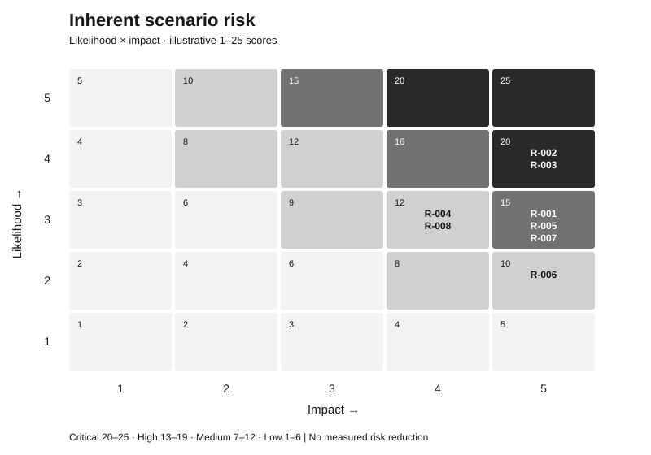

> **Risk status:** Likelihood/impact values and target residual scores are illustrative scenario judgments. Target scores are proposals only; controls were not executed, effectiveness was not tested, and no residual risk was accepted.

> **Publication status:** Fictional public lab scenario. This chapter preserves source material for completeness. Configurations and test procedures are proposed; results are expected outcomes, not executed evidence. No real client, engagement, approval, compliance opinion or control effectiveness is asserted. Organization, workforce, data and regulatory details are hypothetical planning assumptions.

---

# Risk Heatmap

Scores represent likelihood multiplied by impact on a 1–5 scale. Each risk appears once; darker cells show higher scenario scores. These are planning judgments, not measured probabilities.

## Key Observations

| Observation | Detail |
|---|---|
| Highest inherent scenarios | R-002 credential compromise and R-003 ransomware each score 20/25 in the current illustrative register |
| High-rated scenarios | R-001, R-005 and R-007 are high under the current scenario scoring |
| Target scores | Post-control scores elsewhere are proposals only, not measured residual risk |
| Risk reduction | No risk has been shown to decrease or be eliminated; VM controls have not been tested |

This heatmap is a planning visualization, not a measured change in risk posture.
---

**End of Risk Heatmap**
