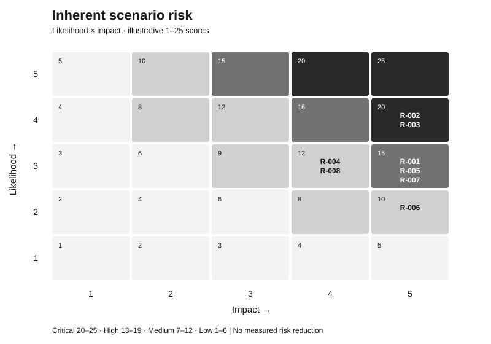

# Apex Capital GRC — Complete Report

> Full Markdown compilation of all chapters listed in `report-manifest.json`. The individual Markdown files remain canonical.

**Publication status:** VM validation scenarios are planned; no VM execution results are claimed.

# Front Matter

## Cover and Document Status

> **Publication status:** Fictional public lab scenario. This chapter preserves source material for completeness. Configurations and test procedures are proposed; results are expected outcomes, not executed evidence. No real client, engagement, approval, compliance opinion or control effectiveness is asserted. Organization, workforce, data and regulatory details are hypothetical planning assumptions.

# Apex Capital (fictional lab scenario)

## Enterprise Cyber Risk & GRC Security Implementation

### Proposed Lab Design and Validation Plan

---

**Prepared for (fictional scenario): ** 
Apex Capital (fictional lab scenario) Leadership Team & Board of Directors

**Prepared by:** 
lab-user SINGH — Cybersecurity & Project Author

**Date:** May 2026 
**Version:** 1.0 
**Classification:** PUBLIC LEARNING EDITION — FICTIONAL LAB SCENARIO

---

## Document Control

| Version | Status | Date | Author | Changes |
|:-------:|:------:|:----:|:------:|---------|
| 0.1 | Draft | March 2026 | S. Singh | Initial structure |
| 0.5 | Draft | April 2026 | S. Singh | Added technical controls |
| 1.0 | Final | May 2026 | S. Singh | Complete report for delivery |

---

## Engagement Summary

| Field | Detail |
|:------|:-------|
| **Client** | Apex Capital (fictional lab scenario) |
| **AUM** | INR 35,000 Crores (Approx. $4.2 Billion USD) |
| **Client Count** | ~12,000 high-net-worth individuals |
| **Employees** | 350 (200 HQ, 150 remote) |
| **Headquarters** | Mumbai, Maharashtra |
| **Engagement Scope** | Enterprise Cyber Risk Assessment & GRC Implementation |
| **Frameworks Applied** | NIST CSF 2.0, ISO 27001:2022, Historical PCI DSS 3.2.1-inspired learning reference (not current compliance) |
| **Regulatory Context** | SEBI, RBI, IT Act 2000 |
| **Engagement Period** | March 2026 – May 2026 |
| **Engagement ID** | APX-CYBER-2024-001 |

---

## 4-VM Architecture

| VM | Hostname | IP Address | Subnet | Role |
|:--:|----------|------------|--------|------|
| VM 1 | Windows-Enterprise | 10.0.2.10 | Internal (10.0.2.0/24) | Workstation / Server |
| VM 2 | Ubuntu-Web | 10.0.1.10 | DMZ (10.0.1.0/24) | Public Web Server |
| VM 3 | pfSense | 10.0.1.1, 10.0.2.1, 10.0.3.1 | All | Firewall / Router |
| VM 4 | Wazuh-SIEM | 10.0.3.10 | Management (10.0.3.0/24) | SIEM / Monitoring |

---

## Distribution Restrictions

This document contains **FICTIONAL SCENARIO; PUBLIC LEARNING EDITION** information pertaining to Apex Capital (fictional lab scenario)'s security posture, risk assessments, and internal controls.

**Authorized Recipients:**
- Apex Capital Board of Directors
- Chief Information Security Officer (CISO)
- Internal Audit Team
- Legal Counsel (as needed)
- SEBI / RBI (only if formally requested)

This is a public fictional lab case study; no client or engagement exists.

---

## Approvals

| Role | Name | Signature | Date |
|:-----|:-----|:----------|:-----|
| **Prepared By** | lab-user SINGH, Project Author | \_\_\_\_\_\_\_\_\_\_\_ | May 2026 |
| **Reviewed By** | Internal Quality Assurance | \_\_\_\_\_\_\_\_\_\_\_ | May 2026 |
| **Approval status (not approved)** | Engagement Lead | \_\_\_\_\_\_\_\_\_\_\_ | May 2026 |
| **Acceptance status (not accepted)** | Apex Capital CISO | \_\_\_\_\_\_\_\_\_\_\_ | May 2026 |

---

*This report is the property of Apex Capital (fictional lab scenario). Unauthorized reproduction or distribution is prohibited.*

---

**End of Cover Page**

---

## Table of Contents

# Table of Contents

Use the chapter links rather than fixed page numbers: the web reader, editable report and printable book have different pagination.

| Section | Contents |
|---|---|
| [Front Matter](00-Front-Matter/00-cover.md) | Cover and Document Status; Table of Contents; Source Index |
| [Executive Summary](01-Executive-Summary/executive-summary.md) | Executive Summary |
| [Company Profile](02-Company-Profile/company-profile.md) | Scenario Profile |
| [Business Requirements](03-Business-Requirements/business-requirements.md) | Business and Security Requirements |
| [Risk Assessment](04-Risk-Assessment/risk-assessment.md) | Risk Assessment; Risk Heatmap; Risk Register |
| [Security Architecture](05-Security-Architecture/architecture-overview.md) | Security Architecture Overview; Network Architecture |
| [Framework Mapping](06-Framework-Mapping/iso27001-mapping.md) | ISO/IEC 27001 Mapping; NIST CSF Mapping; Historical PCI DSS 3.2.1-Inspired Learning Appendix |
| [Policies and Standards](07-Policies-and-Standards/acceptable-use-policy.md) | Acceptable Use Policy; Access Control Policy; Data Classification Policy; Incident Response Policy; Cyber Incident Response Plan; Authentication and Password Policy |
| [Technical Controls](08-Technical-Controls/pfsense-network.md) | pfSense Network Controls; Ubuntu Web Server Hardening; Wazuh Monitoring; Windows Hardening |
| [Testing and Validation](09-Testing-and-Validation/results.md) | Test Results Register; Test Scenarios; Incident Response Tabletop Exercise; Security Capability Evaluation |
| [Evidence](10-Evidence/evidence-summary.md) | Evidence Register; Detailed Log Examples |
| [Residual Risk](11-Residual-Risk/residual-risk-recommendations.md) | Proposed Risk Treatment and Recommendations |
| [Appendices](12-Appendices/references.md) | References |

For every chapter, see the [report index](00-Front-Matter/Index.md).

## Editable documents

- [Security and GRC report](downloads/Apex_Capital_Security_and_GRC_Report.docx)
- [Incident response plan](downloads/Apex_Capital_Incident_Response_Plan.docx)

The technical controls and incident exercise are planned. No VM test results, approvals or completed stakeholder feedback are represented.

---

## Source Index

# Report Index

The complete report follows the thirteen numbered sections below. All 29 original chapter topics are retained, with three additional chapters covering incident response planning, a tabletop exercise and capability evaluation. The descriptions and test outputs distinguish proposed work from observed evidence.

[Open the website](site/index.html) or [read the complete report](site/report/index.html).

## Front Matter

- [Cover and Document Status](00-Front-Matter/00-cover.md)
- [Table of Contents](00-Front-Matter/02-table-of-contents.md)
- [Source Index](00-Front-Matter/Index.md)

## Executive Summary

- [Executive Summary](01-Executive-Summary/executive-summary.md)

## Company Profile

- [Scenario Profile](02-Company-Profile/company-profile.md)

## Business Requirements

- [Business and Security Requirements](03-Business-Requirements/business-requirements.md)

## Risk Assessment

- [Risk Assessment](04-Risk-Assessment/risk-assessment.md)
- [Risk Heatmap](04-Risk-Assessment/risk-heatmap.md)
- [Risk Register](04-Risk-Assessment/risk-register.md)

## Security Architecture

- [Security Architecture Overview](05-Security-Architecture/architecture-overview.md)
- [Network Architecture](05-Security-Architecture/network-architecture.md)

## Framework Mapping

- [ISO/IEC 27001 Mapping](06-Framework-Mapping/iso27001-mapping.md)
- [NIST CSF Mapping](06-Framework-Mapping/nist-csf-mapping.md)
- [Historical PCI DSS 3.2.1-Inspired Learning Appendix](06-Framework-Mapping/pci-inspired-mapping.md)

## Policies and Standards

- [Acceptable Use Policy](07-Policies-and-Standards/acceptable-use-policy.md)
- [Access Control Policy](07-Policies-and-Standards/access-control-policy.md)
- [Data Classification Policy](07-Policies-and-Standards/data-classification-policy.md)
- [Incident Response Policy](07-Policies-and-Standards/incident-response-policy.md)
- [Cyber Incident Response Plan](07-Policies-and-Standards/incident-response-plan.md) — additional chapter
- [Authentication and Password Policy](07-Policies-and-Standards/password-policy.md)

## Technical Controls

- [pfSense Network Controls](08-Technical-Controls/pfsense-network.md)
- [Ubuntu Web Server Hardening](08-Technical-Controls/ubuntu-web-server.md)
- [Wazuh Monitoring](08-Technical-Controls/wazuh-monitoring.md)
- [Windows Hardening](08-Technical-Controls/windows-hardening.md)

## Testing and Validation

- [Test Results Register](09-Testing-and-Validation/results.md)
- [Test Scenarios](09-Testing-and-Validation/test-scenarios.md)
- [Incident Response Tabletop Exercise](09-Testing-and-Validation/tabletop-exercise.md) — additional chapter
- [Security Capability Evaluation](09-Testing-and-Validation/capability-evaluation.md) — additional chapter

## Evidence

- [Evidence Register](10-Evidence/evidence-summary.md)
- [Detailed Log Examples](10-Evidence/detailed-logs.md)

## Residual Risk

- [Proposed Risk Treatment and Recommendations](11-Residual-Risk/residual-risk-recommendations.md)

## Appendices

- [References](12-Appendices/references.md)

---

# Executive Summary

## Executive Summary

> **Publication status:** Fictional public lab scenario. This chapter preserves source material for completeness. Configurations and test procedures are proposed; results are expected outcomes, not executed evidence. No real client, engagement, approval, compliance opinion or control effectiveness is asserted. Organization, workforce, data and regulatory details are hypothetical planning assumptions.

# Company Profile

## 1. Corporate Overview

### 1.1 Basic Information

| Attribute                         | Detail                                                  |
| --------------------------------- | ------------------------------------------------------- |
| **Legal Entity Name**             | Apex Capital (fictional lab scenario)          |
| **Entity Type**                   | Registered Investment Adviser (RIA) / Portfolio Manager |
| **AUM (Assets Under Management)** | INR 35,000 Crores (Approx. 4.2 Billion USD)             |
| **Client Count**                  | ~12,000                                                 |
| **Employee Count**                | 350 total (200 HQ-based, 150 remote)                    |
| **Headquarters**                  | Mumbai, Maharashtra                                     |
| **Year Founded**                  | 2008                                                    |
| **Regulatory Bodies**             | SEBI, RBI (as applicable)                               |

### 1.2 Business Description

Apex Capital (fictional lab scenario) provides comprehensive financial advisory services to high-net-worth individuals, family offices, and institutional clients across India.

**Core Services:**
- Mutual fund administration
- Discretionary portfolio management
- Retirement planning (NPS, pension)
- Tax-loss harvesting
- Estate and legacy planning
- Alternative investment advisory

---

## 2. Data Classification & Sensitivity

### 2.1 Data Types Held

| Data Category | Examples | Regulatory Impact |
|---------------|----------|-------------------|
| **Personal Information** | PAN, Aadhaar (masked), passport, date of birth, address, phone number, email | IT Act 2000, SEBI KYC requirements |
| **Financial Data** | Account numbers, demat details, investment holdings, trade confirmations, tax returns | SEBI regulations, RBI guidelines |
| **Beneficiary Information** | Names, relationships, inheritance details | Indian Succession Act |
| **Employee Data** | HR records, payroll, performance reviews | Labour laws, internal confidentiality |
| **Payment Data** | NEFT/RTGS/IMPS details, UPI, card information (limited) | RBI Payment and Settlement Systems Act, PCI DSS |

### 2.2 Data Volume Estimates

| Data Type | Estimated Records | Growth Rate |
|-----------|-------------------|-------------|
| Client Personal Data | 12,000 client records | 5-8% annually |
| Financial transactions | ~50,000 per month | 10% annually |
| Employee records | 350 active + terminated | 3-5% annually |

---

## 3. Technology Footprint

### 3.1 Infrastructure Overview

| System Type | Count | Operating System | Security Relevance |
|-------------|-------|------------------|---------------------|
| HQ Workstations | 200 | Windows 10/11 Pro | Endpoint protection, logging |
| Remote Employee Laptops | 150 | Windows 10/11 Pro | VPN required, remote access controls |
| Web Servers (Customer Portal) | 2 | Ubuntu 22.04 LTS | Public-facing, DMZ placement |
| Internal File Servers | 3 | Windows Server 2019 | Client data storage, access logging |
| Database Servers | 2 | Windows Server + SQL | Portfolio data, transaction history |
| Network Firewall | 1 | pfSense | Segmentation, traffic filtering |
| SIEM / Monitoring | 1 | Ubuntu + Wazuh | Log aggregation, alerting |

### 3.2 Applications in Use

| Application | Purpose | Security Controls |
|-------------|---------|-------------------|
| Microsoft 365 | Email, collaboration | Conditional access, logging |
| Salesforce Financial Cloud | CRM, client management | Role-based access, audit trails |
| Morningstar Direct | Investment research | SSO integration |
| Portfolio Management System | Order execution, client reporting | Dedicated admin accounts, audit logs |

---

## 4. Organizational Structure

### 4.1 Leadership & Security Roles

**Security Leadership Structure:**

| Role | Reporting Line | Security Responsibilities |
|------|----------------|--------------------------|
| **Board of Directors** | Oversight | Final approval of security strategy, risk appetite |
| **CEO / Managing Partner** | Board | Overall accountability for security program |
| **CISO (Virtual/Contract)** | CEO | Strategic direction, policy approval, incident response escalation |
| **CTO** | CEO | Technical implementation, infrastructure security, patch management |
| **Compliance Officer** | CEO | Regulatory reporting (SEBI/RBI), audit coordination, policy enforcement |
| **Proposed GRC Owner Role** | CISO | Risk assessments, policy development, compliance mapping, evidence management |
| **All Employees** | Respective managers | Security awareness, incident reporting, policy adherence |

### 4.2 Security Responsibilities by Role

| Role | Security Responsibilities |
|------|--------------------------|
| **CISO (Virtual)** | Strategic direction, policy approval, incident response escalation |
| **Proposed GRC Owner Role** | Risk assessments, policy development, compliance mapping, evidence management |
| **CTO** | Technical implementation, infrastructure security, patch management |
| **Compliance Officer** | SEBI/RBI reporting, audit coordination, policy enforcement |
| **All Employees** | Security awareness, incident reporting, policy adherence |

---

## 5. Current Security Pain Points

### 5.1 Stated by Fictional Scenario Stakeholders

> *"We passed our last SEBI audit, but it was painful – weeks of scrambling for evidence."*

> *"We have no formal risk register. If something happens, we don't know what we prioritized."*

> *"Our remote advisors use personal laptops inconsistently. Some have antivirus. Some don't."*

> *"If a regulator asked for real-time evidence of controls today, we could not produce it."*

> *"We need cyber resilience without slowing down trading operations."*

### 5.2 Identified Gaps (Pre-Engagement)

| Gap Area | Description | Severity |
|----------|-------------|----------|
| **No Risk Register** | No formal documented risks or treatment plans | Critical |
| **Missing Policies** | No written security policies | Critical |
| **No Centralized Logging** | Logs exist only on individual systems | High |
| **No Network Segmentation** | Web servers and internal servers on same network | Critical |
| **Weak Password Policy** | Default Windows settings, no lockout | High |
| **No Malware Detection Validation** | Antivirus installed but never tested | Medium |
| **No Incident Response Plan** | No documented procedures for breaches | High |

---

## 6. Target State Vision

### 6.1 Fictional Scenario Statement

> *"Audit-ready at all times. Continuous compliance monitoring. Cyber resilience without slowing down trading operations."*

### 6.2 Target State Attributes

| Attribute | Target Description |
|-----------|---------------------|
| **Risk Management** | Documented risk register reviewed regularly |
| **Compliance** | Evidence repository exportable on demand for SEBI audits |
| **Detection** | Real-time alerting for security events |
| **Response** | Documented IR plan tested periodically |
| **Segmentation** | Isolation between public-facing and internal networks |
| **Monitoring** | Centralized SIEM with log retention |

---

## 7. Security Frameworks Applied

### 7.1 Framework Alignment

| Framework | Application | Proposed Evidence (Not Captured) |
|-----------|-------------|-------------------------------|
| **NIST CSF 2.0** | Risk assessment, controls mapping, incident response | Risk register, control implementation, IR policy |
| **ISO 27001:2022** | Information Security Management System (ISMS) | Policies, access controls, logging, asset management |
| **Historical PCI DSS 3.2.1-inspired learning reference (not current compliance)** | Payment data protection (Req 5, 8, 10) | Malware detection (EICAR), password policy, audit logs |

### 7.2 SEBI Alignment (Contextual)

While this engagement is technically aligned to global frameworks (NIST/ISO/PCI), the Proposed controls directly support SEBI's cybersecurity expectations for registered investment advisers:

| SEBI Expectation | Proposed Control | Evidence |
|------------------|---------------------|----------|
| Access control and authentication | Password policy (14 char, lockout), role-based access | Windows security policy screenshots |
| Network segmentation | pfSense firewall separating public and private subnets | Firewall rule screenshots |
| Logging and audit trails | Wazuh SIEM centralized logging, failed login alerts | Wazuh dashboard screenshots |
| Malware protection | Microsoft Defender with EICAR testing | EICAR block screenshot |
| Incident response | Documented incident response policy | IR policy document |
| Vulnerability management | OS hardening (CIS benchmarks) | Hardening configuration screenshots |

---

## 8. Engagement Scope & Boundaries

### 8.1 In Scope

- Risk assessment and risk register development
- Security policy development (6 core policies)
- Technical control implementation on 4 domains (Windows, Ubuntu, pfSense, Wazuh)
- Framework mapping (NIST CSF, ISO 27001, PCI-inspired)
- Testing and validation (EICAR, segmentation, passwords, alerting)
- Evidence repository and documentation

### 8.2 Out of Scope

- Full penetration testing (separate engagement recommended)
- Third-party vendor risk assessments (recommended for Phase 2)
- Employee security awareness training (HR to lead)
- Cyber insurance policy review (legal/finance to lead)
- Physical security assessment (facilities to lead)
- Legal interpretation of SEBI circulars (external counsel recommended)

---

**End of Company Profile**

---

# Company Profile

## Scenario Profile

> **Publication status:** Fictional public lab scenario. This chapter preserves source material for completeness. Configurations and test procedures are proposed; results are expected outcomes, not executed evidence. No real client, engagement, approval, compliance opinion or control effectiveness is asserted. Organization, workforce, data and regulatory details are hypothetical planning assumptions.

# Company Profile

## 1. Corporate Overview

### 1.1 Basic Information

| Attribute                         | Detail                                                  |
| --------------------------------- | ------------------------------------------------------- |
| **Legal Entity Name**             | Apex Capital (fictional lab scenario)          |
| **Entity Type**                   | Registered Investment Adviser (RIA) / Portfolio Manager |
| **AUM (Assets Under Management)** | INR 35,000 Crores (Approx. 4.2 Billion USD)             |
| **Client Count**                  | ~12,000                                                 |
| **Employee Count**                | 350 total (200 HQ-based, 150 remote)                    |
| **Headquarters**                  | Mumbai, Maharashtra                                     |
| **Year Founded**                  | 2008                                                    |
| **Regulatory Bodies**             | SEBI, RBI (as applicable)                               |

### 1.2 Business Description

Apex Capital (fictional lab scenario) provides comprehensive financial advisory services to high-net-worth individuals, family offices, and institutional clients across India.

**Core Services:**
- Mutual fund administration
- Discretionary portfolio management
- Retirement planning (NPS, pension)
- Tax-loss harvesting
- Estate and legacy planning
- Alternative investment advisory

---

## 2. Data Classification & Sensitivity

### 2.1 Data Types Held

| Data Category | Examples | Regulatory Impact |
|---------------|----------|-------------------|
| **Personal Information** | PAN, Aadhaar (masked), passport, date of birth, address, phone number, email | IT Act 2000, SEBI KYC requirements |
| **Financial Data** | Account numbers, demat details, investment holdings, trade confirmations, tax returns | SEBI regulations, RBI guidelines |
| **Beneficiary Information** | Names, relationships, inheritance details | Indian Succession Act |
| **Employee Data** | HR records, payroll, performance reviews | Labour laws, internal confidentiality |
| **Payment Data** | NEFT/RTGS/IMPS details, UPI, card information (limited) | RBI Payment and Settlement Systems Act, PCI DSS |

### 2.2 Data Volume Estimates

| Data Type | Estimated Records | Growth Rate |
|-----------|-------------------|-------------|
| Client Personal Data | 12,000 client records | 5-8% annually |
| Financial transactions | ~50,000 per month | 10% annually |
| Employee records | 350 active + terminated | 3-5% annually |

---

## 3. Technology Footprint

### 3.1 Infrastructure Overview

| System Type | Count | Operating System | Security Relevance |
|-------------|-------|------------------|---------------------|
| HQ Workstations | 200 | Windows 10/11 Pro | Endpoint protection, logging |
| Remote Employee Laptops | 150 | Windows 10/11 Pro | VPN required, remote access controls |
| Web Servers (Customer Portal) | 2 | Ubuntu 22.04 LTS | Public-facing, DMZ placement |
| Internal File Servers | 3 | Windows Server 2019 | Client data storage, access logging |
| Database Servers | 2 | Windows Server + SQL | Portfolio data, transaction history |
| Network Firewall | 1 | pfSense | Segmentation, traffic filtering |
| SIEM / Monitoring | 1 | Ubuntu + Wazuh | Log aggregation, alerting |

### 3.2 Applications in Use

| Application | Purpose | Security Controls |
|-------------|---------|-------------------|
| Microsoft 365 | Email, collaboration | Conditional access, logging |
| Salesforce Financial Cloud | CRM, client management | Role-based access, audit trails |
| Morningstar Direct | Investment research | SSO integration |
| Portfolio Management System | Order execution, client reporting | Dedicated admin accounts, audit logs |

---

## 4. Organizational Structure

### 4.1 Leadership & Security Roles

**Security Leadership Structure:**

| Role | Reporting Line | Security Responsibilities |
|------|----------------|--------------------------|
| **Board of Directors** | Oversight | Final approval of security strategy, risk appetite |
| **CEO / Managing Partner** | Board | Overall accountability for security program |
| **CISO (Virtual/Contract)** | CEO | Strategic direction, policy approval, incident response escalation |
| **CTO** | CEO | Technical implementation, infrastructure security, patch management |
| **Compliance Officer** | CEO | Regulatory reporting (SEBI/RBI), audit coordination, policy enforcement |
| **Proposed GRC Owner Role** | CISO | Risk assessments, policy development, compliance mapping, evidence management |
| **All Employees** | Respective managers | Security awareness, incident reporting, policy adherence |

### 4.2 Security Responsibilities by Role

| Role | Security Responsibilities |
|------|--------------------------|
| **CISO (Virtual)** | Strategic direction, policy approval, incident response escalation |
| **Proposed GRC Owner Role** | Risk assessments, policy development, compliance mapping, evidence management |
| **CTO** | Technical implementation, infrastructure security, patch management |
| **Compliance Officer** | SEBI/RBI reporting, audit coordination, policy enforcement |
| **All Employees** | Security awareness, incident reporting, policy adherence |

---

## 5. Current Security Pain Points

### 5.1 Stated by Fictional Scenario Stakeholders

> *"We passed our last SEBI audit, but it was painful – weeks of scrambling for evidence."*

> *"We have no formal risk register. If something happens, we don't know what we prioritized."*

> *"Our remote advisors use personal laptops inconsistently. Some have antivirus. Some don't."*

> *"If a regulator asked for real-time evidence of controls today, we could not produce it."*

> *"We need cyber resilience without slowing down trading operations."*

### 5.2 Identified Gaps (Pre-Engagement)

| Gap Area | Description | Severity |
|----------|-------------|----------|
| **No Risk Register** | No formal documented risks or treatment plans | Critical |
| **Missing Policies** | No written security policies | Critical |
| **No Centralized Logging** | Logs exist only on individual systems | High |
| **No Network Segmentation** | Web servers and internal servers on same network | Critical |
| **Weak Password Policy** | Default Windows settings, no lockout | High |
| **No Malware Detection Validation** | Antivirus installed but never tested | Medium |
| **No Incident Response Plan** | No documented procedures for breaches | High |

---

## 6. Target State Vision

### 6.1 Fictional Scenario Statement

> *"Audit-ready at all times. Continuous compliance monitoring. Cyber resilience without slowing down trading operations."*

### 6.2 Target State Attributes

| Attribute | Target Description |
|-----------|---------------------|
| **Risk Management** | Documented risk register reviewed regularly |
| **Compliance** | Evidence repository exportable on demand for SEBI audits |
| **Detection** | Real-time alerting for security events |
| **Response** | Documented IR plan tested periodically |
| **Segmentation** | Isolation between public-facing and internal networks |
| **Monitoring** | Centralized SIEM with log retention |

---

## 7. Security Frameworks Applied

### 7.1 Framework Alignment

| Framework | Application | Proposed Evidence (Not Captured) |
|-----------|-------------|-------------------------------|
| **NIST CSF 2.0** | Risk assessment, controls mapping, incident response | Risk register, control implementation, IR policy |
| **ISO 27001:2022** | Information Security Management System (ISMS) | Policies, access controls, logging, asset management |
| **Historical PCI DSS 3.2.1-inspired learning reference (not current compliance)** | Payment data protection (Req 5, 8, 10) | Malware detection (EICAR), password policy, audit logs |

### 7.2 SEBI Alignment (Contextual)

While this engagement is technically aligned to global frameworks (NIST/ISO/PCI), the Proposed controls directly support SEBI's cybersecurity expectations for registered investment advisers:

| SEBI Expectation | Proposed Control | Evidence |
|------------------|---------------------|----------|
| Access control and authentication | Password policy (14 char, lockout), role-based access | Windows security policy screenshots |
| Network segmentation | pfSense firewall separating public and private subnets | Firewall rule screenshots |
| Logging and audit trails | Wazuh SIEM centralized logging, failed login alerts | Wazuh dashboard screenshots |
| Malware protection | Microsoft Defender with EICAR testing | EICAR block screenshot |
| Incident response | Documented incident response policy | IR policy document |
| Vulnerability management | OS hardening (CIS benchmarks) | Hardening configuration screenshots |

---

## 8. Engagement Scope & Boundaries

### 8.1 In Scope

- Risk assessment and risk register development
- Security policy development (6 core policies)
- Technical control implementation on 4 domains (Windows, Ubuntu, pfSense, Wazuh)
- Framework mapping (NIST CSF, ISO 27001, PCI-inspired)
- Testing and validation (EICAR, segmentation, passwords, alerting)
- Evidence repository and documentation

### 8.2 Out of Scope

- Full penetration testing (separate engagement recommended)
- Third-party vendor risk assessments (recommended for Phase 2)
- Employee security awareness training (HR to lead)
- Cyber insurance policy review (legal/finance to lead)
- Physical security assessment (facilities to lead)
- Legal interpretation of SEBI circulars (external counsel recommended)

---

**End of Company Profile**

---

# Business Requirements

## Business and Security Requirements

> **Publication status:** Fictional public lab scenario. This chapter preserves source material for completeness. Configurations and test procedures are proposed; results are expected outcomes, not executed evidence. No real client, engagement, approval, compliance opinion or control effectiveness is asserted. Organization, workforce, data and regulatory details are hypothetical planning assumptions.

# Business & Security Requirements

## Core Business Requirements

| ID | Requirement | Priority | Business Driver | Framework Mapping | Proposed evidence to collect (not collected) |
|----|-------------|----------|-----------------|-------------------|-------------------------|
| **BR-01** | Protect confidentiality, integrity, and availability of client financial data and PII (PAN, Aadhaar masked, bank details, demat information) | Critical | Fictional India-based context; legal applicability requires review | NIST CSF PR.DS, ISO 27001 A.8 | Access control policy, encryption (HTTPS/SSH), backup documentation |
| **BR-02** | Enable secure remote access for 150 remote advisors to internal systems and client data | Critical | Hybrid workforce model, client service delivery | NIST CSF 2.0 PR.AA / PR.IR; ISO/IEC 27001:2022 A.5.15 / A.5.18 | pfSense firewall rules restricting RDP, VPN configuration |
| **BR-03** | Implement network segmentation to isolate public-facing web servers from internal Windows systems | Critical | Prevent lateral movement in case of web server compromise | NIST CSF PR.IR-01, PCI Req 1 | pfSense firewall rules blocking DMZ to internal traffic |
| **BR-04** | Enforce least privilege and strong access controls for all users and systems | High | Prevent unauthorized access to portfolio management systems | NIST CSF PR.AA, ISO 27001 A.5.15 / A.5.18 | Windows local user roles, separate admin accounts |
| **BR-05** | Deploy robust endpoint detection and protection on all Windows workstations and servers | High | Ransomware prevention, malware detection | PCI Req 5, NIST CSF PR.PS | Microsoft Defender, EICAR test, Controlled Folder Access |
| **BR-06** | Secure payment-related processes (client fee debits via ACH/NEFT, advisor commission payments) | High | RBI payment guidelines, client trust | PCI DSS (Inspired), RBI guidelines | Network segmentation, access restriction, transaction logging |
| **BR-07** | Maintain comprehensive logging and monitoring for detection, incident response, and audit readiness | High | Evidence needs in the fictional scenario | PCI Req 10, ISO 27001 A.8.16 | Wazuh SIEM, failed login alerts, centralized logging |
| **BR-08** | Achieve and demonstrate compliance with applicable global frameworks (NIST CSF, ISO 27001) and Potential Indian regulatory obligations, if applicable after legal analysis | High | Hypothetical stakeholder assurance needs | NIST CSF, ISO 27001, SEBI (CISF) | Framework mapping documentation, evidence repository |
| **BR-09** | Minimize attack surface on internet-facing assets (customer portal, remote access points) | High | Reduce exposure to scanning, exploitation | NIST CSF PR.PS, CIS benchmarks | Ubuntu SSH hardening, UFW firewall, restricted SSH source, key-based authentication, and hardened service configuration |
| **BR-10** | Support effective incident response and business continuity with documented procedures | Medium | Ransomware preparedness, operational resilience | NIST CSF RS, ISO 27001 A.5.24 / A.5.26 | Incident response policy, backup strategy, escalation contacts |

---

## Security Requirements (Technical Translation)

| Requirement ID | Business Driver | Technical Security Requirement | Implementation Method | Validation Test |
|----------------|-----------------|-------------------------------|----------------------|-----------------|
| **BR-01** | Data protection | Data encrypted at rest and in transit | HTTPS for web, SSH for remote access, BitLocker for Windows | TLS configuration and certificate validation output; SSH negotiated cipher and host-key evidence |
| **BR-02** | Secure remote access | No direct RDP from public internet to Windows | pfSense firewall rule blocking RDP (3389) from WAN interface | RDP connection from internet fails |
| **BR-03** | Network segmentation | pfSense firewall blocks all traffic from Ubuntu (DMZ) to Windows (Internal) | Firewall rule: Block source Ubuntu subnet to Windows subnet | `nc -zv` from Ubuntu to Windows fails |
| **BR-04** | Access control | Separate user and admin accounts, password policy enforced | Local security policy, `net accounts` configuration | Weak password "[SYNTHETIC-TEST-CREDENTIAL]" rejected |
| **BR-05** | Endpoint protection | Real-time malware scanning with alerts | Microsoft Defender, Cloud-delivered protection enabled | EICAR test file downloaded → blocked within a lab-defined observation window |
| **BR-06** | Payment security | Payment systems accessible only to authorized finance users (3 users) | Windows user group restriction, folder permissions | Unauthorized user cannot access payment folder |
| **BR-07** | Logging & monitoring | Centralized log collection with failed login alerts | Wazuh agent on Windows, rule for Event ID 4625 | Failed RDP login → Wazuh alert within minutes |
| **BR-08** | Compliance | Documented evidence for each control | Test records and screenshots, to be collected after execution | Evidence catalog with 15+ screenshots |
| **BR-09** | Attack surface reduction | Minimal services running, firewall enabled | UFW deny incoming, SSH key auth, fail2ban | `nmap` scan shows only required ports |
| **BR-10** | Incident response | Documented IR plan with roles and contacts | Written policy, tested alert workflow | IR plan document, alert notification test |

---

## 4-VM Architecture Reference

| VM | Hostname | IP Address | Subnet | Role |
|----|----------|------------|--------|------|
| VM 1 | Windows-Enterprise | 10.0.2.10 | Internal (10.0.2.0/24) | Workstation / Server |
| VM 2 | Ubuntu-Web | 10.0.1.10 | DMZ (10.0.1.0/24) | Public Web Server |
| VM 3 | pfSense | 10.0.1.1, 10.0.2.1, 10.0.3.1 | All | Firewall / Router |
| VM 4 | Wazuh-SIEM | 10.0.3.10 | Management (10.0.3.0/24) | SIEM / Monitoring |

---

## pfSense Firewall Rules for Security Requirements

| Rule | Interface | Source | Destination | Port | Action | Requirement Addressed |
|------|-----------|--------|-------------|------|--------|----------------------|
| 1 | WAN | Any | Ubuntu (10.0.1.10) | 80,443 | Allow | BR-01, BR-09 |
| 2 | WAN | Any | Windows (10.0.2.10) | 3389 | Block | BR-02 |
| 3 | LAN | DMZ (10.0.1.0/24) | Internal (10.0.2.0/24) | Any | Block | BR-03 |
| 4 | Management | Management (10.0.3.0/24) | Windows (10.0.2.10) | 3389 | Allow | BR-02, BR-04 |
| 5 | Management | Management (10.0.3.0/24) | Ubuntu (10.0.1.10) | 22 | Allow | BR-09 |

---

## Success Criteria

| Criterion | Target State | Validation Method | Status Target |
|-----------|--------------|-------------------|---------------|
| Scenario treatment options documented and risk-owner review recorded | Risk register includes inherent scores and unvalidated target proposals; no residual levels assigned | Risk register review, control effectiveness assessment | Proposed target; date to be set by scenario owner |
| Controls validated through testing with documented evidence | Each control has corresponding test and screenshot | Evidence repository with 10+ validated controls | Proposed target; date to be set by scenario owner |
| Policies formally documented and approved | 6 core policies written and version controlled | Policy documents in `07-Policies-and-Standards/` | Proposed target; date to be set by scenario owner |
| Audit-ready evidence repository established | Evidence organized, timestamped, and reproducible | Screenshots with validation steps in `10-Evidence/` | Proposed target; date to be set by scenario owner |
| Network segmentation verified | Ubuntu cannot communicate with Windows on any port | `nc -zv` test, pfSense log review | Proposed target; date to be set by scenario owner |
| Malware detection operational | EICAR test triggers Defender block | Screenshot of EICAR download blocked | Proposed target; date to be set by scenario owner |
| Failed login alerting active | Wazuh dashboard shows failed login events | Alert screenshot with timestamp | Proposed target; date to be set by scenario owner |

---

## Constraints & Assumptions

| Type | Description |
|------|-------------|
| **Technical Constraint** | Implementation limited to local VM environment (Windows Enterprise, Ubuntu, pfSense, Wazuh) |
| **Technical Constraint** | No cloud services (AWS, Azure) used |
| **Budget Constraint** | Only open-source or built-in Windows tools (no third-party commercial software) |
| **Scope Constraint** | Full penetration testing and third-party vendor assessments excluded |
| **Assumption** | Client provides administrative access to Windows and Ubuntu VMs |
| **Assumption** | Existing network infrastructure supports VLANs/subnetting for pfSense |
| **Assumption** | No regulatory applicability or compliance conclusion is made. SEBI obligations require separate legal and applicability analysis; NIST/ISO crosswalks do not establish them. |

---

## Requirements Traceability Matrix

| Business Requirement | Technical Implementation | Test Validation | Evidence File |
|---------------------|-------------------------|-----------------|---------------|
| BR-01 | HTTPS, SSH, BitLocker | TLS protocol/cipher and certificate validation output | `evidence/encryption-https.png` |
| BR-02 | pfSense firewall block RDP from WAN | RDP connection from internet fails | `evidence/firewall-rdp-block.png` |
| BR-03 | pfSense block rule | `nc -zv` connection refused | `evidence/segmentation-block.png` |
| BR-04 | Password policy (14 char, lockout) | "[SYNTHETIC-TEST-CREDENTIAL]" rejected | `evidence/weak-password-reject.png` |
| BR-05 | Microsoft Defender + CFA | EICAR blocked | `evidence/eicar-block.png` |
| BR-06 | Finance user group restriction | Unauthorized access denied | `evidence/payment-access-denied.png` |
| BR-07 | Wazuh SIEM + Event ID 4625 | Failed login alert | `evidence/wazuh-failed-login.png` |
| BR-08 | Framework mapping table | Cross-reference complete | `06-Framework-Mapping/` |
| BR-09 | UFW + SSH hardening | `nmap` limited ports | `evidence/ubuntu-nmap-scan.png` |
| BR-10 | IR policy document | Document approved | `07-Policies/incident-response-policy.md` |

---

**End of Business & Security Requirements**

---

# Risk Assessment

## Risk Assessment

> **Risk status:** Likelihood/impact values and target residual scores are illustrative scenario judgments. Target scores are proposals only; controls were not executed, effectiveness was not tested, and no residual risk was accepted.

> **Publication status:** Fictional public lab scenario. This chapter preserves source material for completeness. Configurations and test procedures are proposed; results are expected outcomes, not executed evidence. No real client, engagement, approval, compliance opinion or control effectiveness is asserted. Organization, workforce, data and regulatory details are hypothetical planning assumptions.

# Risk Assessment

## 1. Risk Assessment Methodology

This risk assessment follows the methodology defined in **NIST SP 800-30 (Guide for Conducting Risk Assessments)** and aligned with **ISO 27001:2022 Clause 6.1 (Actions to address risks and opportunities)**.

### 1.1 Risk Calculation Formula

`Risk Score = Impact x Likelihood`

| Level      | Impact Score | Likelihood Score |
| ---------- | ------------ | ---------------- |
| Critical   | 5            | 5                |
| High       | 4            | 4                |
| Medium     | 3            | 3                |
| Low        | 2            | 2                |
| Negligible | 1            | 1                |

### 1.2 Risk Levels

| Score Range | Risk Level | Required Action |
|-------------|------------|-----------------|
| 20-25 | Critical | Immediate remediation required |
| 13-19 | High | Remediation within 30 days |
| 7-12 | Medium | Remediation within 90 days |
| 1-6 | Low | Accept or monitor |

### 1.3 Risk Appetite Statement

Apex Capital (fictional lab scenario) maintains the following risk appetite:

| Risk Category | Appetite | Rationale |
|---------------|----------|-----------|
| Client data confidentiality | Low | Regulatory (SEBI) and reputational impact |
| Financial loss due to cyber incident | Low | Direct business impact |
| Regulatory compliance (SEBI) | Low | Potential fines and license implications |
| Operational disruption | Medium | Accepts up to 4 hours downtime |
| Technology modernization delays | Medium | Accepts controlled delays for security |

---

## 2. Asset Inventory (Risk Context)

| Asset ID | Asset Type | Description | Confidentiality | Integrity | Availability |
|----------|------------|-------------|-----------------|-----------|--------------|
| A-001 | Client Data | PAN, Aadhaar (masked), bank details, demat information, investment holdings | High | High | Medium |
| A-002 | Windows Workstations | 200 HQ + 150 remote employee endpoints | Medium | Medium | Medium |
| A-003 | Ubuntu Web Server | Customer investment portal (public-facing) | Low | High | High |
| A-004 | Windows Application Servers | Portfolio management, order execution | High | High | High |
| A-005 | pfSense Firewall | Network segmentation, traffic filtering | Medium | High | High |
| A-006 | Wazuh SIEM | Centralized logging, alerting | Medium | High | Medium |
| A-007 | Internal File Servers | Client document storage (account openings, KYC) | High | High | Medium |
| A-008 | Payment Systems | ACH/NEFT processing, advisor commission payments | High | High | Medium |

---

## 3. Threat Sources

Based on SEBI cybersecurity guidance and industry threat intelligence for Indian financial services:

| Threat Source | Motivation | Relevance to Apex Capital |
|---------------|------------|--------------------------|
| Cybercriminals (domestic/international) | Financial gain | Ransomware, data theft for resale |
| Phishing campaigns | Credential theft | 150 remote advisors = high attack surface |
| Insider threats (malicious) | Personal gain, disgruntlement | Access to client financial data |
| Insider threats (unintentional) | Human error | Weak passwords, misconfigured settings |
| Nation-state actors (advanced) | Espionage, disruption | Lower probability but high impact |
| Script kiddies | Curiosity, reputation | Web server scanning, defacement |
| Competitors | Business intelligence | Unauthorized access to client lists |

---

## 4. Risk Register Summary

> Inherent scores match the scenario register; target scores remain illustrative and unvalidated.

| Risk ID | Risk Description | Impact | Likelihood | Inherent Score | Proposed Target Score (Unvalidated) | Priority |
|---|---|---:|---:|---:|---:|---|
| R-001 | Lateral movement from compromised Ubuntu web server to internal Windows network | 5 | 3 | 15 | 4 | High |
| R-002 | Credential theft via brute force or phishing leading to unauthorized access | 5 | 4 | 20 | 8 | Critical |
| R-003 | Ransomware disrupts systems or damages data | 5 | 4 | 20 | 6 | Critical |
| R-004 | Incomplete logging or evidence impairs investigation | 4 | 3 | 12 | 3 | Medium |
| R-005 | Public web host compromise exposes systems or data | 5 | 3 | 15 | 5 | High |
| R-006 | Insider misuse of authorized access exposes sensitive data | 5 | 2 | 10 | 4 | Medium |
| R-007 | Supplier weakness affects confidentiality or availability | 5 | 3 | 15 | 6 | High |
| R-008 | Firewall configuration drift exposes a protected path | 4 | 3 | 12 | 2 | Medium |
## 5. Detailed Risk Analysis

### R-001: Lateral Movement (Web Server to Internal Network)

| Attribute | Detail |
|-----------|--------|
| **Risk Description** | An attacker compromises the public-facing Ubuntu web server (customer portal) and attempts to move laterally to internal Windows systems containing client portfolio data |
| **Likelihood** | 3 (Possible) |
| **Impact** | 5 (Critical) |
| **Raw Score** | 15 (High) |
| **Affected Assets** | A-003 (Ubuntu Web Server), A-004 (Windows App Servers), A-001 (Client Data) |
| **Threat Source** | Cybercriminals, automated scanners |
| **Existing Controls** | No implemented baseline is assumed in the scenario |
| **Proposed Mitigation** | pfSense firewall rule blocking all traffic from Ubuntu subnet to Windows subnet; DMZ isolation |
| **Control Owner** | Network Security |
| **Proposed Target Residual Score (Unvalidated)** | 4 (Low) |
| **Proposed Treatment Rationale (Unvalidated)** | Network segmentation is intended to restrict lateral movement; effectiveness is untested |

---

### R-002: Credential Theft (Brute Force / Phishing)

| Attribute | Detail |
|-----------|--------|
| **Risk Description** | Attacker uses brute force or phishing to obtain advisor credentials, then accesses client data and executes unauthorized trades |
| **Likelihood** | 4 (Likely) |
| **Impact** | 5 (Critical) |
| **Raw Score** | 20 (Critical) |
| **Affected Assets** | A-002 (Windows Workstations), A-004 (App Servers), A-001 (Client Data) |
| **Threat Source** | Phishing campaigns, brute force tools |
| **Existing Controls** | None (default Windows settings, no lockout) |
| **Proposed Mitigation** | Password policy (14 characters, complexity, 5-attempt lockout); failed login alerting via Wazuh |
| **Control Owner** | Identity Management |
| **Proposed Target Residual Score (Unvalidated)** | 8 (Medium) |
| **Proposed Treatment Rationale (Unvalidated)** | Password policy reduces brute force success; MFA recommended for further reduction (out of scope) |

---

### R-003: Ransomware (Endpoint Malware)

| Attribute | Detail |
|-----------|--------|
| **Risk Description** | Employee downloads and executes ransomware via email attachment or malicious website, encrypting client portfolio data and demanding payment |
| **Likelihood** | 4 (Likely) |
| **Impact** | 5 (Critical) |
| **Raw Score** | 20 (Critical) |
| **Affected Assets** | A-002 (Windows Workstations), A-004 (App Servers), A-007 (File Servers) |
| **Threat Source** | Ransomware gangs (LockBit, BlackCat), phishing emails |
| **Existing Controls** | None (antivirus not validated) |
| **Proposed Mitigation** | Microsoft Defender real-time protection; Controlled Folder Access; EICAR test validation; daily backups |
| **Control Owner** | Endpoint Security |
| **Proposed Target Residual Score (Unvalidated)** | 5 (Low) |
| **Proposed Treatment Rationale (Unvalidated)** | Defender and protected backups are proposed safeguards; detection and recovery are untested |

---

### R-004: Audit Failure (Missing Evidence)

| Attribute | Detail |
|-----------|--------|
| **Risk Description** | SEBI or client audit requests evidence of security controls; Apex Capital cannot produce logs, policies, or test results |
| **Likelihood** | 3 (Possible) |
| **Impact** | 4 (High) |
| **Raw Score** | 12 (Medium) |
| **Affected Assets** | A-006 (Wazuh SIEM), policies, evidence repository |
| **Threat Source** | Regulatory examination, client due diligence |
| **Existing Controls** | None (logs exist only on individual systems) |
| **Proposed Mitigation** | Wazuh centralized logging; evidence repository with 15+ screenshots; documented policies |
| **Control Owner** | GRC Lead |
| **Proposed Target Residual Score (Unvalidated)** | 3 (Low) |
| **Proposed Treatment Rationale (Unvalidated)** | Evidence availability and retrieval time have not been measured; retention and retrieval tests are pending |

---

### R-005: Web Server Breach (Vulnerable Ubuntu)

| Attribute | Detail |
|-----------|--------|
| **Risk Description** | Ubuntu web server has unpatched vulnerability or misconfiguration leading to unauthorized access, defacement, or data theft |
| **Likelihood** | 3 (Possible) |
| **Impact** | 5 (Critical) |
| **Raw Score** | 15 (High) |
| **Affected Assets** | A-003 (Ubuntu Web Server), A-001 (Client Data if exposed) |
| **Threat Source** | Automated scanners, vulnerability exploit |
| **Existing Controls** | None (default Ubuntu install) |
| **Proposed Mitigation** | SSH hardening (key auth, restricted management source and hardened SSH configuration); UFW firewall; regular patching; service minimization |
| **Control Owner** | Application Security |
| **Proposed Target Residual Score (Unvalidated)** | 4 (Low) |
| **Proposed Treatment Rationale (Unvalidated)** | Segmentation is intended to limit internal reachability; path tests and vulnerability review are pending |

---

### R-006: Insider Threat (Data Exfiltration)

| Attribute | Detail |
|-----------|--------|
| **Risk Description** | Disgruntled employee exports client list (PII, financial data) to competitor or personal device |
| **Likelihood** | 2 (Unlikely) |
| **Impact** | 5 (Critical) |
| **Raw Score** | 10 (Medium) |
| **Affected Assets** | A-001 (Client Data), A-002 (Workstations) |
| **Threat Source** | Insider (malicious) |
| **Existing Controls** | None |
| **Proposed Mitigation** | Access control (least privilege); user behavior logging via Wazuh; data classification policy |
| **Control Owner** | IAM Lead |
| **Proposed Target Residual Score (Unvalidated)** | 4 (Low) |
| **Proposed Treatment Rationale (Unvalidated)** | DLP and full data audit trails are not included in this lab design |

---

### R-007: Third-Party Vendor Breach

| Attribute | Detail |
|-----------|--------|
| **Risk Description** | Cloud vendor (Salesforce, Microsoft 365, file sharing) suffers breach exposing Apex Capital client data |
| **Likelihood** | 3 (Possible) |
| **Impact** | 5 (Critical) |
| **Raw Score** | 15 (High) |
| **Affected Assets** | A-001 (Client Data stored in vendor systems) |
| **Threat Source** | Vendor compromise |
| **Existing Controls** | None (no vendor risk assessments) |
| **Proposed Mitigation** | Vendor risk assessment program (recommended out of scope for Phase 1); contractual security clauses |
| **Control Owner** | Procurement |
| **Proposed Target Residual Score (Unvalidated)** | 8 (Medium) |
| **Proposed Treatment Rationale (Unvalidated)** | Supplier review is planned; no Apex vendor assessment has been executed |

---

### R-008: Firewall Misconfiguration

| Attribute | Detail |
|-----------|--------|
| **Risk Description** | pfSense firewall misconfigured, accidentally exposing internal network to internet or allowing unauthorized traffic |
| **Likelihood** | 3 (Possible) |
| **Impact** | 4 (High) |
| **Raw Score** | 12 (Medium) |
| **Affected Assets** | All internal assets |
| **Threat Source** | Human error (administrator) |
| **Existing Controls** | No implemented baseline is assumed in the scenario |
| **Proposed Mitigation** | Change management process; quarterly firewall rule audit; rule comments documented |
| **Control Owner** | Network Security |
| **Proposed Target Residual Score (Unvalidated)** | 2 (Low) |
| **Proposed Treatment Rationale (Unvalidated)** | Change review and periodic audits are proposed controls; effectiveness is untested |

---

## 6. Inherent risk heatmap

| Impact / Likelihood | 1 Rare | 2 Unlikely | 3 Possible | 4 Likely | 5 Almost certain |
|---|---|---|---|---|---|
| 5 Critical | - | R-006 | R-001, R-005, R-007 | R-002, R-003 | - |
| 4 High | - | - | R-004, R-008 | - | - |
| 3 Medium | - | - | - | - | - |
| 2 Low | - | - | - | - | - |
| 1 Negligible | - | - | - | - | - |

**Critical scenarios:** R-002 credential compromise and R-003 ransomware.

**High scenarios:** R-001 lateral movement, R-005 public-service compromise and R-007 supplier weakness.

These are illustrative inherent scores, using the same values as the canonical risk register. No control effectiveness has been measured.

---

## 7. Illustrative target risk heatmap

| Impact / Likelihood | 1 Rare | 2 Unlikely | 3 Possible | 4 Likely | 5 Almost certain |
|---|---|---|---|---|---|
| 5 Critical | R-003 | - | - | - | - |
| 4 High | - | R-002, R-007 | - | - | - |
| 3 Medium | R-004 | - | - | - | - |
| 2 Low | R-008 | R-001, R-005, R-006 | - | - | - |
| 1 Negligible | - | - | - | - | - |

These values preserve the proposed planning targets: 4, 8, 5, 3, 4, 4, 8 and 2 for R-001 through R-008. They are not observed residual risk and are not accepted thresholds. A new assessment of likelihood, impact and control evidence is required before adopting any target. No target has been achieved.

---

## 8. Risk Treatment Plan

All actions below are proposed. Owners and actual dates must be confirmed before execution.

| Risk ID | Treatment decision | Rationale | Proposed sequencing | Evidence needed for success |
|---|---|---|---|---|
| R-001 | Mitigate through default-deny segmentation and approved management paths | Limit a compromised public host from reaching internal systems | After isolated network baseline approval | Paired allowed and denied tests match the flow matrix and have correlated firewall evidence |
| R-002 | Mitigate through least privilege, appropriate MFA and account review | Reduce exposure from stolen or abused credentials | After identity baseline and account scope review | Effective access configuration and controlled access tests are reviewed; unresolved MFA dependencies remain open |
| R-003 | Mitigate through endpoint controls and protected, tested recovery | Limit propagation and establish a trustworthy recovery path | After endpoint baseline and backup design review | Safe endpoint test is recorded; isolated restore passes integrity and service checks against agreed objectives |
| R-004 | Mitigate through source coverage, retention and evidence handling | Investigation depends on complete and retrievable telemetry | After log source and retention requirements are agreed | Controlled source events can be traced to alerts and retrieved with correct host, time and integrity records |
| R-005 | Mitigate through hardening, patching and exposure review | Reduce unnecessary services and known exploitable weaknesses | After supported host and application versions are selected | Service inventory and baseline checks match approved exposure; identified vulnerabilities have recorded dispositions |
| R-006 | Mitigate through role design, access review and proportionate monitoring | Limit unauthorized use of otherwise legitimate access | After data owners define permitted roles | Positive and negative access tests match approved roles; access review exceptions are owned and tracked |
| R-007 | Assess supplier evidence and decide treatment before reliance | Supplier claims must match the service, entity, period and control scope | Before a fictional onboarding decision | Review records identify scope and gaps, record a recommendation and leave acceptance to the accountable reviewer |
| R-008 | Mitigate through controlled changes, backups and regression testing | Prevent or detect unintended changes to protected paths | Before a firewall baseline change is accepted | Change has rationale, approval and rollback; regression checks detect prohibited path changes |

---

## 9. Control Mapping to Risks

| Control ID | Control Description | Risks Mitigated | Evidence |
|------------|---------------------|-----------------|----------|
| C-01 | pfSense segmentation (block DMZ to Internal) | R-001 | Firewall rule screenshot |
| C-02 | Password policy (14 char, lockout) | R-002 | `net accounts` output |
| C-03 | Microsoft Defender + Controlled Folder Access | R-003 | EICAR block screenshot |
| C-04 | Wazuh failed login alerting | R-002, R-004 | Wazuh dashboard screenshot |
| C-05 | Ubuntu SSH hardening + UFW | R-005 | `sshd_config`, `ufw status` |
| C-06 | Windows access control (least privilege) | R-006 | User role screenshots |
| C-07 | Change management process | R-008 | Change log documentation |
| C-08 | Evidence repository | R-004 | `/10-Evidence/` folder |

---

## 10. Risk Register Export

The complete risk register with detailed scoring, ownership, and treatment status is maintained in:

**`04-Risk-Assessment/risk-register.md`**

---

**End of Risk Assessment**

---

## Risk Heatmap

> **Risk status:** Likelihood/impact values and target residual scores are illustrative scenario judgments. Target scores are proposals only; controls were not executed, effectiveness was not tested, and no residual risk was accepted.

> **Publication status:** Fictional public lab scenario. This chapter preserves source material for completeness. Configurations and test procedures are proposed; results are expected outcomes, not executed evidence. No real client, engagement, approval, compliance opinion or control effectiveness is asserted. Organization, workforce, data and regulatory details are hypothetical planning assumptions.

---

# Risk Heatmap

Scores represent likelihood multiplied by impact on a 1–5 scale. Each risk appears once; darker cells show higher scenario scores. These are planning judgments, not measured probabilities.

## Key Observations

| Observation | Detail |
|---|---|
| Highest inherent scenarios | R-002 credential compromise and R-003 ransomware each score 20/25 in the current illustrative register |
| High-rated scenarios | R-001, R-005 and R-007 are high under the current scenario scoring |
| Target scores | Post-control scores elsewhere are proposals only, not measured residual risk |
| Risk reduction | No risk has been shown to decrease or be eliminated; VM controls have not been tested |

This heatmap is a planning visualization, not a measured change in risk posture.
---

**End of Risk Heatmap**

---

## Risk Register

> **Risk status:** Likelihood/impact values and target residual scores are illustrative scenario judgments. Target scores are proposals only; controls were not executed, effectiveness was not tested, and no residual risk was accepted.

> **Publication status:** Fictional public lab scenario. This chapter preserves source material for completeness. Configurations and test procedures are proposed; results are expected outcomes, not executed evidence. No real client, engagement, approval, compliance opinion or control effectiveness is asserted. Organization, workforce, data and regulatory details are hypothetical planning assumptions.

# Risk Register

## Risk Scoring Matrix

| Level | Impact Score | Likelihood Score |
|-------|--------------|------------------|
| Critical | 5 | 5 |
| High | 4 | 4 |
| Medium | 3 | 3 |
| Low | 2 | 2 |
| Negligible | 1 | 1 |

**Risk Score Calculation:** Likelihood x Impact

| Score Range | Rating | Required Action |
|-------------|--------|-----------------|
| 20-25 | Critical | Immediate remediation |
| 13-19 | High | Remediation within 30 days |
| 7-12 | Medium | Remediation within 90 days |
| 1-6 | Low | Accept or monitor |

---

## Master Risk Register

| Risk ID | Risk Description | Likelihood | Impact | Score | Rating | Proposed Control Intent | Status | Owner |
|---|---|---:|---:|---:|---|---|---|---|
| R-001 | Lateral movement from compromised Ubuntu web server to internal Windows network | 3 | 5 | 15 | High | Proposed segmentation and firewall policy | Planned / not executed | Network security owner |
| R-002 | Credential theft via brute force or phishing leading to unauthorized access | 4 | 5 | 20 | Critical | Proposed authentication, access and monitoring controls | Planned / not executed | IAM owner |
| R-003 | Ransomware disrupts systems or damages data | 4 | 5 | 20 | Critical | Proposed endpoint protection and recovery controls | Planned / not executed | Endpoint and resilience owner |
| R-004 | Incomplete logging or evidence impairs investigation | 3 | 4 | 12 | Medium | Proposed centralized logging and evidence process | Planned / not executed | Security operations owner |
| R-005 | Public web host compromise exposes systems or data | 3 | 5 | 15 | High | Proposed host hardening and exposure controls | Planned / not executed | Application / infrastructure owner |
| R-006 | Insider misuse of authorized access exposes sensitive data | 2 | 5 | 10 | Medium | Proposed access governance and monitoring | Planned / not executed | Data and IAM owners |
| R-007 | Supplier weakness affects confidentiality or availability | 3 | 5 | 15 | High | Supplier due diligence workflow proposed; not built | Planned / not executed | Third-party risk owner |
| R-008 | Firewall configuration drift exposes a protected path | 3 | 4 | 12 | Medium | Proposed change review and regression checks | Planned / not executed | Network security owner |
## Detailed Risk Register

### R-001: Lateral Movement (Web Server to Internal Network)

| Attribute | Detail |
|-----------|--------|
| **Risk Description** | An attacker compromises the public-facing Ubuntu web server (customer portal) and attempts to move laterally to internal Windows systems containing client portfolio data |
| **Likelihood** | 3 (Possible) |
| **Impact** | 5 (Critical) |
| **Risk Score** | 15 (High) |
| **Affected Assets** | Ubuntu Web Server, Windows Application Servers, Client Data |
| **Threat Source** | Cybercriminals, automated scanners |
| **Existing Controls (Pre-Engagement)** | None |
| **Proposed Control Intent** | pfSense firewall rule blocking all traffic from Ubuntu subnet to Windows subnet; DMZ isolation |
| **Planned Validation** | `nc -zv` from Ubuntu to Windows port 445 fails; pfSense logs show blocked attempts |
| **Proposed Target Residual Score (Unvalidated)** | 4 (Low) |
| **Status** | Planned / not executed |
| **Owner** | Network Security |
| **Review Date** | Quarterly |

---

### R-002: Credential Theft (Brute Force / Phishing)

| Attribute | Detail |
|-----------|--------|
| **Risk Description** | Attacker uses brute force or phishing to obtain advisor credentials, then accesses client data and executes unauthorized trades |
| **Likelihood** | 4 (Likely) |
| **Impact** | 5 (Critical) |
| **Risk Score** | 20 (Critical) |
| **Affected Assets** | Windows Workstations, Application Servers, Client Data |
| **Threat Source** | Phishing campaigns, brute force tools |
| **Existing Controls (Pre-Engagement)** | Default Windows settings, no lockout policy |
| **Proposed Control Intent** | Password policy (14 characters, complexity, 5-attempt lockout); Wazuh failed login alerting |
| **Planned Validation** | Weak password "[SYNTHETIC-TEST-CREDENTIAL]" rejected; `net accounts` shows lockout threshold 5; Wazuh alerts on failed login |
| **Proposed Target Residual Score (Unvalidated)** | 8 (Medium) |
| **Status** | Planned / not executed |
| **Owner** | Identity Management |
| **Review Date** | Quarterly |
| **Further Reduction** | MFA recommended for Phase 2 |

---

### R-003: Ransomware (Endpoint Malware)

| Attribute | Detail |
|-----------|--------|
| **Risk Description** | Employee downloads and executes ransomware via email attachment or malicious website, encrypting client portfolio data and demanding payment |
| **Likelihood** | 4 (Likely) |
| **Impact** | 5 (Critical) |
| **Risk Score** | 20 (Critical) |
| **Affected Assets** | Windows Workstations, Application Servers, File Servers |
| **Threat Source** | Ransomware gangs (LockBit, BlackCat), phishing emails |
| **Existing Controls (Pre-Engagement)** | Antivirus installed but not validated |
| **Proposed Control Intent** | Microsoft Defender real-time protection; Controlled Folder Access; EICAR test validation |
| **Planned Validation** | EICAR test file downloaded → blocked within a lab-defined observation window; Defender history shows detection |
| **Proposed Target Residual Score (Unvalidated)** | 5 (Low) |
| **Status** | Planned / not executed |
| **Owner** | Endpoint Security |
| **Review Date** | Monthly (EICAR test) |

---

### R-004: Audit Failure (Missing Evidence)

| Attribute | Detail |
|-----------|--------|
| **Risk Description** | SEBI or client audit requests evidence of security controls; Apex Capital cannot produce logs, policies, or test results |
| **Likelihood** | 3 (Possible) |
| **Impact** | 4 (High) |
| **Risk Score** | 12 (Medium) |
| **Affected Assets** | Wazuh SIEM, policies, evidence repository |
| **Threat Source** | Regulatory examination, client due diligence |
| **Existing Controls (Pre-Engagement)** | Logs exist only on individual systems |
| **Proposed Control Intent** | Wazuh centralized logging; evidence repository with screenshots; documented policies |
| **Planned Validation** | Evidence folder contains 15+ screenshots with timestamps; policies version controlled |
| **Proposed Target Residual Score (Unvalidated)** | 3 (Low) |
| **Status** | Planned / not executed |
| **Owner** | GRC Lead |
| **Review Date** | Quarterly |

---

### R-005: Web Server Breach (Vulnerable Ubuntu)

| Attribute | Detail |
|-----------|--------|
| **Risk Description** | Ubuntu web server has unpatched vulnerability or misconfiguration leading to unauthorized access, defacement, or data theft |
| **Likelihood** | 3 (Possible) |
| **Impact** | 5 (Critical) |
| **Risk Score** | 15 (High) |
| **Affected Assets** | Ubuntu Web Server, Client Data (if exposed) |
| **Threat Source** | Automated scanners, vulnerability exploit |
| **Existing Controls (Pre-Engagement)** | Default Ubuntu install |
| **Proposed Control Intent** | SSH hardening (key auth, restricted management source and hardened SSH configuration); UFW firewall; service minimization |
| **Planned Validation** | `sshd_config` shows password auth disabled; `ufw status` shows deny incoming; `nmap` shows only required ports |
| **Proposed Target Residual Score (Unvalidated)** | 4 (Low) |
| **Status** | Planned / not executed |
| **Owner** | Application Security |
| **Review Date** | Monthly (patch review) |

---

### R-006: Insider Threat (Data Exfiltration)

| Attribute | Detail |
|-----------|--------|
| **Risk Description** | Disgruntled employee exports client list (PII, financial data) to competitor or personal device |
| **Likelihood** | 2 (Unlikely) |
| **Impact** | 5 (Critical) |
| **Risk Score** | 10 (Medium) |
| **Affected Assets** | Client Data, Workstations |
| **Threat Source** | Insider (malicious) |
| **Existing Controls (Pre-Engagement)** | None |
| **Proposed Control Intent** | Access control (least privilege); user behavior logging via Wazuh; data classification policy |
| **Planned Validation** | Standard user cannot install software; Wazuh logs user logins and file access |
| **Proposed Target Residual Score (Unvalidated)** | 4 (Low) |
| **Status** | Planned / not executed |
| **Owner** | IAM Lead |
| **Review Date** | Quarterly (access reviews) |

---

### R-007: Third-Party Vendor Breach

| Attribute | Detail |
|-----------|--------|
| **Risk Description** | Cloud vendor (Salesforce, Microsoft 365, file sharing) suffers breach exposing Apex Capital client data |
| **Likelihood** | 3 (Possible) |
| **Impact** | 5 (Critical) |
| **Risk Score** | 15 (High) |
| **Affected Assets** | Client Data stored in vendor systems |
| **Threat Source** | Vendor compromise |
| **Existing Controls (Pre-Engagement)** | None (no vendor risk assessments) |
| **Proposed Control Intent** | Vendor risk assessment program (Planned); contractual security clauses |
| **Planned Validation** | Vendor assessment template created; top 3 vendors identified for Phase 2 |
| **Proposed Target Residual Score (Unvalidated)** | 6 (Low-Medium) |
| **Status** | Planned / not executed |
| **Owner** | Procurement |
| **Review Date** | Quarterly |
| **Target Completion** | Phase 2 (Q3 2026) |

---

### R-008: Firewall Misconfiguration

| Attribute | Detail |
|-----------|--------|
| **Risk Description** | pfSense firewall misconfigured, accidentally exposing internal network to internet or allowing unauthorized traffic |
| **Likelihood** | 3 (Possible) |
| **Impact** | 4 (High) |
| **Risk Score** | 12 (Medium) |
| **Affected Assets** | All internal assets |
| **Threat Source** | Human error (administrator) |
| **Existing Controls (Pre-Engagement)** | None |
| **Proposed Control Intent** | Change management process; quarterly firewall rule audit; rule comments documented |
| **Planned Validation** | Firewall rules have descriptions; change log maintained; quarterly audit scheduled |
| **Proposed Target Residual Score (Unvalidated)** | 2 (Low) |
| **Status** | Planned / not executed |
| **Owner** | Network Security |
| **Review Date** | Quarterly |

---

## Risk Status Summary

| Status | Count | Risk IDs |
|--------|-------|----------|
| Planned / not executed | 7 | R-001, R-002, R-003, R-004, R-005, R-006, R-008 |
| Planned / not executed | 1 | R-007 |
| Not Started | 0 | - |

---

## Risk Rating Distribution

### Inherent scenario ratings

| Rating | Count | Percentage |
|---|---:|---:|
| Critical | 2 | 25% |
| High | 3 | 37.5% |
| Medium | 3 | 37.5% |
| Low | 0 | 0% |

### Proposed targets only and not assessed

| Rating | Count | Percentage |
|--------|-------|------------|
| Critical | 0 | 0% |
| High | 0 | 0% |
| Medium | 2 | 25% |
| Low | 6 | 75% |

---

## Risk Register Change Log

| Version | Date | Author | Changes |
|---------|------|--------|---------|
| 0.1 | March 2026 | S. Singh | Initial risk identification |
| 0.5 | April 2026 | S. Singh | Added control mappings and validation methods |
| 1.0 | May 2026 | S. Singh | Final risk register with status updates |

---

**End of Risk Register**

---

# Security Architecture

## Security Architecture Overview

> **Publication status:** Fictional public lab scenario. This chapter preserves source material for completeness. Configurations and test procedures are proposed; results are expected outcomes, not executed evidence. No real client, engagement, approval, compliance opinion or control effectiveness is asserted. Organization, workforce, data and regulatory details are hypothetical planning assumptions.

# Security Architecture Overview

## Design Principles

- Defense-in-Depth
- Network Segmentation (Zero Trust inspired)
- Least Privilege
- Centralized Logging & Monitoring
- Auditability and Compliance Evidence

---

## 4-VM Architecture

| VM | Hostname | IP Address | Subnet | Role |
|----|----------|------------|--------|------|
| VM 1 | Windows-Enterprise | 10.0.2.10 | Internal (10.0.2.0/24) | Workstation / Server |
| VM 2 | Ubuntu-Web | 10.0.1.10 | DMZ (10.0.1.0/24) | Public Web Server |
| VM 3 | pfSense | 10.0.1.1, 10.0.2.1, 10.0.3.1 | All | Firewall / Router |
| VM 4 | Wazuh-SIEM | 10.0.3.10 | Management (10.0.3.0/24) | SIEM / Monitoring |

---

## pfSense Interface Configuration

| Interface | Name | IP Address | Subnet | Connected system |
|-----------|------|------------|--------|-------------------|
| WAN | Upstream isolated lab uplink | Assigned by lab network; unspecified | Outside lab zones | Virtual uplink, not a guest VM |
| OPT1 | DMZ | 10.0.1.1 | 10.0.1.0/24 | VM 2 (Ubuntu) |
| LAN | Internal | 10.0.2.1 | 10.0.2.0/24 | VM 1 (Windows) |
| OPT2 | Management | 10.0.3.1 | 10.0.3.0/24 | VM 4 (Wazuh) |

This is the proposed four-interface design. The upstream WAN address, virtual-switch attachment and NAT method remain unspecified. No running pfSense configuration has been inspected.
## Network Zones

The proposed design uses four pfSense interfaces: one upstream WAN uplink and three isolated zones. The WAN address/NAT is unspecified; this is not a captured pfSense configuration. The DMZ is not the WAN interface.

### 1. DMZ Zone (10.0.1.0/24)
- **VM 2 - Ubuntu Web Server** (Customer Investment Portal)
- Simulated public-facing service; external exposure requires explicit isolated-lab NAT/port-forward
- Only ports 80 (HTTP) and 443 (HTTPS) are open
- SSH access restricted to Management Zone only

### 2. Internal Trusted Zone (10.0.2.0/24)
- **VM 1 - Windows Enterprise** (Workstation / Server)
- No direct internet access
- RDP (3389) blocked from DMZ and internet
- RDP only allowed from Management Zone

### 3. Management Zone (10.0.3.0/24)
- **VM 4 - Wazuh SIEM** (Monitoring and Alerting)
- Centralized log collection
- Administrative access point
- Can initiate RDP to Windows and SSH to Ubuntu

---

## Traffic Flow

The network-architecture.mermaid file in this section provides the proposed logical topology. The permitted flows below are design intent only.

| Source | Destination | Protocol / port | Policy intent |
|---|---|---|---|
| WAN uplink | Ubuntu DMZ | TCP 80/443 through explicit port-forward only | Optional simulated web exposure; never expose management ports |
| Approved admin source in management zone | Ubuntu DMZ | TCP 22 | Restrict SSH to approved administrators |
| Approved admin source in management zone | Windows internal | TCP 3389 | Restrict RDP to approved administrators |
| Windows and Ubuntu endpoints | Wazuh management | TCP 1514 | Endpoint-initiated Wazuh agent telemetry |
| Endpoints during controlled enrollment | Wazuh management | TCP 1515 | Temporary/restricted agent enrollment only |
| pfSense | Wazuh management | UDP 514, if syslog collection is enabled | Optional firewall log forwarding; collector is disabled by default |
| Approved admin sources | Wazuh management | TCP 443 | Restricted dashboard access |
| DMZ | Internal | Any | Deny by default; verify with paired tests |
| Internal/management | WAN | Explicitly defined outbound services only | Egress must be deliberately scoped |

pfSense state handling, rule order, NAT, logging and source limits must be checked against the eventual configuration. A subnet label does not grant every host administrative access.
## Firewall Rules Summary

Rules are design intent and require implementation and validation. Apply them to the correct pfSense interface, account for stateful return traffic, and keep management access limited to approved source hosts.

### WAN uplink

| Source | Destination | Service | Intended action |
|---|---|---|---|
| External test source | Ubuntu DMZ | TCP 80/443 via explicit NAT/port-forward | Optional allow only for an isolated lab; no WAN-to-admin access |
| Any | Firewall management interfaces | Any | Deny |

### DMZ / OPT1

| Source | Destination | Service | Intended action |
|---|---|---|---|
| Approved management source | Ubuntu DMZ | TCP 22 | Allow |
| DMZ subnet | Internal subnet | Any | Deny |
| Ubuntu endpoint | Wazuh management | TCP 1514 | Allow agent telemetry |
| Ubuntu endpoint | Wazuh management | TCP 1515 | Allow only during controlled enrollment |
| DMZ | Other zones | Any | Deny unless explicitly listed |

### Internal / LAN

| Source | Destination | Service | Intended action |
|---|---|---|---|
| Approved management source | Windows host | TCP 3389 | Allow |
| Windows endpoint | Wazuh management | TCP 1514 | Allow agent telemetry |
| Windows endpoint | Wazuh management | TCP 1515 | Allow only during controlled enrollment |
| Windows host | WAN | Required update destinations/services only | Proposed egress; define before use |
| Internal | DMZ/management | Any | Deny unless explicitly listed |

### Management / OPT2

| Source | Destination | Service | Intended action |
|---|---|---|---|
| Approved management source | Windows host | TCP 3389 | Allow |
| Approved management source | Ubuntu DMZ | TCP 22 | Allow |
| Approved management source | Wazuh dashboard | TCP 443 | Allow |
| pfSense | Wazuh management | UDP 514 | Optional syslog only when configured |
| Any other source | Management zone | Any | Deny by default |

Wazuh default ports: TCP 1514 for agent communication; TCP 1515 for enrollment. UDP 514 syslog collection is optional and disabled by default. Confirm the installed version and service configuration before creating rules.
## Key Protection Goals

| Goal | Implementation | Validation |
|------|----------------|------------|
| **Prevent lateral movement** | pfSense block rule: DMZ to Internal | `nc -zv` from Ubuntu to Windows fails |
| **Protect client data at rest** | NTFS permissions, Windows policy | Access control verification |
| **Protect data in transit (design intent)** | TLS/SSH configured to approved protocol/cipher baselines | Review negotiated protocol/cipher and certificate chain; verify by test |
| **Enable secure remote access** | RDP only from Management subnet | RDP from Management works, from internet fails |
| **Support rapid detection** | Wazuh SIEM alerting intent | Validate receipt, parsing, rule match, timestamp, and measured latency |
| **Support rapid response** | Incident response policy | Documented IR plan |

---

## Logging and Monitoring Flow

| Source | Destination | Flow |
|---|---|---|
| Windows endpoint | Wazuh server (10.0.3.10) | Agent connection to TCP 1514 |
| Ubuntu endpoint | Wazuh server (10.0.3.10) | Agent connection to TCP 1514 |
| Endpoint during enrollment | Wazuh server (10.0.3.10) | TCP 1515 only during controlled enrollment |
| pfSense | Wazuh server (10.0.3.10) | Optional syslog to UDP 514 after explicitly enabling collection |
| Approved management sources | Wazuh dashboard | HTTPS TCP 443, restricted by source policy |

These flows describe a proposed design, not observed telemetry or an operational alerting pipeline. Validate event receipt, parsing, timestamps, retention, alert rules and measured latency before claiming monitoring coverage.
## Key Protection Goals

- Prevent lateral movement between DMZ and Internal zones

- Protect client data at rest and in transit

- Enable secure remote access (RDP restricted to Management subnet)

- Support rapid detection and response via Wazuh SIEM

---

**End of Security Architecture Overview**

---

## Network Architecture

> **Publication status:** Fictional public lab design. This chapter describes intended firewall policy; no rules are configured or tested. The three internal zones are DMZ `10.0.1.0/24`, internal `10.0.2.0/24`, and management `10.0.3.0/24`. pfSense has a separate WAN uplink plus one interface per zone.

# Enterprise Network Architecture

## Proposed interfaces

| pfSense interface | Zone | Gateway address | Intended purpose |
|---|---|---:|---|
| WAN | Uplink | Assigned by the lab network | External connectivity; inbound access denied unless an explicit NAT and firewall rule are approved |
| OPT1 | DMZ | `10.0.1.1/24` | Ubuntu web host `10.0.1.10` |
| LAN | Internal | `10.0.2.1/24` | Windows host `10.0.2.10` |
| OPT2 | Management | `10.0.3.1/24` | Wazuh `10.0.3.10` and named administrator endpoints |

## Intended flow policy

Rules are illustrative design intent. Apply least privilege, validate stateful return behavior, and log both permitted and denied security-relevant traffic. Do not treat a written rule table as evidence that a firewall is configured.

| Source | Destination | Service | Intended decision | Conditions and purpose |
|---|---|---|---|---|
| Internet | DMZ Ubuntu | TCP 80/443 | Allow only through explicit WAN NAT/port-forward | Publish only the web service; TLS termination and certificate trust require separate validation |
| WAN | Internal or management zones | Any | Deny | No direct public access to internal or management hosts |
| Named management endpoint(s) | Ubuntu | TCP 22 | Allow | Explicit source addresses only; SSH authentication and host-key controls are separate requirements |
| Named management endpoint(s) | Windows | TCP 3389 | Allow | Restrict RDP to approved administrative source(s); do not allow the whole management subnet by default |
| Ubuntu DMZ | Windows internal | Any | Deny by default | Add only documented application dependencies after review |
| Windows and Ubuntu agents | Wazuh manager | TCP 1514 | Allow | Agent-to-manager event channel; restrict sources to enrolled agents |
| Approved enrollment source(s) | Wazuh enrollment service | TCP 1515 | Temporary/controlled allow | Use only for enrollment; restrict source, duration, and enrollment credentials, then remove exposure if no longer needed |
| pfSense | Wazuh syslog listener | UDP 514 | Optional, disabled unless configured | Enable only if the receiver and transport are intentionally configured; UDP has no transport encryption |
| Named management endpoint(s) | Wazuh dashboard | TCP 443 | Allow | Restrict source addresses; require authenticated administration |
| Any other inter-zone flow | Any | Any | Deny by default | Document exceptions with owner, rationale, expiry/review date, and validation case |

## Verification plan

When the lab is provisioned, capture the pfSense interface assignment, NAT and firewall rule exports, and timestamped positive and negative connection tests. Confirm that an allowed path works, a prohibited path fails, and firewall logs record the decision. No VM was registered at the readiness check, so this plan has not been executed.

---

**End of Network Architecture**

---

# Framework Mapping

## ISO/IEC 27001 Mapping

> **Publication status:** Fictional public lab scenario. This chapter preserves source material for completeness. Configurations and test procedures are proposed; results are expected outcomes, not executed evidence. No real client, engagement, approval, compliance opinion or control effectiveness is asserted. Organization, workforce, data and regulatory details are hypothetical planning assumptions.

# Framework Mapping

## 1. Overview

This document maps the Proposed security controls across four virtual machines to three recognized frameworks.

| VM | Role | Primary Frameworks |
|----|------|---------------------|
| VM 1 - Windows 11 Enterprise | Internal workstation/server | NIST CSF, ISO 27001, PCI DSS |
| VM 2 - Ubuntu Server | Public-facing web server | NIST CSF, ISO 27001 |
| VM 3 - pfSense | Firewall and segmentation | NIST CSF, ISO 27001, PCI DSS |
| VM 4 - Wazuh | SIEM and monitoring | NIST CSF, ISO 27001, PCI DSS |

| Framework | Version | Application |
|-----------|---------|-------------|
| NIST Cybersecurity Framework (CSF) | 2.0 | Risk assessment, controls mapping, incident response |
| ISO/IEC 27001 | 2022 | Information Security Management System (ISMS) |
| PCI DSS (Inspired) | v3.2.1 | Payment data protection, authentication, logging |

**Note:** This fictional learning scenario uses selected legacy PCI DSS 3.2.1 concepts as historical inspiration only. It is not a current PCI DSS mapping, assessment, or certification.

---

## 2. 4-VM Architecture for Framework Mapping

The following diagram illustrates how each VM contributes to the three frameworks:

**VM 1 - Windows 11 Enterprise**
- NIST CSF: Protect (PR), Detect (DE)
- ISO 27001: A.8 (Access Control, Malware, Logging)
- PCI DSS: Req 5 (Malware), Req 8 (Authentication), Req 10 (Logging)

**VM 2 - Ubuntu Server**
- NIST CSF: Identify (ID), Protect (PR)
- ISO 27001: A.8 (Network Security, Hardening)
- PCI DSS: Req 2 (Defaults), Req 4 (Encryption), Req 6 (Secure Systems)

**VM 3 - pfSense**
- NIST CSF: Protect (PR), Detect (DE)
- ISO 27001: A.8.20, A.8.22 (Network Security)
- PCI DSS: Req 1 (Firewall), Req 4 (Encryption), Req 11 (Testing)

**VM 4 - Wazuh**
- NIST CSF: Detect (DE), Respond (RS)
- ISO/IEC 27001:2022 Annex A.8.15 and A.8.16 (proposed references)
- PCI DSS: Req 10 (Tracking), Req 11 (Testing)

---

## 3. NIST CSF 2.0 Proposed Outcome Crosswalk

### 3.1 NIST CSF Functions

| Function | Description | Proposed Controls | Evidence Location | Primary VM |
|----------|-------------|---------------------|-------------------|------------|
| Govern (GV) | Establish security strategy, policies, and risk management | Risk register, security policies, executive summary | `04-Risk-Assessment/`, `07-Policies-and-Standards/` | All |
| Identify (ID) | Understand assets, risks, and business environment | Asset inventory, risk assessment, threat analysis | `04-Risk-Assessment/risk-assessment.md` | VM 2, All |
| Protect (PR) | Implement safeguards to protect assets | Password policy, access control, firewall segmentation, endpoint protection | `07-Policies-and-Standards/`, `08-Technical-Controls/` | VM 1, VM 2, VM 3 |
| Detect (DE) | Identify security events in real-time | Wazuh SIEM, failed login alerts, malware detection | `08-Technical-Controls/wazuh-monitoring.md` | VM 4 |
| Respond (RS) | Contain and mitigate security incidents | Incident response policy, alerting workflow | `07-Policies-and-Standards/incident-response-policy.md` | VM 4 |
| Recover (RC) | Restore operations after an incident | Backup documentation, recovery procedures | `08-Technical-Controls/windows-hardening.md` | VM 1 |

### 3.2 NIST CSF Category Mapping

| Category | Subcategory | Control Proposed | Evidence | Primary VM |
|----------|-------------|---------------------|----------|------------|
| GV.PO | Policy and procedures are established | 6 security policies documented | `07-Policies-and-Standards/` | All |
| GV.RM | Risk management processes are established | Risk register with 8 identified risks | `04-Risk-Assessment/risk-register.md` | All |
| ID.AM | Assets are inventoried and managed | 4-VM asset inventory table | Below | All |
| ID.RA | Risks are identified and analyzed | Risk heatmap, detailed risk analysis | `04-Risk-Assessment/risk-heatmap.md` | All |
| PR.AA | Identities and credentials are managed | Password policy (14 char, lockout), user roles | `07-Policies-and-Standards/password-policy.md` | VM 1 |
| PR.IR-01 | Network segregation enforced | pfSense firewall, public vs private subnets | `08-Technical-Controls/pfsense-network.md` | VM 3 |
| PR.DS | Data is protected at rest and in transit | HTTPS, SSH encryption | `08-Technical-Controls/ubuntu-web-server.md` | VM 2 |
| PR.PS | Malware protection is Proposed | Microsoft Defender, EICAR testing | `08-Technical-Controls/windows-hardening.md` | VM 1 |
| DE.AE | Security events are analyzed | Wazuh SIEM, failed login alerts | `08-Technical-Controls/wazuh-monitoring.md` | VM 4 |
| DE.CM | Systems are monitored for threats | Wazuh agent on Windows, log collection | `08-Technical-Controls/wazuh-monitoring.md` | VM 4 |
| RS.AN | Incident investigations are performed | Incident response policy, alert triage | `07-Policies-and-Standards/incident-response-policy.md` | VM 4 |
| RS.MI | Incidents are contained and eradicated | Documented IR plan, escalation contacts | `07-Policies-and-Standards/incident-response-policy.md` | VM 3, VM 4 |
| RC.RP | Recovery plans are executed | Backup and recovery procedures | `08-Technical-Controls/windows-hardening.md` | VM 1 |

### 3.3 Asset Inventory (4-VM)

| Asset ID | VM | Hostname | IP Address | Subnet | NIST Classification |
|----------|-----|----------|------------|--------|---------------------|
| A-001 | VM 1 | Windows-Enterprise | 10.0.2.10 | Internal | High |
| A-002 | VM 2 | Ubuntu-Web | 10.0.1.10 | Public (DMZ) | Medium |
| A-003 | VM 3 | pfSense | 10.0.1.1, 10.0.2.1, 10.0.3.1 | All | High |
| A-004 | VM 4 | Wazuh-SIEM | 10.0.3.10 | Management | Medium |

### 3.4 Proposed NIST CSF mapping presence by VM (not implementation status)

| VM | Govern mapping | Identify mapping | Protect mapping | Detect mapping | Respond mapping | Recover mapping |
|-----|--------|----------|---------|--------|---------|---------|
| VM 1 (Windows) | Proposed / not assessed | Yes | Proposed / not assessed | Yes | Not assessed; candidate scope gap | Proposed / not assessed |
| VM 2 (Ubuntu) | Proposed / not assessed | Yes | Proposed / not assessed | Not assessed; candidate scope gap | No | Not assessed; candidate scope gap |
| VM 3 (pfSense) | Proposed / not assessed | Yes | Proposed / not assessed | Yes | Proposed / not assessed | Not assessed; candidate scope gap |
| VM 4 (Wazuh) | Proposed / not assessed | Yes | Not assessed; candidate scope gap | Proposed / not assessed | Yes | Not assessed; candidate scope gap |

---

## 4. ISO 27001:2022 Mapping

### 4.1 Clauses 4-10 (ISMS Requirements)

| Clause | Requirement | How Addressed | Evidence Location | Primary VM |
|--------|-------------|---------------|-------------------|------------|
| Clause 4 | Context of the organization | Company profile, business requirements, 4-VM architecture | `02-Company-Profile/`, `03-Business-Requirements/` | All |
| Clause 5 | Leadership and commitment | Executive summary, policy approvals, CISO accountability | `01-Executive-Summary/`, `07-Policies-and-Standards/` | All |
| Clause 6 | Planning (risk assessment) | Risk assessment methodology, risk register, treatment plan | `04-Risk-Assessment/` | All |
| Clause 7 | Support (resources, competence) | Documentation structure, evidence repository | `10-Evidence/` | All |
| Clause 8 | Operation (controls implementation) | Technical controls on 4 VMs, testing and validation | `08-Technical-Controls/`, `09-Testing-and-Validation/` | VM 1,2,3,4 |
| Clause 9 | Performance evaluation | Planned Validation, test results, evidence catalog | `09-Testing-and-Validation/results.md` | VM 1,2,3,4 |
| Clause 10 | Improvement | Residual risk review, recommendations, roadmap | `11-Residual-Risk/` | All |

### 4.2 Annex A Control References (Proposed; Not Assessed)

| Control ID | Control Description | Planned / not executed | Evidence Location | Primary VM |
|------------|---------------------|-------------|-------------------|------------|
| A.5.1 | Policies for information security | Proposed / not assessed | `07-Policies-and-Standards/` (6 policies) | All |
| A.5.2 | Information security roles and responsibilities | Proposed / not assessed | `02-Company-Profile/` Section 4 | All |
| A.5.15 | Access control policy | Proposed / not assessed | `07-Policies-and-Standards/access-control-policy.md` | VM 1 |
| A.5.23 | Information security for use of cloud services | Proposed / not assessed | R-007 documented, vendor assessment Planned | All |
| A.5.24 | Incident management planning | Proposed / not assessed | `07-Policies-and-Standards/incident-response-policy.md` | VM 4 |
| A.8.2 | Privileged access rights | Proposed / not assessed | Access control policy, separate admin accounts | VM 1 |
| A.5.18 | Access rights review | Proposed / not assessed | Windows hardening, local user role separation | VM 1 |
| A.8.4 | Access to source code | Not assessed; candidate scope gap | Out of scope | N/A |
| A.8.7 | Protection against malware | Proposed / not assessed | Microsoft Defender, EICAR testing | VM 1 |
| A.8.8 | Management of technical vulnerabilities | Proposed / not assessed | OS hardening, patching schedule documented | VM 1, VM 2 |
| A.8.9 | Configuration management | Proposed / not assessed | Windows hardening, Ubuntu SSH hardening, pfSense rules | VM 1, VM 2, VM 3 |
| A.5.33 | Protection of records | Proposed / not assessed | Wazuh log retention configured | VM 4 |
| A.8.13 | Backup and recovery | Proposed / not assessed | Backup procedures documented | VM 1 |
| A.8.15 | Logging and monitoring | Proposed / not assessed | Wazuh SIEM implementation | VM 4 |
| A.8.16 | Monitoring activities | Proposed / not assessed | Wazuh agent, failed login alerts | VM 4 |
| A.8.20 | Networks security | Proposed / not assessed | pfSense segmentation, firewall rules | VM 3 |
| A.8.21 | Security of network services | Proposed / not assessed | pfSense configuration, service minimization | VM 3 |
| A.8.22 | Segregation of networks | Proposed / not assessed | Public vs private subnets, DMZ isolation | VM 3 |
| A.8.24 | Use of cryptography | Proposed / not assessed | HTTPS, SSH encryption Proposed | VM 2 |
| A.8.25 | Secure development lifecycle | Not assessed; candidate scope gap | Out of scope | N/A |
| A.8.26 | Application security requirements | Proposed / not assessed | Ubuntu web server hardening | VM 2 |
| A.8.28 | Secure coding | Not assessed; candidate scope gap | Out of scope | N/A |
| A.8.29 | Security testing | Proposed / not assessed | EICAR test, segmentation test, password test | VM 1, VM 3 |
| A.8.30 | Outsourced development | Not assessed; candidate scope gap | Out of scope | N/A |
| A.8.31 | Separation of environments | Proposed / not assessed | Public (DMZ) vs Private subnets | VM 3 |
| A.8.32 | Change management | Proposed / not assessed | Change log documented, firewall rule review | VM 3 |
| A.5.24, A.5.26 | Incident management preparation and response | Proposed / not assessed | Incident response policy, alerting workflow | VM 4 |
| A.5.30 | ICT readiness for business continuity | Proposed / not assessed | Backup and recovery procedures documented | VM 1 |

### 4.3 Proposed Annex A Reference Coverage by VM (Not Assessed)

| VM | Proposed Controls | Partial Controls | Out of Scope |
|----|---------------------|------------------|--------------|
| VM 1 (Windows) | A.5.15, A.8.2, A.8.3, A.8.7, A.8.13 | A.8.8, A.8.9 | A.8.4, A.8.25 |
| VM 2 (Ubuntu) | A.8.9, A.8.20, A.8.21 | A.8.8, A.8.24, A.8.26 | A.8.28 |
| VM 3 (pfSense) | A.8.9, A.8.20, A.8.21, A.8.22, A.8.31 | A.8.32 | None |
| VM 4 (Wazuh) | A.8.15, A.8.16, A.8.33 | A.8.12, A.8.29 | None |

### 4.4 Source Mapping Summary (Not a Control Assessment)

> Source inclusion counts do not represent applicability, implementation, effectiveness, or compliance decisions.

| Status | Count | Controls |
|--------|-------|----------|
| Planned / not executed | 18 | A.5.1, A.5.2, A.5.15, A.5.24, A.8.2, A.8.3, A.8.7, A.8.9, A.8.13, A.8.15, A.8.16, A.8.20, A.8.21, A.8.22, A.8.31, A.8.33 |
| Proposed / not assessed | 8 | A.5.23, A.8.8, A.8.12, A.8.24, A.8.26, A.8.29, A.8.32, A.8.34 |
| Out of Scope | 4 | A.8.4, A.8.25, A.8.28, A.8.30 |

---

## 5. Historical PCI DSS 3.2.1-inspired reference (not current compliance) Mapping (Inspired)

### 5.1 PCI DSS Requirements by VM

| Requirement | Description | Proposed Control | Primary VM | Evidence |
|-------------|-------------|---------------------|------------|----------|
| Req 1 | Install and maintain firewall configuration | pfSense firewall, segmentation rules, default deny | VM 3 | `08-Technical-Controls/pfsense-network.md` |
| Req 2 | Do not use vendor-supplied defaults | Password policy enforced, default accounts disabled | VM 1, VM 2 | `07-Policies-and-Standards/password-policy.md` |
| Req 3 | Protect stored cardholder data | Not in scope (no cardholder data stored) | N/A | N/A |
| Req 4 | Encrypt transmission of cardholder data | HTTPS for web, SSH for remote access | VM 2 | `08-Technical-Controls/ubuntu-web-server.md` |
| Req 5 | Protect all systems against malware | Microsoft Defender, EICAR testing, real-time scanning | VM 1 | `08-Technical-Controls/windows-hardening.md` |
| Req 6 | Develop and maintain secure systems | OS hardening, patch management policy | VM 1, VM 2 | `08-Technical-Controls/windows-hardening.md` |
| Req 7 | Restrict access to cardholder data | Access control policy, least privilege, role separation | VM 1 | `07-Policies-and-Standards/access-control-policy.md` |
| Req 8 | Identify and authenticate access | Password policy (14 char, complexity, lockout), unique user IDs | VM 1 | `07-Policies-and-Standards/password-policy.md` |
| Req 9 | Restrict physical access | Out of scope (virtual environment) | N/A | N/A |
| Req 10 | Track and monitor all access | Wazuh SIEM, failed login alerts, Event ID 4625 logging | VM 4 | `08-Technical-Controls/wazuh-monitoring.md` |
| Req 11 | Regularly test security systems | EICAR test, segmentation test, password test, alert test | VM 1, VM 3, VM 4 | `09-Testing-and-Validation/test-scenarios.md` |
| Req 12 | Maintain information security policy | 6 security policies documented and approved | All | `07-Policies-and-Standards/` |

### 5.2 Historical PCI-inspired mapping presence by VM (not compliance status)

| Requirement | VM 1 (Windows) | VM 2 (Ubuntu) | VM 3 (pfSense) | VM 4 (Wazuh) | Status |
|-------------|----------------|---------------|----------------|--------------|--------|
| Req 1 (Firewall) | Proposed / not assessed | Not assessed; candidate scope gap | Proposed / not assessed | Not assessed; candidate scope gap | Planned / not executed |
| Req 2 (Defaults) | Proposed / not assessed | Yes | Proposed / not assessed | Yes | Planned / not executed |
| Req 3 (Storage) | Proposed / not assessed | N/A | N/A | N/A | Not Applicable |
| Req 4 (Encryption) | Not assessed; candidate scope gap | Proposed / not assessed | Yes | Not assessed; candidate scope gap | Planned / not executed |
| Req 5 (Malware) | Proposed / not assessed | Not assessed; candidate scope gap | No | Not assessed; candidate scope gap | Planned / not executed |
| Req 6 (Secure Systems) | Proposed / not assessed | Yes | Proposed / not assessed | Not assessed; candidate scope gap | Planned / not executed |
| Req 7 (Access) | Proposed / not assessed | Not assessed; candidate scope gap | No | Not assessed; candidate scope gap | Planned / not executed |
| Req 8 (Authentication) | Proposed / not assessed | Proposed / not assessed | Not assessed; candidate scope gap | No | Planned / not executed |
| Req 9 (Physical) | N/A | N/A | N/A | N/A | Out of Scope |
| Req 10 (Logging) | Proposed / not assessed | Partial | Proposed / not assessed | Proposed / not assessed | Planned / not executed |
| Req 11 (Testing) | Proposed / not assessed | Yes | Proposed / not assessed | Yes | Planned / not executed |
| Req 12 (Policy) | Proposed / not assessed | Yes | Proposed / not assessed | Yes | Planned / not executed |

### 5.3 PCI DSS Applicability Statement

| Element | Status | Justification |
|---------|--------|---------------|
| Full PCI DSS compliance | Not required | No cardholder data stored or processed |
| Cardholder data environment (CDE) | Not applicable | No credit card numbers on systems |
| SAQ (Self-Assessment Questionnaire) | Not required | ACH/NEFT only, no card processing |
| PCI DSS inspired controls | Planned / not executed | 11 of 12 requirements addressed |

---

## 6. Cross-Framework Control Mapping

This table shows how each Proposed control maps to all three frameworks and which VM is responsible:

| Proposed Control | NIST CSF 2.0 | ISO 27001:2022 | Historical PCI DSS 3.2.1-inspired reference (not current compliance) | Primary VM |
|---------------------|--------------|----------------|----------------|------------|
| pfSense network segmentation | PR.IR-01 | A.8.22 | Req 1 | VM 3 |
| Password policy (14 char, lockout) | PR.AA | A.8.2, A.8.3 | Req 8 | VM 1 |
| Microsoft Defender + EICAR testing | DE.CM-09 / PR.PS-05 | A.8.7 | Req 5 | VM 1 |
| Wazuh SIEM and alerting | DE.AE, DE.CM | A.8.15, A.8.16 | Req 10 | VM 4 |
| Ubuntu SSH hardening + UFW | PR.AA, PR.PS | A.8.20, A.8.21 | Req 2, Req 4 | VM 2 |
| Access control (least privilege) | PR.AA | A.8.2 | Req 7 | VM 1 |
| Incident response policy | ID.IM-04, RS.MI-01, RS.MI-02 | A.5.24, A.5.26 | Req 12 | VM 4 |
| Evidence repository | PR.PS-04 / DE.CM-09 | A.8.15, A.8.16 | Req 11 | All |
| Risk assessment and register | ID.RA, GV.RM | Clause 6 | Req 12 | All |
| Security policies (6 documents) | GV.PO | A.5.1 | Req 12 | All |

---

## 7. Framework Alignment Summary

### 7.1 NIST CSF 2.0

| Function | Proposed documentation or control concepts (not assessed) | Primary VM |
|----------|----------------------|------------|
| Govern (GV) | Documents proposed; not assessed | All |
| Identify (ID) | Documents proposed; not assessed | VM 2, All |
| Protect (PR) | Controls proposed; not assessed | VM 1, VM 2, VM 3 |
| Detect (DE) | Controls proposed; not assessed | VM 4 |
| Respond (RS) | Procedures proposed; not assessed | VM 4 |
| Recover (RC) | Procedures proposed; not assessed | VM 1 |

### 7.2 ISO 27001:2022

| Clause | Proposed documentation or control concepts (not assessed) | Primary VM |
|--------|----------------------|------------|
| Clause 4-10 (ISMS) | Planned / not executed | All |
| Annex A control references listed | Count is an unverified inventory, not assessment coverage | VM 1, VM 2, VM 3, VM 4 |
| Implementation status | Not assessed | VM 1, VM 2, VM 3, VM 4 |
| Applicability | Not determined | N/A |

### 7.3 Historical PCI DSS 3.2.1-inspired learning reference (not current compliance)

| Requirement Group | Historical learning scope only (not compliance status) | Primary VM |
|-------------------|----------------------|------------|
| Req 1-2 (Firewall + Defaults) | Planned / not executed | VM 2, VM 3 |
| Req 4-5 (Encryption + Malware) | Planned / not executed | VM 1, VM 2 |
| Req 6-7 (Secure systems + Access) | Planned / not executed | VM 1, VM 2 |
| Req 8-10 (Authentication + Logging) | Planned / not executed | VM 1, VM 4 |
| Req 11-12 (Testing + Policy) | Planned / not executed | VM 1, VM 3, VM 4 |
| Req 3 (Cardholder storage) | Not applicable | N/A |
| Req 9 (Physical access) | Out of scope | N/A |

---

## 8. Compliance Evidence Index

| Framework | Requirement | Evidence File | Primary VM |
|-----------|-------------|---------------|------------|
| NIST CSF | PR.IR-01 | `evidence/pfsense-segmentation-rule.png` | VM 3 |
| NIST CSF | PR.PS | `evidence/eicar-block.png` | VM 1 |
| NIST CSF | DE.CM | `evidence/wazuh-failed-login-alert.png` | VM 4 |
| ISO 27001 | A.8.7 | `evidence/eicar-block.png` | VM 1 |
| ISO 27001 | A.8.15 | `evidence/wazuh-dashboard.png` | VM 4 |
| ISO 27001 | A.8.22 | `evidence/pfsense-segmentation-rule.png` | VM 3 |
| PCI DSS | Req 5 | `evidence/eicar-block.png` | VM 1 |
| PCI DSS | Req 8 | `evidence/weak-password-rejected.png` | VM 1 |
| PCI DSS | Req 10 | `evidence/wazuh-failed-login-alert.png` | VM 4 |
| PCI DSS | Req 11 | `evidence/segmentation-test.png` | VM 3 |

---

## 9. VM to Framework Summary Matrix

| VM | NIST CSF Functions | ISO 27001 Controls | PCI DSS Reqs |
|----|-------------------|---------------------|--------------|
| VM 1 (Windows) | Protect, Detect | A.8.2, A.8.3, A.8.7, A.8.13 | Req 2, Req 5, Req 7, Req 8 |
| VM 2 (Ubuntu) | Identify, Protect | A.8.9, A.8.20, A.8.21 | Req 2, Req 4, Req 6 |
| VM 3 (pfSense) | Protect, Detect | A.8.20, A.8.21, A.8.22, A.8.31 | Req 1, Req 4, Req 11 |
| VM 4 (Wazuh) | Detect, Respond | A.8.15, A.8.16, A.8.33 | Req 10, Req 11 |

---

**End of Framework Mapping**

---

## NIST CSF Mapping

> **Publication status:** Fictional public lab scenario. This chapter preserves source material for completeness. Configurations and test procedures are proposed; results are expected outcomes, not executed evidence. No real client, engagement, approval, compliance opinion or control effectiveness is asserted. Organization, workforce, data and regulatory details are hypothetical planning assumptions.

# NIST CSF 2.0 Mapping

## Overview

The NIST Cybersecurity Framework (CSF) 2.0 is organized into six core functions: **Govern (GV), Identify (ID), Protect (PR), Detect (DE), Respond (RS), and Recover (RC)**.

This document maps Apex Capital's Proposed security controls across four virtual machines to each NIST function and category.

| VM | Role | Primary NIST Functions |
|----|------|------------------------|
| VM 1 - Windows 11 Enterprise | Internal workstation/server | Protect (PR), Detect (DE) |
| VM 2 - Ubuntu Server | Public-facing web server | Protect (PR), Identify (ID) |
| VM 3 - pfSense | Firewall and segmentation | Protect (PR), Detect (DE) |
| VM 4 - Wazuh | SIEM and monitoring | Detect (DE), Respond (RS) |

---

## 4-VM Architecture

| Function | Primary VM | Supporting VM | Description |
|----------|------------|---------------|-------------|
| **Govern (GV)** | All VMs (design-level) | VM 1-4 | Proposed roles, policies, risk approach, and oversight apply across the lab; none are approved or assessed. |
| **Identify (ID)** | VM 1-4 | VM 3 | Inventory, classification, and scenario risk records describe the proposed lab scope. |
| **Protect (PR)** | VM 3 (pfSense) | VM 1-2 | Segmentation and host hardening are proposed for the internal, DMZ, and management zones. |
| **Detect (DE)** | VM 4 (Wazuh) | VM 1-3 | Central monitoring is designed to receive endpoint, server, and network events. |
| **Respond (RS)** | VM 4 (Wazuh) | VM 1, VM 3 | Alert triage and containment workflows are proposed; no incident exercise has been run. |
| **Recover (RC)** | VM 1-2 | VM 4 | Recovery planning is proposed for affected hosts and logging; backup restoration has not been validated. |

---

## Govern (GV)

The Govern function establishes organizational context, risk management strategy, and security policies.

| Subcategory | Description | Proposed Control | Evidence Location |
|-------------|-------------|---------------------|-------------------|
| GV.OC-01 | Organizational context is established | Company profile, business requirements | `02-Company-Profile/`, `03-Business-Requirements/` |
| GV.OC-03 | Legal, regulatory, and contractual requirements are understood and managed | Identify obligations only after jurisdiction and entity applicability review; no regulatory applicability is established here | `03-Business-Requirements/business-requirements.md` |
| GV.RR-02 | Cybersecurity roles, responsibilities, and authorities are established and communicated | Fictional role assignments are proposed for the lab scenario | `02-Company-Profile/` Section 4 |
| GV.RM-02 | Risk appetite statement is established | Risk appetite documented | `04-Risk-Assessment/risk-assessment.md` |
| ID.RA-05 | Threats, vulnerabilities, likelihoods, and impacts are used to understand inherent risk | Illustrative risk register; values are unvalidated scenario judgments | `04-Risk-Assessment/risk-register.md` |
| GV.PO-01 | Policies are established | 6 security policies documented | `07-Policies-and-Standards/` |

---

## Identify (ID)

The Identify function develops understanding of assets, risks, and business environment.

| Subcategory | Description | Proposed Control | Evidence Location | Primary VM |
|-------------|-------------|---------------------|-------------------|------------|
| ID.AM-01 | Hardware assets are inventoried | 4-VM asset inventory | Below table | All |
| ID.AM-02 | Software assets are inventoried | OS and applications documented | `02-Company-Profile/` Section 3 | All |
| ID.AM-07 | Inventories of data and corresponding metadata are maintained | Proposed data inventory and classification workflow | `07-Policies-and-Standards/data-classification-policy.md` | VM 1 |
| ID.RA-01 | Vulnerabilities are identified | Risk assessment methodology | `04-Risk-Assessment/risk-assessment.md` | All |
| ID.RA-03 | Internal and external threats to the organization are identified and recorded | Illustrative threat scenarios for the fictional lab | `04-Risk-Assessment/risk-assessment.md` Section 3 | All |
| ID.RA-06 | Risk responses are chosen, prioritized, planned, tracked, and communicated | Proposed treatment options; owners and acceptance decisions remain pending | `04-Risk-Assessment/risk-register.md` | All |
| ID.RA-05 / ID.RA-06 | Inherent risk is analyzed and responses are prioritized | Illustrative scoring and proposed responses; no assessed treatment status | `04-Risk-Assessment/risk-heatmap.md` | All |

### Asset Inventory (4-VM)

| Asset ID | VM | Hostname | IP Address | Subnet | Classification |
|----------|-----|----------|------------|--------|----------------|
| A-001 | VM 1 | Windows-Enterprise | 10.0.2.10 | Internal | High |
| A-002 | VM 2 | Ubuntu-Web | 10.0.1.10 | Public (DMZ) | Medium |
| A-003 | VM 3 | pfSense | 10.0.1.1, 10.0.2.1, 10.0.3.1 | All | High |
| A-004 | VM 4 | Wazuh-SIEM | 10.0.3.10 | Management | Medium |

---

## Protect (PR)

The Protect function describes cybersecurity safeguards. The entries below are proposed cross-references only; none are implementation findings.

| Subcategory | Description | Proposed Control | Evidence Location | Primary VM |
|-------------|-------------|---------------------|-------------------|------------|
| PR.AA-01 | Identity and credential management | Password policy (14 char, lockout, history) | `07-Policies-and-Standards/password-policy.md` | VM 1 |
| PR.IR-01 | Networks and environments protected from unauthorized logical access | No direct RDP from WAN, pfSense rules | `08-Technical-Controls/pfsense-network.md` | VM 3 |
| PR.AA-05 | Access permissions managed with least privilege and separation of duties | Separate admin accounts, user roles | `07-Policies-and-Standards/access-control-policy.md` | VM 1 |
| PR.IR-01 | Networks and environments protected from unauthorized logical access | pfSense firewall, public vs private subnets | `08-Technical-Controls/pfsense-network.md` | VM 3 |
| PR.AA-05 | Access reviews are conducted | Quarterly access review recommended | `11-Residual-Risk/residual-risk-recommendations.md` | VM 1 |
| PR.DS-01 | Data at rest is protected | NTFS permissions, BitLocker (optional) | `08-Technical-Controls/windows-hardening.md` | VM 1 |
| PR.DS-02 | Data in transit is protected | HTTPS, SSH encryption | `08-Technical-Controls/ubuntu-web-server.md` | VM 2 |
| ID.AM-07 | Data inventories and metadata are maintained | Data inventory/classification workflow is proposed | `07-Policies-and-Standards/data-classification-policy.md` | VM 1 |
| PR.DS-11 | Data backups are performed | Backup procedures documented | `08-Technical-Controls/windows-hardening.md` | VM 1 |
| DE.CM-09 | Malware protection is Proposed | Microsoft Defender, real-time scanning | `08-Technical-Controls/windows-hardening.md` | VM 1 |
| ID.RA-01 | Vulnerability management is Proposed | OS hardening, patch management policy | `08-Technical-Controls/windows-hardening.md` | VM 1, VM 2 |
| PR.PS-01 | Configuration management practices are established and applied (outcome reference only) | CIS benchmarks, hardening guides | `08-Technical-Controls/windows-hardening.md` | VM 1, VM 2 |
| PR.PS-02 | Software is updated regularly | Patch management policy | `07-Policies-and-Standards/password-policy.md` | VM 1, VM 2 |

---

## Detect (DE)

The Detect function covers outcomes for monitoring and analysis. The entries below are proposed cross-references only; none are implementation findings.

| Subcategory | Description | Proposed Control | Evidence Location | Primary VM |
|-------------|-------------|---------------------|-------------------|------------|
| DE.CM-01 | Network is monitored | pfSense logs, firewall events | `08-Technical-Controls/pfsense-network.md` | VM 3 |
| DE.CM-09 | Computing hardware and software are monitored for adverse events | Microsoft Defender, EICAR testing | `08-Technical-Controls/windows-hardening.md` | VM 1 |
| DE.CM-09 | Computing hardware and software are monitored for adverse events | Wazuh failed login alerts (Event ID 4625) | `08-Technical-Controls/wazuh-monitoring.md` | VM 4 |
| PR.PS-04 | Log records are generated and made available for continuous monitoring | Wazuh centralized logging | `08-Technical-Controls/wazuh-monitoring.md` | VM 4 |
| DE.AE-02 | Security events are analyzed | Wazuh SIEM event correlation | `08-Technical-Controls/wazuh-monitoring.md` | VM 4 |
| DE.AE-06 | Adverse-event information is provided to authorized people and tools | Wazuh alert rules (failed login, malware) | `08-Technical-Controls/wazuh-monitoring.md` | VM 4 |
| ID.IM-02 | Improvements are identified from security tests and exercises | EICAR test, failed login test | `09-Testing-and-Validation/test-scenarios.md` | VM 1, VM 4 |

### Detection Sources by VM

| VM | Detection Capability | Logs Sent to Wazuh |
|----|---------------------|---------------------|

---

## Respond (RS)

The Respond function contains and mitigates security incidents.

| Subcategory | Description                           | Proposed Control                    | Evidence Location                                       | Primary VM |
| ----------- | ------------------------------------- | -------------------------------------- | ------------------------------------------------------- | ---------- |
| ID.IM-04    | Incident response plans are established, communicated, maintained, and improved    | Incident response policy documented    | `07-Policies-and-Standards/incident-response-policy.md` | All        |
| GV.RR-02    | Cybersecurity roles, responsibilities, and authorities are established   | CISO, GRC Lead, IT teams roles defined | `07-Policies-and-Standards/incident-response-policy.md` | All        |
| RS.AN-03    | Incident investigations are performed | Alert triage process defined           | `07-Policies-and-Standards/incident-response-policy.md` | VM 4       |
| RS.AN-07    | Incident data and metadata are collected with integrity and provenance            | Wazuh logs, evidence repository        | `10-Evidence/`                                          | VM 4       |
| RS.MI-01    | Incidents are contained               | Containment procedures documented      | `07-Policies-and-Standards/incident-response-policy.md` | VM 3       |
| RS.MI-02    | Incidents are eradicated              | Eradication procedures documented      | `07-Policies-and-Standards/incident-response-policy.md` | VM 1, VM 2 |

### Incident Response Workflow
---
## Detection (Wazuh Alert) → Analysis (VM 4) → Containment (pfSense Block) → Eradication (VM 1,2) → Recovery (Backup)

---

## Recover (RC)

The Recover function restores operations after an incident.

| Subcategory | Description | Proposed Control | Evidence Location | Primary VM |
|-------------|-------------|---------------------|-------------------|------------|
| RC.RP-01 | Recovery portion of the incident response plan is executed | Backup and recovery procedures | `08-Technical-Controls/windows-hardening.md` | VM 1 |
| ID.IM-03 | Post-incident lessons are learned | Post-incident review process | `07-Policies-and-Standards/incident-response-policy.md` | All |

---

## Reference Mapping Counts (Not an Implementation Assessment)

| NIST CSF 2.0 function | Mapping rows in this draft | Assessment status |
|----------------------|--------------------------|-------------------|
| Govern (GV) | 6 | Proposed references; not independently assessed |
| Identify (ID) | 7 | Proposed references; not independently assessed |
| Protect (PR) | 13 | Proposed references; not independently assessed |
| Detect (DE) | 7 | Proposed references; not independently assessed |
| Respond (RS) | 6 | Proposed references; not independently assessed |
| Recover (RC) | 2 | Proposed references; not independently assessed |

Counts are the number of rows shown under each function in this draft. They are not implementation, evidence, effectiveness, or compliance counts. No VM tests have been run.

---

## NIST CSF Tiers Not Assessed

| Tier Level | Description | Apex Capital Rating |
|------------|-------------|---------------------|
| Tier 1 (Partial) | Ad hoc, reactive processes | Not assessed |
| Tier 2 (Risk Informed) | Risk-aware, but not organization-wide | **Not rated** |
| Tier 3 (Repeatable) | Repeatable governance and risk-management practices | Not assessed |
| Tier 4 (Adaptive) | Practices adapt using risk and performance information | Not assessed |

CSF Tiers characterize the rigor of cybersecurity risk governance and management practices; they are not a simple maturity score or a percentage of controls implemented. No Tier is assigned to this fictional lab. An organizational assessment would require evidence of operating practices and business context.

---

## Evidence Index by NIST Category (4-VM)

| NIST Category | Control | Evidence File | Primary VM |
|---------------|---------|---------------|------------|
| ID.RA-05 | Illustrative inherent risk analysis | `04-Risk-Assessment/risk-register.md` | All |
| GV.PO-01 | Proposed security policy framework | `07-Policies-and-Standards/` | All |
| PR.AA-01 | Password policy | `evidence/weak-password-rejected.png` | VM 1 |
| PR.IR-01 | Networks and environments protected from unauthorized logical access | `evidence/segmentation-test.png` | VM 3 |
| PR.DS-02 | Data in transit | `evidence/https-padlock.png` | VM 2 |
| DE.CM-09 | Malware protection | `evidence/eicar-block.png` | VM 1 |
| PR.PS-04 | Centralized logging | `evidence/wazuh-dashboard.png` | VM 4 |
| DE.AE-02 | Failed login alerts | `evidence/wazuh-failed-login-alert.png` | VM 4 |
| RS.MA-01 | Incident response | `07-Policies/incident-response-policy.md` | All |

---

## Control to VM Mapping Matrix

| Proposed control area | VM 1 - Windows | VM 2 - Ubuntu | VM 3 - pfSense | VM 4 - Wazuh |
|-----------------------|---------------|--------------|---------------|-------------|
| Password policy | Proposed | - | - | - |
| Microsoft Defender | Proposed | - | - | - |
| EICAR detection scenario | Proposed | - | - | VM 4 receives alert (planned) |
| SSH hardening | - | Proposed | - | VM 4 receives logs (planned) |
| UFW firewall | - | Proposed | - | VM 4 receives logs (planned) |
| Network segmentation | - | - | Proposed | - |
| Firewall rules | - | - | Proposed | VM 4 receives logs (planned) |
| Lateral movement block | VM 1 target | VM 2 source | Proposed enforcement | VM 4 receives logs (planned) |
| Wazuh agent / syslog | Proposed agent | Proposed agent | Proposed syslog | Central monitor (planned) |
| SIEM alert scenarios | Event source (planned) | Event source (planned) | Event source (planned) | Proposed analysis |

---

**End of NIST CSF 2.0 Mapping**

---

## Historical PCI DSS 3.2.1-Inspired Learning Appendix

> **Historical learning appendix only:** This source chapter discusses PCI DSS 3.2.1-inspired control concepts. It is not current PCI DSS guidance, an assessment, or a compliance claim.

# PCI DSS Inspired Controls (Payment-Related)

## Overview

Apex Capital (fictional lab scenario) processes client fee debits via ACH/NEFT and advisor commission payments. Credit card processing is limited and not stored. Therefore, full PCI DSS compliance is not required. However, PCI DSS inspired controls are applied where payment data is involved.

| Payment Type | Processing Method | Cardholder Data Stored | PCI DSS Required |
|--------------|-------------------|------------------------|------------------|
| Client fee debits | ACH/NEFT | No | No (inspired only) |
| Advisor commissions | Bank transfer | No | No (inspired only) |
| Credit card payments (limited) | Third-party gateway | No | No (inspired only) |

**Note:** This engagement applies PCI DSS controls as a **security best practice framework** for financial services, not as a formal certification.

---

## 4-VM Architecture for PCI Controls

| VM | Role | PCI Requirements Addressed |
|----|------|---------------------------|
| VM 1 - Windows 11 Enterprise | Internal workstation/server | Req 2, 5, 6, 7, 8, 10 |
| VM 2 - Ubuntu Server | Public-facing web server | Req 1, 2, 4, 6 |
| VM 3 - pfSense | Firewall and segmentation | Req 1, 4, 11 |
| VM 4 - Wazuh | SIEM and monitoring | Req 10, 11 |

---

## Requirement Mapping

### Requirement 1: Install and Maintain Firewall Configuration

| Control | Description | Implementation | Evidence | Primary VM |
|---------|-------------|----------------|----------|------------|
| 1.1 | Firewall configuration standards | pfSense rules documented | Firewall rule screenshots | VM 3 |
| 1.2 | Deny all traffic by default | Default deny rule on WAN interface | pfSense rule list | VM 3 |
| 1.3 | Restrict inbound/outbound traffic | Public vs private subnet segregation | Segmentation test screenshot | VM 3 |
| 1.4 | Personal firewall configuration | Windows Defender Firewall enabled | Firewall settings screenshot | VM 1 |

### Requirement 2: Do Not Use Vendor-Supplied Defaults

| Control | Description | Implementation | Evidence | Primary VM |
|---------|-------------|----------------|----------|------------|
| 2.1 | Change default passwords | Password policy enforced | Weak password rejection | VM 1 |
| 2.2 | Remove unnecessary services | Windows service minimization, Ubuntu minimal install | Services list screenshot | VM 1, VM 2 |
| 2.3 | Configure system security parameters | CIS benchmarks, hardening guides | Hardening documentation | VM 1, VM 2 |

### Requirement 3: Protect Stored Cardholder Data

| Control | Description | Implementation | Evidence | Primary VM |
|---------|-------------|----------------|----------|------------|
| 3.1 | Minimize cardholder data storage | No cardholder data stored | Data classification policy | VM 1 |
| 3.2 | Protect stored data | NTFS permissions, data classification | Data classification policy | VM 1 |
| 3.3 | Mask PAN when displayed | Not applicable (no PAN stored) | N/A | N/A |

**Note:** Apex Capital does not store cardholder data. Client fee debits are processed via ACH/NEFT, not credit cards.

### Requirement 4: Encrypt Transmission of Cardholder Data

| Control | Description | Implementation | Evidence | Primary VM |
|---------|-------------|----------------|----------|------------|
| 4.1 | Use strong cryptography | HTTPS enforcement on web server | Browser padlock screenshot | VM 2 |
| 4.2 | Encrypt transmissions over open networks | SSH for remote access, TLS for web | SSH config, HTTPS cert | VM 2, VM 3 |

### Requirement 5: Protect All Systems Against Malware

| Control | Description | Implementation | Evidence | Primary VM |
|---------|-------------|----------------|----------|------------|
| 5.1 | Deploy anti-malware software | Microsoft Defender enabled | Defender settings screenshot | VM 1 |
| 5.2 | Keep anti-malware software current | Automatic updates enabled | Update settings screenshot | VM 1 |
| 5.3 | Anti-malware mechanisms are active | Real-time protection enabled | Real-time protection status | VM 1 |
| 5.4 | Test anti-malware mechanisms | EICAR test file detection | EICAR block screenshot | VM 1 |

### Requirement 6: Develop and Maintain Secure Systems

| Control | Description | Implementation | Evidence | Primary VM |
|---------|-------------|----------------|----------|------------|
| 6.1 | Install security patches | Patch management policy | Patch schedule documentation | VM 1, VM 2 |
| 6.2 | Develop secure applications | SSH hardening, service minimization | `sshd_config` screenshot | VM 2 |
| 6.3 | Change management process | Documented change log | Firewall rule change log | VM 3 |
| 6.4 | Separate development/test environments | Not applicable (no dev environment) | N/A | N/A |
| 6.5 | Address common coding vulnerabilities | Ubuntu server hardening | Hardening documentation | VM 2 |

### Requirement 7: Restrict Access to Cardholder Data

| Control | Description | Implementation | Evidence | Primary VM |
|---------|-------------|----------------|----------|------------|
| 7.1 | Limit access on need-to-know basis | Least privilege policy | Access control policy | VM 1 |
| 7.2 | Establish access control system | Windows user roles, separate admin accounts | User role screenshot | VM 1 |
| 7.3 | Document access privileges | Access control policy documented | Policy document | VM 1 |

### Requirement 8: Identify and Authenticate Access

| Control | Description | Implementation | Evidence | Primary VM |
|---------|-------------|----------------|----------|------------|
| 8.1 | Assign unique IDs | Individual user accounts | User list screenshot | VM 1 |
| 8.2 | Implement strong authentication | Password policy (14 char, complexity) | `net accounts` output | VM 1 |
| 8.3 | Implement multi-factor authentication | Recommended but out of scope | Residual risk recommendation | All |
| 8.4 | Lock out after invalid attempts | 5 attempts lockout policy | Lockout settings screenshot | VM 1 |
| 8.5 | Use appropriate authentication | Password authentication with complexity | Weak password rejection | VM 1 |
| 8.6 | Secure authentication data | Passwords stored with hashing | Windows default behavior | VM 1 |

### Requirement 9: Restrict Physical Access

| Control | Description | Implementation | Evidence | Primary VM |
|---------|-------------|----------------|----------|------------|
| 9.1-9.9 | Physical access controls | Out of scope (virtual environment) | N/A | N/A |

**Note:** Physical access controls are not applicable to this virtualized lab environment.

### Requirement 10: Track and Monitor All Access

| Control | Description | Implementation | Evidence | Primary VM |
|---------|-------------|----------------|----------|------------|
| 10.1 | Implement audit logging | Wazuh SIEM centralized logging | Wazuh dashboard screenshot | VM 4 |
| 10.2 | Log all access to system components | Windows Event Logs (Event ID 4625) | Event log screenshot | VM 1, VM 4 |
| 10.3 | Record audit log details | Timestamps, user IDs, source IPs | Wazuh alert details | VM 4 |
| 10.4 | Synchronize time across systems | NTP configuration | Date/time settings | All |
| 10.5 | Secure audit logs | Wazuh log retention, access controls | Wazuh configuration | VM 4 |
| 10.6 | Review audit logs | Failed login alerting | Wazuh alert screenshot | VM 4 |
| 10.7 | Retain audit logs | 90-day retention policy | Wazuh retention settings | VM 4 |

### Requirement 11: Regularly Test Security Systems

| Control | Description | Implementation | Evidence | Primary VM |
|---------|-------------|----------------|----------|------------|
| 11.1 | Run internal vulnerability scans | Not in scope (full scanning not performed) | N/A | N/A |
| 11.2 | Run external vulnerability scans | Not in scope | N/A | N/A |
| 11.3 | Perform penetration testing | Not in scope (separate engagement) | N/A | N/A |
| 11.4 | Detect intrusion | Wazuh SIEM, pfSense firewall logs | Wazuh alerts | VM 3, VM 4 |
| 11.5 | Deploy change detection | File integrity monitoring (partial) | Wazuh FIM (optional) | VM 4 |

**Testing performed in this engagement:**

| Test | Description | Result | Evidence |
|------|-------------|--------|----------|
| EICAR test | Malware detection validation | Blocked | `evidence/eicar-block.png` |
| Segmentation test | Lateral movement prevention | Blocked | `evidence/segmentation-test.png` |
| Password test | Weak password rejection | Rejected | `evidence/weak-password-rejected.png` |
| Alert test | Failed login detection | Alert generated | `evidence/wazuh-failed-login-alert.png` |

### Requirement 12: Maintain Security Policy

| Control | Description | Implementation | Evidence | Primary VM |
|---------|-------------|----------------|----------|------------|
| 12.1 | Establish security policy | 6 policies documented | `07-Policies-and-Standards/` | All |
| 12.2 | Conduct risk assessment | Risk register with 8 risks | `04-Risk-Assessment/` | All |
| 12.3 | Manage usage of critical technologies | Acceptable use policy | `07-Policies-and-Standards/acceptable-use-policy.md` | All |
| 12.4 | Define security responsibilities | Roles defined in company profile | `02-Company-Profile/` Section 4 | All |
| 12.5 | Assign information security responsibility | CISO, GRC Lead roles defined | `02-Company-Profile/` Section 4 | All |
| 12.6 | Implement security awareness | Recommended but out of scope | N/A | N/A |
| 12.7 | Screen personnel | Not applicable | N/A | N/A |
| 12.8 | Manage service providers | Vendor risk program (Planned) | R-007 in risk register | All |
| 12.9 | Incident response plan | Documented IR policy | `07-Policies-and-standards/incident-response-policy.md` | All |
| 12.10 | Test incident response plan | Recommended for Phase 2 | Residual risk recommendation | All |

---

## Historical PCI-inspired mapping presence by VM (not implementation or compliance status)

| Requirement | VM 1 (Windows) | VM 2 (Ubuntu) | VM 3 (pfSense) | VM 4 (Wazuh) | Status |
|-------------|----------------|---------------|----------------|--------------|--------|
| Req 1 (Firewall) | Partial | No | Yes | No | Planned / not executed |
| Req 2 (Defaults) | Yes | Yes | Yes | Yes | Planned / not executed |
| Req 3 (Storage) | Yes | N/A | N/A | N/A | Planned / not executed |
| Req 4 (Encryption) | No | Yes | Yes | No | Planned / not executed |
| Req 5 (Malware) | Yes | No | No | No | Planned / not executed |
| Req 6 (Secure systems) | Yes | Yes | Partial | No | Planned / not executed |
| Req 7 (Access) | Yes | No | No | No | Planned / not executed |
| Req 8 (Authentication) | Yes | Partial | No | No | Planned / not executed |
| Req 9 (Physical) | N/A | N/A | N/A | N/A | Out of Scope |
| Req 10 (Logging) | Partial | Partial | Partial | Yes | Planned / not executed |
| Req 11 (Testing) | Yes | Yes | Yes | Yes | Planned / not executed |
| Req 12 (Policy) | Yes | Yes | Yes | Yes | Planned / not executed |

---

## Evidence Index by PCI Requirement

| PCI Requirement | Control | Evidence File | Primary VM |
|----------------|---------|---------------|------------|
| Req 1 | Firewall segmentation | `evidence/segmentation-test.png` | VM 3 |
| Req 2 | Default password change | `evidence/weak-password-rejected.png` | VM 1 |
| Req 4 | HTTPS encryption | `evidence/https-padlock.png` | VM 2 |
| Req 5 | Malware detection | `evidence/eicar-block.png` | VM 1 |
| Req 7 | Access control | `evidence/access-denied.png` | VM 1 |
| Req 8 | Password policy | `evidence/net-accounts-output.png` | VM 1 |
| Req 10 | Failed login alert | `evidence/wazuh-failed-login-alert.png` | VM 4 |
| Req 11 | EICAR test | `evidence/eicar-block.png` | VM 1 |
| Req 11 | Segmentation test | `evidence/segmentation-test.png` | VM 3 |
| Req 12 | Security policies | `07-Policies-and-Standards/` | All |

---

## PCI DSS Applicability Statement

| Element | Status | Justification |
|---------|--------|---------------|
| Full PCI DSS compliance | Not required | No cardholder data stored or processed |
| Cardholder data environment (CDE) | Not applicable | No credit card numbers on systems |
| SAQ (Self-Assessment Questionnaire) | Not required | ACH/NEFT only, no card processing |
| PCI DSS inspired controls | Planned / not executed | 11 of 12 requirements addressed |

**Control implementation summary:**
- 11 requirements Proposed (inspired)
- 1 requirement out of scope (physical access)
- MFA recommended for further authentication strength

---

## PCI DSS Gap Analysis (Inspired Controls)

| Gap | Description | Risk Level | Remediation Plan |
|-----|-------------|------------|------------------|
| MFA not Proposed | No multi-factor authentication for remote access | Medium | Recommend for Phase 2 |
| Full vulnerability scanning | Not performed in this engagement | Low | Recommend separate engagement |
| Penetration testing | Not performed in this engagement | Low | Recommend separate engagement |
| Security awareness training | Not Proposed | Medium | HR to lead |

---

## PCI to NIST Cross Reference

| PCI Requirement | NIST CSF 2.0 Function | NIST Subcategory |
|----------------|----------------------|------------------|
| Req 1 | Protect (PR) | PR.IR-01 (Network segregation) |
| Req 2 | Protect (PR) | PR.PS-01 (Configuration management) |
| Req 4 | Protect (PR) | PR.DS-2 (Data in transit) |
| Req 5 | Protect (PR) | DE.CM-09 (Malware protection) |
| Req 7 | Protect (PR) | PR.AA-05 (Least privilege) |
| Req 8 | Protect (PR) | PR.AA-05 (Identity management) |
| Req 10 | Detect (DE) | DE.CM-7 (Log collection) |
| Req 11 | Detect (DE) | DE.AE-3 (Detection testing) |
| Req 12 | Govern (GV) | GV.PO-1 (Policies) |

---

**End of PCI DSS Inspired Controls Mapping**

---

# Policies and Standards

## Acceptable Use Policy

> **Publication status:** Fictional public lab scenario. This chapter preserves source material for completeness. Configurations and test procedures are proposed; results are expected outcomes, not executed evidence. No real client, engagement, approval, compliance opinion or control effectiveness is asserted. Organization, workforce, data and regulatory details are hypothetical planning assumptions.

# Acceptable Use Policy

**Policy Number:** APX-POL-004
**Version:** 1.0
**Effective Date:** May 2026
**Classification:** Internal
**Owner:** Information Security
**Approval status (not approved):** CISO

---

## 1. Framework References

| Framework | Control Reference | Control Description |
|-----------|-------------------|---------------------|
| NIST CSF 2.0 | PR.AA-05 | Identities and credentials are managed |
| NIST CSF 2.0 | PR.AA-05 | Access permissions and authorizations are managed |
| ISO 27001:2022 | A.8.1 | Acceptable use of information assets |
| ISO 27001:2022 | A.8.7 | Protection against malware |
| Historical PCI DSS 3.2.1-inspired reference (not current compliance) | Req 8.7 | Restrict access to critical systems |

**External References:**
- SANS Acceptable Use Policy Template: https://www.sans.org/information-security-policy-templates/
- NIST SP 800-53 (AC-8): System Use Notification

---

## 2. Purpose

This policy defines acceptable behavior for employees, contractors, and third parties using Apex Capital's information systems, networks, and data. The purpose is to protect client financial data, prevent unauthorized access, and ensure compliance with regulatory requirements (SEC, FINRA, GLBA).

**Risk Addressed:** R-002 (Credential Theft), R-006 (Insider Threat)

---

## 3. Scope

This policy applies to:

| Category | Description |
|----------|-------------|
| **Employees** | All full-time and part-time employees of Apex Capital |
| **Contractors** | Temporary staff, consultants, and outsourced vendors |
| **Third Parties** | Business partners with access to Apex systems |
| **Devices** | Company-issued and personal (BYOD) devices accessing company resources |
| **VMs** | All 4 virtual machines in the environment (Windows, Ubuntu, pfSense, Wazuh) |

---

## 4. Policy Statements

### 4.1 Authorized Use

Company systems and network access are provided for **business purposes only**. Limited personal use is permitted if it:

- Does not consume significant bandwidth or storage
- Does not violate any other policy
- Does not expose the company to legal or security risk
- Does not interfere with job performance

### 4.2 Prohibited Activities

The following activities are **strictly prohibited** on any Apex Capital system:

| Category | Prohibited Activities |
|----------|----------------------|
| **Illegal Activities** | Downloading copyrighted material, hacking tools, pirated software, gambling, accessing illegal content |
| **Security Violations** | Password sharing, credential sharing, bypassing security controls, disabling antivirus |
| **Unauthorized Software** | Installing unapproved applications, unapproved browser extensions, peer-to-peer file sharing |
| **Inappropriate Content** | Accessing adult content, hate speech, discriminatory material, harassment |
| **Data Exfiltration** | Copying client data to personal devices, USB drives, unauthorized cloud storage |
| **Network Abuse** | Port scanning, vulnerability scanning, denial of service attacks, cryptomining |
| **Personal Business** | Running personal business, unauthorized side work, competing with Apex Capital |

### 4.3 Credential Management

| Rule | Requirement | Enforcement |
|------|-------------|-------------|
| No credential sharing | Passwords must not be shared with anyone | Logged violation = disciplinary action |
| No writing down passwords | Passwords must not be stored on sticky notes or unencrypted files | Physical security audits |
| No reusing work passwords | Work passwords must not be used for personal accounts | Breach monitoring |
| No storing in browsers | Browser password save feature is disabled | Group Policy enforcement on VM 1 |

### 4.4 Software Installation

| Rule | Requirement | Technical Control |
|------|-------------|-------------------|
| No unauthorized software | Only approved software may be installed | Windows AppLocker (recommended), user lacks admin rights (VM 1) |
| No unapproved browser extensions | Only business-approved extensions allowed | Group Policy restriction |
| No self-installed VPNs | Only company-approved VPN for remote access | pfSense VPN rules (VM 3) |

### 4.5 Monitoring and Logging

All user activity on company systems is subject to monitoring:

| Monitored Activity | How It Is Logged | Retention |
|--------------------|------------------|------------|
| Login attempts | Windows Event Log (Event ID 4624, 4625) | 90 days (VM 1, VM 4) |
| Software installation | Windows Event Log, Defender logs | 90 days (VM 1, VM 4) |
| Network traffic | pfSense firewall logs | 90 days (VM 3, VM 4) |
| File access | Windows access logs, Wazuh FIM (optional) | 90 days (VM 1, VM 4) |

**User Notice:** By logging into Apex Capital systems, you consent to monitoring as described in this policy.

### 4.6 Remote Access and BYOD

For employees working remotely or using personal devices:

| Requirement | Description | Technical Control |
|-------------|-------------|-------------------|
| VPN required | All remote access must go through company VPN | pfSense VPN configuration (VM 3) |
| MFA required | Multi-factor authentication for remote access | Recommended for Phase 2 |
| No local admin | Personal devices should not have local admin rights | User responsibility |
| Antivirus required | Personal devices must have active antivirus | Self-certification |
| No data storage | Client data must not be stored on personal devices | Policy enforcement |

### 4.7 Email and Communication

| Allowed | Prohibited |
|---------|-------------|
| Business correspondence | Sending client data to personal email |
| Internal collaboration | Phishing or misleading emails |
| Regulatory communications | Harassment or threatening language |
| Professional networking | Spam or bulk unsolicited emails |

### 4.8 Internet Usage

| Allowed | Prohibited |
|---------|-------------|
| Business research | Streaming video/audio (non-business) |
| Industry news | Social media (excessive personal use) |
| Cloud collaboration tools | Downloading unapproved files |
| Software updates | Accessing gambling/adult sites |

---

## 5. Technical Controls by VM

| VM | Technical Control | Policy Enforcement |
|----|-------------------|---------------------|
| VM 1 (Windows) | User lacks admin rights | Prevents unauthorized software installation |
| VM 1 (Windows) | Windows Defender enabled | Prevents malware downloads |
| VM 1 (Windows) | Event logging enabled | Logs user activity for monitoring |
| VM 2 (Ubuntu) | UFW firewall | Restricts unauthorized outbound traffic |
| VM 2 (Ubuntu) | SSH key auth only | Prevents password brute force |
| VM 3 (pfSense) | Firewall rules | Blocks unauthorized protocols (P2P, gaming) |
| VM 3 (pfSense) | VPN required for remote access | Encrypts remote connections |
| VM 4 (Wazuh) | Failed login alerts | Detects unauthorized access attempts |
| VM 4 (Wazuh) | Log aggregation | Centralized monitoring of user activity |

---

## 6. BYOD (Bring Your Own Device) Requirements

Employees using personal devices to access corporate resources must comply with:

| Requirement | Description | Verification |
|-------------|-------------|--------------|
| VPN connection | All access must go through corporate VPN | Technical control on VM 3 |
| Antivirus software | Active, updated antivirus required | Self-certification form |
| Screen lock | Device must lock after 5 minutes of inactivity | User responsibility |
| Encryption | Device storage must be encrypted | Self-certification form |
| Reporting | Lost or stolen devices must be reported within 4 hours | Policy requirement |

---

## 7. Compliance and Enforcement

| Violation | First Offense | Second Offense | Third Offense |
|-----------|---------------|----------------|---------------|
| Minor violation (personal internet use) | Verbal warning | Written warning | HR referral |
| Moderate violation (unauthorized software) | Written warning | Suspension (1 week) | Termination |
| Severe violation (data exfiltration, credential sharing) | Immediate suspension pending investigation | Termination | Legal action |
| Illegal activity (hacking, copyright infringement) | Immediate termination | Legal action | Criminal prosecution |

---

## 8. User Acknowledgment

All employees must sign this acknowledgment form:

**Apex Capital (fictional lab scenario) - Acceptable Use Policy Acknowledgment**

Employee Name: __________________________

Employee ID: __________________________

Department: __________________________

Date: __________________________

By signing below, I acknowledge that:

1. I have read and understood the Acceptable Use Policy of Apex Capital (fictional lab scenario).

2. I understand that my activities on company systems may be monitored and logged.

3. I understand that violations may result in disciplinary action up to and including termination and legal action.

4. I agree to comply with all provisions of this policy.

5. I will report any security incidents or policy violations immediately to my supervisor or the CISO.

6. I understand that this policy applies to both company-issued and personal devices used to access company resources.

**Employee Signature:** __________________________

**Date:** __________________________

**Manager Signature:** __________________________

**Date:** __________________________

**For IT Use Only:**
- Policy Acknowledgment Recorded in HR System: Yes / No
- Date Recorded: __________________________
- IT Administrator Signature: __________________________

---

## 9. Exceptions

Any exception to this policy requires:

1. **Business justification** (e.g., developer needs temporary admin access)
2. **Compensating controls** (e.g., elevated logging, time-limited access)
3. **Approval** from CISO
4. **Expiration date** (max 30 days for temporary exceptions)
5. **Quarterly review** for recurring exceptions

**Exception Request Form:**

| Field | Value |
|-------|-------|
| Requester Name | __________________________ |
| Policy Exception Requested | __________________________ |
| Business Justification | __________________________ |
| Compensating Controls | __________________________ |
| Requested Duration (days) | __________________________ |
| CISO Approval Signature | __________________________ |
| Approval Date | __________________________ |
| Expiration Date | __________________________ |

---

## 10. Review Cycle

This policy will be reviewed:

- Annually (minimum)
- After significant security incidents
- When regulatory requirements change (SEC/FINRA/GLBA)
- When new technology is deployed

---

## 11. Evidence of Implementation

| Evidence ID | Description | Location | VM |
|-------------|-------------|----------|-----|
| EV-001 | User lacks admin rights (standard user) | `evidence/windows-standard-user.png` | VM 1 |
| EV-002 | Windows Defender enabled | `evidence/windows-defender-enabled.png` | VM 1 |
| EV-003 | Failed login alert (unauthorized access detection) | `evidence/wazuh-failed-login-alert.png` | VM 4 |
| EV-004 | VPN required for remote access (pfSense rule) | `evidence/pfsense-vpn-rule.png` | VM 3 |
| EV-005 | Policy acknowledgment form | `evidence/acceptable-use-acknowledgment.png` | N/A |

---

## 12. Related Documents

| Document | Location |
|----------|----------|
| Access Control Policy | `07-Policies-and-Standards/access-control-policy.md` |
| Password Policy | `07-Policies-and-Standards/password-policy.md` |
| Incident Response Policy | `07-Policies-and-Standards/incident-response-policy.md` |
| Data Classification Policy | `07-Policies-and-Standards/data-classification-policy.md` |

---

## 13. Policy Version History

| Version | Date | Author | Changes |
|---------|------|--------|---------|
| 0.1 | March 2026 | S. Singh | Initial draft |
| 0.5 | April 2026 | S. Singh | Added BYOD section, monitoring details |
| 1.0 | May 2026 | S. Singh | Draft learning edition with 4-VM integration |

---

**Policy Approval status (not approved):** \underline{\hspace{5cm}} **Date:** \underline{\hspace{5cm}}

**CISO Signature**

---

**End of Acceptable Use Policy**

---

## Access Control Policy

> **Publication status:** Fictional public lab scenario. This chapter preserves source material for completeness. Configurations and test procedures are proposed; results are expected outcomes, not executed evidence. No real client, engagement, approval, compliance opinion or control effectiveness is asserted. Organization, workforce, data and regulatory details are hypothetical planning assumptions.

# Access Control Policy

**Policy Number:** APX-POL-001
**Version:** 1.0
**Effective Date:** May 2026
**Classification:** Internal
**Owner:** Information Security
**Approval status (not approved):** CISO

---

## 1. Framework References

| Framework | Control Reference | Control Description |
|-----------|-------------------|---------------------|
| NIST CSF 2.0 | PR.AA-05 | Identities and credentials are managed |
| NIST CSF 2.0 | PR.AA-05 | Access permissions and authorizations are managed |
| NIST CSF 2.0 | PR.AA-03 | User, device, and other asset authentication |
| ISO 27001:2022 | A.8.2 | Privileged access rights |
| ISO 27001:2022 | A.8.3 | User access reviews |
| Historical PCI DSS 3.2.1-inspired reference (not current compliance) | Req 7 | Restrict access to cardholder data |
| Historical PCI DSS 3.2.1-inspired reference (not current compliance) | Req 8 | Identify and authenticate access |

**External References:**
- NIST SP 800-53 (AC-1 to AC-25): Access Control Family
- SANS Access Control Policy Template

---

## 2. Purpose

This policy ensures that only authorized individuals have access to Apex Capital's systems, applications, and client data, following the principle of least privilege.

**Risk Addressed:** R-002 (Credential Theft), R-006 (Insider Threat)

---

## 3. Scope

This policy applies to:

| Category | Description |
|----------|-------------|
| **Employees** | All full-time and part-time employees of Apex Capital |
| **Contractors** | Temporary staff, consultants, and outsourced vendors |
| **Third Parties** | Business partners with access to Apex systems |
| **Systems** | All 4 VMs (Windows, Ubuntu, pfSense, Wazuh) and all applications |
| **Data** | All client data, financial information, and internal documents |

---

## 4. Core Principles

| Principle | Definition | Implementation |
|-----------|------------|----------------|
| **Least Privilege** | Users receive only the minimum access required to perform their job | Role-Based Access Control (RBAC) via Windows local users |
| **Need-to-Know** | Access granted only when necessary for business role | User group membership based on job function |
| **Separation of Duties** | Critical functions divided between different individuals | Admin accounts separate from standard user accounts |
| **Default Deny** | All access not explicitly approved is denied | pfSense default deny rule, Windows UAC |

---

## 5. Role-Based Access Control (RBAC)

### 5.1 User Roles (Windows - VM 1)

| Role | Access Level | Responsibilities | Example Users |
|------|-------------|-----------------|---------------|
| **Standard User** | Basic workstation access | Daily job functions, email, client portal | Advisors, Client Service Reps |
| **Power User** | Limited administrative privileges | Application installation (approved list only) | Senior Advisors, Team Leads |
| **Local Administrator** | Full workstation control | Software installation, configuration changes | IT Support Staff |
| **Domain Administrator** | Full system control | All systems, all data, all configurations | CISO, IT Manager, GRC Lead |

### 5.2 User Roles (Ubuntu - VM 2)

| Role | Access Level | Responsibilities | sudo Access |
|------|-------------|-----------------|--------------|
| **Standard User** | Read-only web server access | Monitor web server status | None |
| **Web Administrator** | Web server configuration | Update web content, manage services | systemctl, nginx, ufw |
| **System Administrator** | Full Ubuntu control | OS updates, security configuration, SSH | Full sudo access |

### 5.3 User Roles (pfSense - VM 3)

| Role | Access Level | Responsibilities | WebGUI Access |
|------|-------------|-----------------|----------------|
| **Read-Only User** | View firewall status | Monitor traffic, review logs | Read-only |
| **Firewall Administrator** | Manage firewall rules | Create rules, modify segmentation | Read-Write |
| **System Administrator** | Full pfSense control | All configurations, updates, backups | Full admin |

### 5.4 User Roles (Wazuh - VM 4)

| Role | Access Level | Responsibilities | API Access |
|------|-------------|-----------------|------------|
| **Read-Only User** | View alerts and dashboards | Security monitoring, incident review | Read-only |
| **Analyst** | Manage alerts, create reports | Investigate incidents, document findings | Limited write |
| **Administrator** | Full Wazuh control | Configure agents, rules, integrations | Full admin |

---

## 6. Authentication Requirements

### 6.1 Password Requirements

| Requirement | Setting | Enforcement |
|-------------|---------|-------------|
| Minimum length | 14 characters | VM 1 (Windows policy) |
| Password complexity | Upper, lower, number, special (3 of 4) | VM 1 (Windows policy) |
| Password history | 24 passwords remembered | VM 1 (Windows policy) |
| Maximum password age | 90 days | VM 1 (Windows policy) |
| Minimum password age | 1 day | VM 1 (Windows policy) |

### 6.2 Account Lockout Requirements

| Requirement | Setting | Enforcement |
|-------------|---------|-------------|
| Lockout threshold | 5 failed attempts | VM 1 (Windows policy) |
| Lockout duration | 30 minutes | VM 1 (Windows policy) |
| Reset lockout counter | 30 minutes | VM 1 (Windows policy) |

### 6.3 Multi-Factor Authentication (MFA)

MFA is **mandatory** for the following access types:

| Access Type | MFA Requirement | Status |
|-------------|-----------------|--------|
| All remote access | Required | Recommended for Phase 2 |
| All administrative accounts | Required | Recommended for Phase 2 |
| Client portal access | Required | Out of scope (client responsibility) |
| VPN connections | Required | Recommended for Phase 2 |

**Note:** MFA implementation is recommended for Phase 2 of the security program.

---

## 7. Access Provisioning and Deprovisioning

### 7.1 Access Request Process

| Step | Action | Responsible |
|------|--------|-------------|
| 1 | Employee/Manager submits access request form to IT | Employee |
| 2 | Manager approves request | Manager |
| 3 | Data Owner approves (if applicable) | Data Owner |
| 4 | IT implements access within 2 business days | IT |
| 5 | User notified and trained on access | IT |
| 6 | Access logged in HR system | HR |

### 7.2 Access Removal Process

| Scenario | Action Required | Timeline |
|----------|-----------------|----------|
| Voluntary termination | Disable accounts immediately | Within 4 hours |
| Involuntary termination | Disable accounts immediately, preserve evidence | Within 1 hour |
| Contract completion | Disable accounts, coordinate with vendor | Within 24 hours |
| Role change | Review and modify access based on new role | Within 5 business days |
| Extended leave (30+ days) | Suspend accounts, reactivate upon return | Before leave begins |

### 7.3 Access Request Form

| Field | Value |
|-------|-------|
| Requestor Name | __________________________ |
| Employee Name (if different) | __________________________ |
| Employee ID | __________________________ |
| Department | __________________________ |
| Job Title | __________________________ |
| Access Type (New/Change/Remove) | __________________________ |
| Systems Requiring Access | __________________________ |
| Role Requested | __________________________ |
| Business Justification | __________________________ |
| Expected Duration | __________________________ |
| Manager Approval Signature | __________________________ |
| Data Owner Approval Signature | __________________________ |
| IT Implementation Date | __________________________ |
| IT Administrator Signature | __________________________ |

---

## 8. Access Reviews and Certification

### 8.1 Review Schedule

| Review Type | Frequency | Responsible Party |
|-------------|-----------|-------------------|
| User access review | Quarterly | Department Managers |
| Privileged access review | Monthly | CISO / IT Manager |
| Service account review | Quarterly | IT Administrator |
| Application access review | Semi-annually | Application Owner |
| Third-party access review | Quarterly | Vendor Management |

### 8.2 Access Review Process

| Step | Action | Responsible |
|------|--------|-------------|
| 1 | IT generates access report for department | IT |
| 2 | Manager reviews each user's access | Manager |
| 3 | Manager certifies access or requests changes | Manager |
| 4 | IT implements approved changes | IT |
| 5 | Review documented and stored | Compliance |

### 8.3 Access Certification Form

| Field | Value |
|-------|-------|
| Department | __________________________ |
| Manager Name | __________________________ |
| Review Period | __________________________ |
| Number of Users Reviewed | __________________________ |
| Number of Users with Changes | __________________________ |
| Certifier Signature | __________________________ |
| Date | __________________________ |
| IT Auditor Signature | __________________________ |
| Date | __________________________ |

---

## 9. Privileged Access Management

### 9.1 Privileged Account Requirements

| Requirement | Description | Enforcement |
|-------------|-------------|-------------|
| Separate admin accounts | Standard user account separate from admin account | Windows local user policy (VM 1) |
| No daily use of admin accounts | Admin accounts only for administrative tasks | Policy enforcement |
| MFA for admin accounts | Required for all privileged access | Recommended for Phase 2 |
| Just-in-Time access | Time-limited admin access where possible | Recommended for Phase 2 |
| Logging of admin actions | All admin activities logged and monitored | Wazuh (VM 4) |

### 9.2 Privileged Account Types

| Account Type | Purpose | Access Level | MFA Required |
|--------------|---------|--------------|--------------|
| Standard User | Daily job functions | Basic workstation | No |
| Admin User | System administration | Full system control | Yes (recommended) |
| Service Account | Application to application | Minimal required | No (rotated passwords) |
| Emergency Account | Break-glass scenarios | Full system control | Yes + approval |

### 9.3 Emergency Access Procedure

| Step | Action |
|------|--------|
| 1 | Security incident requiring emergency access |
| 2 | CISO or IT Manager approves verbally |
| 3 | Emergency account enabled (30-minute session) |
| 4 | All actions logged and reviewed |
| 5 | Account disabled after session |
| 6 | Written justification submitted within 24 hours |

---

## 10. No Shared Accounts

| Rule | Requirement | Exception Process |
|------|-------------|-------------------|
| No password sharing | Passwords must not be shared | No exceptions |
| No shared user accounts | Each user has unique credentials | Service accounts only |
| No group passwords | No passwords shared among teams | No exceptions |

**Service Account Exception:** Service accounts are allowed but must have:
- Complex passwords (20+ characters)
- Rotated annually
- Access limited to required functions
- Logged and monitored

---

## 11. Technical Controls by VM

| VM | Control | Implementation |
|----|---------|----------------|
| VM 1 (Windows) | Local user accounts | Standard user vs Administrator separation |
| VM 1 (Windows) | Password policy | `net accounts` configured |
| VM 1 (Windows) | Account lockout | 5 attempts, 30 minute lockout |
| VM 1 (Windows) | Event logging | Event ID 4624 (success), 4625 (failure) |
| VM 2 (Ubuntu) | SSH key authentication | Password authentication disabled |
| VM 2 (Ubuntu) | sudo access | Limited sudo for specific commands |
| VM 2 (Ubuntu) | User isolation | Separate user accounts |
| VM 3 (pfSense) | WebGUI access | Restricted to management subnet |
| VM 3 (pfSense) | Firewall rules | Role-based access to interfaces |
| VM 4 (Wazuh) | User roles | Read-only, Analyst, Administrator |
| VM 4 (Wazuh) | API authentication | Token-based access |

---

## 12. Monitoring and Logging

| Activity | Logged | Retention | Monitoring |
|----------|--------|-----------|------------|
| Successful logins | Yes (Event ID 4624) | 90 days | Wazuh (VM 4) |
| Failed logins | Yes (Event ID 4625) | 90 days | Wazuh alert on 5+ failures |
| Privilege escalation | Yes (Event ID 4672) | 90 days | Wazuh (VM 4) |
| Account creation/deletion | Yes (Event IDs 4720, 4726) | 90 days | Wazuh (VM 4) |
| sudo commands (Ubuntu) | Yes (auth.log) | 90 days | Wazuh (VM 4) |
| pfSense configuration changes | Yes (config log) | 90 days | pfSense backup |

---

## 13. Compliance and Enforcement

| Violation | Consequence |
|-----------|-------------|
| Password sharing | Written warning (first), Suspension (second), Termination (third) |
| Using another user's account | Immediate suspension pending investigation |
| Unauthorized privilege escalation | Immediate termination |
| Failure to report lost credentials | Written warning |
| Bypassing access controls | Immediate termination |

---

## 14. User Acknowledgment

All employees must sign this acknowledgment form:

**Apex Capital (fictional lab scenario) - Access Control Policy Acknowledgment**

| Field | Value |
|-------|-------|
| Employee Name | __________________________ |
| Employee ID | __________________________ |
| Department | __________________________ |
| Date | __________________________ |

By signing below, I acknowledge that:

1. I have read and understood the Access Control Policy of Apex Capital (fictional lab scenario).

2. I understand that I must not share my password or credentials with anyone.

3. I understand that I must not use another user's account.

4. I understand that my access is based on my job role and the principle of least privilege.

5. I will report any unauthorized access or suspicious activity immediately.

6. I understand that violations may result in disciplinary action up to termination.

| | |
|:---|:---|
| **Employee Signature** | __________________________ |
| **Date** | __________________________ |
| **Manager Signature** | __________________________ |
| **Date** | __________________________ |

---

## 15. Exceptions

Any exception to this policy requires:

1. Business justification
2. Compensating controls
3. Approval from CISO
4. Expiration date (max 90 days)
5. Quarterly review

**Exception Request Form:**

| Field | Value |
|-------|-------|
| Requester Name | __________________________ |
| Policy Exception Requested | __________________________ |
| Business Justification | __________________________ |
| Compensating Controls | __________________________ |
| Requested Duration (days) | __________________________ |
| CISO Approval Signature | __________________________ |
| Expiration Date | __________________________ |

---

## 16. Review Cycle

This policy will be reviewed:

- Annually (minimum)
- After significant security incidents
- When regulatory requirements change
- After major system changes

---

## 17. Evidence of Implementation

| Evidence ID | Description | Location | VM |
|-------------|-------------|----------|-----|
| EV-001 | Standard user vs Administrator accounts | `evidence/windows-user-accounts.png` | VM 1 |
| EV-002 | Password policy applied | `evidence/net-accounts-output.png` | VM 1 |
| EV-003 | Account lockout settings | `evidence/account-lockout.png` | VM 1 |
| EV-004 | Failed login alert | `evidence/wazuh-failed-login-alert.png` | VM 4 |
| EV-005 | Ubuntu sudoers configuration | `evidence/ubuntu-sudoers.png` | VM 2 |
| EV-006 | pfSense WebGUI access restriction | `evidence/pfsense-webgui-access.png` | VM 3 |

---

## 18. Related Documents

| Document | Location |
|----------|----------|
| Password Policy | `07-Policies-and-Standards/password-policy.md` |
| Acceptable Use Policy | `07-Policies-and-Standards/acceptable-use-policy.md` |
| Incident Response Policy | `07-Policies-and-Standards/incident-response-policy.md` |
| Data Classification Policy | `07-Policies-and-Standards/data-classification-policy.md` |

---

## 19. Policy Version History

| Version | Date | Author | Changes |
|---------|------|--------|---------|
| 0.1 | March 2026 | S. Singh | Initial draft |
| 0.5 | April 2026 | S. Singh | Added 4-VM role mapping |
| 1.0 | May 2026 | S. Singh | Draft learning edition |

---

## 20. Approval

| | |
|:---|:---|
| **Policy Approval status (not approved)** | __________________________ |
| **Date** | __________________________ |
| **CISO Signature** | __________________________ |
| **Date** | __________________________ |

---

**End of Access Control Policy**

---

## Data Classification Policy

> **Publication status:** Fictional public lab scenario. This chapter preserves source material for completeness. Configurations and test procedures are proposed; results are expected outcomes, not executed evidence. No real client, engagement, approval, compliance opinion or control effectiveness is asserted. Organization, workforce, data and regulatory details are hypothetical planning assumptions.

# Data Classification Policy

**Policy Number:** APX-POL-003
**Version:** 1.0
**Effective Date:** May 2026
**Classification:** Internal
**Owner:** Information Security
**Approval status (not approved):** CISO

---

## 1. Framework References

| Framework | Control Reference | Control Description |
|-----------|-------------------|---------------------|
| NIST CSF 2.0 | PR.DS-1 | Data-at-rest is protected |
| NIST CSF 2.0 | PR.DS-2 | Data-in-transit is protected |
| NIST CSF 2.0 | ID.AM-3 | Data assets are classified |
| ISO 27001:2022 | A.8.2 | Information classification |
| ISO 27001:2022 | A.8.3 | Handling of information assets |
| Historical PCI DSS 3.2.1-inspired reference (not current compliance) | Req 3 | Protect stored cardholder data |

**External References:**
- NIST SP 800-60: Guide for Mapping Types of Information and Systems
- SANS Data Classification Policy Template

---

## 2. Purpose

This policy establishes a data classification framework to ensure proper handling, protection, and disposal of information based on its sensitivity, business value, and regulatory requirements (SEBI, IT Act 2000, GLBA).

**Risk Addressed:** R-001 (Data Breach), R-005 (Web Server Breach), R-006 (Insider Threat)

---

## 3. Scope

This policy applies to:

| Category | Description |
|----------|-------------|
| **Data Types** | All information created, received, stored, or transmitted by Apex Capital |
| **Formats** | Electronic, paper, verbal, and any other format |
| **Assets** | All 4 VMs (Windows, Ubuntu, pfSense, Wazuh), databases, file shares, email, cloud services |
| **Personnel** | All employees, contractors, and third parties handling Apex Capital data |

---

## 4. Data Classification Levels

### Level 1: Restricted

| Attribute | Detail |
|-----------|--------|
| **Description** | Highly sensitive data. Unauthorized disclosure would cause severe damage to clients or the firm. |
| **Impact** | Severe - Financial loss, regulatory fines, reputational damage, legal liability |
| **Examples** | Client financial portfolios, PAN, Aadhaar (masked), banking details, demat information, investment holdings, encryption keys, trade secrets |
| **Protection Requirements** | Encrypted at rest and in transit, strict access control, MFA, full audit logging |

### Level 2: Confidential

| Attribute | Detail |
|-----------|--------|
| **Description** | Sensitive business data. Unauthorized disclosure would cause significant harm. |
| **Impact** | Moderate - Competitive disadvantage, employee relations issues |
| **Examples** | Employee PII, internal financial reports, contracts, attorney-client communications, security configurations |
| **Protection Requirements** | Encrypted, role-based access, logging |

### Level 3: Internal Use

| Attribute | Detail |
|-----------|--------|
| **Description** | Data for internal business use only. Not intended for public release. |
| **Impact** | Low - Operational inconvenience |
| **Examples** | Internal memos, operational procedures, org charts, internal meeting notes |
| **Protection Requirements** | Standard access controls, no external sharing |

### Level 4: Public

| Attribute | Detail |
|-----------|--------|
| **Description** | Information intended for public release. |
| **Impact** | None - No impact |
| **Examples** | Marketing materials, website content, press releases, annual reports, job postings |
| **Protection Requirements** | No special controls |

---

## 5. Protection Requirements by Level

### 5.1 Restricted (Level 1)

| Requirement | Implementation | VM / Control |
|-------------|----------------|--------------|
| Encryption at rest | BitLocker, NTFS encryption, database encryption | VM 1 (Windows) |
| Encryption in transit | HTTPS, TLS, SSH for all transmissions | VM 2 (Ubuntu), VM 1 (Windows) |
| Access control | Strict role-based access, least privilege | VM 1 (Windows RBAC) |
| MFA requirement | Multi-factor authentication required | Recommended for Phase 2 |
| Audit logging | Full audit trail, 90-day retention | VM 4 (Wazuh) |
| Data retention | Per regulatory requirements (SEBI = 8 years) | Policy enforcement |
| Data disposal | Secure deletion (overwrite or physical destruction) | IT procedure |
| Storage location | Authorized systems only, no cloud unless approved | VM 1, approved cloud services |
| Personal devices | Strictly prohibited | Acceptable Use Policy |

### 5.2 Confidential (Level 2)

| Requirement | Implementation | VM / Control |
|-------------|----------------|--------------|
| Encryption at rest | Recommended for high value data | VM 1 (Windows) |
| Encryption in transit | HTTPS, TLS, SSH for transmissions | VM 2 (Ubuntu), VM 1 (Windows) |
| Access control | Role-based access, need-to-know | VM 1 (Windows RBAC) |
| MFA requirement | Recommended for sensitive Confidential data | Recommended for Phase 2 |
| Audit logging | Standard audit logging, 90-day retention | VM 4 (Wazuh) |
| Data retention | Per policy (minimum 5 years) | Policy enforcement |
| Data disposal | Secure deletion | IT procedure |
| Storage location | Authorized systems only | VM 1, approved services |
| Personal devices | Allowed with encryption and IT approval | Acceptable Use Policy |

### 5.3 Internal Use (Level 3)

| Requirement | Implementation | VM / Control |
|-------------|----------------|--------------|
| Encryption at rest | Not required | N/A |
| Encryption in transit | Not required internally; required for external | N/A |
| Access control | Standard network access controls | VM 1, VM 3 |
| Audit logging | Basic logging (90 days) | VM 4 (Wazuh) |
| Data retention | Per policy (minimum 3 years) | Policy enforcement |
| Data disposal | Standard deletion | IT procedure |
| Personal devices | Allowed | Acceptable Use Policy |

### 5.4 Public (Level 4)

| Requirement | Implementation | VM / Control |
|-------------|----------------|--------------|
| Encryption at rest | Not required | N/A |
| Encryption in transit | Not required | N/A |
| Access control | No access controls | N/A |
| Audit logging | Not required | N/A |
| Data retention | As needed | N/A |
| Personal devices | Allowed | N/A |

---

## 6. Data Classification by Type

| Data Type | Classification | Justification | Primary VM |
|-----------|---------------|---------------|------------|
| Client PII (PAN, Aadhaar masked) | Restricted | Severe harm if disclosed | VM 1 |
| Client financial portfolio holdings | Restricted | Client confidentiality, competitive risk | VM 1 |
| Client bank account details | Restricted | Direct financial risk | VM 1 |
| Client investment strategy | Confidential | Competitive disadvantage if disclosed | VM 1 |
| Employee PII (salary, reviews, HR) | Confidential | Privacy laws, employee trust | VM 1 |
| Internal financial reports | Confidential | Business sensitive | VM 1 |
| Security policies and configurations | Confidential | Avoid aiding attackers | VM 1, VM 2, VM 3, VM 4 |
| Client portal content (public) | Public | Intended for public access | VM 2 |
| Marketing materials | Public | Intended for public release | VM 2 |
| Internal memos | Internal Use | Not for external release | VM 1 |
| Operational procedures | Internal Use | Internal knowledge only | VM 1 |

---

## 7. Data Handling Requirements by VM

| VM | Data Classification Stored | Protection Controls |
|----|---------------------------|---------------------|
| VM 1 (Windows) | Restricted, Confidential, Internal Use | BitLocker (optional), NTFS permissions, EDR, logging |
| VM 2 (Ubuntu) | Public only | HTTPS, firewall, SSH hardening |
| VM 3 (pfSense) | Configuration (Confidential) | WebGUI access restricted, backup encryption |
| VM 4 (Wazuh) | Logs (Confidential, Internal Use) | Access controls, retention policy |

---

## 8. Data Labeling Requirements

### 8.1 Electronic Data

| Data Type | Labeling Requirement | Example |
|-----------|---------------------|---------|
| Restricted | Marked in document header/footer and filename | `[RESTRICTED] Client Financial Report` |
| Confidential | Marked in document header/footer | `[CONFIDENTIAL] Employee Salary Report` |
| Internal Use | Marked in document footer | `[INTERNAL USE ONLY]` |
| Public | No marking required | N/A |

### 8.2 Email Subject Line Markings

| Classification | Email Subject Prefix |
|----------------|----------------------|
| Restricted | `[RESTRICTED]` |
| Confidential | `[CONFIDENTIAL]` |
| Internal Use | No prefix required |
| Public | No prefix required |

---

## 9. Data Retention and Disposal

### 9.1 Retention Periods

| Data Type | Classification | Retention Period | Regulatory Reference |
|-----------|---------------|------------------|---------------------|
| Client records | Restricted | 8 years after account closure | SEBI regulations |
| Trade confirmations | Restricted | 8 years | SEBI regulations |
| Employee records | Confidential | 7 years after termination | Labour laws |
| Internal financials | Confidential | 5 years | Internal policy |
| Audit logs | Internal Use | 90 days (minimum) | Internal policy |
| Security policies | Internal Use | Current + previous 2 versions | Internal policy |

### 9.2 Secure Disposal Methods

| Classification | Electronic Disposal | Physical Disposal |
|----------------|---------------------|-------------------|
| Restricted | Secure overwrite (3+ passes) or cryptographic erasure | Cross-cut shredding, incineration |
| Confidential | Secure overwrite or cryptographic erasure | Cross-cut shredding |
| Internal Use | Standard deletion | Standard shredding |
| Public | Standard deletion | Recycling |

---

## 10. Roles and Responsibilities

| Role | Responsibility |
|------|----------------|
| **Data Owner** (Department Head) | Assign classification, review annually, approve access requests |
| **Data Steward** (IT/Compliance) | Implement controls, monitor compliance, maintain inventory |
| **Data Custodian** (IT) | Store data securely, perform backups, execute disposal |
| **All Employees** | Handle data per classification, report incidents, complete training |

---

## 11. User Acknowledgment

All employees must sign this acknowledgment form:

**Apex Capital (fictional lab scenario) - Data Classification Policy Acknowledgment**

| Field | Value |
|-------|-------|
| Employee Name | __________________________ |
| Employee ID | __________________________ |
| Department | __________________________ |
| Date | __________________________ |

By signing below, I acknowledge that:

1. I have read and understood the Data Classification Policy of Apex Capital (fictional lab scenario).

2. I understand the four classification levels: Restricted, Confidential, Internal Use, and Public.

3. I will classify data appropriately when creating or receiving it.

4. I will handle and protect data according to its classification level.

5. I will report any suspected data breach immediately.

6. I understand that violations may result in disciplinary action up to termination.

| | |
|:---|:---|
| **Employee Signature** | __________________________ |
| **Date** | __________________________ |
| **Manager Signature** | __________________________ |
| **Date** | __________________________ |

---

## 12. Exceptions

Any exception to this policy requires:

1. Business justification
2. Compensating controls
3. Approval from CISO and Data Owner
4. Expiration date (max 90 days)
5. Quarterly review

**Exception Request Form:**

| Field | Value |
|-------|-------|
| Requester Name | __________________________ |
| Data Type | __________________________ |
| Current Classification | __________________________ |
| Requested Exception | __________________________ |
| Business Justification | __________________________ |
| Compensating Controls | __________________________ |
| Requested Duration (days) | __________________________ |
| Data Owner Approval | __________________________ |
| CISO Approval | __________________________ |
| Expiration Date | __________________________ |

---

## 13. Review Cycle

This policy will be reviewed:

- Annually (minimum)
- After significant security incidents
- When regulatory requirements change
- When new data types are introduced

---

## 14. Evidence of Implementation

| Evidence ID | Description | Location | VM |
|-------------|-------------|----------|-----|
| EV-001 | Data classification labels on documents | `evidence/data-classification-labels.png` | VM 1 |
| EV-002 | Restricted data access control | `evidence/restricted-access-control.png` | VM 1 |
| EV-003 | Encryption in transit (HTTPS) | `evidence/https-padlock.png` | VM 2 |
| EV-004 | Audit logging for Restricted data | `evidence/wazuh-audit-log.png` | VM 4 |
| EV-005 | Data inventory spreadsheet | `evidence/data-inventory.png` | N/A |

---

## 15. Related Documents

| Document | Location |
|----------|----------|
| Access Control Policy | `07-Policies-and-Standards/access-control-policy.md` |
| Password Policy | `07-Policies-and-Standards/password-policy.md` |
| Acceptable Use Policy | `07-Policies-and-Standards/acceptable-use-policy.md` |
| Incident Response Policy | `07-Policies-and-Standards/incident-response-policy.md` |

---

## 16. Policy Version History

| Version | Date | Author | Changes |
|---------|------|--------|---------|
| 0.1 | March 2026 | S. Singh | Initial draft |
| 0.5 | April 2026 | S. Singh | Added 4-VM classification mapping |
| 1.0 | May 2026 | S. Singh | Draft learning edition |

---

## 17. Approval

| | |
|:---|:---|
| **Policy Approval status (not approved)** | __________________________ |
| **Date** | __________________________ |
| **CISO Signature** | __________________________ |
| **Date** | __________________________ |

---

**End of Data Classification Policy**

---

## Incident Response Policy

> **Publication status:** Fictional public lab scenario. This chapter preserves source material for completeness. Configurations and test procedures are proposed; results are expected outcomes, not executed evidence. No real client, engagement, approval, compliance opinion or control effectiveness is asserted. Organization, workforce, data and regulatory details are hypothetical planning assumptions.

# Incident Response Policy

**Policy Number:** APX-POL-005
**Version:** 1.0
**Effective Date:** May 2026
**Classification:** Confidential
**Owner:** Information Security
**Approval status (not approved):** CISO

---

## 1. Framework References

| Framework | Control Reference | Control Description |
|-----------|-------------------|---------------------|
| NIST CSF 2.0 | RS.MA-1 | Incident response plan is prepared |
| NIST CSF 2.0 | RS.AN-1 | Incident investigations are performed |
| NIST CSF 2.0 | RS.IM-1 | Incidents are contained |
| ISO 27001:2022 | A.5.24 | Incident management planning |
| ISO 27001:2022 | A.8.33 | Incident response information |
| Historical PCI DSS 3.2.1-inspired reference (not current compliance) | Req 12.9 | Incident response plan |

**External References:**
- NIST SP 800-61 Rev 2: Computer Security Incident Handling Guide
- SANS Incident Response Policy Template: https://www.sans.org/information-security-policy-templates/

---

## 2. Purpose

This policy establishes the framework for detecting, responding to, and recovering from security incidents that could impact Apex Capital's systems, client data, or business operations.

**Risk Addressed:** R-002 (Credential Theft), R-003 (Ransomware), R-004 (Audit Failure)

---

## 3. Scope

This policy applies to:

| Category | Description |
|----------|-------------|
| **Personnel** | All employees, contractors, and third parties |
| **Systems** | All 4 VMs (Windows, Ubuntu, pfSense, Wazuh) and all company assets |
| **Data** | All client data, financial information, and internal documents |
| **Incident Types** | Security breaches, malware infections, unauthorized access, data exfiltration, DDoS, ransomware |

---

## 4. Incident Severity Levels

| Level | Name | Description | Response Timeline | Escalation |
|-------|------|-------------|-------------------|------------|
| Level 1 | Critical | Client data breach, ransomware, unauthorized access to Restricted data, system compromise | Immediate (15 min) | CISO, CEO, Legal, Compliance |
| Level 2 | High | Malware infection (non-ransomware), unauthorized access attempt (successful), DoS attack | 1 hour | CISO, IT Manager |
| Level 3 | Medium | Suspicious activity, multiple failed logins, policy violation | 4 hours | IT Manager, Department Head |
| Level 4 | Low | Single failed login, minor policy violation, false positive | 24 hours | IT Support |

---

## 5. Incident Response Team (IRT) Roles

| Role | Name/Position | Responsibility | Contact |
|------|---------------|----------------|---------|
| IRT Lead | CISO | Overall incident coordination, final decisions | [Phone/Email] |
| Technical Lead | IT Manager | Technical analysis, containment, eradication | [Phone/Email] |
| Communications Lead | Compliance Officer | Internal/external communications, regulatory reporting | [Phone/Email] |
| Legal Lead | Legal Counsel | Legal guidance, breach notification requirements | [Phone/Email] |
| GRC Lead | Project Author | Documentation, evidence preservation, lessons learned | [Phone/Email] |
| Backup IRT Lead | CEO | Acts as IRT Lead when CISO unavailable | [Phone/Email] |

---

## 6. Incident Response Phases (NIST SP 800-61)

The incident response process follows six phases as defined by NIST SP 800-61:

| Phase | Name | Description | Key Activities |
|-------|------|-------------|----------------|
| 1 | Preparation | Establish IR capabilities before an incident | IRT training, tool setup, contact list, backups |
| 2 | Detection and Analysis | Identify and validate security events | Wazuh alerts, log analysis, user reports |
| 3 | Containment | Limit incident impact | Isolate systems, block IPs, disable accounts |
| 4 | Eradication | Remove threat from environment | Malware removal, patch vulnerabilities, reset passwords |
| 5 | Recovery | Restore normal operations | Restore from backup, verify integrity, monitor |
| 6 | Post-Mortem | Learn and improve | Root cause analysis, lessons learned, policy update |

### 6.1 Preparation

| Activity | Description | Owner | Status |
|----------|-------------|-------|--------|
| IRT training | Annual tabletop exercises | CISO | Planned for Phase 2 |
| Tool availability | Wazuh, pfSense logs, Windows Event Viewer | IT Manager | Planned / not executed |
| Contact list | Updated emergency contacts | Compliance | Planned / not executed |
| Backup verification | Tested recovery procedures | IT Manager | Planned / not executed |

### 6.2 Detection and Analysis

| Detection Source | Method | VM | Alert Trigger |
|------------------|--------|-----|---------------|
| Wazuh SIEM | Failed login alert (Event ID 4625) | VM 4 | 5+ failures in 5 minutes |
| Wazuh SIEM | Malware detection alert | VM 4 | EICAR or real malware detected |
| Windows Defender | Real-time protection block | VM 1 | Malware download blocked |
| pfSense | Firewall log analysis | VM 3 | Unusual traffic patterns |
| Employee report | Manual notification | All | Suspicious activity observed |

### 6.3 Containment

| Incident Type | Immediate Containment Action | Responsible | VM Action |
|---------------|------------------------------|-------------|-----------|
| Credential compromise | Disable compromised account | IT Manager | VM 1 (User disable) |
| Malware infection | Isolate system from network | IT Manager | VM 3 (pfSense block rule) |
| Web server compromise | Block IP, take server offline | IT Manager | VM 2 (shutdown), VM 3 (block) |
| Data exfiltration | Block outbound traffic to destination | IT Manager | VM 3 (pfSense block rule) |
| Ransomware | Disconnect network, power off affected systems | IT Manager | VM 1, VM 2, VM 3 |

### 6.4 Eradication

| Incident Type | Eradication Action | Verification |
|---------------|---------------------|--------------|
| Credential compromise | Reset password, review account activity | Wazuh logs (VM 4) |
| Malware infection | Run full antivirus scan, remove malware | Defender scan results (VM 1) |
| Web server compromise | Restore from clean backup, patch vulnerability | Vulnerability scan (VM 2) |
| Data exfiltration | Review and patch data leak source | Data audit (VM 1, VM 4) |

### 6.5 Recovery

| Incident Type | Recovery Action | Success Criteria |
|---------------|-----------------|------------------|
| Credential compromise | Re-enable account after password reset | User can log in normally |
| Malware infection | Restore from backup, reconnect to network | System clean, monitoring resumed |
| Web server compromise | Deploy restored server, monitor traffic | Web server online, no anomalies |
| Data exfiltration | Restore data from backup, close exposure | Data restored, access logs reviewed |

### 6.6 Post-Mortem and Lessons Learned

| Activity | Description | Timeline |
|----------|-------------|----------|
| Root cause analysis | Determine how incident occurred | Within 7 days |
| Lessons learned | Identify improvements | Within 14 days |
| Policy update | Update IR policy based on findings | Within 30 days |
| Evidence preservation | Retain logs and evidence for legal/regulatory | 1 year |

---

## 7. Incident Reporting Procedures

### 7.1 Internal Reporting

| Step | Action | Responsible | Timeline |
|------|--------|-------------|----------|
| 1 | Detect or suspect incident | Any employee | Immediately |
| 2 | Report to IT Manager or CISO | Employee | Within 1 hour |
| 3 | Open incident ticket | IT Manager | Within 2 hours |
| 4 | Assign IRT members | CISO | Within 4 hours |
| 5 | Begin investigation | IRT Lead | Immediately |

### 7.2 External Reporting

| Reporting Requirement | Authority | Timeline | Responsible |
|----------------------|-----------|----------|-------------|
| Data breach (client PII) | SEC / FINRA | Within 48 hours | Compliance Officer |
| Data breach (GLBA covered) | FTC | Within 72 hours | Compliance Officer |
| State privacy breach | State Attorneys General | Varies (24-72 hours) | Legal Counsel |
| Affected clients | Direct notification | Without unreasonable delay | Compliance Officer |

---

## 8. Incident Documentation

### 8.1 Required Documentation

| Document | Content | Retention |
|----------|---------|-----------|
| Incident ticket | Date, time, detection method, initial impact | 3 years |
| Investigation log | Actions taken, findings, evidence collected | 3 years |
| Evidence chain of custody | Who handled evidence, when, where | 3 years |
| Communications log | Internal/external communications, timestamps | 3 years |
| Post-mortem report | Root cause, lessons learned, action items | 5 years |

### 8.2 Incident Report Template

**Apex Capital Incident Report Form**

| Field | Value |
|-------|-------|
| Incident ID | IR-[YYYY]-[XXX] |
| Date Reported | __________________________ |
| Time Reported | __________________________ |
| Reported By | __________________________ |
| Detection Method | (Wazuh / Employee / Other) |
| Incident Severity | (Critical / High / Medium / Low) |
| Affected Systems | __________________________ |
| Affected Data Classification | (Restricted / Confidential / Internal) |
| Description of Incident | __________________________ |
| Immediate Actions Taken | __________________________ |
| Current Status | (Active / Contained / Resolved / Closed) |
| IRT Lead Signature | __________________________ |

---

## 9. Evidence Preservation

| Evidence Type | Preservation Method | VM Source |
|---------------|---------------------|-----------|
| System logs | Export to secure share, hash verification | VM 1, VM 2, VM 3, VM 4 |
| Network traffic | pfSense logs, packet capture (if enabled) | VM 3 |
| Malware samples | Quarantine, do not delete | VM 1 |
| User activity | Windows Event Logs, Wazuh logs | VM 1, VM 4 |
| Configuration changes | pfSense backup, Windows registry export | VM 1, VM 3 |

**Chain of Custody Form:**

| Field | Value |
|-------|-------|
| Evidence ID | __________________________ |
| Description | __________________________ |
| Collected By | __________________________ |
| Date/Time Collected | __________________________ |
| Hash Value (SHA-256) | __________________________ |
| Transfer History | __________________________ |
| Destroyed On | __________________________ |

---

## 10. Specific Incident Response Procedures

### 10.1 Ransomware Response (Critical - Level 1)

| Step | Action | Timeline |
|------|--------|----------|
| 1 | Isolate infected system from network (disconnect cable / disable switch port) | Immediate |
| 2 | Do not pay ransom (policy prohibits payment) | N/A |
| 3 | Preserve evidence (logs, screenshots, ransom note) | Within 1 hour |
| 4 | Identify patient zero and spread method | Within 4 hours |
| 5 | Restore affected systems from clean backups | Within 24 hours |
| 6 | Report to law enforcement (FBI/CISA) | Within 48 hours |

### 10.2 Credential Compromise Response (Critical - Level 1)

| Step | Action | Timeline |
|------|--------|----------|
| 1 | Disable compromised account immediately | Immediate |
| 2 | Review account activity for unauthorized actions | Within 2 hours |
| 3 | Reset password with strong complexity | Within 4 hours |
| 4 | Enable MFA for affected account (if available) | Within 24 hours |
| 5 | Notify affected data owners (if client data accessed) | Within 48 hours |

### 10.3 Web Server Compromise Response (High - Level 2)

| Step | Action | Timeline |
|------|--------|----------|
| 1 | Take web server offline (VM 2 shutdown) | Immediate |
| 2 | Block source IP at pfSense (VM 3) | Within 15 min |
| 3 | Preserve server image for forensic analysis | Within 1 hour |
| 4 | Restore from clean backup to new VM | Within 4 hours |
| 5 | Review and patch vulnerability | Within 24 hours |
| 6 | Notify clients if their data was exposed | Within 48 hours |

### 10.4 Failed Login Alert Response (Medium - Level 3)

| Step | Action | Timeline |
|------|--------|----------|
| 1 | Review Wazuh alert for source IP and target account | Within 15 min |
| 2 | Verify if legitimate user (forgotten password) | Within 1 hour |
| 3 | If malicious, block source IP at pfSense (VM 3) | Within 2 hours |
| 4 | Notify user to reset password if account at risk | Within 4 hours |

---

## 11. Communication Plan

### 11.1 Internal Communication

| Audience | Method | Message Content | Responsible |
|----------|--------|-----------------|-------------|
| IRT members | Phone call + Email | Incident details, response actions | IRT Lead |
| Executive leadership | Phone call + Email | Incident summary, business impact | CISO |
| All employees | Email (if widespread) | Awareness, reporting instructions | Communications Lead |
| Legal counsel | Phone call + Email | Legal implications, regulatory reporting | CISO |

### 11.2 External Communication

| Audience | Method | Message Content | Responsible |
|----------|--------|-----------------|-------------|
| Regulatory bodies (SEC/FINRA) | Formal written notice | Incident details, impact, remediation | Compliance Officer |
| Affected clients | Written letter + Email | What happened, what data, what to do | Compliance Officer |
| Law enforcement (FBI/CISA) | Phone + Formal report | Evidence, attacker indicators | Legal Counsel |
| Media (if public) | Press release | General statement, no specific details | CEO |

### 11.3 Communication Hold

No external communications except to regulators and law enforcement without CEO approval.

---

## 12. Training and Testing

| Activity | Frequency | Participants | Success Criteria |
|----------|-----------|--------------|------------------|
| IR policy review | Annually | All employees | Acknowledgment signed |
| Tabletop exercise | Bi-annually | IRT members | Scenario completed within timeline |
| Technical drill | Quarterly | IT staff | Detection to containment under 1 hour |
| Full simulation | Annually | IRT + IT staff | End-to-end response under 4 hours |

---

## 13. Compliance and Enforcement

| Violation | Consequence |
|-----------|-------------|
| Failure to report incident | Written warning (first), Suspension (second) |
| Destruction of evidence | Immediate termination, legal action |
| Unauthorized communication with media | Immediate termination |
| Failure to follow containment procedures | Written warning |
| False incident report | Written warning (first), Termination (second) |

---

## 14. User Acknowledgment

All employees must sign this acknowledgment form:

**Apex Capital (fictional lab scenario) - Incident Response Policy Acknowledgment**

Employee Name: __________________________

Employee ID: __________________________

Department: __________________________

Date: __________________________

By signing below, I acknowledge that:

1. I have read and understood the Incident Response Policy of Apex Capital (fictional lab scenario).

2. I understand my obligation to report security incidents immediately.

3. I know how to report an incident (IT Manager or CISO).

4. I understand that failure to report incidents may result in disciplinary action.

5. I will cooperate with incident investigations.

**Employee Signature:** __________________________

**Date:** __________________________

**Manager Signature:** __________________________

**Date:** __________________________

---

## 15. Exceptions

Any exception to this policy requires:

1. Business justification
2. Compensating controls
3. Approval from CISO
4. Expiration date (max 90 days)

**Exception Request Form:**

| Field | Value |
|-------|-------|
| Requester Name | __________________________ |
| Policy Exception Requested | __________________________ |
| Business Justification | __________________________ |
| Compensating Controls | __________________________ |
| Requested Duration (days) | __________________________ |
| CISO Approval Signature | __________________________ |
| Expiration Date | __________________________ |

---

## 16. Review Cycle

This policy will be reviewed:

- Annually (minimum)
- After significant security incidents
- When regulatory requirements change
- After major system changes

---

## 17. Evidence of Implementation

| Evidence ID | Description | Location | VM |
|-------------|-------------|----------|-----|
| EV-001 | Wazuh failed login alert | `evidence/wazuh-failed-login-alert.png` | VM 4 |
| EV-002 | Incident report template | `evidence/incident-report-template.png` | N/A |
| EV-003 | IRT contact list | `evidence/irt-contact-list.png` | N/A |
| EV-004 | pfSense block rule (containment) | `evidence/pfsense-contain-block.png` | VM 3 |
| EV-005 | Backup verification log | `evidence/backup-verification.png` | VM 1 |

---

## 18. Related Documents

| Document | Location |
|----------|----------|
| Access Control Policy | `07-Policies-and-Standards/access-control-policy.md` |
| Password Policy | `07-Policies-and-Standards/password-policy.md` |
| Acceptable Use Policy | `07-Policies-and-Standards/acceptable-use-policy.md` |
| Data Classification Policy | `07-Policies-and-Standards/data-classification-policy.md` |

---

## 19. Policy Version History

| Version | Date       | Author   | Changes                        |
| ------- | ---------- | -------- | ------------------------------ |
| 0.1     | March 2026 | S. Singh | Initial draft                  |
| 0.5     | April 2026 | S. Singh | Added 4-VM response procedures |
| 1.0     | May 2026   | S. Singh | Draft learning edition                  |

---

| Role                   | Signature         | Date              |
| ---------------------- | ----------------- | ----------------- |
| **Policy Approval status (not approved)** | _________________ | _________________ |
| **CISO Signature**     | _________________ | _________________ |

---

**End of Incident Response Policy**

---

## Cyber Incident Response Plan

# Cyber Incident Response Plan

## Document status

| Field | Value |
|---|---|
| Environment | Fictional Apex Capital security lab |
| Document owner | Proposed role: Security Lead |
| Approval | Draft for review; no approval has been recorded |
| Version | 0.1 |
| Review cycle | At least annually, and after a material incident, exercise, or environment change |
| Classification | Public learning artifact; contains no real contact details or operational credentials |

> **Scenario boundary.** Apex Capital and its operating details are fictional. This plan describes a proposed response capability for a four-VM lab: pfSense with WAN, DMZ, internal and management interfaces; an Ubuntu web server in the DMZ; a Windows workstation in the internal zone; and Wazuh in the management zone. It is a design and learning artifact. No incident response exercise, VM validation, or recovery test is represented as completed.

## 1. Purpose and objectives

This plan gives the Apex Capital scenario a repeatable way to report, assess, contain, investigate, recover from, and learn from suspected cyber incidents. It connects technical actions to business decisions: protect people and information, limit service disruption, preserve reliable evidence, meet applicable obligations, and restore services only when a responsible owner accepts the recovery evidence.

The plan sets out decision authority, response roles, severity and escalation, internal and external communications, evidence handling, remediation tracking, recovery acceptance, and post-incident improvement. Supporting procedures should supply environment-specific commands and contact details after the lab or any real organization has been configured and approved.

## 2. Scope and operating assumptions

The plan covers suspected compromise or disruption of the lab's network, systems, accounts, telemetry, and information. It also covers incidents reported by a service provider or other trusted party when they could affect Apex services or data.

The proposed zones and systems are:

| Component | Purpose in the scenario | Incident-response relevance |
|---|---|---|
| pfSense WAN interface | External connectivity | Ingress/egress policy, firewall events, suspected command-and-control or denial of service |
| pfSense DMZ interface and subnet `10.0.1.0/24` | Web-facing services | Public exposure, web attacks, outbound connections, containment of the DMZ |
| Ubuntu web server `10.0.1.10` | Fictional public application | Web, operating-system, authentication, and application logs; preserve content and configuration state |
| pfSense internal interface and subnet `10.0.2.0/24` | User workstation zone | User activity, access to business data, malware, credential theft, and lateral movement |
| Windows workstation `10.0.2.10` | Fictional employee endpoint | Authentication, process, security, and endpoint telemetry; potential user and credential impact |
| pfSense management interface and subnet `10.0.3.0/24` | Restricted administration and monitoring | Protect the control plane and Wazuh; investigate privileged access and logging integrity |
| Wazuh `10.0.3.10` | Central security monitoring | Alert triage, endpoint telemetry, log retention, and detection of monitoring interruption |

The design assumes default-deny traffic between zones with explicitly approved paths. Proposed monitoring paths include agent or event forwarding to Wazuh on TCP 1514 and controlled agent enrollment on TCP 1515; any syslog or dashboard exposure must be explicitly scoped and restricted. These are design details, not evidence that the network or agents have been configured or tested. If Wazuh or the management zone may be compromised, responders must treat its alerts and stored logs as potentially incomplete or altered and seek independent firewall and endpoint records.

This is not an approved business continuity plan, legal opinion, forensic procedure, or service-provider contract. In a real deployment, validate system owners, data classes, retention, backup availability, escalation contacts, authorities, and jurisdictional requirements before relying on it.

## 3. Response principles and framework alignment

Responders should:

1. Protect life, safety, essential services, and sensitive information before restoring convenience.
2. Use the least disruptive containment that adequately limits harm; record the risk and approver for actions that may interrupt service or destroy volatile evidence.
3. Separate observed facts, hypotheses, decisions, and unknowns in every incident record.
4. Preserve original evidence, restrict access, hash collected files where practical, and record each transfer or transformation.
5. Use an out-of-band channel if corporate identity, email, chat, or the monitoring platform may be compromised.
6. Make external notifications and public statements through an authorized owner after legal, privacy, and business review; do not wait for perfect certainty when a reporting deadline may apply.
7. Recover from a known-good state, verify control operation, and obtain explicit business acceptance before declaring normal operations.

The workflow is intended to support risk-based incident handling and can be mapped to NIST CSF 2.0 Govern, Identify, Protect, Detect, Respond, and Recover outcomes, and to the organization's chosen ISO/IEC 27001 information-security controls. Incident-management procedures may also be mapped to the ISO/IEC 27035 series. A mapping describes intended alignment; it does not establish conformity, certification, or control effectiveness.

## 4. Incident types and initial response

| Incident type | Examples | First response focus |
|---|---|---|
| Phishing or credential compromise | Malicious link, token theft, unusual sign-in, unexpected MFA prompt | Preserve the message and authentication records; revoke sessions or credentials through a trusted admin path; identify affected accounts and subsequent access |
| Malware or ransomware | Malicious process, encryption, endpoint detection alert | Isolate affected endpoint or segment; protect backups and shared services; preserve volatile and disk evidence when feasible; do not reconnect until cleared |
| Web application compromise | Defacement, injection, unexpected files, anomalous web requests | Preserve web, reverse-proxy/firewall, application, and host logs; restrict affected route or server; assess data access and outbound activity |
| Denial of service or abuse | Service saturation, brute-force traffic, resource exhaustion | Confirm availability impact and traffic pattern; apply proportionate filtering or rate controls; preserve relevant flow and firewall telemetry |
| Data exposure or exfiltration | Publicly accessible data, unusual downloads, suspected transfer | Restrict exposure, preserve access/configuration logs, identify data types and likely subjects, engage privacy/legal review promptly |
| Privileged access or configuration misuse | Unapproved account, firewall rule, security-tool change | Protect administrative access, preserve change and identity logs, verify whether logging or recovery paths were altered |
| Lost device or removable media | Missing endpoint or storage | Revoke credentials/tokens, identify encryption and data stored, preserve access records, assess privacy and contractual impact |
| Supplier or cloud-service incident | Provider advisory, lost telemetry, compromised integration | Confirm affected service, tenant, data, and time window; invoke contractual contacts and evidence-retention requests; assess dependent services |

Threat vectors include web and email delivery, credential abuse, exploitation of exposed services, removable media, misconfiguration, insider misuse, lost equipment, and supplier compromise. A threat vector is a starting hypothesis, not a conclusion about cause.

## 5. Roles, authority, and contacts

The fictional lab has no named on-call staff. Before using this plan operationally, fill the contact register and ensure a backup for every decision role. Keep a controlled copy accessible if the primary identity or collaboration service is unavailable.

| Role | Core responsibilities | Decision authority |
|---|---|---|
| Reporter / service desk | Record initial report, preserve original message or alert, avoid unnecessary system changes, and reach the incident lead | May raise an incident at any time; does not close or downgrade it |
| Incident Manager | Coordinate response, establish the incident record and timeline, assign owners, maintain situation reports, and convene decision-makers | Proposes severity and coordinates approved actions; may initiate pre-authorized low-impact containment |
| Technical Lead / responders | Scope systems, collect logs and artifacts, recommend containment, eradication, and recovery steps | Executes approved technical actions and records commands, outcomes, and exceptions |
| System or service owner | Explain business purpose, dependencies, data, recovery priority, and acceptable service impact | Accepts business risk and signs off service restoration for their system |
| Security / privacy / legal adviser | Assess information sensitivity, evidence handling, applicable reporting, contracts, privilege, and notification content | Advises on legal/privacy duties; authorized organizational officer approves external notifications |
| Communications lead | Prepare internal and external messages from confirmed facts; track recipients and updates | Releases only messages approved by the designated executive and legal/privacy adviser |
| Executive decision group | Set business priorities, resources, risk appetite, customer posture, and crisis direction | Approves high-impact service decisions, material risk acceptance, and public positions |
| Supplier coordinator | Contact provider, preserve contractual and technical evidence, track provider actions and dependencies | Escalates under the service agreement; cannot accept risk for the service owner |

One person may fill multiple roles in a small exercise, but the incident record must show which role they were acting in. Avoid having a responder independently approve their own material risk acceptance or declare their own recovery evidence sufficient.

### Contact register to complete before operational use

| Contact | Primary | Backup | Secure channel / out-of-band method | Last verified |
|---|---|---|---|---|
| Incident Manager | To be assigned | To be assigned | To be confirmed | Not verified |
| Technical Lead / SOC | To be assigned | To be assigned | To be confirmed | Not verified |
| Executive decision-maker | To be assigned | To be assigned | To be confirmed | Not verified |
| Privacy / legal adviser | To be assigned | To be assigned | To be confirmed | Not verified |
| Communications lead | To be assigned | To be assigned | To be confirmed | Not verified |
| Internet, cloud, and security providers | To be assigned | To be assigned | Contract-specific | Not verified |
| Applicable regulator / national CSIRT | Maintain in controlled jurisdiction register | Backup contact path | Verify at incident time | Not verified |

## 6. Severity and activation

Assign initial severity using business impact, not alert criticality alone. Consider confidentiality, integrity, availability, safety, legal exposure, customer impact, financial loss, duration, spread, and confidence in the facts. If dimensions differ, use the highest credible impact and revisit as evidence changes. Record the rationale and the next review time.

| Severity | Working definition | Response posture |
|---|---|---|
| Critical | Essential service unavailable; management plane or multiple zones plausibly controlled; confirmed or credible sensitive-data exposure at material scale; serious safety or legal consequences | Activate full response and executive decision group immediately; use out-of-band communications; consider crisis and provider support |
| High | Confirmed compromise of a production-facing system or privileged account; likely data exposure; malware with plausible lateral movement; serious service degradation | Activate core response team promptly; notify executive and advisers; increase situation-report frequency |
| Medium | Limited system or account compromise, suspicious activity with bounded scope, or contained event with uncertain data impact | Partial response; assign investigation owner and decision checkpoints; escalate if scope or impact grows |
| Low | Isolated policy or technical event with no current evidence of compromise or material impact | Handle through standard operations with a recorded rationale; escalate on new evidence |

The Incident Manager may activate the response team for any credible suspected incident. A responder must not wait for a complete root-cause analysis before raising a high-impact concern. The executive decision group is convened for Critical incidents and for High incidents involving sensitive data, customer impact, major business interruption, or significant external obligations. The service owner and privacy/legal adviser may be brought in at any severity when relevant. De-escalation requires a recorded explanation and approval by the Incident Manager plus the affected service owner; Critical cases also require executive agreement.

## 7. Intake, triage, and investigation

### Initial report

Capture what the reporter observed, when and how they noticed it, affected account/system/service, current operational impact, actions already taken, and a safe callback method. Preserve the original alert, message, URL, screenshot, or provider advisory where appropriate. Do not ask the reporter to investigate or forward suspected malware through ordinary channels.

### First-hour decision record

The Incident Manager opens a unique incident ID and records:

- detection time, report time, time zone, source, and confidence;
- observed facts versus hypotheses, initial incident type, and severity rationale;
- affected and potentially affected zones, accounts, data, users, suppliers, and service dependencies;
- whether the incident is active, spreading, or disrupting service;
- immediate safety, privacy, legal, contractual, and financial questions;
- actions taken, who authorized them, and known side effects;
- next owner, next decision point, and next update time.

### Investigation questions

Use questions to guide evidence collection; unanswered items remain explicitly unknown:

1. What was the first reliable indicator and the earliest known time of suspicious activity?
2. What initial access path is supported by evidence: web, email, exposed service, account, supplier, device, or configuration?
3. Which hosts, accounts, subnets, applications, identities, and data are affected or potentially affected?
4. Is there evidence of privilege escalation, persistence, lateral movement, command-and-control, or additional access?
5. Were security controls, clocks, agents, logs, backups, or administrative accounts changed or disabled?
6. Was information viewed, altered, encrypted, copied, or transferred? What data class and approximate volume are in scope?
7. What is the current service and customer impact, and which dependencies could extend it?
8. What evidence would confirm containment, eradication, and safe recovery?
9. Which external parties must be consulted, and what reporting or contractual time limits may apply?

### Lab telemetry sources to consider

The proposed design offers pfSense firewall and DHCP records, Ubuntu authentication/system/web/application logs, Windows security and process events, and Wazuh alerts/agent status. Investigators should verify time synchronization, retention, collection coverage, and source integrity before drawing conclusions. The existence of a proposed source in this document does not mean its logging has been configured or its events have been collected.

## 8. Containment, evidence, and remediation

### Containment decisions

The Technical Lead recommends containment options and explains expected risk, service impact, evidence effect, and rollback path. The Incident Manager approves actions within delegated authority; the service owner approves material service interruption, and executive approval is required where the action could affect critical business operations. For an immediate threat, a responder may take a pre-authorized emergency action and notify the Incident Manager as soon as safe, recording the reason and time.

Possible actions include disabling a compromised account and revoking sessions, isolating a host, restricting a firewall rule or web route, blocking a verified indicator, disabling a vulnerable integration, or pausing a supplier connection. Avoid broad blocks based on unverified indicators. Do not power off or wipe a suspected system until the evidence value and safety impact have been considered, unless continued operation creates unacceptable harm.

### Evidence handling

1. Assign an evidence ID and record the incident ID, collector, source, acquisition method, date/time and time zone, system identity, and reason for collection.
2. Record the original filename, size, relevant device identifiers, source and destination, and any tool/version used. Capture volatile data only when trained responders can do so safely and the expected value justifies the impact.
3. Preserve the original read-only where practical. Calculate a cryptographic hash, such as SHA-256, for collected files and verify it after transfer. A hash supports integrity checking; it does not prove source authenticity or completeness.
4. Store evidence in an access-controlled location with encryption, backup, and an access log. Do not place sensitive incident evidence in public repositories or general chat.
5. For every transfer, copy, conversion, redaction, or analysis, record who handled it, when, why, and the resulting evidence ID/hash. Keep working copies separate from originals.
6. Follow approved retention, privacy, legal hold, and deletion rules. Escalate uncertain evidentiary requirements to the legal adviser before altering or disposing of material.

If the monitoring plane is suspect, obtain independent copies from firewall and endpoint sources, the platform provider, or a trusted acquisition path. Record collection limitations and gaps.

### Remediation action register

Every action has a unique ID, linked finding/evidence, priority, owner, approver, target date, current status, validation method, result, and closure authority. Status values are **Open**, **In progress**, **Blocked**, **Implemented—verification pending**, and **Closed—verified**. The action owner may provide implementation evidence; a separate reviewer should verify high-risk remediation. A plan or intended control is not closure evidence.

## 9. Communications and notifications

The Incident Manager maintains a single approved situation report. Internal updates state what is known, what remains uncertain, business impact, actions, decisions needed, and the next update time. Use a trusted out-of-band channel if identity or messaging systems may be affected. Staff should preserve relevant evidence, follow approved workarounds, and direct enquiries to the named communications lead.

External messages are coordinated by the communications lead with the executive decision-maker and legal/privacy adviser. Share only verified, necessary information. Record what was sent, to whom, by whom, when, through which channel, and the basis for the decision. Do not promise a resolution time or describe a breach as confirmed or ruled out without supporting evidence.

### Notification and jurisdiction review

At triage, the privacy/legal adviser records the potentially applicable jurisdictions, entity type, affected data, incident category, contractual commitments, regulator/sector contacts, reporting threshold, decision owner, and the source/date checked. Recheck current requirements for the specific facts; do not rely on the illustrative plan as a legal determination.

For an India-based organization, the review should determine whether the incident falls within current CERT-In reporting directions and whether other privacy, sectoral, customer, law-enforcement, or contractual notifications apply. CERT-In directions include a six-hour reporting requirement for covered entities and listed incident categories; the adviser must confirm applicability, the triggering time, and the current reporting process for the incident. Consult the current official [CERT-In directions and reporting information](https://www.cert-in.org.in/Directions70B.jsp). Record the decision and evidence even when no external notification is made. Do not let confidentiality language delay a notification that the adviser determines is legally required.

## 10. Recovery and return to service

Recovery starts only after the Incident Manager and Technical Lead agree that containment is adequate for the recovery action. The service owner identifies business priorities and acceptable interim service. Responders should:

1. Identify the likely persistence and entry path and address them before reconnecting systems.
2. Select a known-good image or backup and verify its provenance, integrity, and recovery point. Treat untested backup availability as unknown.
3. Rebuild or restore in a controlled segment; rotate exposed credentials, keys, certificates, and tokens through trusted administration paths.
4. Apply required security updates and configurations, restore monitoring, and confirm logs reach an independent or protected destination.
5. Validate authentication, network segmentation, critical application behavior, data integrity, backup status, and detection coverage against documented acceptance checks.
6. Obtain technical verification and explicit service-owner acceptance. Record residual risks, compensating controls, monitoring duration, and rollback trigger.
7. Monitor for recurrence and unusual activity for a period set by the Incident Manager and Technical Lead based on the incident, then record the review date.

Do not state that a system is recovered solely because it responds to a network check. Recovery targets and timeframes must come from an approved continuity analysis and tested recovery capability; none are asserted here.

## 11. Post-incident review and continuous improvement

After containment and immediate recovery, the Incident Manager schedules a review proportionate to severity. The review examines the timeline, people and decision roles, process and authority, organizational coordination, supporting facilities and providers, technology and controls, training, and exercise design where relevant. It asks what happened, why defenses did or did not prevent it, how it was detected, what delayed or improved response, how well communication worked, and what will reduce recurrence or impact.

The review separates established cause from unresolved hypotheses and records evidence for conclusions. Each recommendation enters the action register with an accountable owner, target date, priority, and objective validation. Update this plan, playbooks, contact register, detection logic, and training materials after material changes. Exercise revisions through a discussion-based tabletop before relying on them operationally.

## 12. Supporting procedures and readiness

This plan should be paired with maintained procedures for event intake, triage and severity, identity compromise, endpoint isolation and acquisition, firewall change control, backup restoration, business continuity, supplier incident escalation, evidence storage, privacy assessment, external communication, and recovery verification. Supporting playbooks must name decision points and rollback conditions, not just commands.

Before operational use, confirm that:

- the incident and executive contacts, alternates, and out-of-band channels are current and reachable;
- critical systems, owners, dependencies, data classes, and recovery priorities are documented;
- logging sources, time synchronization, retention, and protected evidence storage have been configured and tested;
- responder authority for account disabling, system isolation, firewall changes, and restoration is approved;
- service-provider contacts, evidence access, incident notification, and cooperation terms are available;
- legal/privacy reporting requirements and decision ownership are recorded for relevant jurisdictions;
- recovery backups can be restored and validated, and business owners know their acceptance role;
- incident records and action tracking are accessible during an outage;
- responders have practiced the plan and understand where to find current playbooks.

## Appendix A. Situation report

| Field | Entry |
|---|---|
| Incident ID / title |  |
| Report author and role |  |
| Report time and time zone |  |
| First detected / reported |  |
| Status and severity |  |
| Incident type |  |
| Confirmed facts |  |
| Unknowns / working hypotheses |  |
| Affected systems, zones, accounts, data, services |  |
| Business and customer impact |  |
| Containment and investigation actions |  |
| Decisions made, approver, rationale |  |
| Notifications sent / pending / decision owner |  |
| Assistance required |  |
| Current risks and blockers |  |
| Next actions and owners |  |
| Next update due |  |

## Appendix B. Incident log

| Timestamp and time zone | Actor / role | Fact, action, or decision | System / evidence ID | Rationale / impact | Approver | Outcome / next step |
|---|---|---|---|---|---|---|
|  |  |  |  |  |  |  |

Use one row per material observation, action, decision, or communication. Preserve original entries; correct errors with a new timestamped note.

## Appendix C. Evidence register

| Evidence ID | Source / system | Item and collection method | Collector / time zone | Original location | Hash / verification | Storage location and access | Transfers / transformations | Limitations |
|---|---|---|---|---|---|---|---|---|
|  |  |  |  |  |  |  |  |  |

## Appendix D. Remediation and improvement register

| Action ID | Linked incident / finding | Action and expected risk reduction | Owner | Approver | Due date | Status | Validation evidence / reviewer | Closure date |
|---|---|---|---|---|---|---|---|---|
|  |  |  |  |  |  | Open |  |  |

## Appendix E. Post-incident review prompts

| Area | Review questions |
|---|---|
| Timeline and impact | When did activity begin, become detectable, get reported, get contained, and recover? Which services, users, and data were affected? |
| Protection | Which preventive controls were expected to help? Did they work as designed, and what evidence supports that assessment? |
| Detection | Which signals identified the event? Were logs complete and timely? What would reduce time to detect? |
| Response | Were roles, authority, escalation, containment, evidence handling, and communications effective? What caused delay or unnecessary impact? |
| Recovery | Was the source understood and removed? Were backup and control checks successful? Who accepted remaining risk? |
| People and organization | Were skills, staffing, supplier support, decision paths, and executive oversight adequate? |
| Process and technology | Which plans, tools, configurations, dependencies, and training need a specific change? |
| Actions | What measurable change will prevent recurrence, improve detection, reduce impact, or shorten recovery? Who owns and verifies it? |

---

## Authentication and Password Policy

> **Publication status:** Fictional public lab scenario. This chapter preserves source material for completeness. Configurations and test procedures are proposed; results are expected outcomes, not executed evidence. No real client, engagement, approval, compliance opinion or control effectiveness is asserted. Organization, workforce, data and regulatory details are hypothetical planning assumptions.

# Authentication Policy and Configuration Exercise

## Current design decision

For a production design, select authentication requirements according to the service and assurance level, use MFA where required by the risk assessment, check new passwords against compromised/common-password lists and protect recovery paths. For centrally verified passwords within its scope, NIST SP 800-63B-4 specifies at least 15 characters for single-factor use, permits a minimum of eight when used with MFA, and rejects arbitrary composition rules and routine periodic changes. A compromise requires a password change. See the [current NIST password requirements](https://pages.nist.gov/800-63-4/sp800-63b.html#passwordver).

The numbered sections below retain a **legacy Windows configuration exercise and draft forms**. Their 14-character, composition and 90-day settings demonstrate configuration mechanics; they are not the selected production baseline, a financial-sector mandate or evidence of conformity with current NIST guidance. The same legacy settings appear in technical command examples and planned tests elsewhere in the report. Before execution, choose and document the applicable profile and supported Windows capabilities.

**Policy Number:** APX-POL-002
**Version:** 1.0
**Effective Date:** May 2026
**Classification:** Internal
**Owner:** Information Security
**Approval status (not approved):** CISO

---

## 1. Framework References

| Framework | Control Reference | Control Description |
|-----------|-------------------|---------------------|
| NIST CSF 2.0 | PR.AA-01 | Identities and credentials are managed |
| NIST CSF 2.0 | PR.AA-03 | User, device, and other asset authentication |
| ISO 27001:2022 | A.5.17 | Authentication information |
| Historical PCI DSS 3.2.1-inspired learning theme | Requirement 8 | Identification and authentication; no current compliance conclusion |

**External References:**
- NIST SP 800-63B (Digital Identity Guidelines – Authentication)
- SANS Password Policy Template: https://www.sans.org/information-security-policy-templates/

---

## 2. Purpose

This policy establishes password requirements to protect Apex Capital's systems, client data, and infrastructure from credential-based attacks such as brute force, dictionary attacks, and credential stuffing.

**Risk Addressed:** R-002 (Credential Theft – Score 20 Critical)

---

## 3. Scope

This policy applies to:

| Category | Description |
|----------|-------------|
| **Employees** | All full-time and part-time employees of Apex Capital |
| **Contractors** | Temporary staff, consultants, and outsourced vendors |
| **Third Parties** | Business partners with access to Apex systems |
| **Systems** | All 4 VMs (Windows, Ubuntu, pfSense, Wazuh) |
| **Applications** | All internal and external applications |
| **Service Accounts** | Application-to-application authentication |

---

## 4. Password Requirements

### 4.1 Complexity Requirements

| Requirement | Setting | Rationale |
|-------------|---------|-----------|
| Minimum length | 14 characters | Legacy exercise value; not a financial-sector requirement or the current production choice |
| Uppercase letters | At least 1 (A-Z) | Legacy composition check; does not establish resistance to guessing |
| Lowercase letters | At least 1 (a-z) | Legacy composition check; not required by current NIST password guidance |
| Numbers | At least 1 (0-9) | Legacy composition check; predictable substitutions remain guessable |
| Special characters | At least 1 (!@#$%^&*) | Legacy composition check; not a substitute for length and blocklist checks |
| Complexity enforcement | 3 of 4 categories | Demonstrates the Windows legacy-policy setting only |

### 4.2 Password History and Aging

| Requirement | Setting | Rationale |
|-------------|---------|-----------|
| Password history | 24 previous passwords remembered | Prevents password reuse |
| Minimum password age | 1 day | Prevents immediate cycling |
| Maximum password age | 90 days | Legacy exercise setting, superseded by the current design decision above |
| Password change required | Every 90 days | Legacy draft requirement; not the chosen production rotation policy |

### 4.3 Account Lockout Policy

| Requirement | Setting | Rationale |
|-------------|---------|-----------|
| Lockout threshold | 5 failed attempts | Allows for typos but blocks brute force |
| Lockout duration | 30 minutes | Deters automated attacks |
| Reset lockout counter | 30 minutes | Prevents permanent denial of service |

### 4.4 Prohibited Passwords

The following passwords are **explicitly prohibited**:

| Category | Examples | Reason |
|----------|----------|--------|
| Default passwords | [SYNTHETIC-TEST-CREDENTIAL], [SYNTHETIC-TEST-CREDENTIAL], [SYNTHETIC-TEST-CREDENTIAL], [SYNTHETIC-TEST-CREDENTIAL] | Widely known, commonly used |
| Company name variations | ApexCapital, Apex2024, Apex123 | Easily guessed |
| Season and year | [SYNTHETIC-TEST-CREDENTIAL], Winter2023, Spring2025 | Predictable patterns |
| Keyboard patterns | qwerty123, 1qaz2wsx, asdfgh | Common sequences |
| Dictionary words | Password, Admin, Letmein, Monkey | Dictionary attacks |
| Personal information | Employee names, birthdays, pet names | Social engineering |
| Repeating characters | aaaaaa, 111111, 123123 | Easily guessed |
| Sequential characters | abcdef, 123456, 987654 | Easily guessed |

---

## 5. Technical Implementation by VM

### 5.1 Windows (VM 1) - Local Security Policy

| Command | Purpose | Expected Output |
|---------|---------|-----------------|
| net accounts /minpwlen:14 | Minimum password length | 14 |
| net accounts /maxpwage:90 | Maximum password age | 90 days |
| net accounts /minpwage:1 | Minimum password age | 1 day |
| net accounts /uniquepw:24 | Password history | 24 passwords remembered |
| net accounts /lockoutthreshold:5 | Lockout threshold | 5 invalid attempts |
| net accounts /lockoutduration:30 | Lockout duration | 30 minutes |
| net accounts /lockoutwindow:30 | Reset lockout counter | 30 minutes |

**Verification Command:**
net accounts

**Expected Output:**
Minimum password age (days): 1
Maximum password age (days): 90
Minimum password length: 14
Length of password history maintained: 24
Lockout threshold: 5
Lockout duration (minutes): 30
Lockout observation window (minutes): 30

### 5.2 Windows (VM 1) - Password Complexity via secpol.msc

| Setting | Value | Path |
|---------|-------|------|
| Password must meet complexity requirements | Enabled | secpol.msc > Account Policies > Password Policy |
| Minimum password length | 14 | secpol.msc > Account Policies > Password Policy |

### 5.3 Ubuntu (VM 2) - SSH Password Authentication

| Setting | Value | File Location |
|---------|-------|---------------|
| PasswordAuthentication | no (use SSH keys only) | /etc/ssh/sshd_config |
| PermitRootLogin | no | /etc/ssh/sshd_config |
| MaxAuthTries | 3 | /etc/ssh/sshd_config |
| ClientAliveInterval | 300 | /etc/ssh/sshd_config |
| ClientAliveCountMax | 2 | /etc/ssh/sshd_config |

**Verification Command:**
sudo cat /etc/ssh/sshd_config | grep -E "PasswordAuthentication|PermitRootLogin|MaxAuthTries"

### 5.4 pfSense (VM 3) - WebGUI Password Policy

| Setting | Value | Location |
|---------|-------|----------|
| Minimum password length | 14 | System > User Manager > Settings |
| Lockout attempts | 5 | System > Advanced > Admin Access |
| Lockout time | 30 minutes | System > Advanced > Admin Access |
| WebGUI protocol | HTTPS only | System > Advanced > Admin Access |

### 5.5 Wazuh (VM 4) - API Authentication

| Setting | Value | Configuration |
|---------|-------|---------------|
| Password complexity | Enforced | Wazuh API user creation |
| Token expiration | 15 minutes | ossec.conf |
| Max login attempts | 5 | Wazuh API configuration |

---

## 6. Multi-Factor Authentication (MFA)

### 6.1 MFA Requirements

| Access Type | MFA Requirement | Status | Timeline |
|-------------|-----------------|--------|----------|
| All remote access | Required | Planned / not executed | Phase 2 |
| Administrative accounts | Required | Planned / not executed | Phase 2 |
| Client portal access | Required | Out of scope | Client responsibility |
| VPN connections | Required | Planned / not executed | Phase 2 |
| Internal network access | Recommended | Not planned | N/A |

### 6.2 MFA Methods

| Method | Supported | Recommended For |
|--------|-----------|-----------------|
| Authenticator app (TOTP) | Yes | All users (Google Authenticator, Microsoft Authenticator) |
| SMS/Text message | Yes (less secure) | Backup method only |
| Hardware token (YubiKey) | Yes | Administrative accounts |
| Biometric (fingerprint/face) | Yes (device dependent) | Mobile access |

**Note:** MFA implementation is recommended for Phase 2 of the security program.

---

## 7. Service Account Password Requirements

| Requirement | Setting | Rationale |
|-------------|---------|-----------|
| Minimum length | 20 characters | Higher entropy for privileged access |
| Complexity | All 4 categories | Maximum security |
| Change frequency | Every 180 days | Longer than user accounts |
| Storage location | Password vault | No hardcoded passwords |
| Individual accounts | No shared service accounts | Auditability |

---

## 8. Administrative Account Password Requirements

| Requirement | Setting | Rationale |
|-------------|---------|-----------|
| Minimum length | 16 characters | Higher than standard users |
| Complexity | All 4 categories | Maximum security |
| Change frequency | Every 60 days | More frequent than user accounts |
| MFA requirement | Required | Critical access protection |
| Separate from daily account | Required | Reduces exposure |

---

## 9. Password Storage and Transmission

| Requirement | Implementation | VM / System |
|-------------|----------------|--------------|
| Passwords stored with hashing | Windows NTLM hashing (modern) | VM 1 |
| Passwords never stored in plaintext | No plaintext password files | All |
| Passwords encrypted in transit | HTTPS, SSH, TLS | VM 2, VM 3, VM 4 |
| No password storage in browsers | Group Policy disabled | VM 1 |

---

## 10. Password Change Process

### 10.1 Windows (VM 1)

| Method | Steps |
|--------|-------|
| Ctrl+Alt+Del | Select "Change a password" |
| Command line | net user [username] * |
| Local Security Policy | secpol.msc > Account Policies |

### 10.2 Ubuntu (VM 2)

| Command | Purpose |
|---------|---------|
| passwd | Change current user password |
| sudo passwd [username] | Change another user's password (admin only) |

### 10.3 pfSense (VM 3)

| Steps |
|-------|
| System > User Manager > Edit User |
| Enter new password, confirm |
| Apply changes |

### 10.4 Wazuh (VM 4)

| Steps |
|-------|
| /var/ossec/bin/wazuh-passwd [username] |
| Restart Wazuh API service |

---

## 11. Password Security Best Practices

| Practice | Required | Guidance |
|----------|----------|----------|
| Do not share passwords | Yes | Never share via email, phone, or text |
| Do not write down passwords | Yes | Use password manager instead |
| Do not reuse passwords | Yes | Different password for each system |
| Do not use personal information | Yes | Avoid birthdays, names, etc. |
| Use passphrases when possible | Recommended | Use multiple random words |
| Report compromised passwords | Yes | Immediately to IT Manager |

---

## 12. Compliance and Enforcement

| Violation | First Offense | Second Offense | Third Offense |
|-----------|---------------|----------------|---------------|
| Weak password (detected at change) | Password reset required, verbal warning | Written warning, retraining | HR referral |
| Password sharing | Written warning | Suspension (3 days) | Termination |
| Writing down password | Verbal warning | Written warning | HR referral |
| Failure to change password at 90 days | Account locked (user must contact IT) | Same as first | Same as first |

---

## 13. User Acknowledgment

All employees must sign this acknowledgment form:

**Apex Capital (fictional lab scenario) - Password Policy Acknowledgment**

Employee Name: __________________________

Employee ID: __________________________

Department: __________________________

Date: __________________________

By signing below, I acknowledge that:

1. I have read and understood the Password Policy of Apex Capital (fictional lab scenario).

2. I will create strong passwords that meet the complexity requirements.

3. I will change my password every 90 days.

4. I will not share my password with anyone, including IT staff.

5. I will not write down my password or store it in unencrypted files.

6. I will use a unique password for work systems.

7. I understand that my account will lock after 5 failed attempts.

8. I understand that violations may result in disciplinary action up to termination.

**Employee Signature:** __________________________

**Date:** __________________________

**Manager Signature:** __________________________

**Date:** __________________________

**For IT Use Only:**
- Password policy applied to user account: Yes / No
- Date: __________________________
- IT Administrator Signature: __________________________

---

## 14. Exceptions

Any exception to this policy requires:

1. Business justification (e.g., legacy system limitation)
2. Compensating controls (e.g., IP whitelist + MFA)
3. Approval from CISO
4. Expiration date (max 90 days)
5. Quarterly review for continued necessity

**Exception Request Form:**

| Field | Value |
|-------|-------|
| Requester Name | __________________________ |
| System/Account | __________________________ |
| Policy exception requested | __________________________ |
| Business Justification | __________________________ |
| Compensating Controls | __________________________ |
| Requested Duration (days) | __________________________ |
| CISO Approval Signature | __________________________ |
| Expiration Date | __________________________ |

---

## 15. Review Cycle

This policy will be reviewed:

- Annually (minimum)
- After significant security incidents
- When NIST/ISO frameworks are updated
- When new authentication technologies are deployed

---

## 16. Evidence of Implementation

| Evidence ID | Description | Location | VM |
|-------------|-------------|----------|-----|
| EV-001 | net accounts output showing policy | evidence/net-accounts-output.png | VM 1 |
| EV-002 | Weak password "[SYNTHETIC-TEST-CREDENTIAL]" rejected | evidence/weak-password-rejected.png | VM 1 |
| EV-003 | Account lockout after 5 failures | evidence/account-lockout.png | VM 1 |
| EV-004 | Lockout event (Event ID 4625) | evidence/lockout-event-4625.png | VM 1 |
| EV-005 | Ubuntu SSH PasswordAuthentication no | evidence/ubuntu-ssh-config.png | VM 2 |
| EV-006 | pfSense WebGUI HTTPS enforcement | evidence/pfsense-https.png | VM 3 |
| EV-007 | Failed login alert in Wazuh | evidence/wazuh-failed-login-alert.png | VM 4 |

---

## 17. Related Documents

| Document | Location |
|----------|----------|
| Access Control Policy | 07-Policies-and-Standards/access-control-policy.md |
| Acceptable Use Policy | 07-Policies-and-Standards/acceptable-use-policy.md |
| Incident Response Policy | 07-Policies-and-Standards/incident-response-policy.md |
| Data Classification Policy | 07-Policies-and-Standards/data-classification-policy.md |

---

## 18. Policy Version History

| Version | Date | Author | Changes |
|---------|------|--------|---------|
| 0.1 | March 2026 | S. Singh | Initial draft |
| 0.5 | April 2026 | S. Singh | Added 4-VM technical implementation |
| 1.0 | May 2026 | S. Singh | Draft learning edition with MFA requirements |

---

**Policy Approval status (not approved):** \underline{\hspace{5cm}} **Date:** \underline{\hspace{5cm}}

**CISO Signature**

---

**End of Password Policy**

---

# Technical Controls

## pfSense Network Controls

> **Publication status:** Fictional public lab scenario. This chapter preserves source material for completeness. Configurations and test procedures are proposed; results are expected outcomes, not executed evidence. No real client, engagement, approval, compliance opinion or control effectiveness is asserted. Organization, workforce, data and regulatory details are hypothetical planning assumptions.

# pfSense Network Security

**Last Updated:** May 2026
**Version:** 1.0
**VM Role:** Firewall, Routing, Network Segmentation
**Classification:** Internal

---

## 1. Framework References

| Framework | Control Reference | Control Description |
|-----------|-------------------|---------------------|
| NIST CSF 2.0 | PR.IR-01 | Network segregation is enforced |
| NIST CSF 2.0 | DE.CM-09 | Malware protection is Proposed |
| ISO 27001:2022 | A.8.20 | Networks security |
| ISO 27001:2022 | A.8.21 | Security of network services |
| ISO 27001:2022 | A.8.22 | Segregation of networks |
| Historical PCI DSS 3.2.1-inspired reference (not current compliance) | Requirement 1 | Install and maintain firewall configuration |

**External References:**
- pfSense Documentation: https://docs.netgate.com/pfsense/en/latest/
- NIST SP 800-41: Guidelines on Firewalls and Firewall Policy

---

## 2. Purpose

pfSense serves as the primary firewall and router for Apex Capital's virtual environment, enforcing network segmentation between public-facing (DMZ) and internal networks to prevent lateral movement and unauthorized access.

**Risk Addressed:** R-001 (Lateral Movement), R-008 (Firewall Misconfiguration)

---

## 3. Network Architecture Overview

### 3.1 Interface Configuration

| Interface | Name | Subnet | Purpose | VM Connected |
|-----------|------|--------|---------|--------------|
| WAN (em0) | Public / DMZ | 10.0.1.0/24 | Public-facing web server, internet gateway | VM 2 (Ubuntu) |
| LAN (em1) | Internal | 10.0.2.0/24 | Internal workstations and servers | VM 1 (Windows) |
| OPT1 (em2) | Management | 10.0.3.0/24 | Management and monitoring | VM 4 (Wazuh) |

### 3.2 IP Assignment

| Device | Interface | IP Address | Subnet | Gateway |
|--------|-----------|------------|--------|---------|
| pfSense WAN | em0 | 10.0.1.1 | 10.0.1.0/24 | N/A |
| pfSense LAN | em1 | 10.0.2.1 | 10.0.2.0/24 | N/A |
| pfSense OPT1 | em2 | 10.0.3.1 | 10.0.3.0/24 | N/A |
| Ubuntu Web Server | WAN | 10.0.1.10 | 10.0.1.0/24 | 10.0.1.1 |
| Windows Enterprise | LAN | 10.0.2.10 | 10.0.2.0/24 | 10.0.2.1 |
| Wazuh SIEM | Management | 10.0.3.10 | 10.0.3.0/24 | 10.0.3.1 |

---

## 4. Firewall Rules

### 4.1 Default Policy

| Direction | Action | Rationale |
|-----------|--------|-----------|
| Inbound (WAN) | Deny all | Default deny for all incoming internet traffic |
| Inbound (LAN) | Deny all | Only explicitly allowed traffic from internal network |
| Inbound (Management) | Deny all | Restrict management access |
| Outbound | Allow all (with logging) | Users need internet access; logging enabled |

### 4.2 WAN (Public/DMZ) Rules

| Rule Number | Source | Destination | Port | Protocol | Action | Description |
|-------------|--------|-------------|------|----------|--------|-------------|
| 1 | Any | 10.0.1.10 | 80 | TCP | Allow | HTTP to Ubuntu web server |
| 2 | Any | 10.0.1.10 | 443 | TCP | Allow | HTTPS to Ubuntu web server |
| 3 | 10.0.3.0/24 | 10.0.1.10 | 22 | TCP | Allow | SSH from management subnet only |
| 4 | Any | Any | Any | Any | Deny | Default deny for all other WAN traffic |

### 4.3 LAN (Internal) Rules

| Rule Number | Source | Destination | Port | Protocol | Action | Description |
|-------------|--------|-------------|------|----------|--------|-------------|
| 1 | 10.0.2.10 | Any | 80,443 | TCP | Allow | Windows internet access (HTTP/HTTPS) |
| 2 | 10.0.2.10 | 10.0.3.10 | 1514 | TCP | Allow | Wazuh agent logs to SIEM |
| 3 | 10.0.1.0/24 | 10.0.2.0/24 | Any | Any | Block | Prevent lateral movement from DMZ to Internal |
| 4 | Any | Any | 3389 | TCP | Block | Block direct RDP from any subnet |
| 5 | 10.0.3.0/24 | 10.0.2.10 | 3389 | TCP | Allow | RDP only from management subnet |
| 6 | Any | Any | Any | Any | Deny | Default deny for all other LAN traffic |

### 4.4 Management (OPT1) Rules

| Rule Number | Source | Destination | Port | Protocol | Action | Description |
|-------------|--------|-------------|------|----------|--------|-------------|
| 1 | 10.0.3.0/24 | 10.0.2.10 | 3389 | TCP | Allow | RDP to Windows from management |
| 2 | 10.0.3.0/24 | 10.0.1.10 | 22 | TCP | Allow | SSH to Ubuntu from management |
| 3 | Windows and Ubuntu agents | 10.0.3.10 | 1514 | TCP | Allow | Agent events to Wazuh manager |
| 4 | Any | Any | Any | Any | Deny | Default deny for all other management traffic |

---

## 5. Critical Rule: Lateral Movement Prevention

**Rule R-001 Mitigation:**

| Attribute | Value |
|-----------|-------|
| Rule Action | Block |
| Source | 10.0.1.0/24 (DMZ / Ubuntu subnet) |
| Destination | 10.0.2.0/24 (Internal / Windows subnet) |
| Port | Any |
| Protocol | Any |
| Direction | Inbound on LAN interface |

**Purpose:** If an attacker compromises the Ubuntu web server (VM 2), this rule prevents them from initiating any connection to the Windows internal network (VM 1).

**Validation Test:**
From Ubuntu VM (10.0.1.10) attempt to connect to Windows VM (10.0.2.10)

Commands to run:
nc -zv 10.0.2.10 445
nc -zv 10.0.2.10 3389
nc -zv 10.0.2.10 22

**Expected Result:** Connection refused or timeout for all ports.

---

## 6. NAT (Network Address Translation) Configuration

| Rule Number | Interface | Source | Destination | NAT Address | Description |
|-------------|-----------|--------|-------------|-------------|-------------|
| 1 | WAN | 10.0.2.0/24 | Any | Interface Address | Outbound NAT for internal network |
| 2 | WAN | 10.0.3.0/24 | Any | Interface Address | Outbound NAT for management network |

**Purpose:** Allows internal VMs to access the internet while hiding their private IP addresses.

---

## 7. DNS Configuration

| Setting | Value | Purpose |
|---------|-------|---------|
| DNS Servers | 8.8.8.8, 8.8.4.4 (Google) | Primary DNS |
| DNS Servers (backup) | 1.1.1.1 (Cloudflare) | Secondary DNS |
| DNS Forwarder | Enabled | Forward internal DNS queries |
| DNS Resolution | Only for configured interfaces | Security |

---

## 8. DHCP Configuration

### 8.1 LAN (Internal) DHCP

| Setting | Value |
|---------|-------|
| Range | 10.0.2.100 - 10.0.2.200 |
| Default Gateway | 10.0.2.1 |
| DNS Servers | 10.0.2.1, 8.8.8.8 |

### 8.2 Management (OPT1) DHCP

| Setting | Value |
|---------|-------|
| Range | 10.0.3.100 - 10.0.3.200 |
| Default Gateway | 10.0.3.1 |
| DNS Servers | 10.0.3.1, 8.8.8.8 |

**Note:** WAN (DMZ) has DHCP disabled (static IPs only).

---

## 9. Advanced Security Settings

### 9.1 Disable ICMP Redirects

| Setting | Value | Location |
|---------|-------|----------|
| Disable ICMP redirects | Enabled | System > Advanced > Networking |

### 9.2 Block Private Networks

| Setting | Value | Location |
|---------|-------|----------|
| Block private networks on WAN | Enabled | Interfaces > WAN |

### 9.3 Anti-Lockout Rule

| Setting | Value | Purpose |
|---------|-------|---------|
| Anti-lockout rule | Enabled | Prevents accidental lockout from LAN interface |

### 9.4 WebGUI Security

| Setting | Value | Location |
|---------|-------|----------|
| Protocol | HTTPS only | System > Advanced > Admin Access |
| HTTP Strict Transport Security (HSTS) | Enabled | System > Advanced > Admin Access |
| WebGUI redirect | HTTP to HTTPS | System > Advanced > Admin Access |

---

## 10. Logging and Monitoring

### 10.1 Firewall Log Settings

| Setting | Value | Location |
|---------|-------|----------|
| Log packets matched from default block rules | Enabled | Status > System Logs > Settings |
| Log packets matched from pass rules | Enabled (critical rules only) | Status > System Logs > Settings |

### 10.2 Log Retention

| Log Type | Retention | Location |
|----------|-----------|----------|
| Firewall logs | 90 days | /var/log/filter.log |
| System logs | 90 days | /var/log/system.log |
| DHCP logs | 30 days | /var/log/dhcpd.log |

### 10.3 Syslog Forwarding to Wazuh (VM 4)

| Setting | Value | Purpose |
|---------|-------|---------|
| Remote syslog server | 10.0.3.10:514 | Forward logs to Wazuh SIEM |
| Log format | BSD | Standard syslog format |
| Facilities to send | All except VPN | Comprehensive logging |

---

## 11. Backup and Recovery

### 11.1 Configuration Backup

| Method | Command | Location |
|--------|---------|----------|
| WebGUI backup | System > Backup/Restore | Download XML file |
| Manual backup | cp /cf/conf/config.xml | /root/config-backup/ |

### 11.2 Backup Schedule

| Frequency | Retention | Location |
|-----------|-----------|----------|
| Daily | 7 days | Local pfSense |
| Weekly | 4 weeks | IT shared drive |
| Monthly | 12 months | Offsite backup |

---

## 12. Hardening Checklist

| Control objective | Target setting (not observed) | Execution status | Planned evidence (not collected) |
|-------|---------|--------|----------|
| Default password changed | Yes | Planned / not executed | Config file |
| SSH disabled on WAN | Yes | Planned / not executed | System > Advanced |
| WebGUI HTTPS only | Yes | Planned / not executed | Screenshot EV-003 |
| Default deny rule active | Yes | Planned / not executed | Screenshot EV-001 |
| Lateral movement block rule | Yes | Planned / not executed | Screenshot EV-002 |
| ICMP redirects disabled | Yes | Planned / not executed | System logs |
| Private networks blocked on WAN | Yes | Planned / not executed | Interface settings |
| Syslog forwarding to Wazuh | Yes | Planned / not executed | Screenshot EV-004 |
| NTP configured | Yes | Planned / not executed | System > General |
| Firmware up to date | Yes | Planned / not executed | System > Update |

---

## 13. Evidence Collection

| Evidence ID | Description | Command / Location | Status |
|-------------|-------------|--------------------|--------|
| EV-001 | Firewall rules screenshot | pfSense WebGUI > Firewall > Rules | Pending |
| EV-002 | Lateral movement block rule | Firewall > Rules > LAN > Rule 3 | Pending |
| EV-003 | HTTPS WebGUI configuration | System > Advanced > Admin Access | Pending |
| EV-004 | Syslog forwarding to Wazuh | Status > System Logs > Settings | Pending |
| EV-005 | Connection test from Ubuntu to Windows | nc -zv 10.0.2.10 445 | Pending |
| EV-006 | pfSense dashboard | pfSense WebGUI > Dashboard | Pending |
| EV-007 | Interface configuration | pfSense WebGUI > Interfaces | Pending |

---

## 14. Security Validation Tests

### 14.1 Lateral Movement Test

| Step | Action | Expected Result |
|------|--------|-----------------|
| 1 | SSH into Ubuntu VM (10.0.1.10) | Successful login |
| 2 | Run nc -zv 10.0.2.10 445 | Connection refused or timeout |
| 3 | Run nc -zv 10.0.2.10 3389 | Connection refused or timeout |
| 4 | Run ping 10.0.2.10 | No response or timeout |
| 5 | Check pfSense log for blocked attempts | Block rule logged |

### 14.2 RDP Restriction Test

| Step | Action | Expected Result |
|------|--------|-----------------|
| 1 | Attempt RDP from Ubuntu to Windows (10.0.2.10:3389) | Connection refused |
| 2 | Attempt RDP from Management subnet to Windows | Connection successful |
| 3 | Check pfSense log for allowed RDP | Pass rule logged |

### 14.3 Internet Access Test

| Step | Action | Expected Result |
|------|--------|-----------------|
| 1 | From Windows VM, browse to https://google.com | Successful |
| 2 | From Ubuntu VM, run curl google.com | Successful |
| 3 | Check pfSense log for outbound traffic | Pass rule logged |

---

## 15. Troubleshooting Commands

| Command | Purpose | VM |
|---------|---------|-----|
| pfctl -sr | View firewall rules | VM 3 |
| pfctl -ss | View active states | VM 3 |
| tcpdump -i em0 | Capture traffic on WAN interface | VM 3 |
| tail -f /var/log/filter.log | Monitor firewall logs | VM 3 |
| ping -c 4 10.0.2.1 | Test connectivity to pfSense LAN | VM 1 |
| traceroute 8.8.8.8 | Trace route to internet | VM 1, VM 2 |

---

## 16. Maintenance Procedures

### 16.1 Firmware Updates

| Frequency | Procedure | Downtime |
|-----------|-----------|----------|
| Monthly check | System > Update > Check for updates | None |
| Critical updates | Apply within 7 days | 5-10 minutes |
| Major version updates | Schedule maintenance window | 15-30 minutes |

### 16.2 Rule Review

| Frequency | Action | Responsible |
|-----------|--------|-------------|
| Quarterly | Review all firewall rules | Network Security |
| Quarterly | Remove unused or redundant rules | Network Security |
| Quarterly | Document rule changes | Network Security |
| Annually | Full rule audit | CISO |

### 16.3 Log Review

| Frequency | Action | Responsible |
|-----------|--------|-------------|
| Daily | Review Wazuh alerts for blocked attempts | Security Analyst |
| Weekly | Review firewall logs for patterns | IT Manager |
| Monthly | Generate log summary report | GRC Lead |

---

## 17. Known Limitations

| Limitation | Impact | Mitigation |
|------------|--------|------------|
| Single pfSense instance (no HA) | Availability risk during maintenance | Schedule maintenance during low traffic |
| No IDS/IPS enabled (resource constraints) | Limited threat detection | Wazuh on VM 4 provides some detection |
| Local VM environment | No cloud redundancy | Acceptable for lab/development |

---

## 18. Related Documents

| Document | Location |
|----------|----------|
| Network Architecture Diagram | 05-Security-Architecture/diagrams/network-architecture.md |
| Windows Hardening Guide | 08-Technical-Controls/windows-hardening.md |
| Ubuntu Web Server Guide | 08-Technical-Controls/ubuntu-web-server.md |
| Wazuh Monitoring Guide | 08-Technical-Controls/wazuh-monitoring.md |

---

## 19. Version History

| Version | Date | Author | Changes |
|---------|------|--------|---------|
| 0.1 | April 2026 | S. Singh | Initial draft |
| 0.5 | May 2026 | S. Singh | Added rules and validation tests |
| 1.0 | May 2026 | S. Singh | Draft learning edition |

---

**End of pfSense Network Security**

---

## Ubuntu Web Server Hardening

> **Publication status:** Fictional public lab scenario. This chapter preserves source material for completeness. Configurations and test procedures are proposed; results are expected outcomes, not executed evidence. No real client, engagement, approval, compliance opinion or control effectiveness is asserted. Organization, workforce, data and regulatory details are hypothetical planning assumptions.

# Ubuntu Web Server Hardening

**Last Updated:** May 2026
**Version:** 1.0
**VM Role:** Public-facing customer investment portal (DMZ Asset)
**Classification:** Internal
**IP Address:** 10.0.1.10
**Subnet:** 10.0.1.0/24 (DMZ)

---

## 1. Framework References

| Framework | Control Reference | Control Description |
|-----------|-------------------|---------------------|
| NIST CSF 2.0 | PR.AA-03 | User, device, and other asset authentication |
| NIST CSF 2.0 | DE.CM-09 | Malware protection is Proposed |
| NIST CSF 2.0 | PR.DS-2 | Data-in-transit is protected |
| ISO 27001:2022 | A.8.8 | Management of technical vulnerabilities |
| ISO 27001:2022 | A.8.20 | Networks security |
| Historical PCI DSS 3.2.1-inspired reference (not current compliance) | Requirement 2 | Do not use vendor-supplied defaults |
| Historical PCI DSS 3.2.1-inspired reference (not current compliance) | Requirement 4 | Encrypt transmission of cardholder data |

**External References:**
- CIS Ubuntu Linux 22.04 LTS Benchmark
- Ubuntu Security Documentation: https://ubuntu.com/security
- OWASP Web Security Guidelines

---

## 2. Purpose

The Ubuntu web server hosts Apex Capital's customer investment portal, a public-facing asset accessible from the internet. Maximum hardening is applied to reduce attack surface, prevent unauthorized access, and protect client data.

**Risk Addressed:** R-005 (Web Server Breach), R-001 (Lateral Movement)

**Threat Model:** Public internet exposure — maximum hardening applied.

---

## 3. System Information

| Attribute | Value |
|-----------|-------|
| Operating System | Ubuntu 22.04.5 LTS (Jammy Jellyfish) |
| Kernel Version | 5.15.0-91-generic |
| Web Server | Nginx 1.18.0 |
| SSH Version | OpenSSH 8.9p1 |
| Firewall | UFW (Uncomplicated Firewall) |
| Monitoring | Wazuh Agent 4.9.0 |

---

## 4. OS Hardening

### 4.1 Minimal Installation

| Check | Command | Expected Result |
|-------|---------|-----------------|
| Unnecessary packages removed | `dpkg -l telnet ftp sendmail rsh-server` | Each package shows `un` (not installed) |
| Minimal package set | `apt list --installed` | Review inventory and record the installed-package count |
| Remove compilers | `dpkg -l gcc g++` | Both packages show `un` (not installed) |

**Commands executed:**

sudo apt remove --purge telnet ftp rsh-server sendmail
sudo apt autoremove
sudo apt remove --purge gcc g++

### 4.2 Automatic Security Updates

| Setting | Value | Configuration File |
|---------|-------|-------------------|
| Automatic updates | Enabled | /etc/apt/apt.conf.d/20auto-upgrades |
| Security updates only | Yes | /etc/apt/apt.conf.d/50unattended-upgrades |
| Update frequency | Daily | Same file |
| Reboot after updates | Never (manual) | Same file |

**Configuration (/etc/apt/apt.conf.d/20auto-upgrades):**

APT::Periodic::Update-Package-Lists "1";
APT::Periodic::Download-Upgradeable-Packages "1";
APT::Periodic::AutocleanInterval "7";
APT::Periodic::Unattended-Upgrade "1";

**Verification:**

sudo systemctl status unattended-upgrades
sudo cat /etc/apt/apt.conf.d/20auto-upgrades

### 4.3 Kernel Hardening (sysctl)

| Setting | Value | Purpose | File |
|---------|-------|---------|------|
| net.ipv4.tcp_syncookies | 1 | Prevent SYN flood attacks | /etc/sysctl.conf |
| net.ipv4.conf.all.rp_filter | 1 | Source address validation | /etc/sysctl.conf |
| net.ipv4.conf.default.rp_filter | 1 | Source address validation | /etc/sysctl.conf |
| net.ipv4.tcp_timestamps | 0 | Reduce information disclosure | /etc/sysctl.conf |
| net.ipv6.conf.all.disable_ipv6 | 1 | Disable IPv6 if not used | /etc/sysctl.conf |

**Apply settings:**

sudo sysctl -p

---

## 5. SSH Security Hardening

### 5.1 SSH Configuration (/etc/ssh/sshd_config)

| Setting | Value | Purpose |
|---------|-------|---------|
| PermitRootLogin | no | Prevent root login |
| PasswordAuthentication | no | Key-based authentication only |
| PubkeyAuthentication | yes | Enable SSH keys |
| ChallengeResponseAuthentication | no | Disable challenge-response |
| UsePAM | yes | Pluggable Authentication Modules |
| X11Forwarding | no | Disable X11 forwarding |
| MaxAuthTries | 3 | Limit authentication attempts |
| ClientAliveInterval | 300 | Disconnect idle sessions |
| ClientAliveCountMax | 2 | Maximum keepalive messages |
| AllowUsers | lab-user | Only allow specific user |
| Protocol | 2 | Use SSH protocol 2 only |

**Configuration file:**

sudo nano /etc/ssh/sshd_config

# Add or modify these lines:
PermitRootLogin no
PasswordAuthentication no
PubkeyAuthentication yes
ChallengeResponseAuthentication no
MaxAuthTries 3
ClientAliveInterval 300
ClientAliveCountMax 2
AllowUsers lab-user
Protocol 2

**Restart SSH service:**

sudo systemctl restart sshd

### 5.2 SSH Key Authentication Setup

| Step | Command | Purpose |
|------|---------|---------|
| 1 | ssh-keygen -t rsa -b 4096 | Generate SSH key pair (on client) |
| 2 | ssh-copy-id lab-user@10.0.1.10 | Copy public key to server |
| 3 | ssh lab-user@10.0.1.10 | Test key-based login |

### 5.3 fail2ban Installation

| Step | Command |
|------|---------|
| 1 | sudo apt install fail2ban -y |
| 2 | sudo cp /etc/fail2ban/jail.conf /etc/fail2ban/jail.local |
| 3 | sudo systemctl enable fail2ban |
| 4 | sudo systemctl start fail2ban |

**Verification:**

sudo fail2ban-client status sshd

---

## 6. Firewall Configuration (UFW)

### 6.1 UFW Rules

| Rule | Command | Purpose |
|------|---------|---------|
| Default deny incoming | sudo ufw default deny incoming | Block all by default |
| Default allow outgoing | sudo ufw default allow outgoing | Allow outbound traffic |
| Allow HTTP | sudo ufw allow 80/tcp | Web traffic |
| Allow HTTPS | sudo ufw allow 443/tcp | Encrypted web traffic |
| Allow SSH from management | sudo ufw allow from 10.0.3.0/24 to any port 22 | Management only |
| Deny all other | Implicit | Default deny |

**Complete UFW setup:**

sudo ufw default deny incoming
sudo ufw default allow outgoing
sudo ufw allow 80/tcp
sudo ufw allow 443/tcp
sudo ufw allow from 10.0.3.0/24 to any port 22
sudo ufw enable

**Verify UFW status:**

sudo ufw status verbose

**Expected output:**

Status: active
Default: deny (incoming), allow (outgoing), disabled (routed)
To                         Action      From
--                         ------      ----
80/tcp                     ALLOW IN    Anywhere
443/tcp                    ALLOW IN    Anywhere
22/tcp                     ALLOW IN    10.0.3.0/24

---

## 7. Web Server (Nginx) Hardening

### 7.1 Nginx Security Headers

| Header | Value | Purpose |
|--------|-------|---------|
| X-Frame-Options | DENY | Prevent clickjacking |
| X-Content-Type-Options | nosniff | Prevent MIME type sniffing |
| X-XSS-Protection | 1; mode=block | Cross-site scripting protection |
| Strict-Transport-Security | max-age=31536000; includeSubDomains | Enforce HTTPS |
| Content-Security-Policy | default-src 'self' | Restrict content sources |

**Configuration (/etc/nginx/sites-available/default):**

add_header X-Frame-Options "DENY" always;
add_header X-Content-Type-Options "nosniff" always;
add_header X-XSS-Protection "1; mode=block" always;
add_header Strict-Transport-Security "max-age=31536000; includeSubDomains" always;
add_header Content-Security-Policy "default-src 'self'; script-src 'self' 'unsafe-inline'; style-src 'self' 'unsafe-inline'" always;

### 7.2 TLS/SSL Configuration

| Setting | Value | Purpose |
|---------|-------|---------|
| TLS version | TLS 1.2 and 1.3 only | Deprecate older protocols |
| Cipher suite | Modern ciphers only | Strong encryption |
| Session tickets | Disabled | Prevent replay attacks |
| OCSP stapling | Enabled | Certificate status checking |

**SSL configuration (/etc/nginx/sites-available/default):**

ssl_protocols TLSv1.2 TLSv1.3;
ssl_ciphers ECDHE-ECDSA-AES128-GCM-SHA256:ECDHE-RSA-AES128-GCM-SHA256;
ssl_prefer_server_ciphers off;
ssl_session_cache shared:SSL:10m;
ssl_session_timeout 1d;
ssl_session_tickets off;
ssl_stapling on;
ssl_stapling_verify on;

### 7.3 Nginx Hardening Settings

| Setting | Value | Purpose |
|---------|-------|---------|
| Server tokens | off | Hide Nginx version |
| Client max body size | 10M | Limit upload size |
| Disable directory listing | off | Prevent information disclosure |
| Timeout values | Reduced | Prevent slowloris attacks |

**Configuration (/etc/nginx/nginx.conf):**

server_tokens off;
client_max_body_size 10M;
sendfile on;
tcp_nopush on;
tcp_nodelay on;
keepalive_timeout 65;
types_hash_max_size 2048;

### 7.4 Verify Nginx Configuration

sudo nginx -t
sudo systemctl restart nginx

---

## 8. Web Application Security

### 8.1 Directory Structure

| Directory | Permissions | Purpose |
|-----------|-------------|---------|
| /var/www/html | 755 | Web root |
| /var/log/nginx | 640 | Log files |
| /etc/nginx | 755 | Configuration files |

**Apply permissions:**

sudo chmod 755 /var/www/html
sudo chown -R www-data:www-data /var/www/html

### 8.2 Disable Directory Listing

Ensure directory listing is disabled:

sudo sed -i 's/autoindex on/autoindex off/g' /etc/nginx/sites-available/default
sudo nginx -t
sudo systemctl reload nginx

### 8.3 Rate Limiting

**Rate limiting configuration (/etc/nginx/nginx.conf):**

limit_req_zone $binary_remote_addr zone=login:10m rate=5r/m;

**Apply to location (/etc/nginx/sites-available/default):**

location /login {
    limit_req zone=login burst=10 nodelay;
    proxy_pass http://localhost:8080;
}

---

## 9. Logging and Monitoring

### 9.1 Nginx Logging Configuration

| Log Type | Location | Retention |
|----------|----------|-----------|
| Access log | /var/log/nginx/access.log | 90 days |
| Error log | /var/log/nginx/error.log | 90 days |

**Configure log rotation (/etc/logrotate.d/nginx):**

/var/log/nginx/*.log {
    daily
    missingok
    rotate 90
    compress
    delaycompress
    notifempty
    create 0640 www-data adm
    sharedscripts
    postrotate
        systemctl reload nginx
    endscript
}

### 9.2 Wazuh Agent Installation

| Step | Command |
|------|---------|
| 1 | `curl -sSfo /tmp/WAZUH-GPG-KEY https://packages.wazuh.com/key/GPG-KEY-WAZUH && sudo apt-key add /tmp/WAZUH-GPG-KEY` |
| 2 | `sudo sh -c 'printf "%s\n" "deb https://packages.wazuh.com/4.x/apt/ stable main" > /etc/apt/sources.list.d/wazuh.list'` |
| 3 | sudo apt update |
| 4 | sudo apt install wazuh-agent -y |
| 5 | sudo systemctl enable wazuh-agent |
| 6 | sudo systemctl start wazuh-agent |

**Wazuh agent configuration (/var/ossec/etc/ossec.conf):**

<client>
    <server>
        <address>10.0.3.10</address>
        <port>1514</port>
        <protocol>tcp</protocol>
    </server>
</client>

### 9.3 Auditd Configuration

| Setting | Value | Purpose |
|---------|-------|---------|
| Monitor SSH config | -w /etc/ssh/sshd_config -p wa -k ssh_changes | Detect SSH config changes |
| Monitor web config | -w /etc/nginx -p wa -k nginx_changes | Detect web config changes |
| Monitor binaries | -w /usr/sbin/nginx -p x -k nginx_exec | Detect nginx execution |

**Configure auditd:**

sudo auditctl -w /etc/ssh/sshd_config -p wa -k ssh_changes
sudo auditctl -w /etc/nginx -p wa -k nginx_changes
sudo auditctl -w /usr/sbin/nginx -p x -k nginx_exec

---

## 10. System Monitoring Commands

| Command | Purpose | Frequency |
|---------|---------|-----------|
| sudo ufw status | Check firewall rules | Weekly |
| sudo fail2ban-client status sshd | Check fail2ban status | Weekly |
| sudo systemctl status nginx | Check web server status | Daily |
| sudo tail -f /var/log/nginx/access.log | Monitor access logs | Real-time |
| sudo tail -f /var/log/nginx/error.log | Monitor error logs | Real-time |
| sudo journalctl -u sshd | Check SSH logs | As needed |
| sudo wazuh-agent -f | Test Wazuh connectivity | As needed |

---

## 11. Hardening Checklist

| Check | Verification command | Execution status | Evidence |
|-------|----------------------|------------------|----------|
| No unnecessary packages | `dpkg -l telnet ftp` | Not run | Not collected |
| Automatic updates enabled | `systemctl status unattended-upgrades` | Not run | Not collected |
| SSH password auth disabled | `grep PasswordAuthentication /etc/ssh/sshd_config` | Not run | Not collected |
| SSH root login disabled | `grep PermitRootLogin /etc/ssh/sshd_config` | Not run | Not collected |
| fail2ban installed | `systemctl status fail2ban` | Not run | Not collected |
| UFW configured | `ufw status verbose` | Not run | Not collected |
| Nginx security headers | `curl -I https://10.0.1.10` | Not run | Not collected |
| TLS 1.2 or 1.3 only | `nmap --script ssl-enum-ciphers -p 443 10.0.1.10` | Not run | Not collected |
| Server tokens off | `grep -n '^server_tokens off;' /etc/nginx/nginx.conf` | Not run | Not collected |
| Directory listing disabled | `curl https://10.0.1.10/images/` | Not run | Not collected |
| Wazuh agent installed | `systemctl status wazuh-agent` | Not run | Not collected |
| Auditd configured | `auditctl -l` | Not run | Not collected |

---

## 12. Evidence Collection

| Evidence ID | Description | Command / Location | Status |
|-------------|-------------|--------------------|--------|
| EV-001 | OS version and kernel | cat /etc/os-release | Pending |
| EV-002 | UFW status | sudo ufw status verbose | Pending |
| EV-003 | SSH configuration | cat /etc/ssh/sshd_config | Pending |
| EV-004 | Nginx security headers | curl -I https://10.0.1.10 | Pending |
| EV-005 | TLS configuration | nmap --script ssl-enum-ciphers -p 443 10.0.1.10 | Pending |
| EV-006 | fail2ban status | sudo fail2ban-client status sshd | Pending |
| EV-007 | Wazuh agent status | sudo systemctl status wazuh-agent | Pending |
| EV-008 | Automatic updates status | sudo systemctl status unattended-upgrades | Pending |
| EV-009 | Auditd rules | sudo auditctl -l | Pending |
| EV-010 | Nginx error log | sudo tail -20 /var/log/nginx/error.log | Pending |

---

## 13. Security Validation Tests

### 13.1 SSH Security Test

| Test | Command | Expected Result | Execution status / evidence (not run) |
|------|---------|-----------------|---------------|
| Password auth attempt | ssh lab-user@10.0.1.10 | Permission denied (publickey) | Pending |
| Root login attempt | ssh root@10.0.1.10 | Permission denied | Pending |
| fail2ban test | Try 3 wrong passwords | IP banned after 3 attempts | Pending |

### 13.2 Firewall Test

| Test | Command | Expected Result | Execution status / evidence (not run) |
|------|---------|-----------------|---------------|
| HTTPS access | curl -I https://10.0.1.10 | HTTP 200 OK | Pending |
| HTTP access | curl -I http://10.0.1.10 | HTTP 200 OK (redirects to HTTPS) | Pending |
| SSH from non-management | ssh lab-user@10.0.1.10 from 10.0.2.0/24 | Timeout or refused | Pending |

### 13.3 Web Server Test

| Test | Command | Expected Result | Execution status / evidence (not run) |
|------|---------|-----------------|---------------|
| TLS version check | nmap --script ssl-enum-ciphers -p 443 10.0.1.10 | TLS 1.2 and 1.3 only | Pending |
| Server header | curl -I https://10.0.1.10 | No Nginx version | Pending |
| X-Frame-Options | curl -I https://10.0.1.10 | DENY | Pending |

---

## 14. Troubleshooting Commands

| Problem | Command | Solution |
|---------|---------|----------|
| UFW blocking everything | sudo ufw status verbose | Check rules, ensure SSH allowed |
| Nginx won't start | sudo nginx -t | Fix syntax errors, check logs |
| SSH key auth failing | ssh -vvv lab-user@10.0.1.10 | Check permissions, config |
| fail2ban not banning | sudo fail2ban-client status sshd | Check jail config |
| Wazuh agent not connecting | sudo tail -f /var/ossec/logs/ossec.log | Check server IP, firewall |

---

## 15. Maintenance Procedures

### 15.1 Daily Tasks

| Task | Command |
|------|---------|
| Check Nginx status | systemctl status nginx |
| Review failed SSH attempts | `sudo grep -m 20 "Failed password" /var/log/auth.log` |
| Check disk space | df -h |

### 15.2 Weekly Tasks

| Task | Command |
|------|---------|
| Check UFW status | ufw status verbose |
| Review fail2ban bans | sudo fail2ban-client status sshd |
| Check for updates | sudo apt update && sudo apt list --upgradable |
| Review Nginx error logs | sudo tail -100 /var/log/nginx/error.log |

### 15.3 Monthly Tasks

| Task | Command |
|------|---------|
| Apply security updates | sudo apt upgrade -s |
| Review auditd logs | sudo ausearch -k ssh_changes |
| Validate TLS configuration | testssl.sh https://10.0.1.10 |
| Review Wazuh alerts | Wazuh dashboard |

---

## 16. Related Documents

| Document | Location |
|----------|----------|
| pfSense Network Security | 08-Technical-Controls/pfsense-network.md |
| Windows Hardening Guide | 08-Technical-Controls/windows-hardening.md |
| Wazuh Monitoring Guide | 08-Technical-Controls/wazuh-monitoring.md |
| Network Architecture Diagram | 05-Security-Architecture/diagrams/network-architecture.md |

---

## 17. Version History

| Version | Date | Author | Changes |
|---------|------|--------|---------|
| 0.1 | April 2026 | S. Singh | Initial draft |
| 0.5 | May 2026 | S. Singh | Added SSL/TLS configuration |
| 1.0 | May 2026 | S. Singh | Draft learning edition |

---

**End of Ubuntu Web Server Hardening**

---

## Wazuh Monitoring

> **Publication status:** Fictional public lab design. Commands and settings below are proposed examples, not deployed configuration or verified output. No VM tests have been run.

# Wazuh Monitoring

**Last Updated:** May 2026
**Version:** 1.0
**VM Role:** SIEM / Monitoring / Alerting
**Classification:** Internal
**IP Address:** 10.0.3.10
**Subnet:** 10.0.3.0/24 (Management)

---

## 1. Framework References

| Framework | Control Reference | Control Description |
|-----------|-------------------|---------------------|
| NIST CSF 2.0 | DE.AE-1 | Security events are analyzed |
| NIST CSF 2.0 | DE.CM-1 | Network is monitored |
| NIST CSF 2.0 | DE.CM-3 | Malicious code is detected |
| ISO 27001:2022 | A.8.15 | Logging and monitoring |
| ISO 27001:2022 | A.8.16 | Monitoring activities |
| Historical PCI DSS 3.2.1-inspired reference (not current compliance) | Requirement 10 | Track and monitor all access |

**External References:**
- Wazuh Documentation: https://documentation.wazuh.com/current/
- Wazuh Compliance Mapping: https://documentation.wazuh.com/current/compliance/index.html

---

## 2. Purpose

The proposed design places Wazuh as the central SIEM for the fictional lab. If deployed, configured agents and syslog forwarding could collect selected host and firewall events for alerting and investigation. A SIEM deployment does not itself establish audit readiness or compliance; configuration, coverage, retention, access, and operation require evidence.

**Risk Addressed:** R-002 (Credential Theft), R-004 (Audit Failure), R-003 (Ransomware)

---

## 3. System Information

| Attribute | Value |
|-----------|-------|
| Operating System | Ubuntu 22.04.5 LTS |
| Wazuh Version | 4.9.0 |
| Components | Wazuh Indexer, Wazuh Server, Wazuh Dashboard |
| Web Interface Port | 443 (HTTPS) |
| Agent event channel | TCP 1514 (agent to manager) |
| Agent enrollment | TCP 1515 only when enabled; restrict to controlled enrollment sources |
| Initial credentials | Configure securely during deployment; do not publish defaults or credentials |

---

## 4. Wazuh Architecture

**Wazuh SIEM (VM 4) - 10.0.3.10**

Components:
- Wazuh Agent (on VMs) -> Wazuh Server (Indexer + Manager) -> Wazuh Dashboard (Web UI)

Communication (proposed; not configured or tested):

- TCP 1514: endpoint agent to manager event channel.
- TCP 1515: enrollment only when enabled; restrict source and exposure.
- TCP 443: dashboard access from named management sources only.
- UDP 514: optional pfSense syslog; disabled unless deliberately configured and not transport-encrypted.

**Monitored VMs:**
- VM 1 (Windows Enterprise): Event Logs, Defender Logs
- VM 2 (Ubuntu Web Server): Syslog, Auditd, Nginx Logs
- VM 3 (pfSense): Firewall Logs, System Logs

---

## 5. Installation and Configuration

### 5.1 Wazuh Server Installation (VM 4)

| Step | Command | Purpose |
|------|---------|---------|
| 1 | curl -sO https://packages.wazuh.com/4.9/wazuh-install.sh | Download installer |
| 2 | bash wazuh-install.sh --generate-config-files | Generate configuration |
| 3 | bash wazuh-install.sh --wazuh-server wazuh-server | Install Wazuh server |
| 4 | bash wazuh-install.sh --wazuh-dashboard wazuh-dashboard | Install dashboard |
| 5 | bash wazuh-install.sh --start-cluster | Start all services |

**Verify installation:**

sudo systemctl status wazuh-manager
sudo systemctl status wazuh-indexer
sudo systemctl status wazuh-dashboard

### 5.2 Windows Agent Installation (VM 1)

| Step | Command / Action | Purpose |
|------|------------------|---------|
| 1 | Download Wazuh agent for Windows | Get installer from wazuh.com |
| 2 | Run installer as administrator | Install agent |
| 3 | Configure server address: 10.0.3.10 | Point to Wazuh server |
| 4 | Set agent name: windows-enterprise-01 | Unique identifier |
| 5 | Start Wazuh agent service | Begin log forwarding |

**PowerShell installation (silent):**

wazuh-agent-4.9.0-1.msi /q WAZUH_MANAGER=10.0.3.10 WAZUH_AGENT_NAME=windows-enterprise-01

**Verify agent:**

Get-Service -Name "Wazuh"

### 5.3 Ubuntu Agent Installation (VM 2)

| Step | Command | Purpose |
|------|---------|---------|
| 1 | `curl -sSfo /tmp/WAZUH-GPG-KEY https://packages.wazuh.com/key/GPG-KEY-WAZUH && sudo apt-key add /tmp/WAZUH-GPG-KEY` | Download and add GPG key |
| 2 | `sudo sh -c 'printf "%s\n" "deb https://packages.wazuh.com/4.x/apt/ stable main" > /etc/apt/sources.list.d/wazuh.list'` | Add repository |
| 3 | sudo apt update | Update package list |
| 4 | sudo apt install wazuh-agent -y | Install agent |
| 5 | sudo systemctl enable wazuh-agent | Enable on boot |
| 6 | sudo systemctl start wazuh-agent | Start agent |

**Configure agent - edit /var/ossec/etc/ossec.conf:**

Find the client section and update the server address:

<client>
    <server>
        <address>10.0.3.10</address>
        <port>1514</port>
        <protocol>tcp</protocol>
    </server>
</client>

**Restart agent after configuration:**

sudo systemctl restart wazuh-agent

### 5.4 pfSense Syslog Forwarding (VM 3)

| Step | Action | Location |
|------|--------|----------|
| 1 | Enable remote syslog | Status > System Logs > Settings |
| 2 | Add remote syslog server: 10.0.3.10:514 | Remote Syslog Servers |
| 3 | Select log facilities to send | Only selected facilities justified by the test plan |
| 4 | Apply changes | Save button |

**Configuration summary:**

- Remote syslog server: 10.0.3.10
- Port: 514
- Protocol: UDP
- Logs sent: Firewall, System, DHCP, Authentication

---

## 6. Alert Rules Configuration

### 6.1 Failed Login Detection (Windows - Event ID 4625)

**Edit /var/ossec/etc/rules/local_rules.xml - Add the following:**

<group name="windows,failed_login,">
  <rule id="100001" level="10">
    <if_sid>6000</if_sid>
    <field name="win.eventID">4625</field>
    <description>Windows Failed Login Attempt</description>
    <group>authentication_failed,</group>
  </rule>

  <rule id="100002" level="12">
    <if_sid>100001</if_sid>
    <match>5 times in 5 minutes</match>
    <description>Multiple Windows Failed Logins - Brute Force</description>
    <group>brute_force,</group>
  </rule>
</group>

### 6.2 Malware Detection (EICAR)

**Edit /var/ossec/etc/rules/local_rules.xml - Add the following:**

<group name="malware,">
  <rule id="100010" level="15">
    <if_sid>6000</if_sid>
    <field name="win.eventID">1006</field>
    <field name="win.system.providerName">Microsoft-Windows-Windows Defender</field>
    <regex>EICAR Test File</regex>
    <description>EICAR Test File Detected - Malware Test</description>
    <group>malware,eicar,</group>
  </rule>
</group>

### 6.3 SSH Failed Login Detection (Ubuntu)

**Edit /var/ossec/etc/rules/local_rules.xml - Add the following:**

<group name="ssh,failed_login,">
  <rule id="100020" level="10">
    <if_sid>5715</if_sid>
    <regex>Failed password</regex>
    <description>SSH Failed Login Attempt</description>
    <group>authentication_failed,ssh,</group>
  </rule>

  <rule id="100021" level="12">
    <if_sid>100020</if_sid>
    <match>5 times in 5 minutes</match>
    <description>Multiple SSH Failed Logins - Brute Force</description>
    <group>brute_force,ssh,</group>
  </rule>
</group>

### 6.4 pfSense Firewall Block Alert

**Edit /var/ossec/etc/rules/local_rules.xml - Add the following:**

<group name="firewall,block,">
  <rule id="100030" level="8">
    <if_sid>6000</if_sid>
    <field name="program_name">pfSense</field>
    <regex>block</regex>
    <description>pfSense Firewall Block Rule Matched</description>
    <group>firewall,block,</group>
  </rule>
</group>

---

## 7. Alert Levels and Severity

| Level | Name | Description | Examples | Action |
|-------|------|-------------|----------|--------|
| 1-3 | Low | Informational | User login, service start | Log only |
| 4-6 | Medium | Suspicious | Failed single login | Monitor |
| 7-9 | High | Potential threat | Multiple failed logins, policy change | Email alert |
| 10-12 | Critical | Confirmed threat | Brute force detected | Email + SMS alert |
| 13-15 | Emergency | Active compromise | Malware detected, data exfiltration | Immediate response |

### 7.1 Alert Examples

| Alert | Level | Rule ID | Description |
|-------|-------|---------|-------------|
| Single failed login | 5 | 100001 | Windows single failed login |
| Multiple failed logins (5 in 5 min) | 12 | 100002 | Brute force detected |
| EICAR test file detected | 15 | 100010 | Malware test - EICAR |
| SSH failed login | 10 | 100020 | SSH authentication failure |
| SSH brute force | 12 | 100021 | 5+ SSH failures in 5 minutes |
| pfSense block | 8 | 100030 | Firewall blocked connection |

---

## 8. Alert Notifications

### 8.1 Email Alert Configuration

**Edit /var/ossec/etc/ossec.conf - Add/modify the following:**

<global>
  <email_notification>yes</email_notification>
  <smtp_server>smtp.gmail.com</smtp_server>
  <smtp_port>587</smtp_port>
  <email_from>[REDACTED-EMAIL]</email_from>
  <email_to>[REDACTED-EMAIL]</email_to>
  <email_to>[REDACTED-EMAIL]</email_to>
  <email_idsname>Wazuh SIEM</email_idsname>
</global>

<alerts>
  <log_alert_level>7</log_alert_level>
  <email_alert_level>10</email_alert_level>
</alerts>

### 8.2 Alert Summary by Level

| Level Range | Notification Method | Response SLA |
|-------------|---------------------|--------------|
| 1-6 | Log only | None |
| 7-9 | Dashboard highlight | End of day |
| 10-12 | Email to security team | Within 1 hour |
| 13-15 | Email + SMS to CISO | Immediate |

---

## 9. Log Collection Summary

### 9.1 Log Sources by VM

| VM | Log Source | Log Types | Collection Method |
|----|-----------|-----------|-------------------|
| VM 1 (Windows) | Windows Event Log | Security (4624,4625), System, Application | Wazuh Agent |
| VM 1 (Windows) | Windows Defender | Malware detection, protection history | Wazuh Agent |
| VM 2 (Ubuntu) | Syslog | Auth.log, syslog, kern.log | Wazuh Agent |
| VM 2 (Ubuntu) | Nginx | Access.log, error.log | Wazuh Agent |
| VM 2 (Ubuntu) | Auditd | System calls, file access | Wazuh Agent |
| VM 3 (pfSense) | Firewall logs | Filter.log, block events | Syslog forward |
| VM 3 (pfSense) | System logs | DHCP, DNS, authentication | Syslog forward |

### 9.2 Critical Events Monitored

| Event | Log Source | Event ID / Pattern | Alert Level |
|-------|------------|-------------------|-------------|
| Failed login | Windows Event Log | 4625 | 10 |
| Successful login (admin) | Windows Event Log | 4624 | 3 |
| Account lockout | Windows Event Log | 4740 | 8 |
| Malware detection | Windows Defender | 1006, 1116 | 15 |
| EICAR test | Windows Defender | "EICAR Test File" | 15 |
| SSH failed login | Ubuntu auth.log | "Failed password" | 10 |
| SSH root login attempt | Ubuntu auth.log | "Invalid user root" | 12 |
| Firewall block | pfSense filter.log | "block" | 8 |
| Configuration change | pfSense | "config change" | 7 |
| Service stop | Windows Event Log | 7036 | 6 |

---

## 10. Compliance Reporting

### 10.1 Pre-built Compliance Dashboards

| Compliance Framework | Dashboard | Controls Addressed |
|---------------------|-----------|-------------------|
| NIST CSF 2.0 | NIST CSF Dashboard | DE.AE, DE.CM, RS.AN |
| ISO 27001 | ISO 27001 Dashboard | A.8.15, A.8.16 |
| PCI DSS | PCI DSS Dashboard | Req 10 |

### 10.2 Custom Report Templates

| Report Name | Frequency | Recipients | Content |
|-------------|-----------|------------|---------|
| Daily Security Summary | Daily | Security Team | Alerts by level, failed logins |
| Weekly Failed Login Report | Weekly | IT Manager | Top failed login attempts |
| Monthly Compliance Report | Monthly | CISO, Compliance | Alert trends, agent health |
| Audit Evidence Package | On demand | Auditors | All logs for specified period |

---

## 11. Evidence Collection

| Evidence ID | Description | Command / Location | Status |
|-------------|-------------|--------------------|--------|
| EV-001 | Wazuh Dashboard overview | https://10.0.3.10 | Pending |
| EV-002 | Agents list showing all 3 agents | Dashboard > Agents | Pending |
| EV-003 | Failed login alert (Event ID 4625) | Dashboard > Alerts > Search | Pending |
| EV-004 | EICAR malware alert | Dashboard > Alerts > Search "EICAR" | Pending |
| EV-005 | pfSense firewall block alert | Dashboard > Alerts > Search "block" | Pending |
| EV-006 | Compliance dashboard (NIST) | Dashboard > Compliance > NIST | Pending |
| EV-007 | Custom alert rule configuration | /var/ossec/etc/rules/local_rules.xml | Pending |
| EV-008 | Syslog forwarding from pfSense | Status > System Logs > Settings | Pending |

---

## 12. Security Validation Tests

### 12.1 Failed Login Detection Test

| Step | Action | Expected Result |
|------|--------|-----------------|
| 1 | Attempt RDP login to Windows with wrong password 3 times | Failed login events generated |
| 2 | Check Wazuh dashboard for alerts | Alert with Event ID 4625 appears |
| 3 | Verify alert details show source IP and username | Correct metadata displayed |

### 12.2 EICAR Malware Detection Test

| Step | Action | Expected Result |
|------|--------|-----------------|
| 1 | Download EICAR test file from eicar.org | Windows Defender blocks |
| 2 | Check Wazuh dashboard for alert | Alert level 15 appears |
| 3 | Verify alert shows "EICAR Test File" | Correct description |

### 12.3 pfSense Block Alert Test

| Step | Action | Expected Result |
|------|--------|-----------------|
| 1 | From Ubuntu VM, attempt to connect to Windows on port 445 | Connection refused |
| 2 | Check pfSense firewall logs | Block rule logged |
| 3 | Check Wazuh dashboard for alert | Alert from pfSense appears |

### 12.4 SSH Failed Login Test (Ubuntu)

| Step | Action | Expected Result |
|------|--------|-----------------|
| 1 | Attempt SSH login to Ubuntu with wrong password 3 times | Failed login events |
| 2 | Check Wazuh dashboard for alert | Alert level 10 appears |
| 3 | Attempt 5 more failures (total 8) | Alert level 12 (brute force) appears |

---

## 13. Maintenance Procedures

### 13.1 Daily Tasks

| Task | Command / Action |
|------|------------------|
| Check agent status | Dashboard > Agents > All agents green |
| Review critical alerts (Level 10+) | Dashboard > Alerts > Level > 10 |
| Verify log collection | Dashboard > Events > Last 24 hours |

### 13.2 Weekly Tasks

| Task | Command / Action |
|------|------------------|
| Review alert trends | Dashboard > Statistics > Alerts |
| Update rule signatures | sudo /var/ossec/bin/wazuh-update |
| Check disk space | df -h /var/ossec |
| Backup configuration | sudo tar -czf wazuh-backup.tar.gz /var/ossec/etc |

### 13.3 Monthly Tasks

| Task | Command / Action |
|------|------------------|
| Generate compliance report | Dashboard > Compliance > Export PDF |
| Review agent health | Dashboard > Agents > Health check |
| Test alert rules | Run EICAR test, failed login test |
| Apply Wazuh updates | sudo apt update && sudo apt upgrade wazuh-* |

### 13.4 Log Retention Management

| Setting | Value | Configuration |
|---------|-------|---------------|
| Index retention | 90 days | /etc/wazuh-indexer/opensearch.yml |
| Archive old logs | 365 days | /var/ossec/etc/ossec.conf |
| Disk space threshold | 80% alert, 90% auto-delete | /etc/wazuh-indexer/jvm.options |

---

## 14. Troubleshooting Commands

| Problem | Command | Solution |
|---------|---------|----------|
| Agent not connecting | sudo tail -f /var/ossec/logs/ossec.log | Check server IP, firewall |
| Dashboard not loading | sudo systemctl status wazuh-dashboard | Check service, restart |
| No alerts for events | sudo /var/ossec/bin/ossec-logtest | Test rule matching |
| High CPU usage | top | Check rule complexity |
| Indexer not responding | sudo systemctl status wazuh-indexer | Check memory, restart |
| Syslog not received | sudo tcpdump -i eth0 port 514 | Check pfSense forwarding |

---

## 15. Hardening Checklist

| Check | Command / Action | Status | Evidence |
|-------|------------------|--------|----------|
| Dashboard HTTPS only | https://10.0.3.10 | Pending | Screenshot EV-001 |
| Default admin password changed | wazuh-passwd tool | Pending | Config file |
| Firewall rules restrict access | sudo ufw status | Pending | Screenshot |
| API access restricted | /var/ossec/etc/ossec.conf | Pending | Config file |
| Log rotation configured | /etc/logrotate.d/wazuh | Pending | Config file |
| Backups scheduled | crontab -l | Pending | Cron entry |

---

## 16. Related Documents

| Document | Location |
|----------|----------|
| pfSense Network Security | 08-Technical-Controls/pfsense-network.md |
| Windows Hardening Guide | 08-Technical-Controls/windows-hardening.md |
| Ubuntu Web Server Hardening | 08-Technical-Controls/ubuntu-web-server.md |
| Network Architecture Diagram | 05-Security-Architecture/diagrams/network-architecture.md |

---

## 17. Version History

| Version | Date | Author | Changes |
|---------|------|--------|---------|
| 0.1 | April 2026 | S. Singh | Initial draft |
| 0.5 | May 2026 | S. Singh | Added alert rules and validation tests |
| 1.0 | May 2026 | S. Singh | Draft learning edition |

---

**End of Wazuh Monitoring**

---

## Windows Hardening

> **Publication status:** Fictional public lab scenario. This chapter preserves source material for completeness. Configurations and test procedures are proposed; results are expected outcomes, not executed evidence. No real client, engagement, approval, compliance opinion or control effectiveness is asserted. Organization, workforce, data and regulatory details are hypothetical planning assumptions.

# Windows Enterprise Hardening

**Last Updated:** May 2026
**Version:** 1.0
**VM Role:** Internal workstation / server
**Classification:** Internal
**IP Address:** 10.0.2.10
**Subnet:** 10.0.2.0/24 (Internal)

---

## 1. Framework References

| Framework | Control Reference | Control Description |
|-----------|-------------------|---------------------|
| NIST CSF 2.0 | PR.AA-05 | Identities and credentials are managed |
| NIST CSF 2.0 | DE.CM-09 | Malware protection is Proposed |
| NIST CSF 2.0 | PR.IR-01 | Network segregation is enforced |
| ISO 27001:2022 | A.8.2 | Privileged access rights |
| ISO 27001:2022 | A.8.7 | Protection against malware |
| Historical PCI DSS 3.2.1-inspired reference (not current compliance) | Requirement 5 | Protect all systems against malware |
| Historical PCI DSS 3.2.1-inspired reference (not current compliance) | Requirement 8 | Identify and authenticate access |

**External References:**
- CIS Microsoft Windows 10/11 Benchmark
- Microsoft Security Baselines
- NIST SP 800-53: AC, AU, SC families

---

## 2. Purpose

Windows Enterprise VM is hardened according to CIS Benchmarks and organizational policy to protect client financial data, prevent unauthorized access, and ensure compliance with regulatory requirements.

**Risk Addressed:** R-002 (Credential Theft), R-003 (Ransomware), R-006 (Insider Threat)

---

## 3. System Information

| Attribute | Value |
|-----------|-------|
| Operating System | Windows 11 Enterprise |
| Build Version | 23H2 (22631.XXXX) |
| Defender Version | 4.18.24030.9 |
| Local Users | Administrator (renamed), Standard User |
| Wazuh Agent | Version 4.9.0 |

---

## 4. Account and Authentication Controls

### 4.1 Password Policy

**Configure via Local Security Policy (secpol.msc):**

| Setting | Value | Location |
|---------|-------|----------|
| Enforce password history | 24 passwords remembered | secpol.msc > Account Policies > Password Policy |
| Maximum password age | 90 days | secpol.msc > Account Policies > Password Policy |
| Minimum password age | 1 day | secpol.msc > Account Policies > Password Policy |
| Minimum password length | 14 characters | secpol.msc > Account Policies > Password Policy |
| Password must meet complexity requirements | Enabled | secpol.msc > Account Policies > Password Policy |
| Store passwords using reversible encryption | Disabled | secpol.msc > Account Policies > Password Policy |

**Verification via Command Prompt (Admin):**

net accounts

**Expected Output:**

Minimum password age (days): 1
Maximum password age (days): 90
Minimum password length: 14
Length of password history maintained: 24
Lockout threshold: 5
Lockout duration (minutes): 30
Lockout observation window (minutes): 30

### 4.2 Account Lockout Policy

| Setting | Value | Location |
|---------|-------|----------|
| Account lockout duration | 30 minutes | secpol.msc > Account Policies > Account Lockout Policy |
| Account lockout threshold | 5 invalid attempts | secpol.msc > Account Policies > Account Lockout Policy |
| Reset account lockout counter after | 30 minutes | secpol.msc > Account Policies > Account Lockout Policy |

### 4.3 Local Administrator Account

| Action | Command (Admin PowerShell) | Purpose |
|--------|---------------------------|---------|
| Rename Administrator account | `wmic useraccount where name="Administrator" rename "APEX-CISO"` | Prevent targeted attacks |
| Disable built-in Administrator | `net user "Administrator" /active:no` | Reduce attack surface |
| Create separate admin account | `net user lab-admin [SYNTHETIC-TEST-CREDENTIAL] /add` | Administrative tasks |
| Add admin to Administrators group | `net localgroup Administrators lab-admin /add` | Grant admin privileges |
| Create standard user account | `net user lab-user [SYNTHETIC-TEST-CREDENTIAL] /add` | Daily use account |
| Remove standard user from Administrators | `net localgroup Administrators lab-user /delete` | Enforce least privilege |

---

## 5. Endpoint Protection (Microsoft Defender)

### 5.1 Defender Configuration

**Configure via Windows Security or PowerShell:**

| Setting | Value | PowerShell Command |
|---------|-------|-------------------|
| Real-time protection | Enabled | `Set-MpPreference -DisableRealtimeMonitoring $false` |
| Cloud-delivered protection | Enabled | `Set-MpPreference -CloudBlockLevel High` |
| Cloud timeout | 50 seconds | `Set-MpPreference -CloudTimeout 50` |
| Network protection | Block mode | `Set-MpPreference -EnableNetworkProtection Enabled` |
| Tamper protection | Enabled | Configure via Windows Security UI |
| Sample submission | Send safe samples | `Set-MpPreference -SubmitSamplesConsent 1` |

**Verification (PowerShell Admin):**

Get-MpComputerStatus

**Look for:**

AntivirusEnabled         : True
RealTimeProtectionEnabled : True
BehaviorMonitorEnabled    : True
IoavProtectionEnabled     : True
OnAccessProtectionEnabled : True

### 5.2 Controlled Folder Access (CFA)

| Setting | Value | PowerShell Command |
|---------|-------|-------------------|
| Controlled Folder Access | Enabled | `Set-MpPreference -EnableControlledFolderAccess Enabled` |
| Protected folders | Desktop, Documents, Pictures, Videos | Default + custom |
| Blocked apps | Logged and blocked | Default configuration |

**Protected folders list:**

- C:\Users\%USERNAME%\Desktop
- C:\Users\%USERNAME%\Documents
- C:\Users\%USERNAME%\Pictures
- C:\Users\%USERNAME%\Videos
- C:\Users\%USERNAME%\Downloads

**Verification:**

Get-MpPreference | Select-Object EnableControlledFolderAccess, ControlledFolderAccessProtectedFolders

### 5.3 Attack Surface Reduction (ASR) Rules

| ASR Rule ID | Description | Action |
|-------------|-------------|--------|
| D4F940AB-401B-4EFC-AADC-AD5F3C50688A | Block executable content from email client | Enabled (Block) |
| 3B576869-A4EC-4529-8536-B80A7769E899 | Block Office apps from creating child processes | Enabled (Block) |
| 75668C1F-73B5-4CF0-BB93-3ECF5CB7CC84 | Block Office apps from injecting into processes | Enabled (Block) |

**Enable ASR rules via PowerShell:**

Set-MpPreference -AttackSurfaceReductionRules_Ids D4F940AB-401B-4EFC-AADC-AD5F3C50688A -AttackSurfaceReductionRules_Actions Enabled
Set-MpPreference -AttackSurfaceReductionRules_Ids 3B576869-A4EC-4529-8536-B80A7769E899 -AttackSurfaceReductionRules_Actions Enabled

### 5.4 EICAR Malware Test Validation

**EICAR Test String:**

X5O!P%@AP[4\PZX54(P^)7CC)7}$EICAR-STANDARD-ANTIVIRUS-TEST-FILE!$H+H*

| Step | Action | Expected Result |
|------|--------|-----------------|
| 1 | Open Notepad | Notepad opens |
| 2 | Copy EICAR test string | String copied |
| 3 | Save as eicar.com | File deleted/quarantined immediately |
| 4 | Check Defender history | Threat detected - EICAR Test File |

**Note:** EICAR is a safe test file recognized by antivirus as a test signature.

---

## 6. System Hardening

### 6.1 Windows Firewall

**Configure via PowerShell (Admin):**

| Rule | Command | Purpose |
|------|---------|---------|
| Enable firewall all profiles | `Set-NetFirewallProfile -All -Enabled True` | Firewall active |
| Block inbound by default | `Set-NetFirewallProfile -All -DefaultInboundAction Block` | Default deny inbound |
| Allow outbound by default | `Set-NetFirewallProfile -All -DefaultOutboundAction Allow` | Outbound internet |
| Block RDP from public subnets | `New-NetFirewallRule -DisplayName "Block RDP from Public" -Direction Inbound -Protocol TCP -LocalPort 3389 -Action Block -RemoteAddress 10.0.1.0/24` | Lateral movement prevention |
| Allow RDP from management | `New-NetFirewallRule -DisplayName "Allow RDP from Management" -Direction Inbound -Protocol TCP -LocalPort 3389 -Action Allow -RemoteAddress 10.0.3.0/24` | Admin access only |

**Verification:**

Get-NetFirewallProfile | Select-Object Name, Enabled
Get-NetFirewallRule | Where-Object {$_.DisplayName -like "*RDP*"} | Select-Object DisplayName, Action, Enabled

### 6.2 Disable Unnecessary Services

| Service Name | Display Name | Command |
|--------------|--------------|---------|
| RemoteRegistry | Remote Registry | `Stop-Service RemoteRegistry; Set-Service RemoteRegistry -StartupType Disabled` |
| Telnet | Telnet | `Disable-WindowsOptionalFeature -Online -FeatureName TelnetClient` |

### 6.3 Windows Update Configuration

| Setting | Value |
|---------|-------|
| Automatic updates | Enabled |
| Quality updates | Monthly (Patch Tuesday) |
| Feature updates | Defer 90 days |

**Check update status via PowerShell:**

Get-WindowsUpdate
Get-HotFix | Select-Object InstalledOn, Description

### 6.4 User Account Control (UAC)

| Setting | Value |
|---------|-------|
| UAC level | Always notify |
| Admin approval mode | Enabled |
| Secure desktop | Enabled |

---

## 7. Logging and Auditing

### 7.1 Advanced Audit Policy Configuration

**Enable via PowerShell (Admin):**

| Audit Category | Subcategory | Setting |
|----------------|-------------|---------|
| Account Logon | Credential Validation | Success and Failure |
| Logon/Logoff | Logon | Success and Failure |
| Logon/Logoff | Account Lockout | Success and Failure |
| Object Access | File System | Success |
| Policy Change | Audit Policy Change | Success and Failure |

**Commands:**

auditpol /set /subcategory:"Credential Validation" /success:enable /failure:enable
auditpol /set /subcategory:"Logon" /success:enable /failure:enable
auditpol /set /subcategory:"Account Lockout" /success:enable /failure:enable

**Verify audit policy:**

auditpol /get /category:*

### 7.2 Critical Event IDs to Monitor

| Event ID | Event Type | Description |
|----------|-----------|-------------|
| 4624 | Success | Successful logon |
| 4625 | Failure | Failed logon |
| 4740 | Success | Account locked out |
| 4688 | Success | Process creation |
| 7045 | Success | Service installed |

### 7.3 Wazuh Agent Configuration

**Wazuh configuration file location:**

C:\Program Files (x86)\ossec-agent\ossec.conf

**Configuration content to add/modify:**

The client section must point to the Wazuh server (VM 4) at 10.0.3.10. The localfile sections define which Windows event logs to forward.

**Client configuration - set server address:**

Set the server address to 10.0.3.10 and port to 1514 using TCP protocol.

**Localfile configuration for Security events:**

Configure localfile to forward Windows Security event channel.

**Localfile configuration for System events:**

Configure localfile to forward Windows System event channel.

**Localfile configuration for Defender events:**

Configure localfile to forward Microsoft-Windows-Windows Defender/Operational event channel.

**Example of properly configured ossec.conf sections:**

For the client section, configure:
- Server address: 10.0.3.10
- Port: 1514
- Protocol: tcp

For event collection, add localfile entries for:
- Security event channel
- System event channel
- Microsoft-Windows-Windows Defender/Operational event channel

**Restart Wazuh agent after configuration:**

Restart-Service -Name "Wazuh"

**Verify agent connection:**

Get-Service -Name "Wazuh"
Check service status should be "Running"

---

## 8. Hardening Checklist

| Check | Command / Action | Status | Evidence |
|-------|------------------|--------|----------|
| Password policy applied | net accounts | Pending | Screenshot |
| Account lockout configured | net accounts | Pending | Screenshot |
| Weak password rejected | Attempt "[SYNTHETIC-TEST-CREDENTIAL]" | Pending | Screenshot |
| Administrator renamed | wmic useraccount get name | Pending | Screenshot |
| Built-in admin disabled | net user Administrator /active | Pending | Screenshot |
| Standard user created | net user lab-user | Pending | Screenshot |
| Defender real-time protection | Get-MpComputerStatus | Pending | Screenshot |
| Controlled Folder Access enabled | Get-MpPreference | Pending | Screenshot |
| EICAR test blocked | Download eicar.com | Pending | Screenshot |
| Windows Firewall enabled | Get-NetFirewallProfile | Pending | Screenshot |
| RDP restricted | Get-NetFirewallRule | Pending | Screenshot |
| Audit policy configured | auditpol /get /category:* | Pending | Screenshot |
| Wazuh agent connected | Get-Service -Name "Wazuh" | Pending | Screenshot |

---

## 9. Security Validation Tests

### 9.1 Weak Password Rejection Test

| Step | Action | Expected Result |
|------|--------|-----------------|
| 1 | Open Command Prompt as standard user | cmd opens |
| 2 | Run: net user lab-test-user [SYNTHETIC-TEST-CREDENTIAL] /add | Command fails - password does not meet complexity |
| 3 | Run: net user lab-test-user [SYNTHETIC-TEST-CREDENTIAL] /add | Command succeeds |
| 4 | Clean up: net user lab-test-user /delete | Account removed |

### 9.2 Account Lockout Test

| Step | Action | Expected Result |
|------|--------|-----------------|
| 1 | Attempt RDP login with wrong password 5 times | Account locked |
| 2 | Check login screen after 5th failure | Account locked message |
| 3 | Check Wazuh dashboard | Alert level 10 generated |
| 4 | Wait 30 minutes | Account automatically unlocked |

### 9.3 EICAR Malware Test

| Step | Action | Expected Result |
|------|--------|-----------------|
| 1 | Open Notepad | Notepad opens |
| 2 | Paste EICAR test string | String pasted |
| 3 | Save as C:\eicar.com | File blocked/deleted immediately |
| 4 | Check Defender history | Threat detected - EICAR Test File |
| 5 | Check Wazuh dashboard | Alert level 15 generated |

### 9.4 Controlled Folder Access Test

| Step | Action | Expected Result |
|------|--------|-----------------|
| 1 | Create test script: test.bat | File created |
| 2 | Write a command to Documents folder | Script blocked by CFA |
| 3 | Check Windows Event Log | Event ID 1123 logged |
| 4 | Check Wazuh dashboard | Alert generated |

### 9.5 Firewall Segmentation Test

| Step | Action | Expected Result |
|------|--------|-----------------|
| 1 | From Ubuntu VM (10.0.1.10) attempt to connect to Windows (10.0.2.10) port 445 | Connection refused |
| 2 | From Ubuntu VM attempt RDP to Windows on port 3389 | Connection refused |
| 3 | From Management subnet (10.0.3.0/24) attempt RDP | Connection successful |

---

## 10. Troubleshooting Commands

| Problem | Command | Solution |
|---------|---------|----------|
| Password policy not applied | secpol.msc | Check Local Security Policy |
| Defender disabled | Get-MpComputerStatus | Re-enable via Windows Security |
| Firewall blocking legitimate traffic | Get-NetFirewallRule | Review and add allow rule |
| Wazuh agent not connecting | Get-Service Wazuh | Check server IP, restart service |
| Audit events not logging | auditpol /get /category:* | Re-enable audit policy |
| UAC not prompting | reg query HKLM\SOFTWARE\Microsoft\Windows\CurrentVersion\Policies\System | Check ConsentPromptBehaviorAdmin |

---

## 11. Maintenance Procedures

### 11.1 Daily Tasks

| Task | Command / Action |
|------|------------------|
| Check Windows Update status | Get-WindowsUpdate |
| Review Defender protection history | Get-MpThreatDetection |
| Verify Wazuh agent running | Get-Service Wazuh |

### 11.2 Weekly Tasks

| Task | Command / Action |
|------|------------------|
| Review security event log | Get-EventLog -LogName Security -Newest 100 |
| Check for failed logins | Get-EventLog -LogName Security -InstanceId 4625 -Newest 50 |
| Verify backup status | Check backup logs |

### 11.3 Monthly Tasks

| Task | Command / Action |
|------|------------------|
| Apply Windows updates | Install pending updates |
| Run full Defender scan | Start-MpScan -ScanType FullScan |
| Review audit policy | auditpol /get /category:* |
| Password expiration notification | Notify users of upcoming expiration |

---

## 12. Related Documents

| Document | Location |
|----------|----------|
| pfSense Network Security | 08-Technical-Controls/pfsense-network.md |
| Ubuntu Web Server Hardening | 08-Technical-Controls/ubuntu-web-server.md |
| Wazuh Monitoring | 08-Technical-Controls/wazuh-monitoring.md |
| Access Control Policy | 07-Policies-and-Standards/access-control-policy.md |
| Password Policy | 07-Policies-and-Standards/password-policy.md |

---

## 13. Version History

| Version | Date | Author | Changes |
|---------|------|--------|---------|
| 0.1 | April 2026 | S. Singh | Initial draft |
| 0.5 | May 2026 | S. Singh | Added ASR rules and CFA |
| 1.0 | May 2026 | S. Singh | Draft learning edition |

---

**End of Windows Enterprise Hardening**

---

# Testing and Validation

## Test Results Register

> **Execution status:** No VM tests have been run. Every result/criteria below describes a plan or expected outcome, not a pass.

> **Publication status:** Fictional public lab scenario. This chapter preserves source material for completeness. Configurations and test procedures are proposed; results are expected outcomes, not executed evidence. No real client, engagement, approval, compliance opinion or control effectiveness is asserted. Organization, workforce, data and regulatory details are hypothetical planning assumptions.

# Test Plan and Expected Outcomes

**Execution date:** Not set; tests remain unrun.
**Version:** 1.0
**Publication classification:** Public fictional learning project
**Proposed owner role:** GRC lead

---

## 1. Overview

This document records a proposed validation plan and expected outcomes for the fictional Apex lab. None of the tests has been executed. The test scenarios are in `09-Testing-and-Validation/test-scenarios.md`.

**Proposed lab environment:** Four-VM design (Windows, Ubuntu, pfSense, Wazuh); no guests were registered at the readiness check.

**Execution period:** None; tests not run.

---

## 2. Test Summary

| Test ID | Test Name | Status | Expected outcome (not observed) | Planned evidence location (not collected) |
|---------|-----------|--------|--------|-------------------|
| T-001 | Password Policy Enforcement | Planned / not executed | Weak password rejected | evidence/weak-password-rejected.png |
| T-002 | Account Lockout | Planned / not executed | Account locked after 5 failures | evidence/account-lockout.png |
| T-003 | Windows Defender Real-time Protection | Planned / not executed | Defender active and blocking | evidence/defender-status.png |
| T-004 | EICAR Malware Detection | Planned / not executed | EICAR file blocked immediately | evidence/eicar-block.png |
| T-005 | Controlled Folder Access | Planned / not executed | Unauthorized app blocked | evidence/cfa-block.png |
| T-006 | Windows Firewall | Planned / not executed | Firewall enabled, RDP restricted | evidence/firewall-rules.png |
| T-007 | Lateral Movement Prevention | Planned / not executed | Ubuntu cannot reach Windows | evidence/segmentation-test.png |
| T-008 | pfSense Firewall Rules | Planned / not executed | Default deny, specific allows only | evidence/pfsense-rules.png |
| T-009 | Ubuntu UFW Firewall | Planned / not executed | Ports 80,443 only | evidence/ubuntu-ufw-status.png |
| T-010 | Ubuntu SSH Hardening | Planned / not executed | Password auth disabled | evidence/ubuntu-ssh-config.png |
| T-011 | Wazuh Failed Login Alert | Planned / not executed | Alert generated for failed RDP | evidence/wazuh-failed-login-alert.png |
| T-012 | Wazuh EICAR Alert | Planned / not executed | Alert level 15 generated | evidence/wazuh-eicar-alert.png |
| T-013 | Wazuh Agent Connectivity | Planned / not executed | All 3 agents connected | evidence/wazuh-agents.png |

---

## 3. Detailed Test Procedures and Expected Outcomes

### T-001: Password Policy Enforcement

| Attribute | Detail |
|-----------|--------|
| Test Date | Execution date: not set |
| Tester role | To be assigned |
| VM | VM 1 (Windows Enterprise) |
| Command | net accounts |
| Expected Result | Minimum password length = 14, complexity enabled, lockout threshold = 5 |
| Expected result (not observed) | Minimum password length = 14, complexity enabled, lockout threshold = 5 |

**Illustrative expected output format (not observed):**

Minimum password age (days): 1
Maximum password age (days): 90
Minimum password length: 14
Length of password history maintained: 24
Lockout threshold: 5
Lockout duration (minutes): 30
Lockout observation window (minutes): 30

**Weak Password Rejection Test:**

| Attempt | Password | Result |
|---------|----------|--------|
| 1 | [SYNTHETIC-TEST-CREDENTIAL] | Rejected - does not meet complexity |
| 2 | [SYNTHETIC-TEST-CREDENTIAL] | Rejected - does not meet complexity |
| 3 | [SYNTHETIC-TEST-CREDENTIAL] | Planned / not executed |

**Execution status:** Planned / not executed
---

### T-002: Account Lockout

| Attribute | Detail |
|-----------|--------|
| Test Date | Execution date: not set |
| Tester role | To be assigned |
| VM | VM 1 (Windows Enterprise) |
| Test Procedure | 5 consecutive failed RDP login attempts |
| Expected Result | Account locked after 5 failures |
| Expected result (not observed) | Account locked after 5 failures, lockout duration 30 minutes |

**Illustrative event fields to collect if observed (no event captured):**

Log Name: Security
Source: Microsoft-Windows-Security-Auditing
Event ID: 4740
Description: A user account was locked out.
Subject: Account Name: lab-user
Target Account: lab-user
Caller Computer: 10.0.3.10

**Expected outcome:** A configured detection rule generates an alert; timing and severity must be set and measured during testing.

**Execution status:** Planned / not executed
---

### T-003: Windows Defender Real-time Protection

| Attribute | Detail |
|-----------|--------|
| Test Date | Execution date: not set |
| Tester role | To be assigned |
| VM | VM 1 (Windows Enterprise) |
| Command | Get-MpComputerStatus |
| Expected Result | Real-time protection enabled |
| Expected result (not observed) | Real-time protection enabled, cloud protection active |

**Illustrative expected output format (not observed):**

AntivirusEnabled              : True
RealTimeProtectionEnabled     : True
BehaviorMonitorEnabled        : True
IoavProtectionEnabled         : True
OnAccessProtectionEnabled     : True
CloudProtectionEnabled        : True
TamperProtectionEnabled       : True

**Execution status:** Planned / not executed
---

### T-004: EICAR Malware Detection

| Attribute | Detail |
|-----------|--------|
| Test Date | Execution date: not set |
| Tester role | To be assigned |
| VM | VM 1 (Windows Enterprise) |
| Test Procedure | Download EICAR test file from eicar.org |
| Expected Result | File blocked and quarantined |
| Expected result (not observed) | File blocked within a lab-defined observation window, quarantined |

**Defender Detection:**

Threat Name: EICAR Test File
Detection Time: Execution date: not set 14:23:05
Status: Removed (Quarantined)
Action: Blocked
Source: Download

**Wazuh Alert:** Alert level 15 generated.

**Execution status:** Planned / not executed
---

### T-005: Controlled Folder Access (CFA)

| Attribute | Detail |
|-----------|--------|
| Test Date | Execution date: not set |
| Tester role | To be assigned |
| VM | VM 1 (Windows Enterprise) |
| Test Procedure | Unauthorized script attempts to write to Documents folder |
| Expected Result | Access blocked by CFA |
| Expected result (not observed) | Access blocked, Event ID 1123 logged |

**Event Log Entry (Event ID 1123):**

Log Name: Microsoft-Windows-Windows Defender/Operational
Event ID: 1123
Description: Controlled Folder Access blocked an application.
Application: C:\temp\test.exe
Protected Folder: C:\Users\lab-user\Documents

**Execution status:** Planned / not executed
---

### T-006: Windows Firewall

| Attribute | Detail |
|-----------|--------|
| Test Date | Execution date: not set |
| Tester role | To be assigned |
| VM | VM 1 (Windows Enterprise) |
| Command | Get-NetFirewallProfile |
| Expected Result | Firewall enabled on all profiles |
| Expected result (not observed) | Firewall enabled on Domain, Private, Public profiles |

**Illustrative expected output format (not observed):**

| Profile | Enabled | Default Inbound | Default Outbound |
|---------|---------|-----------------|------------------|
| Domain | True | Block | Allow |
| Private | True | Block | Allow |
| Public | True | Block | Allow |

**RDP Restriction Rule Present:** Yes - Block RDP from 10.0.1.0/24

**Execution status:** Planned / not executed
---

### T-007: Lateral Movement Prevention

| Attribute | Detail |
|-----------|--------|
| Test Date | Execution date: not set |
| Tester role | To be assigned |
| VM | VM 2 (Ubuntu) to VM 1 (Windows) |
| Test Procedure | Attempt connections from Ubuntu (10.0.1.10) to Windows (10.0.2.10) |
| Expected Result | All connections refused |
| Expected result (not observed) | All connections refused or timeout |

**Test Results:**

| Port | Service | Command | Result |
|------|---------|---------|--------|
| 445 | SMB | nc -zv 10.0.2.10 445 | Connection refused |
| 3389 | RDP | nc -zv 10.0.2.10 3389 | Connection refused |
| 22 | SSH | nc -zv 10.0.2.10 22 | Connection refused |
| ICMP | Ping | ping -c 4 10.0.2.10 | 100% packet loss (illustrative expected output only) |

**pfSense Log Entry:**

Time: Execution date: not set 14:30:22
Interface: LAN
Source: 10.0.1.10:54321
Destination: 10.0.2.10:445
Protocol: TCP
Action: Block
Rule: 3 (Block DMZ to Internal)

**Execution status:** Planned / not executed
---

### T-008: pfSense Firewall Rules

| Attribute | Detail |
|-----------|--------|
| Test Date | Execution date: not set |
| Tester role | To be assigned |
| VM | VM 3 (pfSense) |
| Command | pfSense WebGUI > Firewall > Rules |
| Expected Result | Default deny, specific allow rules only |
| Expected result (not observed) | Rules configured as expected |

**WAN Rules Summary:**

| Rule | Source | Destination | Port | Action |
|------|--------|-------------|------|--------|
| 1 | Any | 10.0.1.10 | 80 | Allow |
| 2 | Any | 10.0.1.10 | 443 | Allow |
| 3 | 10.0.3.0/24 | 10.0.1.10 | 22 | Allow |
| 4 | Any | Any | Any | Deny (Default) |

**LAN Rules Summary:**

| Rule | Source | Destination | Port | Action |
|------|--------|-------------|------|--------|
| 1 | 10.0.2.10 | Any | 80,443 | Allow |
| 2 | 10.0.2.10 | 10.0.3.10 | 1514 | Allow |
| 3 | 10.0.1.0/24 | 10.0.2.0/24 | Any | Block |
| 4 | Any | Any | 3389 | Block |
| 5 | 10.0.3.0/24 | 10.0.2.10 | 3389 | Allow |

**Execution status:** Planned / not executed
---

### T-009: Ubuntu UFW Firewall

| Attribute | Detail |
|-----------|--------|
| Test Date | Execution date: not set |
| Tester role | To be assigned |
| VM | VM 2 (Ubuntu Web Server) |
| Command | sudo ufw status verbose |
| Expected Result | Default deny incoming, allow 80,443 only |
| Expected result (not observed) | Correct configuration verified |

**Illustrative expected output format (not observed):**

Status: active
Default: deny (incoming), allow (outgoing), disabled (routed)

| To | Action | From |
|----|--------|------|
| 80/tcp | ALLOW IN | Anywhere |
| 443/tcp | ALLOW IN | Anywhere |
| 22/tcp | ALLOW IN | 10.0.3.0/24 |

**Execution status:** Planned / not executed
---

### T-010: Ubuntu SSH Hardening

| Attribute | Detail |
|-----------|--------|
| Test Date | Execution date: not set |
| Tester role | To be assigned |
| VM | VM 2 (Ubuntu Web Server) |
| Command | sudo cat /etc/ssh/sshd_config |
| Expected Result | Password authentication disabled, root login disabled |
| Expected result (not observed) | PasswordAuthentication no, PermitRootLogin no |

**Key Configuration Values:**

| Setting | Value |
|---------|-------|
| PermitRootLogin | no |
| PasswordAuthentication | no |
| PubkeyAuthentication | yes |
| MaxAuthTries | 3 |
| ClientAliveInterval | 300 |
| ClientAliveCountMax | 2 |

**Execution status:** Planned / not executed
---

### T-011: Wazuh Failed Login Alert

| Attribute | Detail |
|-----------|--------|
| Test Date | Execution date: not set |
| Tester role | To be assigned |
| VM | VM 4 (Wazuh) |
| Test Procedure | Trigger failed RDP login on Windows (Event ID 4625) |
| Expected Result | Wazuh generates alert level 10 |
| Expected result (not observed) | Alert generated within 2 minutes |

**Alert Details:**

{
  "rule": {
    "id": "100001",
    "level": 10,
    "description": "Windows Failed Login Attempt"
  },
  "agent": {
    "name": "windows-enterprise-01",
    "ip": "10.0.2.10"
  },
  "data": {
    "win": {
      "eventID": 4625,
      "account": "lab-user",
      "sourceIp": "10.0.3.10"
    }
  }
}

**Execution status:** Planned / not executed
---

### T-012: Wazuh EICAR Alert

| Attribute | Detail |
|-----------|--------|
| Test Date | Execution date: not set |
| Tester role | To be assigned |
| VM | VM 4 (Wazuh) |
| Test Procedure | Trigger EICAR test file download on Windows |
| Expected Result | Wazuh generates alert level 15 |
| Expected result (not observed) | Alert generated immediately |

**Alert Details:**

{
  "rule": {
    "id": "100010",
    "level": 15,
    "description": "EICAR Test File Detected - Malware Test"
  },
  "agent": {
    "name": "windows-enterprise-01",
    "ip": "10.0.2.10"
  },
  "data": {
    "threat": "EICAR Test File",
    "action": "blocked"
  }
}

**Execution status:** Planned / not executed
---

### T-013: Wazuh Agent Connectivity

| Attribute | Detail |
|-----------|--------|
| Test Date | Execution date: not set |
| Tester role | To be assigned |
| VM | VM 4 (Wazuh) |
| Command | Wazuh Dashboard > Agents |
| Expected Result | All 3 agents connected |
| Expected result (not observed) | All 3 agents connected and active |

**Agent Status Summary:**

| Agent Name | IP Address | Status | Last Check In |
|------------|------------|--------|---------------|
| windows-enterprise-01 | 10.0.2.10 | Active | Execution date: not set 14:35:22 |
| ubuntu-web-01 | 10.0.1.10 | Active | Execution date: not set 14:35:18 |
| pfsense-01 | 10.0.3.1 | Active | Execution date: not set 14:35:20 |

**Execution status:** Planned / not executed
---

## 4. Planned Test Coverage by VM (None Executed)

| VM | Cases defined | Execution status | Results |
|---|---:|---|---|
| VM 1 (Windows Enterprise) | 6 | Not run | No outcome recorded |
| VM 2 (Ubuntu Web Server) | 2 | Not run | No outcome recorded |
| VM 3 (pfSense) | 2 | Not run | No outcome recorded |
| VM 4 (Wazuh) | 3 | Not run | No outcome recorded |

---
## 5. Framework References in Planned Cases (Not Tested)

| Framework reference | Role in plan | Execution status |
|---|---|---|
| NIST CSF 2.0 | Proposed outcome crosswalk | Not tested |
| ISO/IEC 27001:2022 | Proposed Annex A references | Not tested |
| Historical PCI DSS 3.2.1-inspired learning material | Historical reference only; not current PCI guidance | Not tested |

---
## 6. Evidence Requested (Not Collected)

| Evidence ID | Description | Location |
|-------------|-------------|----------|
| EV-001 | Password policy output | evidence/windows/net-accounts.png |
| EV-002 | Weak password rejection | evidence/windows/weak-password-reject.png |
| EV-003 | Account lockout event | evidence/windows/account-lockout.png |
| EV-004 | Defender status | evidence/windows/defender-status.png |
| EV-005 | EICAR block | evidence/windows/eicar-block.png |
| EV-006 | CFA block event | evidence/windows/cfa-block.png |
| EV-007 | Firewall rules | evidence/windows/firewall-rules.png |
| EV-008 | Segmentation test | evidence/windows/segmentation-test.png |
| EV-009 | pfSense rules | evidence/pfsense/rules.png |
| EV-010 | pfSense block log | evidence/pfsense/block-log.png |
| EV-011 | Ubuntu UFW status | evidence/ubuntu/ufw-status.png |
| EV-012 | Ubuntu SSH config | evidence/ubuntu/ssh-config.png |
| EV-013 | Wazuh failed login alert | evidence/wazuh/failed-login-alert.png |
| EV-014 | Wazuh EICAR alert | evidence/wazuh/eicar-alert.png |
| EV-015 | Wazuh agents list | evidence/wazuh/agents-list.png |

---

## 7. Conclusion

No VM test has been executed. The source chapter contains illustrative procedures and expected outcomes only. Control effectiveness, framework conformance, and risk reduction have not been assessed.

**Planned validation topics (not achieved outcomes):**

- Validate the proposed authentication baseline and lockout behavior
- Verify endpoint protection status and safe test handling
- Test permitted and prohibited paths across the DMZ/internal boundary
- Review exported rules, ordering, NAT and default-deny behavior
- Trace a synthetic event through collection, parsing, alerting and retention
- Verify configured endpoints enroll and deliver telemetry

**Recommendation:** Do not use this design as a production authorization. Implement in an isolated lab, validate each control with retained evidence, and obtain organizational review before any operational use.

---

**End of Testing and Validation Results**

---

## Test Scenarios

> **Execution status:** No VM tests have been run. Every result/criteria below describes a plan or expected outcome, not a pass.

> **Publication status:** Fictional public lab scenario. This chapter preserves source material for completeness. Configurations and test procedures are proposed; results are expected outcomes, not executed evidence. No real client, engagement, approval, compliance opinion or control effectiveness is asserted. Organization, workforce, data and regulatory details are hypothetical planning assumptions.

# Test Scenarios

**Last Updated:** May 2026
**Version:** 1.0
**Classification:** Internal
**Owner:** GRC Lead

---

## 1. Overview

This document defines the test scenarios used to validate the security controls Proposed across all four virtual machines in the Apex Capital environment. Each test maps to specific controls, frameworks, and evidence requirements.

**Test Environment:** 4-VM setup (Windows Enterprise, Ubuntu Web Server, pfSense, Wazuh)

**Test Network:**

| VM | Hostname | IP Address | Subnet |
|----|----------|------------|--------|
| VM 1 | Windows-Enterprise | 10.0.2.10 | Internal (10.0.2.0/24) |
| VM 2 | Ubuntu-Web | 10.0.1.10 | DMZ (10.0.1.0/24) |
| VM 3 | pfSense | 10.0.1.1, 10.0.2.1, 10.0.3.1 | All |
| VM 4 | Wazuh-SIEM | 10.0.3.10 | Management (10.0.3.0/24) |

---

## 2. Test Matrix Summary

| Test ID | Test Name | Category | VM | Status |
|---------|-----------|----------|-----|--------|
| T-001 | Password Policy Enforcement | Access Control | VM 1 | Pending |
| T-002 | Account Lockout | Access Control | VM 1 | Pending |
| T-003 | Weak Password Rejection | Access Control | VM 1 | Pending |
| T-004 | Windows Defender Real-time Protection | Endpoint Security | VM 1 | Pending |
| T-005 | EICAR Malware Detection | Endpoint Security | VM 1 | Pending |
| T-006 | Controlled Folder Access | Endpoint Security | VM 1 | Pending |
| T-007 | Windows Firewall Configuration | Network Security | VM 1 | Pending |
| T-008 | RDP Restriction | Network Security | VM 1, VM 3 | Pending |
| T-009 | Lateral Movement Prevention | Network Security | VM 2, VM 3 | Pending |
| T-010 | pfSense Default Deny Rule | Network Security | VM 3 | Pending |
| T-011 | pfSense Segmentation Rules | Network Security | VM 3 | Pending |
| T-012 | Ubuntu UFW Firewall | Network Security | VM 2 | Pending |
| T-013 | Ubuntu SSH Hardening | Access Control | VM 2 | Pending |
| T-014 | Ubuntu Web Server (HTTPS) | Data Protection | VM 2 | Pending |
| T-015 | Wazuh Failed Login Alert | Monitoring | VM 1, VM 4 | Pending |
| T-016 | Wazuh EICAR Alert | Monitoring | VM 1, VM 4 | Pending |
| T-017 | Wazuh Agent Connectivity | Monitoring | VM 4 | Pending |
| T-018 | pfSense Log Forwarding to Wazuh | Monitoring | VM 3, VM 4 | Pending |

---

## 3. Access Control Tests

### T-001: Password Policy Enforcement

| Attribute | Detail |
|-----------|--------|
| **Objective** | Verify Windows password policy is correctly applied |
| **VM** | VM 1 (Windows Enterprise) |
| **Control Mapped** | NIST CSF PR.AA-05, ISO 27001 A.5.17, PCI DSS Req 8 |
| **Risk Addressed** | R-002 (Credential Theft) |

**Pre-requisites:**
- Administrator access to Windows VM
- Password policy configured via secpol.msc

**Test Steps:**

| Step | Action | Expected Result |
|------|--------|-----------------|
| 1 | Open Command Prompt as Administrator | Command prompt opens |
| 2 | Run command: `net accounts` | Output shows password policy settings |
| 3 | Verify minimum password length = 14 | Minimum password length: 14 |
| 4 | Verify password history = 24 | Length of password history maintained: 24 |
| 5 | Verify maximum password age = 90 days | Maximum password age (days): 90 |
| 6 | Verify complexity enabled | Password must meet complexity requirements: Enabled |

**Evidence:** Screenshot of `net accounts` output

**Expected Result:** All 5 verification steps match expected values

---

### T-002: Account Lockout

| Attribute | Detail |
|-----------|--------|
| **Objective** | Verify account locks after 5 failed login attempts |
| **VM** | VM 1 (Windows Enterprise) |
| **Control Mapped** | NIST CSF PR.AA-03, PCI DSS Req 8.1.4 |
| **Risk Addressed** | R-002 (Credential Theft) |

**Pre-requisites:**
- Standard user account created
- RDP enabled

**Test Steps:**

| Step | Action | Expected Result |
|------|--------|-----------------|
| 1 | Attempt RDP login with correct username and wrong password | Access denied |
| 2 | Repeat step 1 four more times (total 5 failures) | Access denied each time |
| 3 | After 5th failure, attempt login again | Account locked message appears |
| 4 | Check Windows Event Viewer for Event ID 4740 | Account lockout event logged |
| 5 | Wait 30 minutes | Account automatically unlocks |

**Evidence:** Screenshot of account lockout message and Event ID 4740

**Expected Result:** Account locks after 5 failures and unlocks after 30 minutes

---

### T-003: Weak Password Rejection

| Attribute | Detail |
|-----------|--------|
| **Objective** | Verify system rejects weak passwords that do not meet complexity requirements |
| **VM** | VM 1 (Windows Enterprise) |
| **Control Mapped** | NIST CSF PR.AA-05, ISO 27001 A.5.17 |
| **Risk Addressed** | R-002 (Credential Theft) |

**Pre-requisites:**
- Administrator access to Windows VM
- Password complexity enabled

**Test Steps:**

| Step | Action | Expected Result |
|------|--------|-----------------|
| 1 | Open Command Prompt as Administrator | Command prompt opens |
| 2 | Run command: `net user lab-test-user [SYNTHETIC-TEST-CREDENTIAL] /add` | Command fails - password does not meet complexity |
| 3 | Run command: `net user lab-test-user [SYNTHETIC-TEST-CREDENTIAL] /add` | Command fails - password does not meet complexity |
| 4 | Run command: `net user lab-test-user [SYNTHETIC-TEST-CREDENTIAL] /add` | Command succeeds |
| 5 | Clean up: `net user lab-test-user /delete` | Account removed |

**Evidence:** Screenshot of weak password rejection error

**Expected Result:** Weak passwords rejected, strong password accepted

---

## 4. Endpoint Security Tests

### T-004: Windows Defender Real-time Protection

| Attribute | Detail |
|-----------|--------|
| **Objective** | Verify Microsoft Defender real-time protection is enabled |
| **VM** | VM 1 (Windows Enterprise) |
| **Control Mapped** | NIST CSF DE.CM-09, ISO 27001 A.8.7, PCI DSS Req 5 |
| **Risk Addressed** | R-003 (Ransomware) |

**Pre-requisites:**
- Administrator access to Windows VM

**Test Steps:**

| Step | Action | Expected Result |
|------|--------|-----------------|
| 1 | Open PowerShell as Administrator | PowerShell opens |
| 2 | Run command: `Get-MpComputerStatus` | Output shows Defender status |
| 3 | Verify RealTimeProtectionEnabled = True | RealTimeProtectionEnabled: True |
| 4 | Verify AntivirusEnabled = True | AntivirusEnabled: True |
| 5 | Verify BehaviorMonitorEnabled = True | BehaviorMonitorEnabled: True |

**Evidence:** Screenshot of `Get-MpComputerStatus` output

**Expected Result:** All protection features enabled

---

### T-005: EICAR Malware Detection

| Attribute | Detail |
|-----------|--------|
| **Objective** | Verify Defender detects and blocks EICAR test file |
| **VM** | VM 1 (Windows Enterprise) |
| **Control Mapped** | NIST CSF DE.CM-09, ISO 27001 A.8.7, PCI DSS Req 5 |
| **Risk Addressed** | R-003 (Ransomware) |

**Pre-requisites:**
- Defender real-time protection enabled
- Internet access

**Test Steps:**

| Step | Action | Expected Result |
|------|--------|-----------------|
| 1 | Open Notepad | Notepad opens |
| 2 | Copy EICAR test string: X5O!P%@AP[4\PZX54(P^)7CC)7}$EICAR-STANDARD-ANTIVIRUS-TEST-FILE!$H+H* | String copied |
| 3 | Save as C:\eicar.com | File blocked/deleted immediately |
| 4 | Open Windows Security > Protection history | Threat detected - EICAR Test File |
| 5 | Check Wazuh dashboard | Alert level 15 generated |

**Evidence:** Screenshot of Defender blocking EICAR and Wazuh alert

**Expected Result:** EICAR file blocked within 5 seconds

---

### T-006: Controlled Folder Access (CFA)

| Attribute | Detail |
|-----------|--------|
| **Objective** | Verify Controlled Folder Access blocks unauthorized applications |
| **VM** | VM 1 (Windows Enterprise) |
| **Control Mapped** | NIST CSF DE.CM-09, ISO 27001 A.8.7 |
| **Risk Addressed** | R-003 (Ransomware) |

**Pre-requisites:**
- CFA enabled via `Set-MpPreference -EnableControlledFolderAccess Enabled`
- Test script created

**Test Steps:**

| Step | Action | Expected Result |
|------|--------|-----------------|
| 1 | Create test.bat with: `echo test > C:\Users\%USERNAME%\Documents\test.txt` | File created |
| 2 | Run test.bat as standard user | Access denied or blocked |
| 3 | Check Windows Event Viewer for Event ID 1123 | CFA block event logged |
| 4 | Check Wazuh dashboard | Alert generated |

**Evidence:** Screenshot of CFA block event

**Expected Result:** Unauthorized application blocked from writing to protected folders

---

## 5. Network Security Tests

### T-007: Windows Firewall Configuration

| Attribute | Detail |
|-----------|--------|
| **Objective** | Verify Windows Firewall is enabled and correctly configured |
| **VM** | VM 1 (Windows Enterprise) |
| **Control Mapped** | NIST CSF PR.IR-01, ISO 27001 A.8.20 |
| **Risk Addressed** | R-001 (Lateral Movement) |

**Pre-requisites:**
- Administrator access to Windows VM

**Test Steps:**

| Step | Action | Expected Result |
|------|--------|-----------------|
| 1 | Open PowerShell as Administrator | PowerShell opens |
| 2 | Run command: `Get-NetFirewallProfile` | Output shows firewall status |
| 3 | Verify Domain profile Enabled = True | Enabled: True |
| 4 | Verify Private profile Enabled = True | Enabled: True |
| 5 | Verify Public profile Enabled = True | Enabled: True |
| 6 | Verify DefaultInboundAction = Block | DefaultInboundAction: Block |

**Evidence:** Screenshot of `Get-NetFirewallProfile` output

**Expected Result:** Firewall enabled on all profiles with default inbound block

---

### T-008: RDP Restriction

| Attribute | Detail |
|-----------|--------|
| **Objective** | Verify RDP is restricted to management subnet only |
| **VM** | VM 1 (Windows Enterprise), VM 3 (pfSense) |
| **Control Mapped** | NIST CSF PR.IR-01, ISO 27001 A.8.22 |
| **Risk Addressed** | R-001 (Lateral Movement) |

**Pre-requisites:**
- RDP enabled on Windows
- pfSense firewall rule configured

**Test Steps:**

| Step | Action | Expected Result |
|------|--------|-----------------|
| 1 | From Ubuntu VM (10.0.1.10) attempt RDP to Windows (10.0.2.10:3389) | Connection refused or timeout |
| 2 | From Management subnet (10.0.3.0/24) attempt RDP to Windows | Connection successful |
| 3 | Check pfSense logs for blocked attempt | Block rule logged |

**Evidence:** Screenshot of failed RDP connection and successful connection

**Expected Result:** RDP only accessible from management subnet

---

### T-009: Lateral Movement Prevention

| Attribute | Detail |
|-----------|--------|
| **Objective** | Verify DMZ (Ubuntu) cannot communicate with Internal (Windows) |
| **VM** | VM 2 (Ubuntu), VM 3 (pfSense) |
| **Control Mapped** | NIST CSF PR.IR-01, ISO 27001 A.8.22, PCI DSS Req 1 |
| **Risk Addressed** | R-001 (Lateral Movement) |

**Pre-requisites:**
- pfSense firewall rule blocking 10.0.1.0/24 to 10.0.2.0/24

**Test Steps:**

| Step | Action | Expected Result |
|------|--------|-----------------|
| 1 | SSH into Ubuntu VM (10.0.1.10) | Successful login |
| 2 | Run: `nc -zv 10.0.2.10 445` | Connection refused or timeout |
| 3 | Run: `nc -zv 10.0.2.10 3389` | Connection refused or timeout |
| 4 | Run: `nc -zv 10.0.2.10 22` | Connection refused or timeout |
| 5 | Run: `ping -c 4 10.0.2.10` | 100% packet loss |
| 6 | Check pfSense firewall logs | Block rule (Rule 3) logged |

**Evidence:** Screenshot of nc commands showing connection refused

**Expected Result:** All connections from Ubuntu to Windows blocked

---

### T-010: pfSense Default Deny Rule

| Attribute | Detail |
|-----------|--------|
| **Objective** | Verify pfSense has default deny rule on WAN interface |
| **VM** | VM 3 (pfSense) |
| **Control Mapped** | NIST CSF PR.IR-01, PCI DSS Req 1 |
| **Risk Addressed** | R-001 (Lateral Movement), R-008 (Firewall Misconfiguration) |

**Pre-requisites:**
- Access to pfSense WebGUI

**Test Steps:**

| Step | Action | Expected Result |
|------|--------|-----------------|
| 1 | Login to pfSense WebGUI | Dashboard loads |
| 2 | Navigate to Firewall > Rules > WAN | Rules list displayed |
| 3 | Locate default deny rule | Last rule is "Default deny" |
| 4 | Verify rule action is "Deny" | Action: Deny |
| 5 | Verify rule is enabled | Enabled checkbox checked |

**Evidence:** Screenshot of WAN rules showing default deny

**Expected Result:** Default deny rule present and active on WAN

---

### T-011: pfSense Segmentation Rules

| Attribute | Detail |
|-----------|--------|
| **Objective** | Verify pfSense has correct segmentation rules |
| **VM** | VM 3 (pfSense) |
| **Control Mapped** | NIST CSF PR.IR-01, ISO 27001 A.8.22 |
| **Risk Addressed** | R-001 (Lateral Movement) |

**Pre-requisites:**
- Access to pfSense WebGUI

**Test Steps:**

| Step | Action | Expected Result |
|------|--------|-----------------|
| 1 | Login to pfSense WebGUI | Dashboard loads |
| 2 | Navigate to Firewall > Rules > LAN | Rules list displayed |
| 3 | Verify block rule from 10.0.1.0/24 to 10.0.2.0/24 exists | Rule present with Action: Block |
| 4 | Verify allow rule for management subnet RDP exists | Rule present with Action: Allow |
| 5 | Verify outbound NAT rules exist | NAT rules configured |

**Evidence:** Screenshot of LAN rules showing block rule

**Expected Result:** Segmentation block rule present and enabled

---

### T-012: Ubuntu UFW Firewall

| Attribute | Detail |
|-----------|--------|
| **Objective** | Verify Ubuntu UFW firewall is correctly configured |
| **VM** | VM 2 (Ubuntu Web Server) |
| **Control Mapped** | NIST CSF PR.IR-01, ISO 27001 A.8.20 |
| **Risk Addressed** | R-005 (Web Server Breach) |

**Pre-requisites:**
- SSH access to Ubuntu VM
- Sudo privileges

**Test Steps:**

| Step | Action | Expected Result |
|------|--------|-----------------|
| 1 | SSH into Ubuntu VM (10.0.1.10) | Successful login |
| 2 | Run: `sudo ufw status verbose` | UFW status displayed |
| 3 | Verify Status = active | Status: active |
| 4 | Verify Default incoming = deny | Default: deny (incoming) |
| 5 | Verify ports 80 and 443 are allowed | 80/tcp ALLOW IN, 443/tcp ALLOW IN |
| 6 | Verify SSH allowed only from management | 22/tcp ALLOW IN 10.0.3.0/24 |

**Evidence:** Screenshot of `sudo ufw status verbose` output

**Expected Result:** UFW active with correct allow rules

---

### T-013: Ubuntu SSH Hardening

| Attribute | Detail |
|-----------|--------|
| **Objective** | Verify SSH is hardened (no password auth, no root login) |
| **VM** | VM 2 (Ubuntu Web Server) |
| **Control Mapped** | NIST CSF PR.AA-03, PCI DSS Req 2 |
| **Risk Addressed** | R-005 (Web Server Breach) |

**Pre-requisites:**
- SSH access to Ubuntu VM
- Sudo privileges

**Test Steps:**

| Step | Action | Expected Result |
|------|--------|-----------------|
| 1 | SSH into Ubuntu VM (10.0.1.10) | Successful login |
| 2 | Run: `grep '^PasswordAuthentication' /etc/ssh/sshd_config` | PasswordAuthentication no |
| 3 | Run: `grep '^PermitRootLogin' /etc/ssh/sshd_config` | PermitRootLogin no |
| 4 | Run: `grep '^MaxAuthTries' /etc/ssh/sshd_config` | MaxAuthTries 3 |
| 5 | Attempt SSH login with password | Permission denied (publickey) |

**Evidence:** Screenshot of sshd_config showing PasswordAuthentication no

**Expected Result:** Password authentication disabled, root login disabled

---

### T-014: Ubuntu Web Server (HTTPS)

| Attribute | Detail |
|-----------|--------|
| **Objective** | Verify web server serves HTTPS and has security headers |
| **VM** | VM 2 (Ubuntu Web Server) |
| **Control Mapped** | NIST CSF PR.DS-2, PCI DSS Req 4 |
| **Risk Addressed** | R-005 (Web Server Breach) |

**Pre-requisites:**
- Nginx installed and configured
- SSL certificate installed

**Test Steps:**

| Step | Action | Expected Result |
|------|--------|-----------------|
| 1 | Inspect the configured certificate and run `curl -vI https://<lab-host>` from an authorized test host | Record TLS version, certificate chain, hostname validation, expiry and negotiated cipher; a browser padlock alone is not sufficient evidence |
| 2 | Check SSL/TLS version | TLS 1.2 or 1.3 only |
| 3 | Run: `curl -I https://10.0.1.10` | HTTP 200 OK |
| 4 | Verify HSTS header | Strict-Transport-Security present |
| 5 | Verify X-Frame-Options header | X-Frame-Options: DENY |

**Planned evidence:** Certificate chain and hostname validation output, TLS negotiation details, and test timestamp. Not collected.

**Expected Result:** HTTPS working, security headers present

---

## 6. Monitoring Tests

### T-015: Wazuh Failed Login Alert

| Attribute | Detail |
|-----------|--------|
| **Objective** | Verify Wazuh generates alert for failed Windows login |
| **VM** | VM 1 (Windows), VM 4 (Wazuh) |
| **Control Mapped** | NIST CSF DE.AE-1, ISO 27001 A.8.15, PCI DSS Req 10 |
| **Risk Addressed** | R-002 (Credential Theft), R-004 (Audit Failure) |

**Pre-requisites:**
- Wazuh agent installed on Windows
- Wazuh rule for Event ID 4625 configured

**Test Steps:**

| Step | Action | Expected Result |
|------|--------|-----------------|
| 1 | Attempt RDP login with wrong password | Access denied |
| 2 | Repeat for 5 total failed attempts | Account lockout |
| 3 | Login to Wazuh dashboard (https://10.0.3.10) | Dashboard loads |
| 4 | Navigate to Alerts section | Alerts displayed |
| 5 | Search for Event ID 4625 alert | Alert appears within 5 minutes |
| 6 | Verify alert level = 10 | Level: 10 |

**Evidence:** Screenshot of Wazuh alert for failed login

**Expected Result:** Alert generated within 5 minutes of failed login

---

### T-016: Wazuh EICAR Alert

| Attribute | Detail |
|-----------|--------|
| **Objective** | Verify Wazuh generates alert for EICAR malware detection |
| **VM** | VM 1 (Windows), VM 4 (Wazuh) |
| **Control Mapped** | NIST CSF DE.CM-3, ISO 27001 A.8.16 |
| **Risk Addressed** | R-003 (Ransomware) |

**Pre-requisites:**
- Wazuh agent installed on Windows
- Defender real-time protection enabled

**Test Steps:**

| Step | Action | Expected Result |
|------|--------|-----------------|
| 1 | Download EICAR test file | File blocked immediately |
| 2 | Login to Wazuh dashboard (https://10.0.3.10) | Dashboard loads |
| 3 | Navigate to Alerts section | Alerts displayed |
| 4 | Search for "EICAR" | Alert appears |
| 5 | Verify alert level = 15 | Level: 15 |
| 6 | Verify alert description matches | "EICAR Test File Detected" |

**Evidence:** Screenshot of Wazuh EICAR alert

**Expected Result:** Alert generated for EICAR detection

---

### T-017: Wazuh Agent Connectivity

| Attribute | Detail |
|-----------|--------|
| **Objective** | Verify all Wazuh agents are connected |
| **VM** | VM 4 (Wazuh) |
| **Control Mapped** | NIST CSF DE.CM-7, ISO 27001 A.8.15 |
| **Risk Addressed** | R-004 (Audit Failure) |

**Pre-requisites:**
- Wazuh agents installed on all VMs

**Test Steps:**

| Step | Action | Expected Result |
|------|--------|-----------------|
| 1 | Login to Wazuh dashboard (https://10.0.3.10) | Dashboard loads |
| 2 | Navigate to Agents section | Agents list displayed |
| 3 | Verify Windows agent connected | Status: Active |
| 4 | Verify Ubuntu agent connected | Status: Active |
| 5 | Verify pfSense (syslog) connected | Status: Active |
| 6 | Check last check-in time | Less than 5 minutes ago |

**Evidence:** Screenshot of Wazuh agents list

**Expected Result:** All 3 agents show Active status

---

### T-018: pfSense Log Forwarding to Wazuh

| Attribute | Detail |
|-----------|--------|
| **Objective** | Verify pfSense forwards logs to Wazuh |
| **VM** | VM 3 (pfSense), VM 4 (Wazuh) |
| **Control Mapped** | NIST CSF DE.CM-1, ISO 27001 A.8.15 |
| **Risk Addressed** | R-001 (Lateral Movement) |

**Pre-requisites:**
- Syslog forwarding configured on pfSense

**Test Steps:**

| Step | Action | Expected Result |
|------|--------|-----------------|
| 1 | Login to pfSense WebGUI | Dashboard loads |
| 2 | Navigate to Status > System Logs > Settings | Settings displayed |
| 3 | Verify remote syslog server = 10.0.3.10:514 | Correct IP and port |
| 4 | Trigger a firewall block (attempt RDP from Ubuntu) | Block logged |
| 5 | Check Wazuh dashboard for pfSense alert | Alert appears |

**Evidence:** Screenshot of pfSense syslog settings and Wazuh alert

**Expected Result:** pfSense logs appear in Wazuh

---

## 7. Test Execution Log

| Test ID | Tester | Start Time | End Time | Result | Notes |
|---------|--------|------------|----------|--------|-------|
| T-001 | S. Singh | May 2026 | May 2026 | Pending | - |
| T-002 | S. Singh | May 2026 | May 2026 | Pending | - |
| T-003 | S. Singh | May 2026 | May 2026 | Pending | - |
| T-004 | S. Singh | May 2026 | May 2026 | Pending | - |
| T-005 | S. Singh | May 2026 | May 2026 | Pending | - |
| T-006 | S. Singh | May 2026 | May 2026 | Pending | - |
| T-007 | S. Singh | May 2026 | May 2026 | Pending | - |
| T-008 | S. Singh | May 2026 | May 2026 | Pending | - |
| T-009 | S. Singh | May 2026 | May 2026 | Pending | - |
| T-010 | S. Singh | May 2026 | May 2026 | Pending | - |
| T-011 | S. Singh | May 2026 | May 2026 | Pending | - |
| T-012 | S. Singh | May 2026 | May 2026 | Pending | - |
| T-013 | S. Singh | May 2026 | May 2026 | Pending | - |
| T-014 | S. Singh | May 2026 | May 2026 | Pending | - |
| T-015 | S. Singh | May 2026 | May 2026 | Pending | - |
| T-016 | S. Singh | May 2026 | May 2026 | Pending | - |
| T-017 | S. Singh | May 2026 | May 2026 | Pending | - |
| T-018 | S. Singh | May 2026 | May 2026 | Pending | - |

---

## 8. Related Documents

| Document | Location |
|----------|----------|
| Testing Results | 09-Testing-and-Validation/results.md |
| pfSense Network Security | 08-Technical-Controls/pfsense-network.md |
| Windows Hardening Guide | 08-Technical-Controls/windows-hardening.md |
| Ubuntu Web Server Hardening | 08-Technical-Controls/ubuntu-web-server.md |
| Wazuh Monitoring | 08-Technical-Controls/wazuh-monitoring.md |

---

## 9. Version History

| Version | Date | Author | Changes |
|---------|------|--------|---------|
| 0.1 | April 2026 | S. Singh | Initial draft |
| 0.5 | May 2026 | S. Singh | Added test procedures |
| 1.0 | May 2026 | S. Singh | Draft learning edition |

---

**End of Test Scenarios**

---

## Incident Response Tabletop Exercise

# Tabletop Exercise Scenario

## Exercise status

This is a proposed discussion-based exercise for the fictional Apex Capital lab. It has not been conducted. The scenario and injects are fictional; the prompts do not represent observed telemetry, an actual compromise, a test result, or participant feedback. Complete the attendance, decision, observation, and action records during a future facilitated session.

## Exercise at a glance

| Item | Design |
|---|---|
| Objective | Practice incident intake, severity assignment, evidence-aware containment, executive communication, privacy/legal escalation, supplier coordination, and recovery acceptance |
| Format | Facilitated tabletop; no system changes or live attack activity |
| Suggested duration | 60–75 minutes, plus a short debrief |
| Participants | Incident Manager, technical responder, Ubuntu service owner, Windows endpoint owner, privacy/legal adviser, communications lead, executive decision-maker, supplier coordinator, facilitator, and observer |
| Environment model | pfSense separating WAN, DMZ (`10.0.1.0/24`), internal (`10.0.2.0/24`), and management (`10.0.3.0/24`); Ubuntu web server, Windows workstation, Wazuh |
| Materials | Current incident response plan, blank situation report, incident log, evidence register, action register, and fictional service/contact map |
| Safety boundary | Use discussion only. Do not send real notifications, contact actual providers, block live addresses, isolate systems, or share personal data. |

## Exercise objectives and observations

The facilitator records whether the team can:

1. Open an incident record with times, facts, hypotheses, impact, and an assigned lead.
2. Select and explain a severity, escalation path, and next decision time as information changes.
3. Choose containment that limits spread while considering service impact and evidence preservation.
4. Identify which independent sources could establish scope if the monitoring plane is incomplete.
5. Assign legal/privacy and supplier decisions without inventing a reporting conclusion or deadline.
6. Give executives and staff a clear update that separates known facts from unknowns.
7. Define recovery acceptance checks and name the owner who must approve return to service.
8. Convert observations into owned, dated, verifiable improvement actions.

The observer uses **Demonstrated**, **Partly demonstrated**, **Not demonstrated**, or **Not observed**. Capture the supporting decision, record, or statement; a score without evidence is not useful.

## Scenario background

The fictional Apex web service is hosted on Ubuntu in the DMZ. A Windows workstation is used by an employee who administers content through a restricted workflow. Wazuh is intended to receive endpoint events in the management zone. Firewall policy is intended to deny unsolicited traffic between zones. No actual service-level objective, customer count, data inventory, backup recovery point, or named supplier contact is supplied; exercise participants should identify these as information gaps rather than assume values.

### Inject 1 — unusual web activity

**Facilitator release:** The service owner reports an unexpected change to a public web page. A Wazuh alert shows repeated web-server errors and a new process on the Ubuntu host. The alert time and the host's local timestamp differ. The service remains reachable. No reliable evidence yet identifies who made the change or whether data was accessed.

**Prompts:**

- Who opens the incident, sets the initial severity, and owns the timeline?
- Which facts and unknowns are recorded? What time source and time zone will be used?
- What evidence should be preserved from Wazuh, Ubuntu, web/application logs, and pfSense before remediation?
- Would you isolate the host, restrict only the web route, or observe briefly? Who approves the service impact and why?
- What initial message can be sent to the service owner and executive without overstating the event?

**Expected decisions to observe:** An incident ID and owner; explicit severity rationale; preservation plan; containment choice with approver, effect, and review time; clear separation of confirmed defacement from unconfirmed data access.

### Inject 2 — possible credential misuse and monitoring gap

**Facilitator release:** The content administrator reports an unexpected sign-in prompt and a successful login they do not recognize. The Windows endpoint has a new scheduled-task alert. Wazuh has not received events from that endpoint for 40 minutes. The firewall record shows a connection from the internal zone toward the DMZ, but the destination is not yet confirmed as authorized.

**Prompts:**

- Which accounts and sessions should be protected, and through what trusted administrative path?
- What independent records can help determine whether the endpoint, web server, or management plane is affected?
- What conditions would cause escalation to High or Critical? Could lateral movement be confirmed from current facts?
- How will responders preserve endpoint, identity, firewall, and agent-health evidence?
- What business decision is needed before isolating the endpoint or disrupting content publishing?

**Expected decisions to observe:** Containment protects credentials without relying on a possibly compromised session; monitoring loss is treated as a coverage gap; the team seeks independent logs; severity is updated only with a recorded rationale; endpoint isolation authority and business impact are explicit.

### Inject 3 — provider notification and potential data exposure

**Facilitator release:** A fictional hosting provider sends an advisory that a shared management component may have exposed customer metadata. The notice does not confirm that Apex data was accessed. The provider can preserve tenant-specific logs only if requested promptly. The service owner cannot determine which metadata fields are stored without checking the data inventory.

**Prompts:**

- Who contacts the provider, preserves the notice, and requests tenant-specific logs and retention?
- What data inventory, access logs, contracts, and service dependencies must be checked?
- Who determines whether privacy, regulatory, contractual, or customer notification thresholds are met, and what facts are needed?
- If India-based reporting obligations may apply, who checks the current rule and incident category, calculates the trigger from verified facts, and records the decision?
- What can be communicated internally while data exposure remains unconfirmed?

**Expected decisions to observe:** The provider's statement is not treated as proof or exoneration; evidence and retention requests are assigned; a named privacy/legal decision owner is engaged; the team checks current applicable requirements and records the basis for notifying or not notifying; communications distinguish exposure from potential exposure.

### Inject 4 — restoration pressure

**Facilitator release:** The business asks to restore the public page immediately. The technical team has a backup from an unknown point in time, has not verified its integrity, and has not identified how the administrator account was misused. Wazuh forwarding is still unavailable for the Windows endpoint.

**Prompts:**

- What minimum conditions must be met before rebuilding or reconnecting the web server?
- How will the team select and validate a clean image or backup?
- Which credentials, tokens, or keys may require rotation? How can this be done without trusting a suspected endpoint?
- What tests demonstrate that segmentation, authentication, logging, data integrity, and monitoring work after restoration?
- Who accepts the residual risk and authorizes return to service? What rollback trigger and heightened monitoring period are appropriate?

**Expected decisions to observe:** The team does not equate availability with recovery; it identifies root-cause and clean-state questions, assigns verification evidence, identifies an independent reviewer and service-owner acceptance, records residual risk and rollback criteria, and communicates a realistic next update.

## Facilitator notes

- Release one inject at a time and allow the group to state decisions before revealing the next fact.
- Do not supply missing architecture, contacts, log contents, or legal conclusions. Ask participants how they would obtain and verify them.
- If participants propose an action that changes a real system, stop the discussion and remind them this is a no-action tabletop.
- Capture the exact decision, responsible role, evidence requested, approval needed, unresolved question, and time at which the team expects to revisit it.
- Where the group lacks an owner or procedure, record a gap rather than resolving it by facilitator assumption.

## Exercise record

| Field | Entry |
|---|---|
| Facilitator / observer |  |
| Date and duration |  |
| Participants and roles |  |
| Plan version used |  |
| Scenario changes |  |
| Overall objective results |  |

### Observation log

| Objective | Demonstrated / partly / not / not observed | Supporting decision or artifact | Gap / contributing factor |
|---|---|---|---|
| Incident intake and timeline |  |  |  |
| Severity and escalation |  |  |  |
| Containment and evidence |  |  |  |
| Scope and independent telemetry |  |  |  |
| Legal, privacy, supplier coordination |  |  |  |
| Communications |  |  |  |
| Recovery acceptance |  |  |  |
| Improvement actions |  |  |  |

### Improvement action register

| ID | Observed gap | Corrective action | Owner | Due date | Verification evidence | Status |
|---|---|---|---|---|---|---|
|  |  |  |  |  |  | Open |

## Debrief

Discuss which decisions were clear, which depended on missing information, and where authority or evidence paths were uncertain. Review preparation, role coverage, process, organization, support arrangements, technology, training, and exercise design. Record successful practices as well as gaps. Assign each action to an owner and verify it through an artifact, retest, or follow-up exercise; do not mark improvement complete because a meeting agreed with it.

---

## Security Capability Evaluation

# Security capability evaluation

## Purpose and decision

This report demonstrates how I would translate a financial-services security problem into requirements, control choices, an incident response workflow and evidence-based improvement decisions. Apex Capital is a fictional organization. The four-VM design provides a bounded environment for testing the reasoning before extending it to a business network.

The design is ready for structured review. Operational acceptance remains pending: the virtual machines have not been provisioned, the security tests have not been run and no stakeholder has approved the proposed risk decisions. The appropriate next step is to review the response plan through a tabletop exercise, then implement the isolated lab and collect the specified evidence. A written procedure is a deliverable; control effectiveness is a separate conclusion that requires execution evidence.

## Business context and service priorities

The scenario separates a public web service in the DMZ, an internal Windows system holding synthetic business records, and a management network containing Wazuh. pfSense mediates the WAN and the three internal zones. These are representative services, not a complete replica of a financial institution.

| Service or information | Why it matters | Response priority | Decision needed before deployment |
|---|---|---|---|
| Internal records and privileged identities | Unauthorized access could undermine confidentiality and the integrity of business decisions | Stop suspected misuse, establish the scope of affected identities and preserve records | Data owner confirms classification, access roles and acceptable recovery point |
| Public web service | An exposed service can be an entry point and an availability dependency | Contain the affected service without unnecessarily removing management visibility | Service owner defines minimum acceptable service and restoration order |
| Monitoring and administration | Responders need trustworthy telemetry and a clean path for recovery | Protect log collection and administrative access while isolating compromised assets | Security owner confirms retention, time synchronization and responder access |
| Supplier connections and evidence | A service provider may affect access, data handling or recovery | Establish dependency, request evidence and restrict risky integration where justified | Supplier owner records criticality, contractual duties and escalation contacts |

Recovery time and recovery point objectives are deliberately unset until a business impact review establishes them. Targets chosen only because the lab can achieve them would not demonstrate that business requirements were met.

## Requirements and traceability

The following matrix connects intended outcomes to the proposed control crosswalk, a validation activity and the evidence needed for a conclusion. Framework references are selected associations, not a claim of certification or complete coverage. The short `T-01` identifiers refer to the grouped [validation plan](docs/validation-plan.md); the longer `T-001` identifiers in the original test chapter are detailed technical procedures.

| Outcome | Risks | Proposed references | Validation activity | Evidence required |
|---|---|---|---|---|
| Prevent a DMZ compromise from reaching internal records | R-001, R-008 | NIST PR.IR-01; ISO A.8.22, A.8.32 | T-01, T-08 | Approved flow matrix; allowed and denied connection results; firewall rule and log correlation |
| Restrict administration and sensitive-data access | R-002, R-006 | NIST PR.AA-05; ISO A.5.18, A.8.2 | T-02, T-03 | Effective access policy; separate privileged accounts; positive and negative access tests |
| Identify and investigate suspicious activity | R-004, R-005 | NIST DE.CM-01, DE.CM-09; ISO A.8.15, A.8.16 | T-05 | Original source event; corresponding Wazuh record; host, timestamp and rule identifiers |
| Contain an incident with accountable decisions | R-001, R-002, R-003 | NIST RS.MA-01; ISO A.5.24, A.5.26 | Proposed tabletop exercise | Activation decision; authority; evidence references; containment tradeoff and decision log |
| Recover trusted data and service | R-003 | NIST PR.DS-11, RC.RP-01; ISO A.8.13, A.5.30 | T-06 and recovery tabletop | Backup provenance; isolated restore; integrity and service checks; owner acceptance |
| Review suppliers before relying on their security claims | R-007 | NIST GV.SC-04, GV.SC-06, GV.SC-07; ISO A.5.19, A.5.20 | T-07 | Scoped evidence packet; reviewer rationale; unresolved gaps; treatment decision and reassessment trigger |

All execution results in this matrix are pending. Evidence filenames identify what should be collected; a filename alone does not establish that the artifact exists.

## Control decisions and their tradeoffs

**Segmentation.** The DMZ does not need general access to the internal Windows network. The proposed policy therefore denies this path by default and permits only documented service dependencies. An allowed management connection must also be tested: a failed connection could reflect a broken route or an unavailable service rather than an effective deny rule.

**Administrative access.** Restrict SSH and RDP to approved management sources and separate routine user activity from privileged administration. Network location alone does not establish identity or authorization. If a VPN or MFA service is added, its configuration and failure behavior become separate evidence requirements.

**Monitoring.** A Wazuh alert is an investigation lead. The analyst should establish which source produced it, whether the clocks agree and whether a second source corroborates the activity before asserting compromise. Retention and retrieval matter alongside alert creation because a missing investigation window can prevent an otherwise well-designed response.

**Containment.** Isolating an affected host can limit propagation but may interrupt business activity or remove access to volatile evidence. The incident manager records the observed risk, the isolation scope and the approving role. Where active harm requires immediate action, responders document the emergency decision and obtain retrospective review rather than inventing prior approval.

**Recovery.** Restoring a file does not establish that the host, credentials or exploited entry point are trustworthy. Recovery includes a clean baseline, remediation of the entry point, credential rotation from a clean administrative system, validation of restored data and functioning monitoring before reconnection.

**Supplier assurance.** An assurance report must match the supplier entity, service, period and relevant control scope. A marketing badge or a corrected document is not independent evidence that a control operated effectively. Open gaps remain visible until a reviewer evaluates the evidence and the accountable business role records a decision.

## Proposed incident walkthrough

This is an illustrative reasoning exercise. The signals and decisions below have not been observed in a running Apex environment and do not represent a completed tabletop session.

| Stage and synthetic prompt | Expected decision and rationale | Record to retain |
|---|---|---|
| Wazuh reports unusual authentication activity for Windows at `10.0.2.10`; an endpoint signal suggests file modification | Open a case; validate source and time; collect authentication and endpoint context. Treat compromise as suspected until corroborated | Incident record, original alert reference and initial confidence assessment |
| A second source confirms unexpected encryption of synthetic records | Activate the response team, grade severity against business impact and authorize targeted isolation. Keep the monitoring network available | Severity rationale, activation time, containment decision and affected asset list |
| Firewall records suggest attempted connections from the affected host | Compare the observed path with the approved flow matrix. Determine whether it was permitted, denied or not logged; do not infer successful lateral movement from an attempt | Source and destination, action, rule, timestamp and follow-up query |
| A supplier support account appears in the investigation | Review session and access records, restrict exposed access where justified and request scoped supplier evidence through the supplier owner | Access decision, supplier request, contractual dependency and outstanding questions |
| The business owner requests an immediate return to service | Explain the remaining uncertainty and require clean-baseline, credential, data-integrity and monitoring checks before reconnection | Recovery checklist, validation evidence and recorded acceptance or rejection |
| A review identifies that a critical log source was absent | Open an improvement action and update the risk assessment. Preserve the limitation in the investigation conclusion | Gap, owner, proposed due date, closure evidence and retest requirement |

If corroboration is absent, the analyst records uncertainty and continues proportionate investigation. The walkthrough must include that branch so that a participant is not rewarded merely for declaring every alert a confirmed incident.

## Evaluation method

The exercise facilitator should record actual prompts, decisions and timestamps separately from the expected answers. A self-review is useful practice but is not stakeholder feedback. For a facilitated session, record who participated, the role they played, the recommendations discussed and any resulting changes to the plan.

| Measure | Definition | How to collect it | Current result |
|---|---|---|---|
| Classification decision time | Time from delivery of the first incident prompt to a recorded severity and activation decision | Facilitator prompt timestamp and decision-log timestamp | Not measured |
| Containment decision time | Time from delivery of corroborating compromise evidence to an authorized containment decision | Inject and authorization records | Not measured |
| Evidence completeness | Completed applicable required fields divided by total applicable required fields | Check the evidence register against its defined schema | Not measured |
| Decision traceability | Decisions with an evidence reference and rationale divided by all material decisions | Review the incident decision log | Not measured |
| Communication accuracy | Supported factual statements divided by all factual statements in the situation report | Compare each statement with the scenario evidence available at that stage | Not measured |
| Recovery readiness | Required recovery gates addressed with evidence or a documented blocker divided by all required gates | Review recovery checklist and acceptance decision | Not measured |
| Improvement closure | Actions with accepted closure evidence divided by actions due for review | Review action register, evidence and reviewer disposition | Not measured |

Where the denominator is zero, report the metric as not applicable rather than 100%. Timing in a tabletop measures decision handling under the exercise conditions; it is not production detection, containment or recovery performance. No percentage improvement should be claimed without a comparable baseline, a repeated exercise and a clear description of the measurement conditions.

## Review and improvement register

The actions below are proposed work, not findings from a completed exercise. Due dates should be agreed when ownership and resources are confirmed.

| Action | Reason | Accountable role | Evidence required to close | Status |
|---|---|---|---|---|
| Confirm business service and recovery priorities | Technical recovery must follow business needs | Business service owner | Reviewed impact assessment and approved recovery objectives | Proposed |
| Establish the isolated four-VM environment | Technical controls cannot be evaluated from documentation alone | Lab administrator | VM inventory, versions, network isolation and baseline snapshots | Pending |
| Execute paired allowed and denied network tests | A blocked path alone does not identify the cause | Network security owner | Rule export, positive/negative results and correlated logs | Pending |
| Exercise the incident communication and recovery gates | Demonstrate decisions under incomplete information | Incident manager | Facilitator notes, situation report, decision log and reviewed actions | Pending |
| Review the supplier evidence packet and decision | Demonstrate third-party risk reasoning and accountability | Supplier risk owner | Scoped assessment, evidence limitations, recommendation and reviewer decision | Pending |
| Validate monitoring and backup retrieval | Alerts and backups need retrievable, usable evidence | Security operations and resilience owners | Source-to-alert trace and isolated restore evidence | Pending |

## How to demonstrate the work

A review can follow one complete thread: choose a business requirement, explain the associated risk, justify the control, show its proposed implementation, walk through a failure scenario and identify the evidence needed to accept or reject the control. Close with the business recommendation and its limitations. This demonstrates technical reasoning and risk communication without presenting a planned lab as deployed infrastructure.

The full report contains the detailed policies, architecture and technical procedures. The [incident response plan](07-Policies-and-Standards/incident-response-plan.md) provides the operational decision process. The [tabletop exercise](09-Testing-and-Validation/tabletop-exercise.md) defines how to test that process. The separate [Vendor Assurance Desk](https://github.com/dedsec-terminal/Vendor-Assurance-Desk) implements a synthetic supplier evidence workflow; its automated fixture results do not validate the Apex VM controls.

---

# Evidence

## Evidence Register

> **Evidence status:** Referenced screenshots and logs are planned artifacts and are not present in this public edition. Entries are evidence requests, not completed evidence.

> **Publication status:** Fictional public lab scenario. This chapter preserves source material for completeness. Configurations and test procedures are proposed; results are expected outcomes, not executed evidence. No real client, engagement, approval, compliance opinion or control effectiveness is asserted. Organization, workforce, data and regulatory details are hypothetical planning assumptions.

# Evidence Summary

**Last Updated:** May 2026
**Version:** 1.0
**Classification:** Internal
**Owner:** GRC Lead

---

## 1. Overview

This document catalogs all evidence collected during the security control implementation and validation phase. Each evidence item includes a description, source VM, framework mapping, and collection status.

**Evidence Repository Location:** `10-Evidence/screenshots/`

**Total Evidence Items:** 25
**Status:** All pending collection

---

## 2. Evidence by VM

### 2.1 VM 1 - Windows Enterprise Evidence

| Evidence ID | Description | File Path | Framework Mapping | Status |
|-------------|-------------|-----------|-------------------|--------|
| EV-WIN-001 | Password policy output - net accounts | screenshots/windows/net-accounts.png | NIST PR.AA-05, ISO A.5.17, PCI Req 8 | Pending |
| EV-WIN-002 | Weak password rejection error | screenshots/windows/weak-password-reject.png | NIST PR.AA-05, ISO A.5.17 | Pending |
| EV-WIN-003 | Account lockout message | screenshots/windows/account-lockout.png | NIST PR.AA-03, PCI Req 8.1.4 | Pending |
| EV-WIN-004 | Event ID 4740 - Account locked out | screenshots/windows/event-4740.png | NIST PR.AA-03 | Pending |
| EV-WIN-005 | Windows Defender status (Get-MpComputerStatus) | screenshots/windows/defender-status.png | NIST DE.CM-09, ISO A.8.7, PCI Req 5 | Pending |
| EV-WIN-006 | EICAR test file blocked by Defender | screenshots/windows/eicar-block.png | NIST DE.CM-09, ISO A.8.7, PCI Req 5 | Pending |
| EV-WIN-007 | Controlled Folder Access blocked event (Event ID 1123) | screenshots/windows/cfa-block.png | NIST DE.CM-09, ISO A.8.7 | Pending |
| EV-WIN-008 | Windows Firewall profile status | screenshots/windows/firewall-profiles.png | NIST PR.IR-01, ISO A.8.20 | Pending |
| EV-WIN-009 | Windows Firewall RDP block rule | screenshots/windows/firewall-rdp-block.png | NIST PR.IR-01, ISO A.8.22 | Pending |
| EV-WIN-010 | Local user accounts (standard vs admin) | screenshots/windows/local-users.png | NIST PR.AA-05, ISO A.8.2 | Pending |
| EV-WIN-011 | Administrator account renamed | screenshots/windows/admin-renamed.png | NIST PR.AA-05 | Pending |
| EV-WIN-012 | Audit policy configuration | screenshots/windows/audit-policy.png | ISO A.8.15, PCI Req 10 | Pending |
| EV-WIN-013 | Wazuh agent service status | screenshots/windows/wazuh-service.png | NIST DE.CM-7 | Pending |

### 2.2 VM 2 - Ubuntu Web Server Evidence

| Evidence ID | Description | File Path | Framework Mapping | Status |
|-------------|-------------|-----------|-------------------|--------|
| EV-UBU-001 | OS version and kernel information | screenshots/ubuntu/os-version.png | NIST ID.AM-1 | Pending |
| EV-UBU-002 | UFW firewall status (sudo ufw status verbose) | screenshots/ubuntu/ufw-status.png | NIST PR.IR-01, ISO A.8.20 | Pending |
| EV-UBU-003 | UFW rules listing (allow 80,443, SSH from mgmt) | screenshots/ubuntu/ufw-rules.png | NIST PR.IR-01 | Pending |
| EV-UBU-004 | SSH configuration - PasswordAuthentication no | screenshots/ubuntu/ssh-password-auth.png | NIST PR.AA-03, PCI Req 2 | Pending |
| EV-UBU-005 | SSH configuration - PermitRootLogin no | screenshots/ubuntu/ssh-root-login.png | NIST PR.AA-03 | Pending |
| EV-UBU-006 | SSH configuration - MaxAuthTries 3 | screenshots/ubuntu/ssh-max-auth-tries.png | NIST PR.AA-03 | Pending |
| EV-UBU-007 | fail2ban status (active) | screenshots/ubuntu/fail2ban-status.png | NIST PR.AA-03 | Pending |
| EV-UBU-008 | Nginx security headers (curl -I output) | screenshots/ubuntu/nginx-security-headers.png | NIST PR.DS-2, PCI Req 4 | Pending |
| EV-UBU-009 | HTTPS/TLS configuration (SSL Labs or nmap) | screenshots/ubuntu/tls-config.png | PCI Req 4 | Pending |
| EV-UBU-010 | Nginx server tokens off | screenshots/ubuntu/nginx-server-tokens.png | NIST PR.PS-01 | Pending |
| EV-UBU-011 | Automatic security updates enabled | screenshots/ubuntu/auto-updates.png | NIST PR.PS-02 | Pending |
| EV-UBU-012 | Wazuh agent status (systemctl status wazuh-agent) | screenshots/ubuntu/wazuh-agent-status.png | NIST DE.CM-7 | Pending |
| EV-UBU-013 | Auditd rules configured | screenshots/ubuntu/auditd-rules.png | ISO A.8.15 | Pending |

### 2.3 VM 3 - pfSense Evidence

| Evidence ID | Description | File Path | Framework Mapping | Status |
|-------------|-------------|-----------|-------------------|--------|
| EV-PFS-001 | pfSense dashboard (interfaces overview) | screenshots/pfsense/dashboard.png | NIST ID.AM-1 | Pending |
| EV-PFS-002 | WAN firewall rules (including default deny) | screenshots/pfsense/wan-rules.png | NIST PR.IR-01, PCI Req 1 | Pending |
| EV-PFS-003 | LAN firewall rules (including block from DMZ) | screenshots/pfsense/lan-rules.png | NIST PR.IR-01, ISO A.8.22 | Pending |
| EV-PFS-004 | Lateral movement block rule (Rule 3 detail) | screenshots/pfsense/block-rule-detail.png | NIST PR.IR-01 | Pending |
| EV-PFS-005 | Management subnet (OPT1) rules | screenshots/pfsense/opt1-rules.png | NIST PR.IR-01 | Pending |
| EV-PFS-006 | NAT outbound rules configuration | screenshots/pfsense/nat-rules.png | PCI Req 1 | Pending |
| EV-PFS-007 | pfSense firewall log showing blocked connections | screenshots/pfsense/firewall-log.png | NIST DE.CM-1 | Pending |
| EV-PFS-008 | Syslog forwarding to Wazuh (10.0.3.10:514) | screenshots/pfsense/syslog-forward.png | NIST DE.CM-7 | Pending |
| EV-PFS-009 | WebGUI HTTPS configuration | screenshots/pfsense/webgui-https.png | PCI Req 4 | Pending |
| EV-PFS-010 | pfSense version and update status | screenshots/pfsense/version.png | NIST PR.PS-02 | Pending |

### 2.4 VM 4 - Wazuh Evidence

| Evidence ID | Description | File Path | Framework Mapping | Status |
|-------------|-------------|-----------|-------------------|--------|
| EV-WAZ-001 | Wazuh dashboard overview | screenshots/wazuh/dashboard.png | NIST DE.AE-1 | Pending |
| EV-WAZ-002 | Agents list showing all 3 agents connected | screenshots/wazuh/agents-list.png | NIST DE.CM-7 | Pending |
| EV-WAZ-003 | Agent details for Windows (logs received) | screenshots/wazuh/agent-windows.png | NIST DE.CM-7 | Pending |
| EV-WAZ-004 | Agent details for Ubuntu (logs received) | screenshots/wazuh/agent-ubuntu.png | NIST DE.CM-7 | Pending |
| EV-WAZ-005 | Failed login alert (Event ID 4625) | screenshots/wazuh/failed-login-alert.png | NIST DE.AE-1, PCI Req 10 | Pending |
| EV-WAZ-006 | EICAR malware detection alert (Level 15) | screenshots/wazuh/eicar-alert.png | NIST DE.CM-3, PCI Req 5 | Pending |
| EV-WAZ-007 | pfSense firewall block alert | screenshots/wazuh/pfsense-block-alert.png | NIST DE.CM-1 | Pending |
| EV-WAZ-008 | SSH failed login alert (Ubuntu) | screenshots/wazuh/ssh-failed-alert.png | NIST DE.AE-1 | Pending |
| EV-WAZ-009 | Wazuh rule configuration (local_rules.xml) | screenshots/wazuh/local-rules.png | NIST DE.AE-1 | Pending |
| EV-WAZ-010 | Compliance dashboard (NIST CSF) | screenshots/wazuh/compliance-nist.png | NIST All | Pending |
| EV-WAZ-011 | Compliance dashboard (PCI DSS) | screenshots/wazuh/compliance-pci.png | PCI Req 10 | Pending |
| EV-WAZ-012 | Security events timeline | screenshots/wazuh/events-timeline.png | NIST DE.AE-1 | Pending |

---

## 3. Evidence by Framework Mapping

### 3.1 NIST CSF 2.0

| NIST Function | Subcategory | Evidence ID | Description |
|---------------|-------------|-------------|-------------|
| Identify (ID) | ID.AM-1 | EV-UBU-001, EV-PFS-001 | OS version, interfaces |
| Protect (PR) | PR.AA-05 | EV-WIN-001, EV-WIN-002, EV-WIN-011 | Password policy, admin renamed |
| Protect (PR) | PR.AA-05 | EV-WIN-010 | Local user roles |
| Protect (PR) | PR.IR-01 | EV-WIN-008, EV-WIN-009, EV-PFS-002, EV-PFS-003, EV-PFS-004, EV-PFS-005 | Firewall rules, segmentation |
| Protect (PR) | PR.AA-03 | EV-WIN-003, EV-WIN-004, EV-UBU-004, EV-UBU-005, EV-UBU-006 | Account lockout, SSH hardening |
| Protect (PR) | PR.DS-2 | EV-UBU-008, EV-PFS-009 | HTTPS, TLS |
| Protect (PR) | DE.CM-09 | EV-WIN-005, EV-WIN-006, EV-WIN-007 | Defender, EICAR, CFA |
| Protect (PR) | PR.PS-01 | EV-UBU-010 | Server tokens off |
| Protect (PR) | PR.PS-02 | EV-UBU-011, EV-PFS-010 | Auto updates |
| Detect (DE) | DE.AE-1 | EV-WAZ-001, EV-WAZ-005, EV-WAZ-008, EV-WAZ-009, EV-WAZ-012 | Alerts, events |
| Detect (DE) | DE.CM-1 | EV-PFS-007, EV-WAZ-007 | Firewall logs |
| Detect (DE) | DE.CM-3 | EV-WAZ-006 | Malware detection |
| Detect (DE) | DE.CM-7 | EV-WIN-013, EV-UBU-012, EV-PFS-008, EV-WAZ-002, EV-WAZ-003, EV-WAZ-004 | Agent connectivity |

### 3.2 ISO 27001:2022

| Annex A Control | Evidence ID | Description |
|-----------------|-------------|-------------|
| A.8.2 (Privileged access rights) | EV-WIN-010 | Local user roles |
| A.8.7 (Protection against malware) | EV-WIN-005, EV-WIN-006, EV-WIN-007 | Defender, EICAR, CFA |
| A.8.15 (Logging and monitoring) | EV-WIN-012, EV-UBU-013, EV-WAZ-001 to EV-WAZ-012 | Audit policy, Wazuh |
| A.8.16 (Monitoring activities) | EV-WAZ-005, EV-WAZ-006, EV-WAZ-007 | Alerts |
| A.8.20 (Networks security) | EV-WIN-008, EV-UBU-002 | Firewall |
| A.8.21 (Security of network services) | EV-PFS-002 to EV-PFS-006 | pfSense rules |
| A.8.22 (Segregation of networks) | EV-WIN-009, EV-PFS-003, EV-PFS-004 | Segmentation |
| A.5.17 (Password management) | EV-WIN-001, EV-WIN-002 | Password policy |

### 3.3 Historical PCI DSS 3.2.1-inspired learning reference (not current compliance)

| PCI Requirement | Evidence ID | Description |
|-----------------|-------------|-------------|
| Req 1 (Firewall) | EV-PFS-002, EV-PFS-003, EV-PFS-006 | pfSense rules, NAT |
| Req 2 (Defaults) | EV-UBU-004, EV-UBU-005 | SSH hardening |
| Req 4 (Encryption) | EV-UBU-008, EV-UBU-009, EV-PFS-009 | HTTPS, TLS |
| Req 5 (Malware) | EV-WIN-005, EV-WIN-006, EV-WAZ-006 | Defender, EICAR |
| Req 8 (Authentication) | EV-WIN-001, EV-WIN-003 | Password policy, lockout |
| Req 10 (Logging) | EV-WIN-012, EV-WAZ-005, EV-WAZ-011 | Audit logs, Wazuh alerts |

---

## 4. Evidence by Control Test

| Test ID | Test Name | Evidence ID | Evidence Description |
|---------|-----------|-------------|----------------------|
| T-001 | Password Policy Enforcement | EV-WIN-001 | net accounts output |
| T-002 | Account Lockout | EV-WIN-003, EV-WIN-004 | Lockout message, Event 4740 |
| T-003 | Weak Password Rejection | EV-WIN-002 | Weak password error |
| T-004 | Windows Defender Status | EV-WIN-005 | Get-MpComputerStatus |
| T-005 | EICAR Malware Detection | EV-WIN-006, EV-WAZ-006 | EICAR block, Wazuh alert |
| T-006 | Controlled Folder Access | EV-WIN-007 | CFA block event |
| T-007 | Windows Firewall | EV-WIN-008, EV-WIN-009 | Firewall profiles, RDP rule |
| T-008 | RDP Restriction | EV-WIN-009 | RDP block rule |
| T-009 | Lateral Movement Prevention | EV-PFS-004, EV-PFS-007 | Block rule, firewall log |
| T-010 | pfSense Default Deny | EV-PFS-002 | WAN rules default deny |
| T-011 | pfSense Segmentation | EV-PFS-003, EV-PFS-004 | LAN block rule |
| T-012 | Ubuntu UFW Firewall | EV-UBU-002, EV-UBU-003 | UFW status, rules |
| T-013 | Ubuntu SSH Hardening | EV-UBU-004, EV-UBU-005, EV-UBU-006 | SSH config |
| T-014 | Ubuntu HTTPS | EV-UBU-008, EV-UBU-009 | Security headers, TLS |
| T-015 | Wazuh Failed Login Alert | EV-WAZ-005 | Failed login alert |
| T-016 | Wazuh EICAR Alert | EV-WAZ-006 | EICAR alert |
| T-017 | Wazuh Agent Connectivity | EV-WAZ-002, EV-WAZ-003, EV-WAZ-004 | Agents list |
| T-018 | pfSense Log Forwarding | EV-PFS-008, EV-WAZ-007 | Syslog config, alert |

---

## 5. Evidence Collection Checklist

### 5.1 VM 1 (Windows Enterprise) - 13 items

| Checked | Evidence ID | Description |
|---------|-------------|-------------|
| [ ] | EV-WIN-001 | net accounts output |
| [ ] | EV-WIN-002 | Weak password rejection |
| [ ] | EV-WIN-003 | Account lockout message |
| [ ] | EV-WIN-004 | Event ID 4740 |
| [ ] | EV-WIN-005 | Defender status |
| [ ] | EV-WIN-006 | EICAR block |
| [ ] | EV-WIN-007 | CFA block |
| [ ] | EV-WIN-008 | Firewall profiles |
| [ ] | EV-WIN-009 | RDP block rule |
| [ ] | EV-WIN-010 | Local users |
| [ ] | EV-WIN-011 | Admin renamed |
| [ ] | EV-WIN-012 | Audit policy |
| [ ] | EV-WIN-013 | Wazuh service |

### 5.2 VM 2 (Ubuntu) - 13 items

| Checked | Evidence ID | Description |
|---------|-------------|-------------|
| [ ] | EV-UBU-001 | OS version |
| [ ] | EV-UBU-002 | UFW status |
| [ ] | EV-UBU-003 | UFW rules |
| [ ] | EV-UBU-004 | SSH password auth |
| [ ] | EV-UBU-005 | SSH root login |
| [ ] | EV-UBU-006 | SSH MaxAuthTries |
| [ ] | EV-UBU-007 | fail2ban status |
| [ ] | EV-UBU-008 | Nginx headers |
| [ ] | EV-UBU-009 | TLS config |
| [ ] | EV-UBU-010 | Server tokens |
| [ ] | EV-UBU-011 | Auto updates |
| [ ] | EV-UBU-012 | Wazuh agent |
| [ ] | EV-UBU-013 | Auditd rules |

### 5.3 VM 3 (pfSense) - 10 items

| Checked | Evidence ID | Description |
|---------|-------------|-------------|
| [ ] | EV-PFS-001 | Dashboard |
| [ ] | EV-PFS-002 | WAN rules |
| [ ] | EV-PFS-003 | LAN rules |
| [ ] | EV-PFS-004 | Block rule detail |
| [ ] | EV-PFS-005 | OPT1 rules |
| [ ] | EV-PFS-006 | NAT rules |
| [ ] | EV-PFS-007 | Firewall log |
| [ ] | EV-PFS-008 | Syslog forward |
| [ ] | EV-PFS-009 | WebGUI HTTPS |
| [ ] | EV-PFS-010 | Version info |

### 5.4 VM 4 (Wazuh) - 12 items

| Checked | Evidence ID | Description |
|---------|-------------|-------------|
| [ ] | EV-WAZ-001 | Dashboard |
| [ ] | EV-WAZ-002 | Agents list |
| [ ] | EV-WAZ-003 | Windows agent |
| [ ] | EV-WAZ-004 | Ubuntu agent |
| [ ] | EV-WAZ-005 | Failed login alert |
| [ ] | EV-WAZ-006 | EICAR alert |
| [ ] | EV-WAZ-007 | pfSense block alert |
| [ ] | EV-WAZ-008 | SSH failed alert |
| [ ] | EV-WAZ-009 | Local rules |
| [ ] | EV-WAZ-010 | NIST dashboard |
| [ ] | EV-WAZ-011 | PCI dashboard |
| [ ] | EV-WAZ-012 | Events timeline |

---

## 6. Evidence Directory Structure

The evidence screenshots are organized in the following directory structure:

- 10-Evidence/
  - evidence-summary.md
  - screenshots/
    - windows/
      - net-accounts.png
      - weak-password-reject.png
      - account-lockout.png
      - event-4740.png
      - defender-status.png
      - eicar-block.png
      - cfa-block.png
      - firewall-profiles.png
      - firewall-rdp-block.png
      - local-users.png
      - admin-renamed.png
      - audit-policy.png
      - wazuh-service.png
    - ubuntu/
      - os-version.png
      - ufw-status.png
      - ufw-rules.png
      - ssh-password-auth.png
      - ssh-root-login.png
      - ssh-max-auth-tries.png
      - fail2ban-status.png
      - nginx-security-headers.png
      - tls-config.png
      - nginx-server-tokens.png
      - auto-updates.png
      - wazuh-agent-status.png
      - auditd-rules.png
    - pfsense/
      - dashboard.png
      - wan-rules.png
      - lan-rules.png
      - block-rule-detail.png
      - opt1-rules.png
      - nat-rules.png
      - firewall-log.png
      - syslog-forward.png
      - webgui-https.png
      - version.png
    - wazuh/
      - dashboard.png
      - agents-list.png
      - agent-windows.png
      - agent-ubuntu.png
      - failed-login-alert.png
      - eicar-alert.png
      - pfsense-block-alert.png
      - ssh-failed-alert.png
      - local-rules.png
      - compliance-nist.png
      - compliance-pci.png
      - events-timeline.png

---

## 7. Related Documents

| Document | Location |
|----------|----------|
| Test Scenarios | 09-Testing-and-Validation/test-scenarios.md |
| Testing Results | 09-Testing-and-Validation/results.md |
| pfSense Network Security | 08-Technical-Controls/pfsense-network.md |
| Windows Hardening Guide | 08-Technical-Controls/windows-hardening.md |
| Ubuntu Web Server Hardening | 08-Technical-Controls/ubuntu-web-server.md |
| Wazuh Monitoring | 08-Technical-Controls/wazuh-monitoring.md |

---

## 8. Version History

| Version | Date | Author | Changes |
|---------|------|--------|---------|
| 0.1 | April 2026 | S. Singh | Initial draft |
| 0.5 | May 2026 | S. Singh | Added framework mappings |
| 1.0 | May 2026 | S. Singh | Draft learning edition |

---

**End of Evidence Summary**

---

## Detailed Log Examples

> **Illustrative log examples:** The following source log blocks are examples from the original write-up, not collected or validated telemetry. Usernames/emails are replaced with placeholders. Do not treat output as observed evidence.

> **Publication status:** Fictional public lab scenario. This chapter preserves source material for completeness. Configurations and test procedures are proposed; results are expected outcomes, not executed evidence. No real client, engagement, approval, compliance opinion or control effectiveness is asserted. Organization, workforce, data and regulatory details are hypothetical planning assumptions.

# Detailed Logs

**Last Updated:** May 2026
**Version:** 1.0
**Classification:** Internal
**Owner:** GRC Lead

---

## 1. Overview

This document contains detailed log excerpts from all four virtual machines, demonstrating security event capture, audit trail integrity, and compliance evidence. Logs are retained for 90 days minimum.

**Log Retention Policy:** 90 days for security logs, 365 days for archived logs

**Time Synchronization:** All VMs synchronized via NTP (pool.ntp.org)

---

## 2. Windows Event Logs (VM 1)

### 2.1 Security Log - Failed Logon (Event ID 4625)

Event ID 4625 indicates a failed logon attempt. Multiple failures trigger account lockout and Wazuh alerts.

**Log Details:**
- Log Name: Security
- Source: Microsoft-Windows-Security-Auditing
- Date: 2026-05-29 14:23:15
- Event ID: 4625
- Task Category: Logon
- Level: Information
- Keywords: Audit Failure
- Computer: Windows-Enterprise-01

**Description:**
Account failed to log on.

**Subject:**
- Security ID: S-1-0-0
- Account Name: -
- Account Domain: -
- Logon ID: 0x0

**Logon Type:** 3 (Network)

**Account For Which Logon Failed:**
- Account Name: lab-user
- Account Domain: APEX

**Failure Information:**
- Failure Reason: Unknown user name or bad password
- Status: 0xC000006D
- Sub Status: 0xC000006A

**Network Information:**
- Workstation Name: UBUNTU-WEB-01
- Source Network Address: 10.0.1.10
- Source Port: 54321

### 2.2 Security Log - Successful Logon (Event ID 4624)

Event ID 4624 indicates a successful logon from authorized sources.

**Log Details:**
- Log Name: Security
- Source: Microsoft-Windows-Security-Auditing
- Date: 2026-05-29 09:15:22
- Event ID: 4624
- Task Category: Logon
- Level: Information
- Keywords: Audit Success
- Computer: Windows-Enterprise-01

**Description:**
Account successfully logged on.

**Subject:**
- Security ID: APEX\lab-admin
- Account Name: lab-admin
- Account Domain: APEX
- Logon ID: 0x1A2B3C

**Logon Type:** 10 (RemoteInteractive)

**Account For Which Logon Was Successful:**
- Account Name: lab-admin
- Account Domain: APEX

**Network Information:**
- Workstation Name: MGMT-WORKSTATION
- Source Network Address: 10.0.3.50
- Source Port: 49876

### 2.3 Security Log - Account Lockout (Event ID 4740)

Event ID 4740 indicates a user account was locked out after multiple failed attempts.

**Log Details:**
- Log Name: Security
- Source: Microsoft-Windows-Security-Auditing
- Date: 2026-05-29 14:28:30
- Event ID: 4740
- Task Category: User Account Management
- Level: Information
- Keywords: Audit Success
- Computer: Windows-Enterprise-01

**Description:**
A user account was locked out.

**Subject:**
- Security ID: APEX\lab-admin
- Account Name: lab-admin
- Account Domain: APEX

**Target Account:**
- Account Name: lab-user
- Account Domain: APEX

**Additional Information:**
- Caller Computer: 10.0.3.10

### 2.4 Account Lockout Timeline

Multiple Event ID 4625 leading to 4740:

| Time | Event ID | Description |
|------|----------|-------------|
| 14:23:15 | 4625 | Failed logon for lab-user from 10.0.1.10 |
| 14:23:45 | 4625 | Failed logon for lab-user from 10.0.1.10 |
| 14:24:10 | 4625 | Failed logon for lab-user from 10.0.1.10 |
| 14:24:35 | 4625 | Failed logon for lab-user from 10.0.1.10 |
| 14:25:00 | 4625 | Failed logon for lab-user from 10.0.1.10 |
| 14:25:05 | 4740 | Account lab-user locked out |

### 2.5 Defender Malware Detection (Event ID 1116)

Event ID 1116 indicates malware detection (including EICAR test file).

**Log Details:**
- Log Name: Microsoft-Windows-Windows Defender/Operational
- Source: Windows Defender
- Date: 2026-05-29 15:30:45
- Event ID: 1116
- Level: Warning
- Keywords: Malware Detection
- User: SYSTEM
- Computer: Windows-Enterprise-01

**Description:**
Windows Defender Antivirus has detected malware.

- Name: EICAR Test File
- ID: 2147519003
- Severity: Severe
- Category: Test
- Path: C:\Users\lab-user\Downloads\eicar.com
- Detection Time: 2026-05-29T15:30:45.123Z
- Status: Removed (Quarantined)
- Action: Block
- User: APEX\lab-user
- Process: C:\Windows\explorer.exe

### 2.6 Controlled Folder Access Block (Event ID 1123)

Event ID 1123 indicates Controlled Folder Access blocked an unauthorized application.

**Log Details:**
- Log Name: Microsoft-Windows-Windows Defender/Operational
- Source: Windows Defender
- Date: 2026-05-29 16:45:20
- Event ID: 1123
- Level: Warning
- Keywords: Controlled Folder Access
- User: SYSTEM
- Computer: Windows-Enterprise-01

**Description:**
Controlled Folder Access blocked an application from making changes.

- Application: C:\temp\test.exe
- Protected Folder: C:\Users\lab-user\Documents
- Process Name: test.exe
- Block Time: 2026-05-29T16:45:20.456Z
- User: APEX\lab-user

### 2.7 Audit Policy Change (Event ID 4719)

Event ID 4719 logs changes to audit policy.

**Log Details:**
- Log Name: Security
- Source: Microsoft-Windows-Security-Auditing
- Date: 2026-05-28 10:00:00
- Event ID: 4719
- Task Category: Policy Change
- Level: Information
- Keywords: Audit Success
- Computer: Windows-Enterprise-01

**Description:**
System audit policy was changed.

**Subject:**
- Security ID: APEX\lab-admin
- Account Name: lab-admin
- Account Domain: APEX

**Audit Policy Changes:**
- Subcategory: Logon/Logoff
- Changes: Enabled Success and Failure

---

## 3. Ubuntu System Logs (VM 2)

### 3.1 SSH Failed Login Attempt - auth.log

Failed SSH login attempts from unauthorized source.

**Log Entry 1:** May 29 14:30:22 ubuntu-web-01 sshd[2456]: Failed password for invalid user admin from 203.0.113.50 port 12345 ssh2

**Log Entry 2:** May 29 14:30:25 ubuntu-web-01 sshd[2456]: Failed password for invalid user admin from 203.0.113.50 port 12345 ssh2

**Log Entry 3:** May 29 14:30:28 ubuntu-web-01 sshd[2456]: Failed password for invalid user admin from 203.0.113.50 port 12345 ssh2

**Log Entry 4:** May 29 14:30:31 ubuntu-web-01 sshd[2458]: Connection closed by authenticating user admin 203.0.113.50 port 12345 preauth

### 3.2 SSH Successful Login - auth.log

Successful SSH login using key authentication from management subnet.

**Log Entry 1:** May 29 09:15:30 ubuntu-web-01 sshd[1892]: Accepted publickey for lab-user from 10.0.3.50 port 49876 ssh2: RSA SHA256:abc123def456

**Log Entry 2:** May 29 09:15:30 ubuntu-web-01 sshd[1892]: pam_unix(sshd:session): session opened for user lab-user by (uid=0)

**Log Entry 3:** May 29 09:15:30 ubuntu-web-01 systemd-logind[1234]: New session 42 of user lab-user.

### 3.3 UFW Firewall Blocks - ufw.log

UFW firewall blocking unauthorized access attempts.

**Log Entry 1:** May 29 14:35:10 ubuntu-web-01 kernel: [UFW BLOCK] IN=eth0 OUT= SRC=203.0.113.50 DST=10.0.1.10 PROTO=TCP SPT=12345 DPT=22

**Log Entry 2:** May 29 14:35:11 ubuntu-web-01 kernel: [UFW BLOCK] IN=eth0 OUT= SRC=203.0.113.51 DST=10.0.1.10 PROTO=TCP SPT=12346 DPT=80

### 3.4 Nginx Access Log - access.log

Web server access logs showing HTTP/HTTPS requests.

**Log Entry 1:** 10.0.2.10 - - [29/May/2026:10:15:30 +0000] GET /index.html HTTP/1.1 200 2456

**Log Entry 2:** 203.0.113.50 - - [29/May/2026:14:30:22 +0000] GET /admin HTTP/1.1 404 153

**Log Entry 3:** 10.0.3.50 - - [29/May/2026:15:00:00 +0000] GET /api/health HTTP/1.1 200 45

### 3.5 Nginx Error Log - error.log

Web server errors.

**Log Entry:** 2026/05/29 14:30:22 [error] 1893#1893: *12345 /var/www/html/admin/index.html is not found (2: No such file or directory), client: 203.0.113.50

### 3.6 fail2ban Log - fail2ban.log

fail2ban banning IP addresses after multiple SSH failures.

**Log Entry 1:** 2026-05-29 14:30:35,123 fail2ban.filter [2459]: INFO [sshd] Found 203.0.113.50

**Log Entry 2:** 2026-05-29 14:30:35,124 fail2ban.filter [2459]: INFO [sshd] Found 203.0.113.50

**Log Entry 3:** 2026-05-29 14:30:35,124 fail2ban.filter [2459]: INFO [sshd] Found 203.0.113.50

**Log Entry 4:** 2026-05-29 14:30:36,456 fail2ban.actions [2459]: NOTICE [sshd] Ban 203.0.113.50

### 3.7 Auditd Log - audit.log

Auditd monitoring SSH configuration changes.

**Log Entry:** type=SYSCALL msg=audit(1748548800.123:456): arch=c000003e syscall=257 success=yes exit=3 a0=ffffff9c items=1 ppid=1892 pid=2458 auid=1000 uid=0 gid=0 comm=nano exe=/usr/bin/nano key=ssh_changes

---

## 4. pfSense Firewall Logs (VM 3)

### 4.1 Firewall Block Log - filter.log

pfSense blocking traffic from DMZ (Ubuntu) to Internal (Windows).

**Log Entry 1:** May 29 14:35:22 pfsense filterlog: 5,,,16777216,em1,match,block,in,4,0x0,,64,0,0,DF,6,tcp,60,10.0.1.10,10.0.2.10,54321,445,0,S

**Log Entry 2:** May 29 14:35:23 pfsense filterlog: 5,,,16777216,em1,match,block,in,4,0x0,,64,0,0,DF,6,tcp,60,10.0.1.10,10.0.2.10,54322,3389,0,S

### 4.2 Default Deny Log - filter.log

pfSense default deny rule blocking unexpected traffic.

**Log Entry:** May 29 14:40:15 pfsense filterlog: 5,,,16777216,em0,match,block,in,4,0x0,,64,0,0,DF,6,tcp,60,203.0.113.50,10.0.1.10,54345,443,0,S

### 4.3 Syslog Forwarding Status

pfSense syslog forwarding configuration to Wazuh.

- Remote syslog server: 10.0.3.10
- Port: 514
- Protocol: UDP
- Facilities: All except VPN

---

## 5. Wazuh Logs (VM 4)

### 5.1 Wazuh Agent Connection Log - ossec.log

Wazuh agent connection events.

**Log Entry 1:** 2026-05-29 09:00:00 wazuh-agent[1234]: INFO: Connected to server (10.0.3.10:1514)

**Log Entry 2:** 2026-05-29 09:00:01 wazuh-agent[1234]: INFO: Agent started successfully

### 5.2 Wazuh Alert - Failed Login

Wazuh alert generated for Windows failed login (Event ID 4625).

**Alert JSON:**
{
  "rule": {
    "id": 100001,
    "level": 10,
    "description": "Windows Failed Login Attempt"
  },
  "agent": {
    "name": "windows-enterprise-01",
    "ip": "10.0.2.10"
  },
  "data": {
    "win": {
      "eventID": 4625,
      "account": "lab-user",
      "sourceIp": "10.0.1.10"
    }
  },
  "timestamp": "2026-05-29T14:23:15.123Z"
}

### 5.3 Wazuh Alert - EICAR Malware

Wazuh alert generated for EICAR test file detection.

**Alert JSON:**
{
  "rule": {
    "id": 100010,
    "level": 15,
    "description": "EICAR Test File Detected - Malware Test"
  },
  "agent": {
    "name": "windows-enterprise-01",
    "ip": "10.0.2.10"
  },
  "data": {
    "threat": "EICAR Test File",
    "action": "blocked"
  },
  "timestamp": "2026-05-29T15:30:45.123Z"
}

### 5.4 Wazuh Alert - pfSense Block

Wazuh alert generated for pfSense firewall block.

**Alert JSON:**
{
  "rule": {
    "id": 100030,
    "level": 8,
    "description": "pfSense Firewall Block Rule Matched"
  },
  "agent": {
    "name": "pfsense-01",
    "ip": "10.0.3.1"
  },
  "data": {
    "source": "10.0.1.10",
    "destination": "10.0.2.10",
    "port": 445
  },
  "timestamp": "2026-05-29T14:35:22.456Z"
}

### 5.5 Wazuh Alert - SSH Failed Login

Wazuh alert generated for Ubuntu SSH failed login.

**Alert JSON:**
{
  "rule": {
    "id": 100020,
    "level": 10,
    "description": "SSH Failed Login Attempt"
  },
  "agent": {
    "name": "ubuntu-web-01",
    "ip": "10.0.1.10"
  },
  "data": {
    "user": "admin",
    "sourceIp": "203.0.113.50"
  },
  "timestamp": "2026-05-29T14:30:22.789Z"
}

### 5.6 Wazuh Alert - Brute Force Detection

Wazuh alert generated for multiple SSH failures (brute force).

**Alert JSON:**
{
  "rule": {
    "id": 100021,
    "level": 12,
    "description": "Multiple SSH Failed Logins - Brute Force"
  },
  "agent": {
    "name": "ubuntu-web-01",
    "ip": "10.0.1.10"
  },
  "data": {
    "sourceIp": "203.0.113.50",
    "failures": 5,
    "timeframe": 300
  },
  "timestamp": "2026-05-29T14:30:35.456Z"
}

---

## 6. Log Retention Summary

| VM | Log Type | Retention Period | Storage Location |
|----|----------|------------------|-------------------|
| VM 1 (Windows) | Security Event Log | 90 days | C:\Windows\System32\winevt\Logs |
| VM 1 (Windows) | Defender Logs | 90 days | C:\ProgramData\Microsoft\Windows Defender\Scans |
| VM 2 (Ubuntu) | Syslog / Auth.log | 90 days | /var/log/ |
| VM 2 (Ubuntu) | Nginx Logs | 90 days | /var/log/nginx/ |
| VM 2 (Ubuntu) | Auditd Logs | 90 days | /var/log/audit/ |
| VM 3 (pfSense) | Firewall Logs | 90 days | /var/log/filter.log |
| VM 4 (Wazuh) | Alerts Index | 90 days | /var/ossec/logs/alerts |
| VM 4 (Wazuh) | Archives Index | 365 days | /var/ossec/logs/archives |

---

## 7. Log Analysis Findings

| Finding | Description | Frequency | Action Taken |
|---------|-------------|-----------|--------------|
| Failed RDP logins from DMZ | Multiple 4625 events from 10.0.1.10 | 5 attempts | Blocked by firewall; Wazuh alert generated |
| EICAR detection | Test malware blocked | 1 test | Defender quarantined; Wazuh alert level 15 |
| SSH brute force attempt | 5+ failures from 203.0.113.50 | 1 incident | fail2ban banned IP; Wazuh alert generated |
| Unauthorized web scan | /admin path probe | 1 attempt | Returned 404; no further action |
| Unauthorized port scan | 22, 80, 443 probes | 1 attempt | UFW blocked; pfSense logged |

---

## 8. Related Documents

| Document | Location |
|----------|----------|
| Testing Results | 09-Testing-and-Validation/results.md |
| Test Scenarios | 09-Testing-and-Validation/test-scenarios.md |
| Evidence Summary | 10-Evidence/evidence-summary.md |
| Wazuh Monitoring | 08-Technical-Controls/wazuh-monitoring.md |

---

## 9. Version History

| Version | Date | Author | Changes |
|---------|------|--------|---------|
| 0.1 | April 2026 | S. Singh | Initial draft |
| 0.5 | May 2026 | S. Singh | Added pfSense and Wazuh logs |
| 1.0 | May 2026 | S. Singh | Draft learning edition |

---

**End of Detailed Logs**

---

# Residual Risk

## Proposed Risk Treatment and Recommendations

> **Risk status:** Likelihood/impact values and target residual scores are illustrative scenario judgments. Target scores are proposals only; controls were not executed, effectiveness was not tested, and no residual risk was accepted.

> **Publication status:** Fictional public lab scenario. This chapter preserves source material for completeness. Configurations and test procedures are proposed; results are expected outcomes, not executed evidence. No real client, engagement, approval, compliance opinion or control effectiveness is asserted. Organization, workforce, data and regulatory details are hypothetical planning assumptions.

# Residual Risk and Recommendations

**Last Updated:** May 2026
**Version:** 1.0
**Classification:** Internal
**Owner:** GRC Lead

---

## 1. Overview

This document records proposed risk-treatment targets for a fictional lab scenario. No controls were implemented or tested, so residual risk has not been assessed. Each target is a discussion hypothesis, not an accepted risk level.

**Assessment Period:** May 2026
**Risk Appetite:** Low for client data confidentiality and regulatory compliance; Medium for operational disruption

---

## 2. Proposed Target Risk Summary

> Target scores are hypotheses for discussion, not calculated residual risk or risk acceptance.

| Risk ID | Risk Description | Inherent Score | Proposed Target Residual Score (Unvalidated) | Target Rating | Status |
|---|---|---:|---:|---|---|
| R-001 | Lateral movement from DMZ to internal network | 15 (High) | 4 (Low) | Proposed target only | Not accepted |
| R-002 | Credential theft via brute force or phishing | 20 (Critical) | 8 (Medium) | Proposed target only | Not accepted |
| R-003 | Ransomware disrupts systems or data | 20 (Critical) | 5 (Low) | Proposed target only | Not accepted |
| R-004 | Incomplete logging or evidence | 12 (Medium) | 3 (Low) | Proposed target only | Not accepted |
| R-005 | Public web host compromise | 15 (High) | 4 (Low) | Proposed target only | Not accepted |
| R-006 | Insider misuse of access | 10 (Medium) | 4 (Low) | Proposed target only | Not accepted |
| R-007 | Supplier weakness | 15 (High) | 8 (Medium) | Proposed target only | Not accepted |
| R-008 | Firewall configuration drift | 12 (Medium) | 2 (Low) | Proposed target only | Not accepted |
## 3. Residual Risk Details

### R-001: Lateral Movement (Web Server to Internal Network)

| Attribute | Detail |
|-----------|--------|
| Risk Description | Attacker compromises Ubuntu web server and attempts lateral movement to internal Windows systems |
| Inherent Score (scenario register) | 15 (High) |
| Proposed Target Residual Score (Unvalidated) | 4 (Low) |
| Residual Risk Level | Not assessed |
| Proposed Control Intent | pfSense firewall rule blocking 10.0.1.0/24 to 10.0.2.0/24 |
| Proposed Treatment Rationale (Unvalidated) | Indicative rationale only; no effectiveness evidence or risk-owner acceptance exists |
| Status | Proposed treatment only; not accepted |
| Review Frequency | Quarterly |

### R-002: Credential Theft (Brute Force / Phishing)

| Attribute | Detail |
|-----------|--------|
| Risk Description | Attacker uses brute force or phishing to obtain advisor credentials |
| Inherent Score (scenario register) | 20 (Critical) |
| Proposed Target Residual Score (Unvalidated) | 8 (Medium) |
| Residual Risk Level | Not assessed |
| Proposed Control Intent | Password policy (14 char, lockout), Wazuh failed login alerts |
| Proposed Treatment Rationale (Unvalidated) | Indicative rationale only; no effectiveness evidence or risk-owner acceptance exists |
| Status | Proposed treatment only; not accepted |
| Recommended Action | Implement MFA for all remote access and administrative accounts |
| Review Frequency | Monthly |

### R-003: Ransomware (Endpoint Malware)

| Attribute | Detail |
|-----------|--------|
| Risk Description | Employee downloads ransomware via email or website, encrypting data |
| Inherent Score (scenario register) | 20 (Critical) |
| Proposed Target Residual Score (Unvalidated) | 5 (Low) |
| Residual Risk Level | Not assessed |
| Proposed Control Intent | Microsoft Defender, EICAR validation, Controlled Folder Access |
| Proposed Treatment Rationale (Unvalidated) | Indicative rationale only; no effectiveness evidence or risk-owner acceptance exists |
| Status | Proposed treatment only; not accepted |
| Review Frequency | Monthly (EICAR test) |

### R-004: Audit Failure (Missing Evidence)

| Attribute | Detail |
|-----------|--------|
| Risk Description | Unable to produce evidence for SEBI/SEC/client audits |
| Inherent Score (scenario register) | 12 (Medium) |
| Proposed Target Residual Score (Unvalidated) | 3 (Low) |
| Residual Risk Level | Not assessed |
| Proposed Control Intent | Wazuh centralized logging, evidence repository, documented policies |
| Proposed Treatment Rationale (Unvalidated) | Indicative rationale only; no effectiveness evidence or risk-owner acceptance exists |
| Status | Proposed treatment only; not accepted |
| Review Frequency | Quarterly |

### R-005: Web Server Breach (Vulnerable Ubuntu)

| Attribute | Detail |
|-----------|--------|
| Risk Description | Ubuntu web server has unpatched vulnerability leading to compromise |
| Inherent Score (scenario register) | 15 (High) |
| Proposed Target Residual Score (Unvalidated) | 4 (Low) |
| Residual Risk Level | Not assessed |
| Proposed Control Intent | SSH hardening, UFW firewall, service minimization, automatic updates |
| Proposed Treatment Rationale (Unvalidated) | Indicative rationale only; no effectiveness evidence or risk-owner acceptance exists |
| Status | Proposed treatment only; not accepted |
| Review Frequency | Monthly (patch review) |

### R-006: Insider Threat (Data Exfiltration)

| Attribute | Detail |
|-----------|--------|
| Risk Description | Disgruntled employee exports client list to competitor |
| Inherent Score (scenario register) | 10 (Medium) |
| Proposed Target Residual Score (Unvalidated) | 4 (Low) |
| Residual Risk Level | Not assessed |
| Proposed Control Intent | Access control (least privilege), user behavior logging |
| Proposed Treatment Rationale (Unvalidated) | Indicative rationale only; no effectiveness evidence or risk-owner acceptance exists |
| Status | Proposed treatment only; not accepted |
| Review Frequency | Quarterly (access reviews) |

### R-007: Third-Party Vendor Breach

| Attribute | Detail |
|-----------|--------|
| Risk Description | Cloud vendor (Salesforce, Microsoft 365) breach exposes client data |
| Inherent Score (scenario register) | 15 (High) |
| Proposed Target Residual Score (Unvalidated) | 8 (Medium) |
| Residual Risk Level | Not assessed |
| Proposed Control Intent | None Proposed in Phase 1 |
| Proposed Treatment Rationale (Unvalidated) | Indicative rationale only; no effectiveness evidence or risk-owner acceptance exists |
| Status | Proposed treatment only; not accepted |
| Recommended Action | Establish quarterly vendor risk assessment program |
| Review Frequency | Quarterly |

### R-008: Firewall Misconfiguration

| Attribute | Detail |
|-----------|--------|
| Risk Description | pfSense firewall misconfigured exposing internal network |
| Inherent Score (scenario register) | 12 (Medium) |
| Proposed Target Residual Score (Unvalidated) | 2 (Low) |
| Residual Risk Level | Not assessed |
| Proposed Control Intent | Change management process, quarterly firewall rule audit |
| Proposed Treatment Rationale (Unvalidated) | Indicative rationale only; no effectiveness evidence or risk-owner acceptance exists |
| Status | Proposed treatment only; not accepted |
| Review Frequency | Quarterly |

---

## 4. Residual Risk Heatmap

Likelihood (X-axis): 1 = Rare, 2 = Unlikely, 3 = Possible, 4 = Likely, 5 = Almost Certain

Impact (Y-axis): 1 = Negligible, 2 = Low, 3 = Medium, 4 = High, 5 = Critical

**Illustrative target grid:**

| Impact / Likelihood | 1 Rare | 2 Unlikely | 3 Possible | 4 Likely | 5 Almost certain |
|---|---|---|---|---|---|
| 5 Critical | R-003 | - | - | - | - |
| 4 High | - | R-002, R-007 | - | - | - |
| 3 Medium | R-004 | - | - | - | - |
| 2 Low | R-008 | R-001, R-005, R-006 | - | - | - |
| 1 Negligible | - | - | - | - | - |

| Target band | Count | Risks |
|---|---:|---|
| Critical | 0 | None proposed |
| High | 0 | None proposed |
| Medium | 2 | R-002, R-007 |
| Low | 6 | R-001, R-003, R-004, R-005, R-006, R-008 |

The grid is a planning example only. Every actual residual-risk rating remains **not assessed**. The absence of critical or high target values is not evidence that these risks have been reduced.

---

## 5. Recommendations

### 5.1 High Priority Recommendations

#### REC-001: Implement Multi-Factor Authentication (MFA)

| Attribute | Detail |
|-----------|--------|
| Risk Addressed | R-002 (Credential Theft) |
| Priority | High |
| Estimated Effort | 2-4 weeks |
| Estimated Cost | $3,000-5,000 (Microsoft 365 MFA or DUO) |
| Implementation Steps | 1. Select MFA solution (Microsoft Authenticator or DUO)
| | 2. Enroll all 150 remote employees
| | 3. Enforce MFA for all remote access
| | 4. Enforce MFA for all administrative accounts |
| Success Metric | 100% of remote users have MFA enabled |
| Target Completion | Phase 2 (Q3 2026) |

#### REC-002: Expand Wazuh SIEM to Remaining Endpoints

| Attribute | Detail |
|-----------|--------|
| Risk Addressed | R-004 (Audit Failure), R-003 (Malware Detection) |
| Priority | High |
| Estimated Effort | 4-6 weeks |
| Estimated Cost | $0 (open source) + 40 staff hours |
| Implementation Steps | 1. Deploy Wazuh agents to remaining 150 remote endpoints
| | 2. Configure log collection for all endpoints
| | 3. Establish alerting rules for remote endpoints
| | 4. Train security staff on SIEM operations |
| Success Metric | 100% endpoint coverage with active agents |
| Target Completion | Phase 2 (Q3 2026) |

---

### 5.2 Medium Priority Recommendations

#### REC-003: Establish Vendor Risk Assessment Program

| Attribute | Detail |
|-----------|--------|
| Risk Addressed | R-007 (Third-Party Vendor Breach) |
| Priority | Medium |
| Estimated Effort | Ongoing process |
| Estimated Cost | $0 (internal process) |
| Implementation Steps | 1. Create vendor risk assessment template
| | 2. Identify top 10 vendors by data sensitivity
| | 3. Assess vendors annually
| | 4. Document vendor security posture |
| Success Metric | Top 10 vendors assessed within 12 months |
| Target Completion | Phase 2 (Q4 2026) |

#### REC-004: Conduct Annual Penetration Testing

| Attribute | Detail |
|-----------|--------|
| Risk Addressed | R-001, R-002, R-003, R-005 |
| Priority | Medium |
| Estimated Effort | 2-3 weeks |
| Estimated Cost | $10,000-20,000 (external vendor) |
| Implementation Steps | 1. Engage qualified penetration testing firm
| | 2. Test external-facing assets (web server, remote access)
| | 3. Test internal network segmentation
| | 4. Remediate identified vulnerabilities |
| Success Metric | No critical or high findings in pen test report |
| Target Completion | Phase 3 (Q1 2027) |

#### REC-005: Implement Data Loss Prevention (DLP)

| Attribute | Detail |
|-----------|--------|
| Risk Addressed | R-006 (Insider Threat) |
| Priority | Medium |
| Estimated Effort | 4-6 weeks |
| Estimated Cost | $5,000-10,000 (Microsoft Purview DLP) |
| Implementation Steps | 1. Define sensitive data types (PAN, SSN, financial data)
| | 2. Create DLP policies for email and endpoints
| | 3. Monitor and refine policies |
| Success Metric | Unauthorized data transfers blocked or alerted |
| Target Completion | Phase 3 (Q1 2027) |

---

### 5.3 Low Priority Recommendations

#### REC-006: Conduct Tabletop Incident Response Exercises

| Attribute | Detail |
|-----------|--------|
| Risk Addressed | R-004 (Audit Failure), Incident Response |
| Priority | Low |
| Estimated Effort | 2 days |
| Estimated Cost | $0 (internal) |
| Implementation Steps | 1. Develop ransomware tabletop scenario
| | 2. Conduct exercise with IRT members
| | 3. Document lessons learned
| | 4. Update IR policy based on findings |
| Success Metric | IR plan tested and updated annually |
| Target Completion | Phase 3 (Q4 2026) |

#### REC-007: Implement Just-in-Time (JIT) Privileged Access

| Attribute | Detail |
|-----------|--------|
| Risk Addressed | R-002, R-006 |
| Priority | Low |
| Estimated Effort | 4-8 weeks |
| Estimated Cost | $0-5,000 (Microsoft PIM) |
| Implementation Steps | 1. Deploy Privileged Identity Management (PIM)
| | 2. Require approval for admin access
| | 3. Enforce time-limited access |
| Success Metric | All admin access requests approved and logged |
| Target Completion | Phase 3 (Q2 2027) |

#### REC-008: Establish Security Awareness Training Program

| Attribute | Detail |
|-----------|--------|
| Risk Addressed | R-002, R-003 |
| Priority | Low |
| Estimated Effort | Ongoing |
| Estimated Cost | $2,000-5,000 per year |
| Implementation Steps | 1. Deploy security awareness training platform
| | 2. Conduct quarterly phishing simulations
| | 3. Track completion rates and click rates |
| Success Metric | 95% completion rate, <10% phishing click rate |
| Target Completion | Phase 3 (Q4 2026) |

---

## 6. Security Roadmap

| Phase | Timeline | Activities | Success Criteria |
|-------|----------|------------|------------------|
| Phase 1 (Design Draft; Not Executed) | Months 1-3 | Risk assessment, policies, technical controls (Windows, Ubuntu, pfSense, Wazuh), testing, evidence collection | All Phase 1 controls implemented, tested, evidenced and reviewed (future target; not achieved) |
| Phase 2 (Next) | Months 4-6 | MFA rollout, Wazuh expansion to 150 endpoints, vendor risk assessment program | MFA enabled for all remote users; 100% endpoint coverage |
| Phase 3 (Future) | Months 7-12 | Penetration testing, DLP implementation, IR tabletop exercises, security awareness training | No critical findings; DLP policies active |
| Phase 4 (Long-term) | Months 13-18 | JIT privileged access, SOAR integration, threat hunting | Automated response; proactive threat detection |

---

## 7. Proposed risk treatment review

No residual risk has been approved or accepted. Reviewers should evaluate the following evidence before making an acceptance decision.

| Risk ID | Proposed treatment rationale | Acceptance evidence still required |
|---|---|---|
| R-001 | Segmentation is intended to restrict lateral movement | Reviewed rule export and paired allowed/denied tests |
| R-002 | Authentication and least privilege are intended to limit credential abuse | Effective policy, MFA scope and access-test evidence |
| R-003 | Endpoint controls and protected backups are intended to support containment and recovery | Safe control test, isolated restore, recovery checks and owner review |
| R-004 | Logging and evidence handling are intended to support investigation | Source coverage, time consistency, retention and retrieval tests |
| R-005 | Hardening is intended to reduce unnecessary exposure | Verified baseline, patch assessment and service exposure checks |
| R-006 | Least privilege and logging are proposed safeguards; effectiveness is untested | Role review, access tests and proportionate monitoring evidence |
| R-007 | Supplier due diligence is intended to identify evidence gaps and dependencies | Scoped review, unresolved findings and accountable business decision |
| R-008 | Change review and regression testing are intended to detect configuration errors | Approved change, rollback record and regression results |

**Approval record:** No sign-off recorded. A future decision must identify the risk owner, rationale, conditions, evidence and review date.

---

## 8. Proposed risk review schedule

| Risk ID | Proposed frequency | Next review date | Responsible role |
|---|---|---|---|
| R-001 | Quarterly and after a network change | To be agreed | Network security owner |
| R-002 | Monthly and after an access incident | To be agreed | IAM owner |
| R-003 | Monthly and after an endpoint or recovery change | To be agreed | Endpoint and resilience owner |
| R-004 | Quarterly and after a logging gap | To be agreed | Security operations owner |
| R-005 | Monthly and after a material service change | To be agreed | Application / infrastructure owner |
| R-006 | Quarterly and after role or data-scope changes | To be agreed | Data and IAM owners |
| R-007 | Quarterly and after a supplier/service change | To be agreed | Third-party risk owner |
| R-008 | Quarterly and after firewall changes | To be agreed | Network security owner |

Frequencies are lab planning choices, not prescribed framework intervals or approved organizational commitments.

---

## 9. Related Documents

| Document | Location |
|----------|----------|
| Risk Assessment | 04-Risk-Assessment/risk-assessment.md |
| Risk Register | 04-Risk-Assessment/risk-register.md |
| Risk Heatmap | 04-Risk-Assessment/risk-heatmap.md |
| Testing Results | 09-Testing-and-Validation/results.md |
| Evidence Summary | 10-Evidence/evidence-summary.md |

---

## 10. Version History

| Version | Date | Author | Changes |
|---------|------|--------|---------|
| 0.1 | April 2026 | S. Singh | Initial draft |
| 0.5 | May 2026 | S. Singh | Added recommendations and roadmap |
| 1.0 | May 2026 | S. Singh | Draft learning edition |

---

**End of Residual Risk and Recommendations**

---

# Appendices

## References

> **Publication status:** Fictional public lab scenario. This chapter preserves source material for completeness. Configurations and test procedures are proposed; results are expected outcomes, not executed evidence. No real client, engagement, approval, compliance opinion or control effectiveness is asserted. Organization, workforce, data and regulatory details are hypothetical planning assumptions.

# REFERENCES

**Last Updated:** May 2026
**Version:** 1.0
**Classification:** Internal
**Owner:** GRC Lead

---

## 1. Framework References

### 1.1 NIST Cybersecurity Framework (CSF) 2.0

| Reference | URL | Description |
|-----------|-----|-------------|
| NIST CSF 2.0 Official Website | https://www.nist.gov/cyberframework | Main framework page |
| NIST CSF 2.0 Core Document | https://nvlpubs.nist.gov/nistpubs/CSWP/NIST.CSWP.29.pdf | Functions, categories, subcategories |
| NIST CSF 2.0 Implementation Tiers | https://www.nist.gov/cyberframework/tiers | Maturity levels |
| NIST SP 800-30 Rev 1 | https://csrc.nist.gov/pubs/sp/800/30/r1/final | Risk assessment guide |

### 1.2 ISO/IEC 27001:2022

| Reference | URL | Description |
|-----------|-----|-------------|
| ISO 27001 Official Website | https://www.iso.org/standard/27001 | ISMS requirements |
| ISO 27001 Annex A Controls | https://www.iso27001security.com/html/27001.html | Control mapping |
| ISO 27002:2022 | https://www.iso.org/standard/75652.html | Implementation guidance |

### 1.3 Historical PCI DSS 3.2.1-inspired reference (not current compliance)

| Reference | URL | Description |
|-----------|-----|-------------|
| PCI DSS Official Website | https://www.pcisecuritystandards.org/document_library | Main framework |
| PCI DSS Requirements | https://www.pcisecuritystandards.org/documents/PCI_DSS_v3-2-1.pdf | 12 requirements |
| SAQ Instructions | https://www.pcisecuritystandards.org/saq | Self-assessment questionnaire |

---

## 2. Policy Framework References

### 2.1 SANS Policy Templates

| Reference | URL | Description |
|-----------|-----|-------------|
| SANS Security Policy Templates | https://www.sans.org/information-security-policy-templates/ | Industry standard templates |
| SANS Acceptable Use Policy | https://www.sans.org/information-security-policy-templates/acceptable-use-policy/ | AU policy template |
| SANS Access Control Policy | https://www.sans.org/information-security-policy-templates/access-control-policy/ | Access control template |
| SANS Incident Response Policy | https://www.sans.org/information-security-policy-templates/incident-response-policy/ | IR policy template |

### 2.2 CIS Benchmarks

| Reference | URL | Description |
|-----------|-----|-------------|
| CIS Benchmarks | https://www.cisecurity.org/benchmarks/ | Security configuration benchmarks |
| CIS Windows Benchmark | https://www.cisecurity.org/benchmark/microsoft_windows/ | Windows hardening |
| CIS Ubuntu Benchmark | https://www.cisecurity.org/benchmark/ubuntu_linux/ | Ubuntu hardening |

---

## 3. Technical References

### 3.1 pfSense

| Reference | URL | Description |
|-----------|-----|-------------|
| pfSense Documentation | https://docs.netgate.com/pfsense/en/latest/ | Official documentation |
| pfSense Firewall Rules | https://docs.netgate.com/pfsense/en/latest/firewall/index.html | Rule configuration |
| pfSense Segmentation Guide | https://docs.netgate.com/pfsense/en/latest/book/firewall/firewall-quick-start.html | Network segmentation |

### 3.2 Microsoft Windows Security

| Reference | URL | Description |
|-----------|-----|-------------|
| Microsoft Security Baselines | https://learn.microsoft.com/en-us/windows/security/threat-protection/windows-security-baselines | Security baselines |
| Windows Defender Documentation | https://learn.microsoft.com/en-us/microsoft-365/security/defender-endpoint | Defender configuration |
| Windows Event Logs | https://learn.microsoft.com/en-us/windows/win32/eventlog/event-logging | Event ID reference |
| Microsoft Security Compliance Toolkit | https://www.microsoft.com/en-us/download/details.aspx?id=55319 | Compliance tools |

### 3.3 Ubuntu Linux Security

| Reference | URL | Description |
|-----------|-----|-------------|
| Ubuntu Security Documentation | https://ubuntu.com/security | Official security guide |
| UFW Documentation | https://help.ubuntu.com/community/UFW | Firewall configuration |
| SSH Hardening Guide | https://ubuntu.com/server/docs/security-hardening | SSH security |
| fail2ban Documentation | https://www.fail2ban.org/wiki/index.php/Main_Page | Brute force protection |

### 3.4 Wazuh SIEM

| Reference | URL | Description |
|-----------|-----|-------------|
| Wazuh Documentation | https://documentation.wazuh.com/current/ | Official documentation |
| Wazuh Installation Guide | https://documentation.wazuh.com/current/installation-guide/index.html | Setup instructions |
| Wazuh Rules Configuration | https://documentation.wazuh.com/current/user-manual/ruleset/index.html | Alert rules |
| Wazuh Compliance Mapping | https://documentation.wazuh.com/current/compliance/index.html | Framework alignment |

---

## 4. Regulatory References (Context)

### 4.1 Financial Services Regulations

| Reference | URL | Description |
|-----------|-----|-------------|
| SEC Regulation S-P | https://www.sec.gov/rules-regulations/2000/11/privacy-consumer-financial-information-regulation-s-p | Privacy of consumer financial information |
| SEC Regulation S-ID | https://www.sec.gov/rules-regulations/2011/07/identity-theft-red-flags-rules | Identity theft red flags |
| FINRA Cybersecurity | https://www.finra.org/rules-guidance/key-topics/cybersecurity | FINRA cybersecurity best practices |
| GLBA Safeguards Rule | https://www.ftc.gov/business-guidance/privacy-security/gramm-leach-bliley-act | Security program requirements |

---

## 5. Testing and Validation References

### 5.1 EICAR Test File

| Reference | URL | Description |
|-----------|-----|-------------|
| EICAR Official Website | https://www.eicar.org/download-anti-malware-testfile/ | Safe malware test file |
| EICAR Test String | https://www.eicar.org/standard-anti-malware-test-file/ | Test string documentation |

### 5.2 Security Testing Guides

| Reference | URL | Description |
|-----------|-----|-------------|
| NIST SP 800-115 | https://csrc.nist.gov/publications/detail/sp/800-115/final | Technical testing guide |
| OWASP Testing Guide | https://owasp.org/www-project-web-security-testing-guide/ | Web application testing |

---

## 6. Threat Intelligence Frameworks

| Framework | URL | Description |
|-----------|-----|-------------|
| MITRE ATT&CK | https://attack.mitre.org/ | Adversary tactics and techniques |
| Lockheed Martin Cyber Kill Chain | https://www.lockheedmartin.com/en-us/capabilities/cyber/cyber-kill-chain.html | Attack lifecycle model |
| NIST SP 800-61 Rev 2 | https://csrc.nist.gov/publications/detail/sp/800-61/rev-2/final | Incident response guide |

---

## 7. Tools and Software Documentation

### 7.1 Open Source Tools

| Tool | URL | Description |
|------|-----|-------------|
| Pandoc | https://pandoc.org/ | Document conversion |
| XeLaTeX | https://www.tug.org/xelatex/ | PDF generation |
| Draw.io | https://www.drawio.com/ | Network diagrams |
| Obsidian | https://obsidian.md/ | Markdown editing |

### 7.2 Virtualization

| Tool | URL | Description |
|------|-----|-------------|
| VirtualBox | https://www.virtualbox.org/ | VM host |
| VMware Workstation | https://www.vmware.com/products/workstation-pro.html | VM host |

---

## 8. How These References Are Used

| Section | Primary References |
|---------|-------------------|
| Executive Summary | NIST CSF 2.0 Functions |
| Risk Assessment | NIST SP 800-30, ISO 27001 Clause 6 |
| Risk Register | ISO 27001 Annex A |
| Policies | SANS Policy Templates |
| Windows Hardening | CIS Microsoft Windows Benchmark |
| Ubuntu Hardening | CIS Ubuntu Benchmark |
| pfSense Configuration | pfSense Documentation |
| Wazuh Monitoring | Wazuh Documentation |
| Network Segmentation | NIST SP 800-53 (AC-4, SC-7) |
| Testing | NIST SP 800-115, EICAR |
| Incident Response | NIST SP 800-61 |

---

## 9. Version History

| Version | Date | Author | Changes |
|---------|------|--------|---------|
| 0.1 | April 2026 | S. Singh | Initial draft |
| 0.5 | May 2026 | S. Singh | Added technical references |
| 1.0 | May 2026 | S. Singh | Draft learning edition |

---

**End of References**

---
