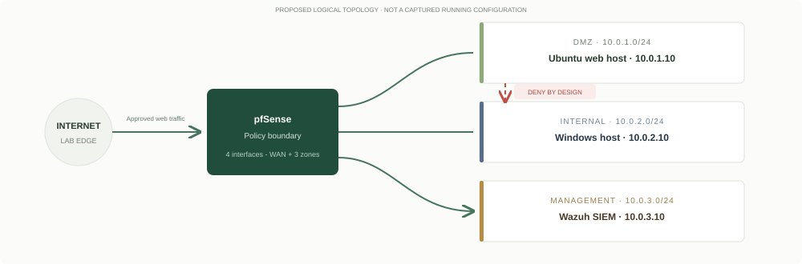

# Lab architecture

## Zones and assets

| Component | Address | Zone | Intended role |
|---|---|---|---|
| pfSense | WAN uplink (assigned by lab network); 10.0.1.1 / 10.0.2.1 / 10.0.3.1 | Boundary | Four virtual interfaces: upstream WAN plus one for each isolated lab zone |
| Ubuntu web VM | 10.0.1.10 | DMZ, 10.0.1.0/24 | Simulated public-facing service |
| Windows VM | 10.0.2.10 | Internal, 10.0.2.0/24 | Simulated business endpoint/server |
| Wazuh VM | 10.0.3.10 | Management, 10.0.3.0/24 | Central log and alert platform |

The selected topology uses four pfSense virtual interfaces: an upstream WAN/uplink, DMZ gateway `10.0.1.1/24`, internal gateway `10.0.2.1/24`, and management gateway `10.0.3.1/24`. The WAN address and upstream network are unspecified because the source does not define them. These are proposed design values, not observed interface configuration. The VM labels and policies below describe intended behavior.

## Security rationale

Separating the public service from the internal host limits the paths available after a web-tier compromise. Restricting administrative access to the management segment reduces exposure of SSH and RDP. Forwarding host and firewall telemetry to a management platform is intended to support investigation; alert coverage and delivery have not been validated.

## Intended flows

| Source | Destination | Service | Intent |
|---|---|---|---|
| WAN uplink | Ubuntu DMZ host | TCP 80/443 through an explicitly configured port-forward | Permit web traffic only when deliberately exposed for the isolated lab; no WAN-to-management rule |
| Approved management clients | Ubuntu DMZ host | TCP 22 | Administrative SSH, restricted to approved management sources |
| Approved management clients | Windows internal host | TCP 3389 | Administrative RDP, restricted to approved management sources |
| DMZ subnet | Internal subnet | Any | Deny by default; test both permitted and prohibited paths |
| Windows and Ubuntu hosts | Wazuh management host | TCP 1514; TCP 1515 only for controlled enrollment | Agent telemetry and enrollment using Wazuh default ports; restrict sources to lab endpoints |
| pfSense | Wazuh management host | UDP 514, if syslog collection is explicitly enabled | Forward firewall logs to the management zone |
| Approved management clients | Wazuh management host | TCP 443 | Dashboard access restricted to authorized administrators |
| Internal / management zones | WAN | Specific outbound services only, if required | Define explicit egress policy; do not imply unrestricted access |

This is the single proposed logical topology for the public edition. pfSense rule evaluation, NAT/port-forward behavior, stateful return traffic, logging and source-address restrictions must be implemented and verified. Management flows should be limited to named administrative endpoints when defined; the `/24` is a lab zone, not a recommendation to grant every host administrative access.

## Design risks to resolve

- The upstream WAN subnet/address, virtual switch attachment and NAT/public exposure method are not specified; keep the lab isolated until explicitly designed.
- No exported pfSense configuration is available, so the proposed rules are not represented as configured.
- Wazuh ports are defaults and configurable. Confirm the deployed version and settings rather than treating defaults as observed state.
- The lab contains one host per zone and cannot evidence production-scale availability, resilience or segmentation across a larger estate.

## Lab readiness

An elevated VM inventory check at `2026-11-16 14:35:09 UTC` found zero registered virtual machines, so these VM-dependent test procedures could not yet be executed. This is a readiness snapshot only; it does not indicate a control failure or pass. Deployment and test states remain **planned / not executed**.
